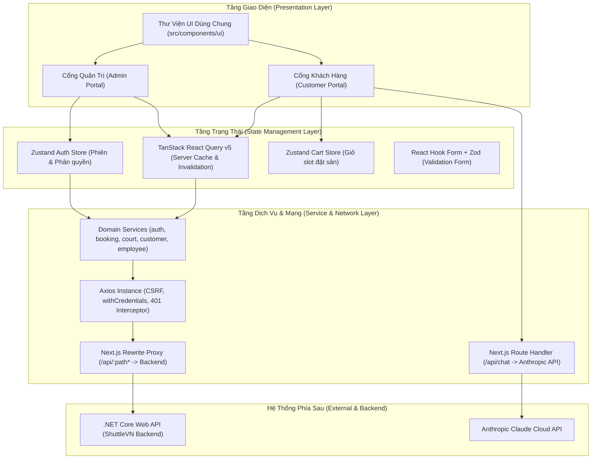
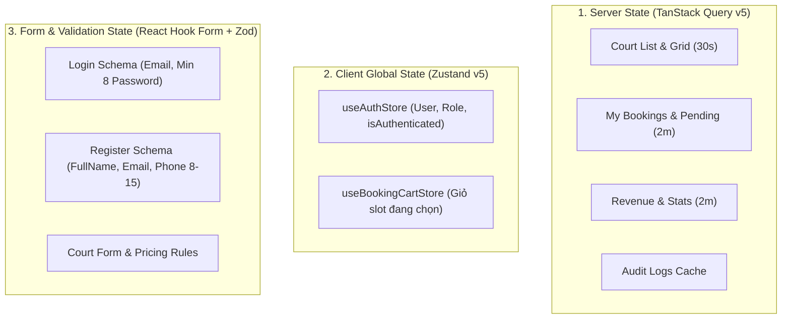
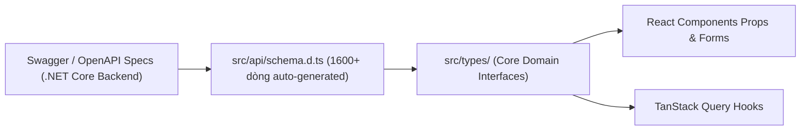

# KIẾN TRÚC FRONTEND (FRONTEND ARCHITECTURE) – SHUTTLEVN
### Đặc tả Kiến trúc Kỹ thuật, Phân tầng Hệ thống & Luồng Dữ liệu Codebase

**Hệ thống Quản lý và Đặt sân Cầu lông Trực tuyến ShuttleVN**  
**Phiên bản tài liệu:** 1.0 · **Ngày cập nhật:** 20/10/2026  
**Căn cứ kỹ thuật & mã nguồn:**
- Mã nguồn thực tế trong `shuttle-vn-frontend/` (Next.js 16/15 App Router, React 19, TypeScript 5, Tailwind CSS v4, TanStack Query v5, Zustand v5, Axios, React Hook Form, Zod v3, Recharts, Sonner).
- Tệp cấu hình gốc: `package.json`, `tsconfig.json`, `next.config.ts`, `tailwind.config.mts`, `src/app/globals.css`, `src/lib/axios.ts`, `src/lib/query-client.ts`.
- Hồ sơ nghiệp vụ chuẩn: `SRS.md` v1.7, `UseCase.md` v1.5, `User-Flows.md` v1.1, `Wireframes.md` v2.0, `UI-screens.md` v2.0, `Design-System.md` v1.0.

> **NGUYÊN TẮC BẢO ĐẢM:**
> 1. **100% Trung thực với Codebase:** Phản ánh chính xác cấu trúc thư mục, các hook, store, service, cơ chế xử lý lỗi, xác thực CSRF và proxy rewrite đang chạy trong mã nguồn.
> 2. **Rõ ràng giữa Hiện trạng và Tương lai:** Phân định rành mạch giữa các luồng đang chạy và các module cần refactor hoặc triển khai mới (ví dụ: luồng redirect role trong `useAuth.ts`, phân quyền menu `AdminSidebar.tsx`, các trang placeholder).
> 3. **Tuyệt đối không bịa đặt:** Mọi quy ước, kiểu dữ liệu, thư viện và đường dẫn đều có thể kiểm chứng trực tiếp trong mã nguồn.

---

## MỤC LỤC

1. [Tổng quan Kiến trúc & Nguyên tắc Thiết kế (Architectural Overview)](#1-tổng-quan-kiến-trúc--nguyên-tắc-thiết-kế-architectural-overview)
2. [Cấu trúc Thư mục & Tổ chức Mã nguồn (Directory Structure)](#2-cấu-trúc-thư-mục--tổ-chức-mã-nguồn-directory-structure)
3. [Kiến trúc Routing & Layouts (Next.js App Router)](#3-kiến-trúc-routing--layouts-nextjs-app-router)
4. [Kiến trúc Quản lý Trạng thái (State Management Architecture)](#4-kiến-trúc-quản-lý-trạng-thái-state-management-architecture)
   - [4.1 Trạng thái Máy chủ (Server State - TanStack Query v5)](#41-trạng-thái-máy-chủ-server-state---tanstack-query-v5)
   - [4.2 Trạng thái Toàn cục Ứng dụng (Client Global State - Zustand v5)](#42-trạng-thái-toàn-cục-ứng-dụng-client-global-state---zustand-v5)
   - [4.3 Trạng thái Form & Xác thực (Form State & Validation - Zod)](#43-trạng-thái-form--xác-thực-form-state--validation---zod)
5. [Xác thực, Phân quyền & Bảo mật (Auth & Security Architecture)](#5-xác-thực-phân-quyền--bảo-mật-auth--security-architecture)
   - [5.1 Khởi tạo Phiên & Phân quyền Trang (RoleGuard)](#51-khởi-tạo-phiên--phân-quyền-trang-roleguard)
   - [5.2 Luồng Điều hướng sau Đăng nhập (Auth Redirection)](#52-luồng-điều-hướng-sau-đăng-nhập-auth-redirection)
   - [5.3 Bảo vệ CSRF Token & Tự động Đăng xuất khi 401](#53-bảo-vệ-csrf-token--tự-động-đăng-xuất-khi-401)
6. [Tầng Tích hợp Dịch vụ & Dữ liệu (API & Data Integration Layer)](#6-tầng-tích-hợp-dịch-vụ--dữ-liệu-api--data-integration-layer)
   - [6.1 Cấu hình HTTP Client (Axios Instance & Interceptors)](#61-cấu-hình-http-client-axios-instance--interceptors)
   - [6.2 Tầng Dịch vụ (Service Layer) & Chế độ Mocking](#62-tầng-dịch-vụ-service-layer--chế-độ-mocking)
   - [6.3 Tích hợp API Route Handler Nội bộ (Anthropic Claude API)](#63-tích-hợp-api-route-handler-nội-bộ-anthropic-claude-api)
   - [6.4 Cơ chế Rewrite / Proxy Ngăn ngừa Lỗi CORS](#64-cơ-chế-rewrite--proxy-ngăn-ngừa-lỗi-cors)
7. [Hệ thống Kiểu dữ liệu & Type Safety (Type System)](#7-hệ-thống-kiểu-dữ-liệu--type-safety-type-system)
8. [Tối ưu hóa Hiệu năng Giao diện (Performance Optimization)](#8-tối-ưu-hóa-hiệu-năng-giao-diện-performance-optimization)
9. [Chiến lược Xử lý Lỗi & Phản hồi Người dùng (Error Handling)](#9-chiến-lược-xử-lý-lỗi--phản-hồi-người-dùng-error-handling)
10. [Lộ trình Hoàn thiện Kỹ thuật (Technical Roadmap & Refactor)](#10-lộ-trình-hoàn-thiện-kỹ-thuật-technical-roadmap--refactor)

---

## 1. TỔNG QUAN KIẾN TRÚC & NGUYÊN TẮC THIẾT KẾ (ARCHITECTURAL OVERVIEW)

Ứng dụng Frontend của ShuttleVN được xây dựng trên nền tảng **Next.js (App Router)** kết hợp **React 19**, **TypeScript** và **Tailwind CSS**. Kiến trúc tuân thủ mô hình **Phân tầng Trách nhiệm (Layered Architecture)** nhằm bảo đảm tính độc lập giữa giao diện hiển thị, quản lý trạng thái và tầng giao tiếp mạng.



### Các nguyên tắc kiến trúc cốt lõi:
1. **Phân tách Trạng thái Máy chủ (Server State) và Trạng thái Cục bộ (Client State):**
   - Mọi dữ liệu có nguồn gốc từ cơ sở dữ liệu (danh sách sân, lịch đặt, hóa đơn, khách hàng) được quản lý và cache bởi **TanStack Query**.
   - Trạng thái phiên làm việc (`AuthUser`) và giỏ hàng tạm thời được quản lý gọn nhẹ bằng **Zustand**.
2. **Type Safety Từ Đầu Đến Cuối (End-to-End Type Safety):**
   - Tích hợp OpenAPI schema tự động (`src/api/schema.d.ts`) làm nguồn chuẩn cho các Domain Types tại `src/types/`.
   - Mọi dữ liệu người dùng nhập đều được kiểm tra hợp lệ thông qua schema **Zod** trước khi gửi tới API.
3. **An toàn Bảo mật theo Thiết kế (Secure by Design):**
   - Sử dụng Cookie an toàn (`withCredentials: true`), tự động đính kèm `X-CSRF-TOKEN`.
   - Cơ chế bảo vệ tuyến đường phân cấp chặt chẽ: `RoleGuard` ở client và Redirection logic theo từng nhóm vai trò (`Customer`, `Employee`, `Admin`).

---

## 2. CẤU TRÚC THƯ MỤC & TỔ CHỨC MÃ NGUỒN (DIRECTORY STRUCTURE)

Dự án tổ chức mã nguồn trong thư mục `src/`, sử dụng TypeScript Path Alias `@/*` trỏ tới `./src/*` (được cấu hình trong `tsconfig.json`).

```text
shuttle-vn-frontend/
├── docs/                             # Hồ sơ tài liệu kỹ thuật & nghiệp vụ
│   ├── User-Flows.md                 # Luồng người dùng & Quyết định cốt lõi (X-01 -> X-07)
│   ├── Wireframes.md                 # Đặc tả 19 khung giao diện (WF-01 -> WF-19)
│   ├── UI-screens.md                 # Đối chiếu hiện trạng Codebase & 19 Modals
│   ├── Design-System.md              # Design tokens, màu sắc, font, CSS rules
│   └── Frontend-Architecture.md      # Tài liệu Kiến trúc kỹ thuật Frontend này
├── src/
│   ├── api/                          # Schema OpenAPI từ Backend
│   │   └── schema.d.ts               # Generated TypeScript definitions từ Swagger/OpenAPI
│   ├── app/                          # Next.js App Router (Pages, Layouts, API Routes)
│   │   ├── (admin)/                  # Route Group Quản trị & Vận hành
│   │   │   ├── audits/page.tsx       # Placeholder WF-19 (Nhật ký hoạt động)
│   │   │   ├── customers/page.tsx    # WF-14 (Quản lý khách hàng)
│   │   │   ├── dashboard/page.tsx    # WF-09 (Bảng điều khiển QTV)
│   │   │   ├── employees/page.tsx    # WF-16 (Quản lý nhân viên)
│   │   │   ├── manage-courts/        # WF-15 (Quản lý sân & bảng giá)
│   │   │   ├── payments/page.tsx     # Placeholder WF-13 (Quản lý thanh toán)
│   │   │   ├── schedule/page.tsx     # WF-12 (Quản lý lịch sân)
│   │   │   ├── statistics/page.tsx   # Placeholder WF-18 (Báo cáo & thống kê)
│   │   │   └── layout.tsx            # Admin Layout Shell (AdminSidebar + AdminHeader)
│   │   ├── (auth)/                   # Route Group Xác thực
│   │   │   ├── login/page.tsx        # WF-02 (Đăng nhập)
│   │   │   └── register/page.tsx     # WF-01 (Đăng ký tài khoản)
│   │   ├── (customer)/               # Route Group Cổng Khách hàng
│   │   │   ├── booking/              # Placeholder trang đặt sân
│   │   │   ├── courts/page.tsx       # WF-04 (Lưới sân & đặt sân đang chạy)
│   │   │   ├── lookup/page.tsx       # WF-06 (Tra cứu đơn đặt sân)
│   │   │   ├── my-bookings/page.tsx  # WF-05 (Lịch sử đặt sân của thành viên)
│   │   │   ├── profile/page.tsx      # WF-07 (Hồ sơ cá nhân)
│   │   │   └── layout.tsx            # Customer Layout Shell (CustomerNav)
│   │   ├── api/                      # Next.js Internal Route Handlers
│   │   │   └── chat/route.ts         # Route Handler kết nối Anthropic Claude API
│   │   ├── globals.css               # Global CSS, Tailwind v4 @import, Slot classes
│   │   ├── layout.tsx                # Root Layout (Fonts, Toaster, Providers)
│   │   └── providers.tsx             # React Query, AuthProvider, Sonner Toaster
│   ├── components/                   # Thư viện React Components
│   │   ├── admin/                    # Components quản trị (CourtTable, RevenueChart, PricingTimeline)
│   │   ├── auth/                     # LoginForm, RegisterForm, RoleGuard
│   │   ├── booking/                  # BookingCard, BookingLookupForm, WalkInBookingForm
│   │   ├── court/                    # CourtGrid, CourtSlotCell, SlotPopup
│   │   ├── layout/                   # CustomerNav, AdminSidebar, AdminHeader, AuthProvider
│   │   ├── profile/                  # ProfileInfoForm, ProfileSidebar, ChangePasswordForm
│   │   └── ui/                       # Atomic UI (Button, Badge, Card, Input, Label, ConfirmDialog)
│   ├── config/                       # Hằng số cấu hình hệ thống
│   │   └── app.ts                    # APP_CONFIG, Labels, Query Keys, Status colors
│   ├── hooks/                        # Custom React Hooks & TanStack Query Hooks
│   │   ├── useAuth.ts                # Auth mutations (login, register, logout)
│   │   ├── useBooking.ts             # Booking queries & mutations
│   │   ├── useCourt.ts               # Court queries & mutations
│   │   ├── useDashboard.ts           # Dashboard stats query
│   │   └── useEmployee.ts            # Employee queries & mutations
│   ├── lib/                          # Cấu hình thư viện bên thứ ba
│   │   ├── axios.ts                  # Axios instance, Interceptors, CSRF
│   │   └── query-client.ts           # React Query Client singleton cấu hình staleTime
│   ├── mocks/                        # Giả lập dữ liệu phục vụ phát triển độc lập
│   │   ├── config.ts                 # Cờ IS_MOCK = process.env.NEXT_PUBLIC_USE_MOCKS
│   │   └── data/                     # Mock fixtures
│   ├── services/                     # Tầng gọi API thuần túy (Service Layer)
│   │   ├── auth.service.ts
│   │   ├── booking.service.ts
│   │   ├── court.service.ts
│   │   ├── customer.service.ts
│   │   ├── dashboard.service.ts
│   │   └── employee.service.ts
│   ├── stores/                       # Zustand Global Stores
│   │   ├── auth.store.ts             # Lưu AuthUser, isAuthenticated, isLoading
│   │   └── booking-cart.store.ts     # Lưu danh sách slot đặt sân
│   ├── types/                        # TypeScript Interfaces & Types
│   │   ├── api.ts                    # ApiResponse, PaginatedResponse
│   │   ├── auth.ts                   # LoginRequest, RegisterRequest, AuthUser
│   │   ├── booking.ts                # Booking, Invoice, BookingStatusHistory
│   │   ├── court.ts                  # Court, CourtSchedule, PricingRule, CourtSlot
│   │   ├── dashboard.ts              # DashboardStats, RevenueStats
│   │   └── audit.ts                  # AuditLog, ActorType
│   └── utils/                        # Tiện ích bổ trợ (Helpers)
│       ├── index.ts                  # cn, formatCurrency, formatDate, getErrorMessage
│       └── auth-mapper.ts            # mapAccountToAuthUser
├── next.config.ts                    # Next.js Config (Rewrites proxy, Remote image patterns)
├── tailwind.config.mts               # Tailwind v4 configuration (Primary colors, Fonts, Radius)
├── tsconfig.json                     # TypeScript strict configuration & Path aliases
└── package.json                      # Project dependencies & npm scripts
```

---

## 3. KIẾN TRÚC ROUTING & LAYOUTS (NEXT.JS APP ROUTER)

Dự án áp dụng cơ chế **Route Groups** của Next.js App Router (được bao bằng dấu ngoặc đơn `()`) để tách biệt hoàn toàn layout mà không ảnh hưởng tới đường dẫn URL trên thanh địa chỉ trình duyệt:

```text
URL Browser           File Hệ Thống
/login            --> src/app/(auth)/login/page.tsx
/register         --> src/app/(auth)/register/page.tsx
/courts           --> src/app/(customer)/courts/page.tsx
/my-bookings      --> src/app/(customer)/my-bookings/page.tsx
/lookup           --> src/app/(customer)/lookup/page.tsx
/profile          --> src/app/(customer)/profile/page.tsx
/dashboard        --> src/app/(admin)/dashboard/page.tsx
/schedule         --> src/app/(admin)/schedule/page.tsx
/manage-courts    --> src/app/(admin)/manage-courts/page.tsx
/customers        --> src/app/(admin)/customers/page.tsx
/employees        --> src/app/(admin)/employees/page.tsx
/payments         --> src/app/(admin)/payments/page.tsx
/statistics       --> src/app/(admin)/statistics/page.tsx
/audits           --> src/app/(admin)/audits/page.tsx
```

### Cơ chế Lồng ghép Layout (Layout Hierarchy):
1. **Root Layout (`src/app/layout.tsx`):**
   - Nạp các biến CSS font (`--font-inter`, `--font-hanken`, `--font-jetbrains`).
   - Bọc toàn bộ ứng dụng trong thẻ `<Providers>` (bao gồm `QueryClientProvider`, `AuthProvider`, `Toaster`).
2. **Customer Layout (`src/app/(customer)/layout.tsx`):**
   - Render thanh điều hướng [CustomerNav.tsx](file:///d:/Shuttle-VN/shuttle-vn-frontend/src/components/layout/CustomerNav.tsx) cố định ở đỉnh trang (`h-[56px]`, màu `#1a1f2e`).
   - Tự động hiển thị `LoginButton` (khi chưa đăng nhập) hoặc `UserMenu` (khi đã xác thực).
3. **Admin Layout (`src/app/(admin)/layout.tsx`):**
   - Render khung giao diện gồm [AdminSidebar.tsx](file:///d:/Shuttle-VN/shuttle-vn-frontend/src/components/layout/AdminSidebar.tsx) cố định bên trái (`w-[220px]`, màu `#FBFBFA`) và [AdminHeader.tsx](file:///d:/Shuttle-VN/shuttle-vn-frontend/src/components/layout/AdminHeader.tsx) ở trên cùng (`h-[52px]`).
   - Toàn bộ nội dung bên trong được bọc trong vùng làm việc có thanh cuộn riêng biệt.

---

## 4. KIẾN TRÚC QUẢN LÝ TRẠNG THÁI (STATE MANAGEMENT ARCHITECTURE)

Hệ thống phân định ranh giới rõ ràng giữa 3 loại trạng thái:



### 4.1 Trạng thái Máy chủ (Server State - TanStack Query v5)
- **Cấu hình Singleton (`src/lib/query-client.ts`):**
  - `staleTime: 1000 * 60 * 2` (Dữ liệu được coi là mới trong 2 phút; không refetch dư thừa).
  - `gcTime: 1000 * 60 * 10` (Dữ liệu không dùng được lưu trong bộ nhớ rác 10 phút trước khi giải phóng).
  - `refetchOnWindowFocus: false` (Không tự ý tải lại khi người dùng chuyển tab trình duyệt, tránh gây giật giao diện).
  - `retry: 1` (Chỉ thử lại 1 lần nếu query gặp sự cố).
- **Hệ thống Query Keys Tập trung (`src/config/app.ts`):**
  Mọi query key đều được định nghĩa thông qua đối tượng hằng số `QUERY_KEYS` để tránh trùng lặp hoặc sai sót khi invalidate cache:
  ```typescript
  export const QUERY_KEYS = {
    courts: ["courts"] as const,
    courtGrid: (date: string) => ["court-grid", date] as const,
    myBookings: ["my-bookings"] as const,
    pendingBookings: (params?: object) => ["pending-bookings", params ?? {}] as const,
    adminBookings: (params?: object) => ["admin-bookings", params ?? {}] as const,
    invoices: ["invoices"] as const,
    dashboard: ["dashboard"] as const,
    auditLogs: ["audit-logs"] as const,
  } as const;
  ```
- **Chiến lược Invalidation (Làm mới Cache):**
  - Khi tạo đơn thành công: `queryClient.invalidateQueries({ queryKey: QUERY_KEYS.myBookings })`.
  - Khi nhân viên xác nhận hoặc hủy đơn: Invalidate cả `pendingBookings`, `adminBookings`, và `courtGrid`.
  - Riêng lưới sân `CourtGrid`: Tích hợp bộ đếm tự động làm mới mỗi 30 giây để cập nhật tức thời các slot vừa được khách khác đặt.

### 4.2 Trạng thái Toàn cục Ứng dụng (Client Global State - Zustand v5)
- **Store Xác thực ([auth.store.ts](file:///d:/Shuttle-VN/shuttle-vn-frontend/src/stores/auth.store.ts)):**
  - Quản lý thông tin tối giản của người dùng đăng nhập:
    ```typescript
    export interface AuthUser {
      accountId: string;
      fullName: string;
      phone: string;
      email: string;
      role: UserRole; // "Admin" | "Employee" | "Customer"
    }
    ```
  - Cung cấp các action: `setUser(user)`, `clearAuth()`, `setLoading(boolean)`.
- **Store Giỏ Slot Đặt Sân ([booking-cart.store.ts](file:///d:/Shuttle-VN/shuttle-vn-frontend/src/stores/booking-cart.store.ts)):**
  - Lưu trữ tạm thời danh sách các slot khách hàng chọn trên lưới trước khi gửi yêu cầu đặt.
  - Tự động cộng tổng tiền `totalAmount` khi thêm/bớt slot.

### 4.3 Trạng thái Form & Xác thực (Form State & Validation - Zod)
- Toàn bộ biểu mẫu sử dụng `react-hook-form` tích hợp resolver `@hookform/resolvers/zod`.
- **Quy chuẩn Validation bám sát Nghiệp vụ gốc:**
  - *Họ và tên:* Tối thiểu 2 ký tự, tự động cắt khoảng trắng thừa (`trim`).
  - *Số điện thoại:* Regex linh hoạt 8–15 chữ số (`BR-26`), cho phép dấu `+` ở đầu, thay thế cho regex 10 số cứng nhắc cũ.
  - *Mật khẩu:* Độ dài bắt buộc từ 8 đến 128 ký tự (`BR-11`), thay thế cho mức `min(6)` cũ.
  - *Email:* Validate chuẩn email RFC 5322, tự động lowercase.

---

## 5. XÁC THỰC, PHÂN QUYỀN & BẢO MẬT (AUTH & SECURITY ARCHITECTURE)

### 5.1 Khởi tạo Phiên & Phân quyền Trang (RoleGuard)
- **Quá trình Bootstrapping ([auth-provider.tsx](file:///d:/Shuttle-VN/shuttle-vn-frontend/src/components/layout/auth-provider.tsx)):**
  Khi ứng dụng khởi động ở trình duyệt, `AuthProvider` ngay lập tức gọi API `authService.getProfile()`:
  - Nếu Cookie phiên hợp lệ: Cập nhật `useAuthStore.setUser(authUser)`.
  - Nếu chưa đăng nhập hoặc 401: Gọi `clearAuth()`.
  - Luôn kết thúc bằng `setLoading(false)` để giải phóng trạng thái chờ.
- **Bảo vệ Trang theo Vai trò ([RoleGuard.tsx](file:///d:/Shuttle-VN/shuttle-vn-frontend/src/components/auth/RoleGuard.tsx)):**
  ```tsx
  <RoleGuard allowedRoles={['Admin', 'Employee']} redirectTo="/courts">
    <ScheduleClient />
  </RoleGuard>
  ```
  - Khi chưa hoàn tất xác thực (`isLoading === true`), component trả về `null` (ngăn chặn chớp giao diện trái phép - Flash of Unauthorized Content).
  - Nếu `user.role` không nằm trong danh sách `allowedRoles`, tự động dùng `router.replace(redirectTo)` chuyển hướng người dùng về trang an toàn.

### 5.2 Luồng Điều hướng sau Đăng nhập (Auth Redirection)
Hiện trạng và quy chuẩn tương lai theo Quyết định cốt lõi **X-02**:

| Vai trò người dùng (`UserRole`) | Hành vi Hiện tại trong `useAuth.ts` | Quy chuẩn Chuẩn hóa Mục tiêu (Quyết định X-02) |
|---|---|---|
| **Khách hàng (`Customer`)** | Chuyển hướng sang `/courts` | Chuyển hướng sang `/courts` (hoặc `/booking`) |
| **Nhân viên (`Employee`)** | Đang chuyển nhầm vào `/dashboard` ⚠️ | Chuyển hướng sang trang vận hành: `/admin/booking-requests` hoặc `/schedule` |
| **Quản trị viên (`Admin`)** | Chuyển hướng sang `/dashboard` | Chuyển hướng sang `/dashboard` (hoặc `/admin/dashboard`) |

> *Ghi chú Refactor:* Cần cập nhật hàm redirect trong `src/hooks/useAuth.ts` (dòng 28–33) để tách rẽ luồng của `Employee` và `Admin`.

### 5.3 Bảo vệ CSRF Token & Tự động Đăng xuất khi 401
- **CSRF Protection ([axios.ts](file:///d:/Shuttle-VN/shuttle-vn-frontend/src/lib/axios.ts)):**
  Với mọi phương thức ghi dữ liệu (`POST`, `PUT`, `PATCH`, `DELETE`), Request Interceptor tự động đọc giá trị cookie `XSRF-TOKEN` của trình duyệt và chèn vào header `X-CSRF-TOKEN`:
  ```typescript
  if (method && ["POST", "PUT", "PATCH", "DELETE"].includes(method)) {
    const csrfToken = getCsrfTokenFromCookie();
    if (csrfToken) config.headers["X-CSRF-TOKEN"] = csrfToken;
  }
  ```
- **Cơ chế 401 Interceptor:**
  Khi Backend trả về mã lỗi `401 Unauthorized` (phiên hết hạn hoặc cookie bị hủy), Response Interceptor lập tức kích hoạt:
  ```typescript
  if (error.response?.status === 401) {
    useAuthStore.getState().clearAuth();
  }
  ```

---

## 6. TẦNG TÍCH HỢP DỊCH VỤ & DỮ LIỆU (API & DATA INTEGRATION LAYER)

### 6.1 Cấu hình HTTP Client (Axios Instance & Interceptors)
Tệp [src/lib/axios.ts](file:///d:/Shuttle-VN/shuttle-vn-frontend/src/lib/axios.ts) khởi tạo client duy nhất cho toàn bộ hệ thống:
- `baseURL: "/api"`: Kết hợp với cơ chế rewrite của Next.js.
- `timeout: 15000`: Hạn chế tình trạng treo kết nối quá 15 giây.
- `withCredentials: true`: Cho phép trình duyệt tự động gửi kèm HttpOnly Cookie phiên làm việc trong mọi request.

### 6.2 Tầng Dịch vụ (Service Layer) & Chế độ Mocking
Các tệp dịch vụ trong `src/services/` đóng gói toàn bộ logic gọi API theo từng domain nghiệp vụ:
- `authService`: Đăng nhập, đăng ký, đăng xuất, lấy hồ sơ cá nhân, gửi mã xác thực.
- `bookingService`: Tạo đơn, đặt nhanh vãng lai, hủy đơn, đổi lịch, lấy danh sách đơn, xác nhận thanh toán.
- `courtService`: Lấy ma trận lưới sân theo ngày, cấu hình bảng giá, đổi trạng thái sân.
- `customerService`: Lấy danh sách khách hàng, cập nhật trạng thái khóa/mở khóa.
- `dashboardService`: Lấy số liệu tổng hợp doanh thu và đơn đặt sân.
- `employeeService`: Lấy danh sách nhân viên, tạo tài khoản nhân viên mới.

**Cơ chế Mocking Độc lập:**
Mỗi hàm dịch vụ đều kiểm tra cờ `IS_MOCK`:
```typescript
if (IS_MOCK) {
  await mockDelay(500);
  return mockBookings;
}
```
Cờ này được kích hoạt thông qua biến môi trường `NEXT_PUBLIC_USE_MOCKS === "true"`, cho phép đội ngũ Frontend phát triển và kiểm thử giao diện độc lập ngay cả khi Backend chưa chạy.

### 6.3 Tích hợp API Route Handler Nội bộ (Anthropic Claude API)
- **Tệp mã nguồn:** `src/app/api/chat/route.ts`.
- **Vai trò:** Hoạt động như một Backend-For-Frontend (BFF) trung gian.
- **Bảo mật Khóa API:** Biến môi trường bí mật `ANTHROPIC_API_KEY` được lưu trữ ở máy chủ Node.js và **không bao giờ bị lộ ra client**.
- **Cấu hình Trợ lý AI:**
  - Endpoint gửi trực tiếp yêu cầu sang `https://api.anthropic.com/v1/messages`.
  - System Prompt bằng Tiếng Việt thân thiện, giới hạn phạm vi trả lời riêng cho dịch vụ đặt sân của ShuttleVN.

### 6.4 Cơ chế Rewrite / Proxy Ngăn ngừa Lỗi CORS
Trong môi trường phát triển (Development), tệp [next.config.ts](file:///d:/Shuttle-VN/shuttle-vn-frontend/next.config.ts) cấu hình rewrite động:
```typescript
async rewrites() {
  return [
    {
      source: "/api/:path*",
      destination: process.env.NEXT_PUBLIC_API_BASE_URL + "/:path*",
    },
  ];
}
```
Mọi yêu cầu gửi tới `/api/...` từ trình duyệt được Next.js server proxy thẳng sang máy chủ backend (mặc định `http://localhost:5000/api/...`), giải quyết triệt để vấn đề chặn CORS và cookie cross-origin.

---

## 7. HỆ THỐNG KIỂU DỮ LIỆU & TYPE SAFETY (TYPE SYSTEM)

Booking dùng `BookingDto` cho tạo, tra cứu, hủy và đổi lịch. Service giữ `expectedState`, `priceSegments` khi chuyển sang domain model. Hủy gửi `CancelBookingRequest` (`expectedState`, `reason`, `refund`); đổi lịch dùng `GET /api/bookings/{bookingId}/reschedule-preview` và `PATCH /api/bookings/{bookingId}/reschedule`, kèm `Idempotency-Key` cho mutation. Hooks tương ứng: `useReschedulePreview`, `useRescheduleBooking`, `useCancelBooking`. Xác nhận/hoàn thành đơn hỗ trợ thêm `amount`. Các contract court không đổi so với Swagger trước đó.

ShuttleVN thiết lập hệ thống kiểu dữ liệu phân cấp 2 tầng chặt chẽ:



1. **Tầng OpenAPI Generated (`src/api/schema.d.ts`):**
   - Được sinh tự động từ tài liệu Swagger JSON của Backend thông qua công cụ `openapi-typescript`.
   - Chứa định nghĩa chính xác cấu trúc request, response, enum của toàn bộ API.
2. **Tầng Domain Models (`src/types/`):**
   - [booking.ts](file:///d:/Shuttle-VN/shuttle-vn-frontend/src/types/booking.ts): Định nghĩa `BookingStatus` (`Pending | Confirmed | Completed | Cancelled`), `InvoiceStatus` (`Unpaid | Paid | Cancelled | Refunded`), `PaymentMethod`, `Booking`, `Invoice`, `BookingStatusHistory`.
   - [court.ts](file:///d:/Shuttle-VN/shuttle-vn-frontend/src/types/court.ts): Định nghĩa `CourtStatus`, `SlotDisplayStatus` (`AVAILABLE | BOOKED | CLOSED`), `CourtSlot`, `CourtGridResponse`.
   - [auth.ts](file:///d:/Shuttle-VN/shuttle-vn-frontend/src/types/auth.ts): Định nghĩa `UserRole` (`Admin | Employee | Customer`), `AccountStatus`.
   - [api.ts](file:///d:/Shuttle-VN/shuttle-vn-frontend/src/types/api.ts): Định nghĩa cấu trúc bọc chuẩn `ApiResponse<T>` và `PaginatedResponse<T>`.

---

## 8. TỐI ƯU HÓA HIỆU NĂNG GIAO DIỆN (PERFORMANCE OPTIMIZATION)

1. **Kỹ thuật Virtualization cho Lưới Ô Đặt Sân lớn (`CourtSlotCell.tsx`):**
   Mỗi ngày hoạt động từ 05:00 đến 22:00 có 34 slot 30 phút cho mỗi sân. Với 10 sân, trang cần render 340 ô slot đồng thời. Codebase tối ưu hóa bằng CSS rendering hints:
   ```css
   content-visibility: auto;
   contain-intrinsic-size: 72px 56px;
   ```
   Trình duyệt tự động bỏ qua công đoạn tính toán layout và render đối với các ô slot đang nằm ngoài khung nhìn cuộn ngang của người dùng.
2. **Tối ưu hóa Băng thông & Hình ảnh (`next/image` + `sharp`):**
   - Sử dụng thư viện nén ảnh gốc C++ `sharp` trong `package.json`.
   - Cấu hình `remotePatterns` cho Supabase storage trong `next.config.ts`.
3. **Thanh cuộn ngang mượt mà (Smooth Horizontal Wheel Scroll):**
   [CourtGrid.tsx](file:///d:/Shuttle-VN/shuttle-vn-frontend/src/components/court/CourtGrid.tsx) lắng nghe sự kiện `wheel` chuột dọc để tự động chuyển hóa thành bước cuộn ngang (`el.scrollLeft += e.deltaY * 1.2`), mang lại trải nghiệm xem timeline tự nhiên như ứng dụng desktop.

---

## 9. CHIẾN LƯỢC XỬ LÝ LỖI & PHẢN HỒI NGƯỜI DÙNG (ERROR HANDLING)

### 9.1 Chuẩn hóa Bóc tách Lỗi API (`getErrorMessage`)
Tệp [src/utils/index.ts](file:///d:/Shuttle-VN/shuttle-vn-frontend/src/utils/index.ts) cung cấp hàm xử lý lỗi tập trung:
```typescript
export function getErrorMessage(error: unknown): string {
  const apiMessage = getApiErrorMessage(error);
  if (apiMessage) return apiMessage;
  if (error instanceof Error) return error.message;
  return "Đã có lỗi xảy ra, vui lòng thử lại.";
}
```
Hàm tự động duyệt qua cấu trúc lỗi chuẩn của ASP.NET Core (`ValidationProblemDetails`, trường `errors` chứa mảng lỗi theo từng thuộc tính) để ghép nối thành câu thông báo tiếng Việt dễ hiểu nhất cho người dùng.

### 9.2 Phân định Phương thức Phản hồi Lỗi (Notification Strategy)
- **Lỗi thao tác nhẹ / Thông báo thành công:** Sử dụng `sonner` Toast góc trên bên phải (`duration: 3000ms`).
- **Lỗi nghiệp vụ nghiêm trọng:** Bắt buộc sử dụng Banner cảnh báo màu đỏ/vàng nằm cố định bên trong form hoặc Modal (Ví dụ: thông báo tài khoản bị khóa do nhập sai mật khẩu 5 lần theo `BR-12`, cảnh báo vi phạm bảo vệ QTV cuối cùng theo `BR-27`).

---

## 10. LỘ TRÌNH HOÀN THIỆN KỸ THUẬT (TECHNICAL ROADMAP & REFACTOR)

Dựa trên đối chiếu giữa kiến trúc thực tế và hồ sơ nghiệp vụ chuẩn, dưới đây là các nhiệm vụ refactor kỹ thuật trọng tâm:

### Ưu tiên 1: Chỉnh sửa Logic Điều hướng & Phân quyền
- [ ] **Sửa luồng redirect sau đăng nhập (`src/hooks/useAuth.ts`):** Tách luồng điều hướng; chuyển `Employee` về `/admin/booking-requests` hoặc `/schedule`, chỉ `Admin` mới vào `/dashboard` (`X-02`).
- [ ] **Phân quyền động cho Sidebar (`src/components/layout/AdminSidebar.tsx`):** Thêm điều kiện ẩn/hiện danh mục theo `user.role` (Nhân viên thấy 4 mục, Quản trị viên thấy 9 mục).
- [ ] **Bổ sung thông tin người dùng và nút Đăng xuất trên Topbar (`src/components/layout/AdminHeader.tsx`).**

### Ưu tiên 2: Chuẩn hóa Dữ liệu Nhập & Trải nghiệm
- [ ] **Form đặt nhanh vãng lai (`src/components/booking/WalkInBookingForm.tsx`):** Chuyển trường Email sang bắt buộc; gắn bước xác thực OTP 6 số qua email trước khi tạo đơn (`X-01`, `X-07`).
- [ ] **Tra cứu đơn (`src/components/booking/BookingLookupForm.tsx`):** Bắt buộc nhập cả mã đơn và thông tin liên hệ (`X-03`); xóa khối nút demo; che một phần tên khách hàng.
- [ ] **Loại bỏ hoàn toàn tàn dư "Tỷ lệ lấp đầy" (`DashboardStats.tsx`)** theo Quyết định `X-04`.
- [ ] **Loại bỏ nút "Hóa đơn" trên thẻ lịch sử của khách (`BookingCard.tsx`)** theo quy tắc `D-13`.

### Ưu tiên 3: Triển khai các Tuyến đường & Component Mới
- [ ] Xây dựng trang Quên mật khẩu `/forgot-password` (`WF-03`).
- [ ] Xây dựng trang Tiếp nhận yêu cầu đặt sân `/admin/booking-requests` (`WF-10`, US-11).
- [ ] Xây dựng trang Chi tiết đơn và dòng thời gian `/admin/bookings/[id]` (`WF-11`, US-12).
- [ ] Hiện thực hóa trang Quản lý thanh toán từ placeholder `/admin/payments` (`WF-13`).
- [ ] Hiện thực hóa trang Báo cáo & Thống kê từ placeholder `/admin/statistics` (`WF-18`).
- [ ] Hiện thực hóa trang Nhật ký hoạt động chỉ đọc từ placeholder `/admin/audits` (`WF-19`).
- [ ] Tạo component giao diện nổi `src/components/chatbot/ChatWidget.tsx` (`WF-08`) kết nối API route `api/chat`.

---

*Tài liệu được xây dựng đồng bộ, kiểm duyệt nghiêm ngặt dựa trên toàn bộ mã nguồn thực tế và hệ thống tiêu chuẩn kỹ thuật của ShuttleVN.*

