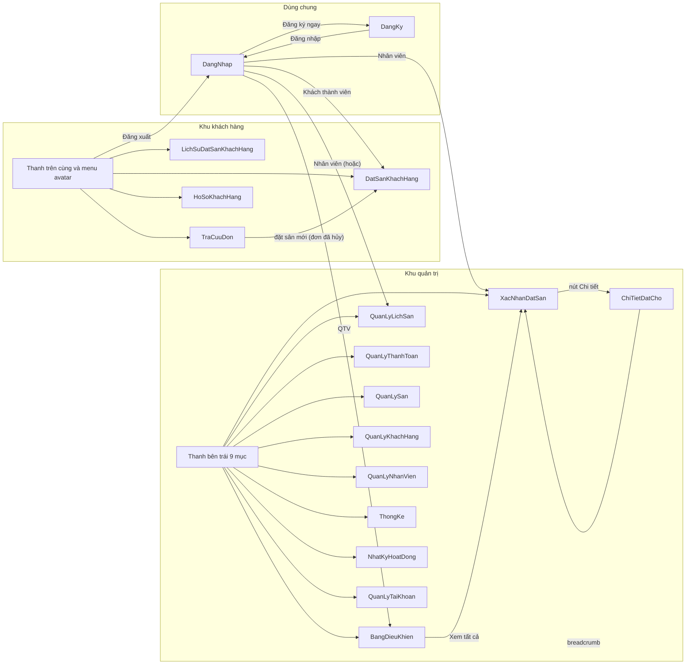
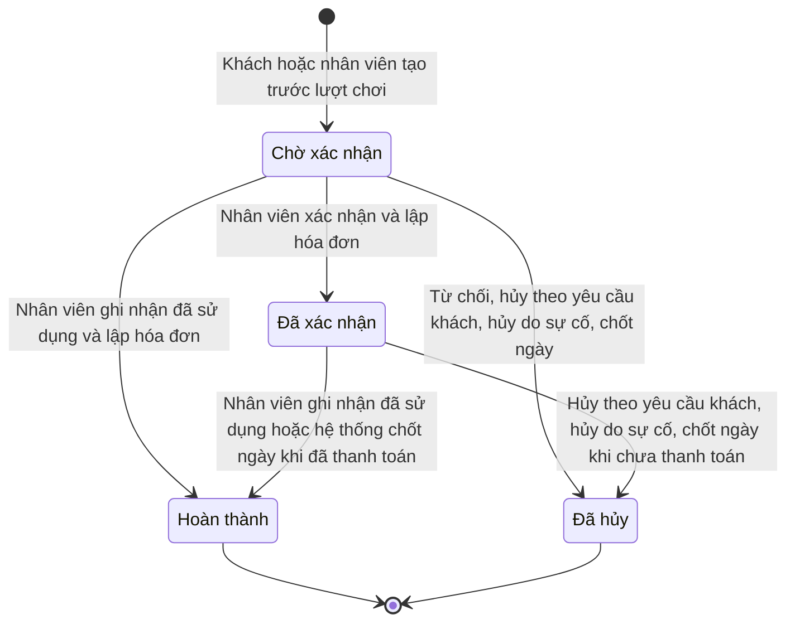
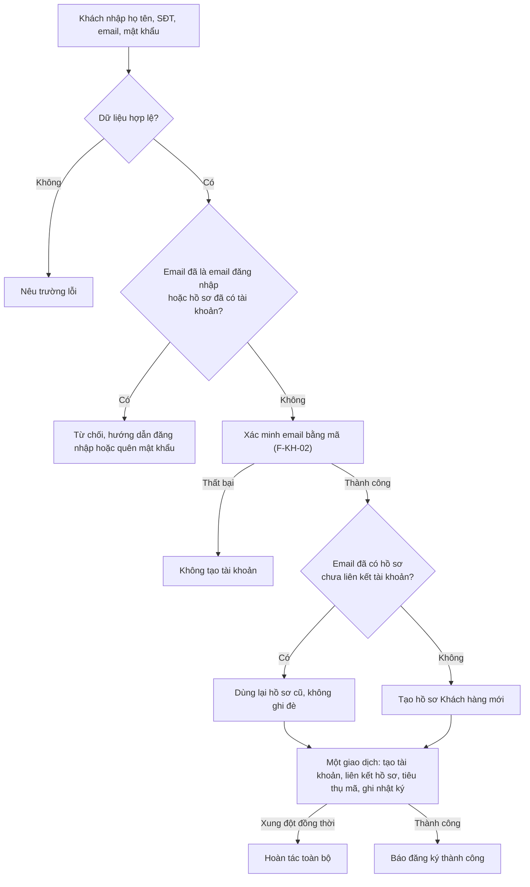
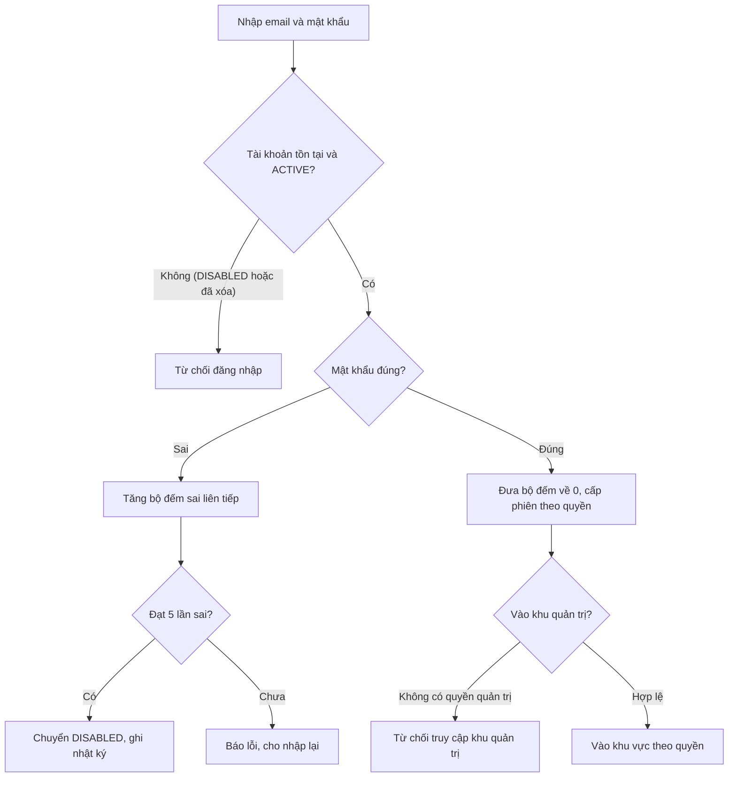
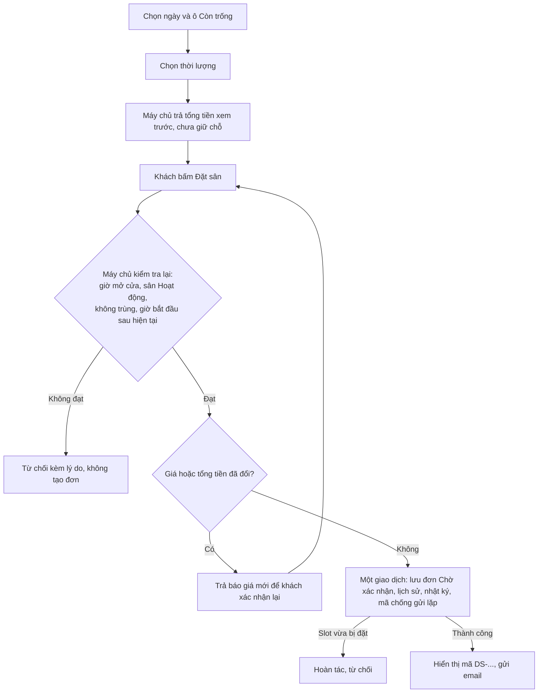
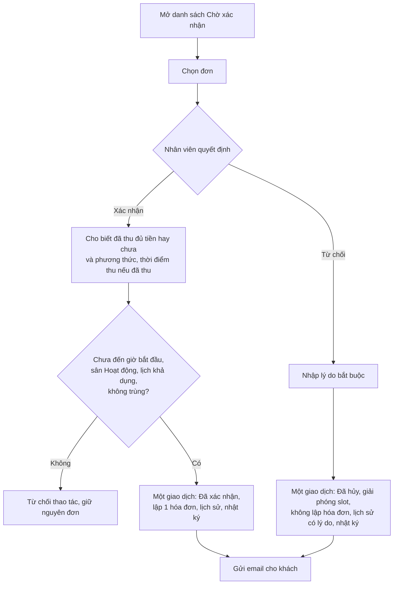
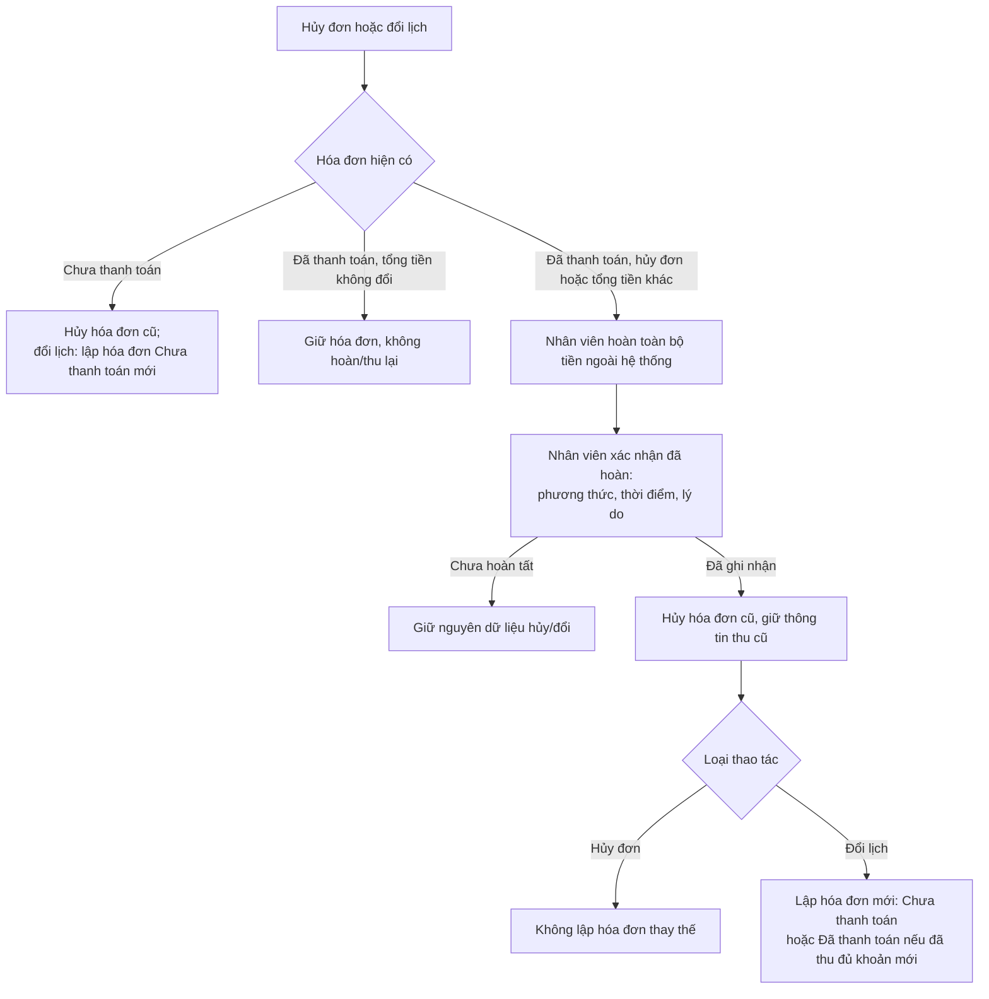
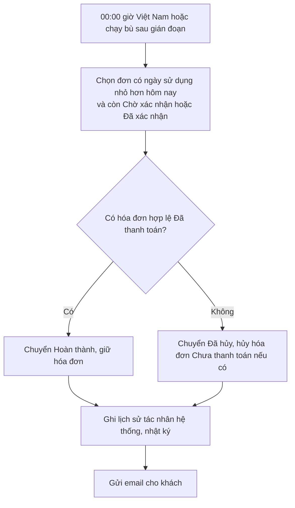

# User Flows – Hệ thống đặt sân cầu lông (ShuttleVN)

**Phiên bản:** 1.1 (đã cập nhật theo các quyết định X-01 đến X-07) · **Ngày lập:** 19/10/2026

**Căn cứ biên soạn:**

- `SRS.md` – Đặc tả yêu cầu phần mềm, phiên bản 1.7 (10/10/2026).
- `UseCase.md` – Mô hình Use-case, phiên bản 1.5 (đồng bộ với SRS 1.7).
- 17 file giao diện HTML: `DangNhap`, `DangKy`, `DatSanKhachHang`, `LichSuDatSanKhachHang`, `TraCuuDon`, `HoSoKhachHang`, `BangDieuKhien`, `XacNhanDatSan`, `ChiTietDatCho`, `QuanLyLichSan`, `QuanLyThanhToan`, `QuanLySan`, `QuanLyKhachHang`, `QuanLyNhanVien`, `QuanLyTaiKhoan`, `ThongKe`, `NhatKyHoatDong`.

---

## Mục lục

1. Giới thiệu và cách đọc tài liệu
2. Người dùng và phân quyền
3. Danh mục màn hình
4. Sơ đồ điều hướng
5. Quy tắc chung áp dụng cho các luồng
6. Luồng khách hàng (F-KH)
7. Luồng nhân viên (F-NV)
8. Luồng quản trị viên (F-QT)
9. Luồng tự động của hệ thống (F-HT)
10. Điểm lệch giữa màn hình và SRS/UC, kèm quyết định xử lý
11. Màn hình, luồng còn thiếu so với SRS/UC
12. Quyết định đã thống nhất và điểm còn mở

---

## 1. Giới thiệu và cách đọc tài liệu

### 1.1 Mục đích

Tài liệu mô tả hành trình thao tác của từng nhóm người dùng trên hệ thống đặt sân cầu lông: người dùng bắt đầu từ màn hình nào, thực hiện thao tác gì, hệ thống kiểm tra và phản hồi ra sao, kết thúc ở trạng thái nào. Tài liệu dùng làm cơ sở thống nhất giữa nghiệp vụ, thiết kế giao diện, phát triển và kiểm thử.

### 1.2 Nguyên tắc biên soạn

1. **Quy tắc nghiệp vụ** (điều kiện, kiểm tra, kết quả, trường hợp lỗi) lấy từ SRS 1.7 và Use-case 1.5. Không bổ sung quy tắc ngoài hai tài liệu này.
2. **Màn hình, thành phần, nhãn, điều hướng** lấy từ các file HTML. Các file HTML là bản mô phỏng giao diện: số liệu trong đó (tên người, ngày 14/08/2026, giá 80.000 ₫, số lượng thống kê...) chỉ là dữ liệu mẫu, không phải quy tắc.
3. **SRS 1.7 và UC 1.5 là nguồn chuẩn duy nhất** cho quy tắc nghiệp vụ, ràng buộc dữ liệu và xử lý giao dịch (quyết định X-01); các file HTML là bản mockup và phải điều chỉnh theo SRS/UC. Luồng viết theo SRS/UC; chỗ HTML khác được đánh dấu `(Lệch UI: D-xx)` và liệt kê ở mục 10 cùng quyết định xử lý.
4. **Khi SRS/UC có luồng nhưng HTML chưa có màn hình**, luồng vẫn được mô tả theo SRS/UC và đánh dấu **[Chưa có màn hình]**; tổng hợp ở mục 11.
5. **Khi HTML có chức năng mà SRS/UC không có**, chức năng đó không được đưa vào luồng chính, trừ khi đã có quyết định giữ lại; được ghi ở mục 10 với nhãn "ngoài SRS/UC" và quyết định tương ứng.
6. Không suy đoán hành vi mà cả SRS, UC và HTML đều không nêu; các điểm này được ghi ở mục 12 (phần điểm còn mở).

### 1.3 Ký hiệu

| Ký hiệu | Ý nghĩa |
| --- | --- |
| `F-KH-xx`, `F-NV-xx`, `F-QT-xx`, `F-HT-xx` | Mã luồng của khách hàng, nhân viên, quản trị viên, hệ thống |
| `UC-xx` | Use-case trong `UseCase.md` |
| `BR-xx`, `KH-xx`, `NV-xx`, `QT-xx`, `NFR-xx` | Quy tắc nghiệp vụ / yêu cầu trong `SRS.md` |
| `[Màn hình: tên.html]` | Màn hình thể hiện bước đó |
| **[Chưa có màn hình]** | Bước có trong SRS/UC nhưng không có trong các file HTML |
| `(Lệch UI: D-xx)` | Màn hình khác SRS/UC, xem mục 10 |
| `E1, E2...` / `A1, A2...` | Ngoại lệ / luồng thay thế, đánh số theo đặc tả Use-case |

---

## 2. Người dùng và phân quyền

### 2.1 Nhóm người dùng

| Nhóm | Mô tả | Truy cập |
| --- | --- | --- |
| Khách vãng lai | Đặt nhanh khi chưa đăng nhập, xác minh email trước khi lưu | Không đăng nhập |
| Khách thành viên | Đặt, hủy, đổi lịch và xem lịch sử đặt sân của mình | Đăng ký, đăng nhập |
| Nhân viên | Xử lý đặt sân, quản lý hồ sơ và tài khoản khách hàng, hóa đơn, trạng thái sân | Tài khoản do QTV cấp |
| Quản trị viên (QTV) | Toàn bộ chức năng của nhân viên, cộng quản lý sân, giá, tài khoản, nhân sự, thống kê, nhật ký | Tài khoản có quyền quản trị |
| Hệ thống | Tác vụ tự động chốt đơn lúc 00:00 giờ Việt Nam (UC-44) | — |

### 2.2 Ma trận phân quyền (SRS mục 2.2)

| Chức năng | Khách vãng lai | Khách thành viên | Nhân viên | QTV |
| --- | :-: | :-: | :-: | :-: |
| Xem sân, lưới sân, giá | ✓ | ✓ | ✓ | ✓ |
| Trợ lý AI | ✓ | ✓ |  |  |
| Đặt sân | ✓ (đặt nhanh) | ✓ | ✓ (cho khách) | ✓ (cho khách) |
| Hủy, đổi lịch đặt sân | Qua nhân viên | Tự thực hiện khi chưa thanh toán; đã thanh toán qua nhân viên | ✓ | ✓ |
| Xem lịch sử đặt sân, hồ sơ cá nhân |  | ✓ (của mình) |  |  |
| Xử lý yêu cầu đặt sân, quản lý lịch đặt sân |  |  | ✓ | ✓ |
| Cập nhật trạng thái sân |  |  | ✓ | ✓ |
| Quản lý khách hàng, hóa đơn, tra cứu nhanh |  |  | ✓ | ✓ |
| Quản lý sân, lịch mở cửa, bảng giá |  |  |  | ✓ |
| Quản lý tài khoản khách hàng (tạo, cập nhật, khóa, mở khóa) |  |  | ✓ | ✓ |
| Quản lý tài khoản nội bộ, phân quyền, nhân viên |  |  |  | ✓ |
| Theo dõi toàn hệ thống, thống kê, nhật ký |  |  |  | ✓ |

Ô trống nghĩa là không được cấp quyền. QTV kế thừa quyền nhân viên. Hard-delete tài khoản chỉ QTV thực hiện; nhân viên chỉ khóa/mở khóa tài khoản khách (BR-27). Quyền của khách thành viên chỉ áp dụng cho hồ sơ và đặt sân liên kết với tài khoản đang đăng nhập; biết mã đặt sân hoặc email không tạo ra quyền truy cập.

### 2.3 Hai khu vực giao diện

| Khu vực | Màn hình | Thanh điều hướng |
| --- | --- | --- |
| Khu khách hàng | `DatSanKhachHang`, `LichSuDatSanKhachHang`, `TraCuuDon`, `HoSoKhachHang` | Thanh trên cùng: Đặt sân · Lịch sử đặt sân · Tra cứu đơn; menu avatar: Hồ sơ cá nhân · Lịch sử đặt sân · Đăng xuất |
| Khu quản trị | `BangDieuKhien`, `QuanLyLichSan`, `XacNhanDatSan`, `ChiTietDatCho`, `QuanLyThanhToan`, `QuanLySan`, `QuanLyKhachHang`, `QuanLyNhanVien`, `ThongKe`, `NhatKyHoatDong`, `QuanLyTaiKhoan` | Thanh bên trái, nhóm: Tổng quan (Bảng điều khiển) · Vận hành (Lịch sân, Xác nhận đặt sân, Thanh toán) · Quản lý (Quản lý sân, Khách hàng, Nhân viên) · Hệ thống (Báo cáo & Thống kê, Nhật ký hoạt động, Tài khoản & Quyền) |
| Dùng chung | `DangNhap`, `DangKy` | Liên kết qua lại giữa hai màn hình |

Các file HTML của khu quản trị chỉ thể hiện giao diện của tài khoản "Admin – Quản trị viên" với đủ 9 mục menu (D-21). Theo quyết định X-02, menu thanh bên phân theo vai trò (căn cứ ma trận SRS 2.2 và chính sách phân quyền máy chủ):

| Mục menu | Nhân viên | QTV | Căn cứ SRS 2.2 |
| --- | :-: | :-: | --- |
| Bảng điều khiển |  | ✓ | Màn hình đích của QTV (X-02); nội dung chưa có use-case (O-05) |
| Lịch sân | ✓ | ✓ | NV-09, NV-13 |
| Xác nhận đặt sân (X-02 gọi là "Yêu cầu đặt sân") | ✓ | ✓ | NV-03 đến NV-08 |
| Thanh toán | ✓ | ✓ | NV-18 đến NV-21 |
| Quản lý sân |  | ✓ | QT-02 đến QT-07 (nhân viên cập nhật trạng thái sân ngay ở Lịch sân, NV-13) |
| Khách hàng | ✓ | ✓ | NV-15, NV-16, NV-24 (phạm vi chức năng của nhân viên: O-03) |
| Nhân viên |  | ✓ | QT-12 đến QT-14 |
| Báo cáo & Thống kê |  | ✓ | QT-17 đến QT-19 |
| Nhật ký hoạt động |  | ✓ | QT-20, QT-21 |
| Tài khoản & Quyền |  | ✓ | QT-08 đến QT-11 |

Ô trống nghĩa là ẩn đối với vai trò đó. Nhân viên khóa/mở khóa tài khoản khách ngay trong mục Khách hàng (NV-24).

### 2.4 Màn hình đích sau đăng nhập (X-02)

| Vai trò | Màn hình đích | Đường dẫn |
| --- | --- | --- |
| Khách thành viên | `DatSanKhachHang` | `/booking` |
| Nhân viên | `XacNhanDatSan` hoặc `QuanLyLichSan` (chưa chốt chọn màn hình nào, O-03) | `/admin/booking-requests` hoặc `/admin/court-schedule` |
| QTV | `BangDieuKhien` | `/admin/dashboard` |

---

## 3. Danh mục màn hình

| STT | File | Tên màn hình | Người dùng | Use-case liên quan | Ghi chú đối chiếu |
| --- | --- | --- | --- | --- | --- |
| 1 | `DangNhap.html` | Đăng nhập | Khách thành viên, Nhân viên, QTV | UC-03 | Có liên kết "Quên mật khẩu?" nhưng chưa có màn hình đích (M-02) |
| 2 | `DangKy.html` | Đăng ký | Khách vãng lai | UC-01 | Chưa có bước nhập mã xác minh (M-01) |
| 3 | `DatSanKhachHang.html` | Đặt sân (lưới sân, chọn thời lượng, thẻ đặt nhanh) | Khách vãng lai, Khách thành viên, Nhân viên (xem) | UC-06, UC-07, UC-08 | UC-05 không có màn hình riêng (M-03) |
| 4 | `LichSuDatSanKhachHang.html` | Lịch sử đặt sân | Khách thành viên | UC-11; nút cho UC-09, UC-10 | Nút Hủy/Đổi lịch chưa có hộp thoại (M-06) |
| 5 | `TraCuuDon.html` | Tra cứu đơn đặt sân | Khách | Chưa có UC (thuộc phạm vi theo X-03) | Xem F-KH-14 và D-14 |
| 6 | `HoSoKhachHang.html` | Hồ sơ cá nhân | Khách thành viên | UC-12 | Có thêm nhiều mục ngoài SRS/UC (D-15 đến D-19) |
| 7 | `BangDieuKhien.html` | Bảng điều khiển | Khu quản trị | Chưa có UC | Màn hình đích của QTV (X-02); nội dung xem D-20, O-05 |
| 8 | `XacNhanDatSan.html` | Xác nhận đặt sân | Nhân viên, QTV | UC-14, UC-15, UC-16 | |
| 9 | `ChiTietDatCho.html` | Chi tiết đặt sân | Nhân viên, QTV | NV-04; UC-15, UC-16, UC-09, UC-10 | Có nút lập hóa đơn thủ công (D-07) |
| 10 | `QuanLyLichSan.html` | Lịch sân | Nhân viên, QTV | UC-19, UC-23; nút cho UC-20 | Nút "Tạo lịch đặt" chưa có biểu mẫu (M-09) |
| 11 | `QuanLyThanhToan.html` | Quản lý thanh toán | Nhân viên, QTV | UC-28, UC-29; UC-17 | Có lập hóa đơn thủ công (D-07) |
| 12 | `QuanLySan.html` | Quản lý sân | QTV (trạng thái sân: cả nhân viên) | UC-31, UC-32, UC-33, UC-23; UC-34, UC-35 (một phần) | Nhiều điểm lệch (D-22 đến D-28) |
| 13 | `QuanLyKhachHang.html` | Quản lý khách hàng | Nhân viên, QTV | UC-24, UC-27 | D-30, D-31 |
| 14 | `QuanLyNhanVien.html` | Quản lý nhân viên | QTV | UC-37 (một phần) | D-32 |
| 15 | `QuanLyTaiKhoan.html` | Tài khoản & Phân quyền | Nhân viên (tài khoản khách), QTV | UC-26, UC-27, UC-36, UC-38 | D-30, D-33 |
| 16 | `ThongKe.html` | Báo cáo & Thống kê | QTV | UC-41, UC-42 | D-34 |
| 17 | `NhatKyHoatDong.html` | Nhật ký hoạt động | QTV | UC-43 | D-35 |

---

## 4. Sơ đồ điều hướng

Sơ đồ gồm các liên kết có trong file HTML, cộng các đường điều hướng sau đăng nhập theo quyết định X-02 (file HTML không có các liên kết này).

Ghi chú: thanh trên cùng có mặt ở cả 4 màn hình khu khách hàng; thanh bên trái có mặt ở cả 11 màn hình khu quản trị. Theo X-02, nhân viên chỉ thấy 4 mục: Lịch sân, Xác nhận đặt sân, Thanh toán, Khách hàng. Khu quản trị không có điều khiển đăng xuất trong các file (M-16).

---

## 5. Quy tắc chung áp dụng cho các luồng

### 5.1 Vòng đời đặt sân (SRS BR-06, mục 3.1)

- Hoàn thành và Đã hủy là trạng thái cuối; không đổi lịch, xác nhận hay chuyển trạng thái, kể cả QTV.
- Đã xác nhận nghĩa là nhân viên đã xác nhận, không đồng nghĩa đã thu tiền. Hoàn thành nghĩa là khách đã sử dụng, không đồng nghĩa đã thanh toán.

### 5.2 Trạng thái đặt sân và trạng thái hóa đơn (SRS 3.3, BR-09)

| Đặt sân | Hóa đơn | Hiển thị |
| --- | --- | --- |
| Chờ xác nhận | Chưa có | "Chưa lập hóa đơn", không ghi Đã thanh toán |
| Đã xác nhận | Chưa thanh toán hoặc Đã thanh toán | Tách nhãn xác nhận đặt sân và nhãn thanh toán; có đúng một hóa đơn hợp lệ |
| Hoàn thành | Chưa thanh toán | Còn khoản cần thu; không tự hủy vào ngày sau |
| Hoàn thành | Đã thanh toán | Đã thu đủ |
| Đã hủy | Chưa có hoặc các hóa đơn Đã hủy | Không nhận tiền, không lập hóa đơn mới |

Hóa đơn: `Chưa thanh toán` → `Đã thanh toán` (thu đủ tiền); `Chưa thanh toán` → `Đã hủy` (hủy đơn hoặc lập bản thay thế). Hóa đơn Đã hủy không kích hoạt lại, không nhận thanh toán. Phương thức thu: Tiền mặt hoặc Chuyển khoản; không hỗ trợ thu một phần, giữ cọc, hoàn một phần.

### 5.3 Quy tắc dùng chung

| Nội dung | Quy tắc | Nguồn |
| --- | --- | --- |
| Slot và giờ đặt | Slot 30 phút; giờ bắt đầu/kết thúc ở phút 00 hoặc 30; bắt đầu < kết thúc, cùng một ngày; tối thiểu 30 phút; không đặt qua nửa đêm | BR-01, BR-20 |
| Đơn mới | Giờ bắt đầu phải sau thời điểm máy chủ; luôn khởi tạo Chờ xác nhận; không tạo đơn cho lượt đã bắt đầu/kết thúc, không tạo trực tiếp Hoàn thành | BR-20 |
| Giờ mở cửa | Đặt sân phải nằm trọn trong giờ mở cửa của ngày đó và lịch phải khả dụng; sân phải Hoạt động | BR-01, NV-14 |
| Không trùng lịch | Một sân chỉ có tối đa một đặt sân chưa hủy tại cùng thời điểm; khoảng giờ tính từ bắt đầu (bao gồm) đến kết thúc (không bao gồm); đảm bảo ở cơ sở dữ liệu | BR-02, NFR-04 |
| Tính tiền | Máy chủ tính theo số phút chịu từng đơn giá, cộng rồi làm tròn một lần đến đồng; lưu tổng tiền và các mốc giá lúc tạo; chỉ tính lại khi đổi sân/ngày/giờ | BR-03, BR-04 |
| Giá thay đổi | Nếu giá hoặc tổng tiền đổi trước khi lưu, trả báo giá mới để người thao tác xác nhận lại; không lưu âm thầm số tiền khác | BR-04 |
| Hủy/đổi lịch theo yêu cầu khách | Chỉ với Chờ xác nhận/Đã xác nhận, khi thời điểm máy chủ ≤ giờ bắt đầu − 1 giờ (đúng mốc vẫn xử lý); giờ bắt đầu mới của đổi lịch cũng phải cách thời điểm xử lý ít nhất 1 giờ | BR-05 |
| Hủy do sự cố vận hành | Nhân viên/QTV, bắt buộc lý do sự cố và xác nhận khách chưa sử dụng; được phép quá mốc 1 giờ | BR-24 |
| Mã | Mã đặt sân `DS-{chữ và số}` (≥ 5 ký tự, không trùng); mã hóa đơn `HD-{yyyyMMdd}-{số thứ tự}` theo ngày lập giờ Việt Nam | BR-07, BR-09 |
| Giao dịch và chống gửi lặp | Mỗi thao tác lưu mọi thay đổi (hồ sơ/tài khoản, đặt sân, hóa đơn, lịch sử, nhật ký) trong một giao dịch; mỗi yêu cầu tạo/đổi/xác nhận/hủy/thu tiền có mã chống gửi lặp: cùng mã cùng nội dung trả kết quả cũ, cùng mã khác nội dung bị từ chối | BR-21 |
| Thời điểm quyết định | Thời điểm máy chủ sau khi giành quyền xử lý bản ghi; không dùng đồng hồ trình duyệt | BR-21, NFR-11 |
| Múi giờ | Ngày sử dụng và thời điểm chuyển ngày theo giờ Việt Nam (UTC+07:00); thời điểm lưu trữ theo UTC | mục 2.3, NFR-07 |
| Lịch sử trạng thái | Ghi trạng thái cũ/mới, tác nhân (khách hàng, nhân viên, hệ thống), mã người thực hiện, thời điểm, lý do, trong cùng giao dịch | BR-13 |
| Nhật ký | Hệ thống tự ghi, bất biến, không có trường lý do; không ghi mật khẩu, mã xác minh | BR-14, NFR-06 |
| Email thông báo | Gửi cho khách sau khi giao dịch tạo/đổi trạng thái thành công; lỗi gửi không làm mất kết quả, ghi lỗi và gửi lại, không tạo lại đơn/hóa đơn | BR-28 |
| Quá ngày sử dụng | Trước mọi thao tác thay đổi đơn quá ngày chưa chốt, máy chủ chốt đơn đó theo BR-17 | BR-17 |
| Phân trang | Mặc định 20 bản ghi, tối đa 100/trang; trang bắt đầu từ 1 | mục 2.3 |
| Bộ lọc ngày | Từ ngày và đến ngày gồm cả hai ngày theo giờ Việt Nam; từ ngày > đến ngày bị từ chối | mục 2.3 |

### 5.4 Thứ tự kiểm tra khi xử lý yêu cầu (SRS 3.2)

| Thứ tự | Kiểm tra | Kết quả nếu không đạt |
| --- | --- | --- |
| 1 | Phiên và quyền vai trò; quyền sở hữu đơn/hồ sơ nếu là khách | Yêu cầu đăng nhập hoặc từ chối; mã đơn của người khác trả Không tìm thấy, không kèm thông tin đơn |
| 2 | Cú pháp dữ liệu, mã chống gửi lặp | Nêu trường không hợp lệ; cùng mã khác nội dung bị từ chối; cùng mã cùng nội dung trả kết quả đã lưu |
| 3 | Bản ghi tồn tại, dữ liệu gốc, chốt đơn quá ngày | Không tìm thấy hoặc Dữ liệu đã thay đổi |
| 4 | Thao tác đã hoàn tất trên trạng thái hiện tại chưa | Trả kết quả hiện có, không đổi dữ liệu/lịch sử |
| 5 | Chuyển trạng thái có hợp lệ không | Trạng thái không cho phép thao tác |
| 6 | Mốc giờ thao tác và điều kiện sử dụng thực tế | Quá hạn hủy/đổi, chưa kết thúc lượt, đã đến giờ bắt đầu, hoặc cần xử lý qua nhân viên |
| 7 | Sân chưa xóa, Hoạt động; lịch/giờ khả dụng và đúng quy tắc | Sân/lịch không khả dụng hoặc giờ không hợp lệ |
| 8 | Không trùng lịch, tổng tiền xem trước, tình trạng hóa đơn và xử lý tiền | Slot đã được đặt, cần xác nhận báo giá mới, hoặc chưa hoàn tất xử lý tiền |
| 9 | Ràng buộc duy nhất/chống xung đột khi lưu | Hoàn tác thao tác, trả dữ liệu cần tải lại; không báo thành công một phần |

---
## 6. Luồng khách hàng

### F-KH-01 Đăng ký tài khoản

- **Use-case:** UC-01 (include UC-02) · **Yêu cầu:** KH-01, KH-02; BR-11, BR-26; NFR-01
- **Người dùng:** Khách vãng lai · **Màn hình:** `DangKy.html`
- **Thành phần màn hình:** Họ và tên · Email · Số điện thoại · Mật khẩu (nút hiện/ẩn) · Xác nhận mật khẩu (nút hiện/ẩn) · nút **ĐĂNG KÝ** · liên kết "Đã có tài khoản? Đăng nhập". Trạng thái lỗi thể hiện trong file: ô Email viền đỏ kèm thông báo "Vui lòng nhập đúng định dạng email".
- **Tiền điều kiện:** Email chưa là email đăng nhập của tài khoản nào; hồ sơ Khách hàng cùng email (nếu có) chưa liên kết tài khoản.

| # | Tác nhân | Thao tác / phản hồi | Màn hình |
| --- | --- | --- | --- |
| 1 | Khách | Mở màn hình đăng ký (từ liên kết "Đăng ký ngay" ở màn hình đăng nhập) | `DangNhap` → `DangKy` |
| 2 | Khách | Nhập họ tên, số điện thoại, email, mật khẩu (và xác nhận mật khẩu), bấm ĐĂNG KÝ | `DangKy` |
| 3 | Hệ thống | Kiểm tra dữ liệu: họ tên, số điện thoại, email bắt buộc; họ tên không chỉ có khoảng trắng; email bỏ khoảng trắng đầu/cuối, chuẩn hóa chữ thường và đúng định dạng; số điện thoại sau khi bỏ dấu cách/gạch ngang có 8–15 chữ số (cho phép dấu + ở đầu); mật khẩu 8–128 ký tự | `DangKy` |
| 4 | Hệ thống + Khách | Thực hiện **F-KH-02** (xác minh email, mục đích "đăng ký"): gửi mã 6 chữ số, khách nhập mã | **[Chưa có màn hình]** (M-01) |
| 5 | Hệ thống | Trong một giao dịch: tạo tài khoản; liên kết đúng một hồ sơ Khách hàng; tiêu thụ mã xác minh; ghi nhật ký | — |
| 6 | Hệ thống | Báo đăng ký thành công | **[Chưa có màn hình]**; file không chỉ ra màn hình tiếp theo |

**Luồng thay thế**

- A1 (bước 5): email đã có hồ sơ chưa liên kết tài khoản → dùng lại hồ sơ đó (giữ mã khách và lịch sử), không ghi đè thông tin cũ bằng dữ liệu trên form.

**Ngoại lệ**

- E1: dữ liệu không hợp lệ → nêu trường lỗi.
- E2: email đã là email đăng nhập hoặc hồ sơ đã có tài khoản → từ chối, hướng dẫn đăng nhập hoặc quên mật khẩu.
- E3: xung đột khi tạo đồng thời → hoàn tác, không để lại tài khoản/hồ sơ mồ côi.

**Kết quả:** có tài khoản khách liên kết đúng một hồ sơ Khách hàng. Không dùng số điện thoại để gộp hồ sơ. Ghi chú: trường "Xác nhận mật khẩu" có trên màn hình nhưng SRS/UC không nêu; được giữ lại theo X-04 (D-37), phía máy chủ chỉ nhận một trường mật khẩu.

---

### F-KH-02 Xác minh email (dùng chung)

- **Use-case:** UC-02 · **Yêu cầu:** KH-02; BR-26; NFR-01
- **Được gọi từ:** F-KH-01 (mục đích đăng ký), F-KH-04 (đặt lại mật khẩu), F-KH-07 (đặt nhanh)
- **Màn hình:** **[Chưa có màn hình]** (M-01)
- **Tiền điều kiện:** email đúng định dạng; chưa vượt giới hạn gửi mã.

| # | Tác nhân | Thao tác / phản hồi |
| --- | --- | --- |
| 1 | Luồng gọi đến | Yêu cầu gửi mã |
| 2 | Hệ thống | Chuẩn hóa email, kiểm tra giới hạn gửi, gửi mã 6 chữ số (hết hạn sau 10 phút) |
| 3 | Người dùng | Nhập mã |
| 4 | Hệ thống | Kiểm tra mã đúng, còn hạn, chưa dùng, đúng email và đúng mục đích |
| 5 | Hệ thống | Trả kết quả xác minh thành công cho luồng gọi đến |

**Luồng thay thế:** A1 (bước 3) gửi lại: sớm nhất sau 60 giây; mã cũ cùng mục đích bị vô hiệu.

**Ngoại lệ**

- E1: mã sai → báo lỗi; lần sai thứ 5 vô hiệu mã (bộ đếm này tách biệt với bộ đếm đăng nhập).
- E2: mã hết hạn hoặc đã dùng → yêu cầu gửi lại.
- E3: vượt giới hạn gửi (5 lần/email/mục đích/giờ; 30 yêu cầu/nguồn truy cập/giờ) → trả yêu cầu thử lại sau, không khóa tài khoản đăng nhập.
- E4: gửi email lỗi → không báo gửi thành công, không tạo đơn/tài khoản.

**Quy tắc:** mã chỉ lưu dạng băm, dùng một lần, không dùng chéo mục đích; không tiết lộ tài khoản có tồn tại hay trả hồ sơ cũ.

---

### F-KH-03 Đăng nhập (khách thành viên, nhân viên, QTV)

- **Use-case:** UC-03 · **Yêu cầu:** KH-03, NV-01, NV-02, QT-01; BR-12; NFR-02, NFR-03
- **Màn hình:** `DangNhap.html`
- **Thành phần màn hình:** Email · Mật khẩu (nút hiện/ẩn) · liên kết "Quên mật khẩu?" (hiện trỏ `#`) · nút **ĐĂNG NHẬP** · liên kết "Chưa có tài khoản? Đăng ký ngay".
- **Tiền điều kiện:** người dùng có tài khoản. Tài khoản nhân viên/QTV do QTV cấp; không có chức năng tự đăng ký nhân viên.

| # | Tác nhân | Thao tác / phản hồi |
| --- | --- | --- |
| 1 | Người dùng | Nhập email, mật khẩu, bấm ĐĂNG NHẬP |
| 2 | Hệ thống | Kiểm tra tài khoản ở trạng thái `ACTIVE` và mật khẩu đúng |
| 3 | Hệ thống | Cấp phiên theo quyền của tài khoản; đưa bộ đếm đăng nhập sai về 0 |
| 4 | Hệ thống | Chuyển đến màn hình đích theo vai trò (X-02): khách thành viên → `DatSanKhachHang`; nhân viên → `XacNhanDatSan` hoặc `QuanLyLichSan`; QTV → `BangDieuKhien` (mục 2.4) |

**Ngoại lệ**

- E1: sai mật khẩu → tăng bộ đếm, báo lỗi; **lần sai thứ 5 chuyển tài khoản sang `DISABLED` ngay lập tức, ghi nhật ký**, không tự mở theo thời gian.
- E2: tài khoản `DISABLED` hoặc đã bị xóa → từ chối.
- E3: tài khoản không có quyền quản trị vào khu vực quản trị → từ chối truy cập.

**Quy tắc:** máy chủ kiểm tra tài khoản còn tồn tại, `ACTIVE` và quyền hiện tại trên mọi yêu cầu cần đăng nhập. Chỉ nhân viên/QTV mở khóa (F-NV-11, F-QT-04); đặt lại mật khẩu không tự mở khóa.

---

### F-KH-04 Quên mật khẩu

- **Use-case:** UC-04 (include UC-02) · **Yêu cầu:** KH-04; BR-12, BR-26
- **Người dùng:** Khách thành viên · **Màn hình:** liên kết "Quên mật khẩu?" trên `DangNhap.html`; **màn hình đích [Chưa có màn hình]** (M-02)
- **Tiền điều kiện:** khách có tài khoản.

| # | Tác nhân | Thao tác / phản hồi |
| --- | --- | --- |
| 1 | Khách | Nhập email |
| 2 | Hệ thống + Khách | Thực hiện F-KH-02 (mục đích "đặt lại mật khẩu") |
| 3 | Khách | Nhập mật khẩu mới |
| 4 | Hệ thống | Trong một giao dịch: lưu mật khẩu mới dạng băm và tiêu thụ mã |

**Ngoại lệ:** E1 xác minh email thất bại → xử lý theo F-KH-02; E2 mật khẩu ngoài 8–128 ký tự → từ chối.

**Quy tắc:** không tiết lộ tài khoản có tồn tại; không tự mở tài khoản `DISABLED`; trạng thái `DISABLED`/`ACTIVE` không đổi sau khi đặt lại mật khẩu.

---

### F-KH-05 Xem sân, lưới sân và đơn giá

- **Use-case:** UC-05, UC-06 · **Yêu cầu:** KH-05, KH-06, KH-07; BR-28
- **Người dùng:** Khách vãng lai, Khách thành viên, Nhân viên · Không yêu cầu đăng nhập
- **Màn hình:** `DatSanKhachHang.html` (UC-06); UC-05 **[Chưa có màn hình riêng]** (M-03)
- **Thành phần màn hình:** ô hiển thị ngày ("Thứ 4, 14/08/2026") · lưới: mỗi hàng là một sân (tên sân, kích thước · loại sàn), mỗi cột là một slot 30 phút (mẫu 05:00–22:00) · dòng "Cập nhật mỗi 30 giây" · chú giải: **Còn trống**, **Đã đặt**, **Đặt của bạn**, **Đóng cửa** (ô gạch chéo).

| # | Tác nhân | Thao tác / phản hồi |
| --- | --- | --- |
| 1 | Người dùng | Mở màn hình đặt sân, chọn ngày |
| 2 | Hệ thống | Hiển thị lưới theo ngày: mỗi slot trong giờ mở cửa là trống hoặc bận |
| 3 | Hệ thống | Hiển thị đơn giá theo khung giờ của từng sân (KH-07). **Chưa có khu vực hiển thị riêng** (M-04); giá chỉ xuất hiện theo thời lượng trong cửa sổ chọn ở F-KH-06 |

**Luồng thay thế:** A1 (bước 2) sân/lịch của ngày đó không khả dụng → hiển thị nhãn không khả dụng (trên màn hình là ô "Đóng cửa").

**Quy tắc hiển thị:** Chờ xác nhận, Đã xác nhận, Hoàn thành giữ chỗ; Đã hủy không giữ chỗ. Slot trống màu xanh và có nhãn; trạng thái phân biệt bằng nhãn, không chỉ màu. Không hiển thị sân Đã xóa, người đặt hay thông tin hóa đơn. Xem giá hoặc chọn slot không giữ chỗ. Theo quyết định X-01 (D-03), các ô có giờ đã qua hoặc ngoài giờ mở cửa bị vô hiệu hóa trên lưới.

---

### F-KH-06 Đặt sân (khách thành viên)

- **Use-case:** UC-07 · **Yêu cầu:** KH-08, KH-09, KH-10; BR-01, BR-02, BR-04, BR-07, BR-13, BR-20, BR-21, BR-28; NFR-04
- **Người dùng:** Khách thành viên · **Màn hình:** `DatSanKhachHang.html`
- **Thành phần màn hình:** ô "Còn trống" trên lưới → cửa sổ nhỏ (popup) gồm tên sân, dòng "giờ bắt đầu – giờ kết thúc (thời lượng)", danh sách thời lượng theo bước 30 phút, nhỏ nhất 30 phút (theo X-01/D-02, thay cho các mức 1 giờ đến 3 giờ trong mockup; SRS không quy định mức tối đa), kèm giá, nút **Đặt sân · {giá}**.
- **Tiền điều kiện:** khách đã đăng nhập, tài khoản `ACTIVE`.

| # | Tác nhân | Thao tác / phản hồi | Màn hình |
| --- | --- | --- | --- |
| 1 | Khách | Chọn ngày, bấm một ô "Còn trống" (xác định sân và giờ bắt đầu) | Lưới (ô giờ đã qua hoặc ngoài giờ mở cửa bị vô hiệu hóa, X-01/D-03) |
| 2 | Khách | Chọn thời lượng trong cửa sổ chọn, từ đó xác định giờ kết thúc | Popup |
| 3 | Hệ thống | Kiểm tra giờ; **máy chủ** trả tổng tiền xem trước theo BR-04. Xem giá không giữ chỗ | Popup |
| 4 | Khách | Xác nhận gửi đặt sân (nút Đặt sân · giá) | Popup |
| 5 | Hệ thống | Kiểm tra lại: giờ mở cửa, sân Hoạt động, không trùng lịch, giá; giờ bắt đầu sau thời điểm máy chủ | — |
| 6 | Hệ thống | Trong một giao dịch: lưu đặt sân (Chờ xác nhận) kèm tổng tiền và các mốc giá đã áp dụng, lịch sử trạng thái, nhật ký, mã chống gửi lặp | — |
| 7 | Hệ thống | Hiển thị mã đặt sân `DS-...` cho khách; gửi email sau khi giao dịch thành công | **[Chưa có màn hình]** (M-05) |

**Luồng thay thế:** A1 (bước 5) giá hoặc tổng tiền đã đổi → trả báo giá mới để khách xác nhận lại, không lưu.

**Ngoại lệ**

- E1: ngoài giờ mở cửa, giờ không hợp lệ hoặc giờ bắt đầu không sau thời điểm máy chủ → từ chối kèm lý do.
- E2: slot đã được đặt (kể cả đặt đồng thời) → từ chối; chỉ một yêu cầu thành công, không tạo đơn một phần.
- E3: sân không Hoạt động hoặc hồ sơ/tài khoản không hợp lệ → từ chối.
- E4: gửi lặp → cùng mã yêu cầu và nội dung trả kết quả cũ; cùng mã khác nội dung bị từ chối.

**Kết quả:** đơn **Chờ xác nhận** thuộc hồ sơ của khách; slot được giữ; chưa có hóa đơn. Đơn xuất hiện ở F-KH-08 (khách) và F-NV-02 (nhân viên). Lỗi gửi email không làm mất đơn đã lưu.

---

### F-KH-07 Đặt nhanh (khách vãng lai)

- **Use-case:** UC-08 (include UC-02) · **Yêu cầu:** KH-11, KH-12; BR-10, BR-12, BR-21, BR-26, BR-28
- **Người dùng:** Khách vãng lai, không cần tài khoản · **Màn hình:** `DatSanKhachHang.html`
- **Thành phần màn hình:** thẻ "Đặt sân nhanh – Khách vãng lai" gồm Họ và tên \*, Số điện thoại \*, Email \* (bắt buộc theo X-01/D-01) và ghi chú sẽ nhận mã `DS-XXXXX`. Thẻ không có nút gửi riêng; nút **Đặt sân · {giá}** nằm trong popup chọn thời lượng. Thứ tự thao tác theo X-07: xem bước 1 và 2.

| # | Tác nhân | Thao tác / phản hồi |
| --- | --- | --- |
| 1 | Khách | Chọn ô trên lưới và thời lượng như F-KH-06 (bước 1–2); điền họ tên, số điện thoại, email ở thẻ đặt nhanh trước hoặc sau khi mở popup đều được (X-07) |
| 2 | Hệ thống | Trả tổng tiền xem trước khi khách chọn thời lượng. Khi khách bấm **Đặt sân · giá**, kiểm tra dữ liệu thẻ đặt nhanh; nếu chưa đủ hoặc không hợp lệ thì báo lỗi yêu cầu hoàn tất thông tin liên hệ (hoặc đưa con trỏ về thẻ đặt nhanh) (X-07) |
| 3 | Hệ thống + Khách | Khi thẻ đã đầy đủ và hợp lệ, thực hiện F-KH-02 (mục đích "đặt nhanh"; gửi mã 6 chữ số về email) trước khi tạo đơn; mã gắn với nội dung yêu cầu đặt. **[Chưa có màn hình]** (M-01) |
| 4 | Hệ thống | Kiểm tra lại giờ mở cửa, sân Hoạt động, không trùng lịch, giá |
| 5 | Hệ thống | Trong một giao dịch: dùng lại hồ sơ theo email (hoặc tạo hồ sơ mới chưa liên kết tài khoản); lưu đặt sân Chờ xác nhận kèm tổng tiền và mốc giá; tiêu thụ mã xác minh; ghi lịch sử, nhật ký, mã chống gửi lặp |
| 6 | Hệ thống | Trả mã đặt sân mới; gửi email sau khi giao dịch thành công |

**Luồng thay thế**

- A1 (bước 5): email đã có hồ sơ (kể cả đã có tài khoản) → gắn đơn vào hồ sơ đó, không ghi đè thông tin cũ, **không trả tên, điện thoại, mã hồ sơ hay lịch sử cũ**.
- A2 (bước 4): giá hoặc tổng tiền đã đổi → trả báo giá mới để khách xác nhận lại.

**Ngoại lệ:** E1 dữ liệu không hợp lệ → nêu trường lỗi; E2 xác minh email thất bại → không lưu đơn; E3 ngoài giờ mở cửa, giờ không hợp lệ, slot đã đặt, sân không Hoạt động → từ chối, không tạo đơn một phần; E4 lỗi khi lưu → **không tiêu thụ mã xác minh**; E5 gửi lặp như E4 của F-KH-06.

**Quy tắc:** họ tên không chỉ có khoảng trắng; số điện thoại 8–15 chữ số (cho phép + ở đầu), lưu dạng chuỗi, không dùng để gộp hồ sơ. Hồ sơ có tài khoản `DISABLED` vẫn đặt nhanh được sau khi xác minh email. Khách không được cấp phiên hay quyền xem lịch sử. Hủy/đổi lịch về sau qua nhân viên (F-KH-11).

---

### F-KH-08 Xem lịch sử đặt sân

- **Use-case:** UC-11 · **Yêu cầu:** KH-20; BR-19, BR-28; mục 2.3, 3.3
- **Người dùng:** Khách thành viên · **Màn hình:** `LichSuDatSanKhachHang.html`
- **Thành phần màn hình:** nhóm tab lọc **Tất cả · Chờ xác nhận · Đã xác nhận · Hoàn thành · Đã hủy** · ô tìm "Tìm theo mã đặt sân..." · danh sách thẻ đơn (nhãn trạng thái, mã, Sân, Ngày, Giờ, dòng thanh toán kèm số tiền, các nút thao tác) · trạng thái rỗng "Không tìm thấy đơn đặt sân nào" · ghi chú: được hủy hoặc đổi lịch nếu thực hiện trước giờ bắt đầu ít nhất 1 tiếng, và liên hệ nhân viên khi cần hỗ trợ.
- **Tiền điều kiện:** khách đã đăng nhập.

| # | Tác nhân | Thao tác / phản hồi |
| --- | --- | --- |
| 1 | Khách | Mở "Lịch sử đặt sân" từ thanh trên cùng hoặc menu avatar |
| 2 | Hệ thống | Hiển thị các đơn của khách: mã, sân, ngày/giờ, tổng tiền, trạng thái sử dụng và trạng thái thanh toán tách riêng; mới nhất trước (theo ngày/giờ sử dụng, sau đó thời điểm tạo); có phân trang (mặc định 20, tối đa 100/trang) |
| 3 | Khách | Lọc theo tab trạng thái hoặc tìm theo mã |
| 4 | Khách | Chọn "Chi tiết" để xem chi tiết đơn |
| 5 | Khách | (Nếu thỏa điều kiện) chọn "Hủy đặt" → F-KH-09, hoặc "Đổi lịch" → F-KH-10 |

**Ngoại lệ:** E1 truy cập mã đơn của người khác → trả Không tìm thấy, không kèm thông tin đơn.

**Quy tắc:** hồ sơ vãng lai đã liên kết sau khi đăng ký vẫn hiện đầy đủ lịch sử cũ. Sân đã xóa hiển thị nhãn "Sân đã xóa #<mã sân>". Quyết định xử lý giao diện: đơn Chờ xác nhận hiển thị "Chưa lập hóa đơn" (X-01/D-12); nút Hủy/Đổi lịch theo BR-05 (D-10, theo nguyên tắc X-01); nút Hóa đơn dành cho khách (D-13) chưa có quyết định (O-01).

---

### F-KH-09 Hủy đặt sân (khách thành viên)

- **Use-case:** UC-09 (được UC-22 mở rộng) · **Yêu cầu:** KH-13, KH-15, KH-16; BR-05, BR-13, BR-21, BR-22, BR-23, BR-28
- **Người dùng:** Khách thành viên (tự hủy đơn chưa thanh toán của mình) · **Màn hình:** nút "Hủy đặt" trên thẻ đơn ở `LichSuDatSanKhachHang.html`; **hộp thoại xác nhận [Chưa có màn hình]** (M-06)
- **Tiền điều kiện:** đơn Chờ xác nhận hoặc Đã xác nhận; khách là chủ đơn; đơn chưa thanh toán; thời điểm máy chủ ≤ giờ bắt đầu − 1 giờ (đúng mốc 1 giờ vẫn xử lý).

| # | Tác nhân | Thao tác / phản hồi |
| --- | --- | --- |
| 1 | Khách | Chọn đơn và yêu cầu hủy |
| 2 | Hệ thống | Kiểm tra quyền sở hữu, trạng thái, mốc 1 giờ |
| 3 | Hệ thống | Trong một giao dịch: chuyển **Đã hủy**; hủy hóa đơn Chưa thanh toán nếu có; ghi lịch sử (tác nhân khách hàng) và nhật ký |
| 4 | Hệ thống | Thông báo hủy thành công; giải phóng slot (đặt lại được nếu sân Hoạt động và lịch khả dụng); gửi email |

**Luồng thay thế:** A1 đơn đã ở trạng thái Đã hủy → trả kết quả Đã hủy sau khi kiểm tra quyền, không xử lý tiền, không ghi chuyển trạng thái lần nữa.

**Ngoại lệ**

- E1: quá mốc 1 giờ → từ chối (sự cố vận hành xử lý bằng F-NV-05).
- E2: đơn đã thanh toán → khách phải làm việc với nhân viên (F-NV-04, F-NV-07).
- E3: đơn không thuộc khách → trả Không tìm thấy, không lộ thông tin.
- E4: đơn Hoàn thành → không cho phép.
- E5: dữ liệu đã thay đổi → tải lại.

---

### F-KH-10 Đổi lịch đặt sân (khách thành viên)

- **Use-case:** UC-10 (được UC-22 mở rộng) · **Yêu cầu:** KH-17, KH-18, KH-19; BR-04, BR-05, BR-22, BR-23, BR-28
- **Người dùng:** Khách thành viên (tự đổi đơn chưa thanh toán) · **Màn hình:** nút "Đổi lịch" trên thẻ đơn ở `LichSuDatSanKhachHang.html`; **màn hình/hộp thoại nhập lịch mới [Chưa có màn hình]** (M-06)
- **Tiền điều kiện:** như F-KH-09; giờ bắt đầu mới cũng cách thời điểm xử lý ít nhất 1 giờ.

| # | Tác nhân | Thao tác / phản hồi |
| --- | --- | --- |
| 1 | Khách | Chọn đơn và nhập sân/ngày/giờ mới |
| 2 | Hệ thống | Kiểm tra quyền, trạng thái, mốc 1 giờ, giờ mở cửa mới, sân Hoạt động, không trùng lịch (loại chính đơn đang đổi) |
| 3 | Hệ thống | Tính giá mới, trả tổng tiền để khách xác nhận |
| 4 | Khách | Xác nhận tổng tiền mới |
| 5 | Hệ thống | Trong một giao dịch: lưu lịch/giá mới (thay các mốc giá đã áp dụng); đồng bộ hóa đơn; ghi nhật ký (giá trị trước/sau, gồm giá cũ) |
| 6 | Hệ thống | Thông báo đổi lịch thành công; gửi email |

**Đồng bộ hóa đơn (bước 5):** đơn Chờ xác nhận vẫn Chờ xác nhận, chưa có hóa đơn; đơn Đã xác nhận chưa thanh toán vẫn Đã xác nhận, hủy hóa đơn Chưa thanh toán cũ và lập một hóa đơn Chưa thanh toán thay thế theo tổng tiền mới. Giữ mã đặt sân, trạng thái và chủ hồ sơ; không ghi chuyển trạng thái vì trạng thái không đổi.

**Ngoại lệ:** E1 quá mốc 1 giờ hoặc giờ bắt đầu mới cách thời điểm xử lý dưới 1 giờ → từ chối; E2 lịch mới ngoài giờ mở cửa, sân không Hoạt động, trùng lịch → từ chối; E3 giá thay đổi trước khi lưu → báo giá mới để xác nhận lại; E4 đơn Hoàn thành/Đã hủy → từ chối; E5 đổi thất bại → giữ nguyên lịch, giá, hóa đơn cũ.

**Đơn đã thanh toán:** khách không tự đổi; làm việc với nhân viên (F-NV-04, F-NV-07).

---

### F-KH-11 Khách vãng lai hủy hoặc đổi lịch qua nhân viên

- **Yêu cầu:** KH-14, KH-17; NV-11, NV-23; BR-05 · **Màn hình:** số hotline hiển thị trên `TraCuuDon.html` ("Hotline: 1900 1234", liên kết `tel:`)

| # | Tác nhân | Thao tác / phản hồi |
| --- | --- | --- |
| 1 | Khách vãng lai | Liên hệ hotline hoặc đến trực tiếp cơ sở (hệ thống chỉ hiển thị số hotline, không hỗ trợ gọi điện trực tuyến) |
| 2 | Nhân viên | Thực hiện hủy/đổi lịch thay khách theo F-NV-04 |

**Quy tắc:** vẫn áp dụng mốc 1 giờ của BR-05 khi nhân viên làm thay khách.

---

### F-KH-12 Xem và cập nhật hồ sơ cá nhân

- **Use-case:** UC-12 · **Yêu cầu:** KH-21; BR-14, BR-18, BR-26
- **Người dùng:** Khách thành viên · **Màn hình:** `HoSoKhachHang.html`, tab **Thông tin**
- **Thành phần màn hình (phạm vi UC-12):** Họ và tên · Email ("Dùng để đăng nhập") · Số điện thoại · nút **Chỉnh sửa** → **Lưu thay đổi** / **Hủy**; thông báo lỗi: "Họ tên không được để trống", "Email không hợp lệ", "Số điện thoại không hợp lệ".
- **Tiền điều kiện:** khách đã đăng nhập.

| # | Tác nhân | Thao tác / phản hồi |
| --- | --- | --- |
| 1 | Khách | Mở "Hồ sơ cá nhân" từ menu avatar; xem thông tin |
| 2 | Khách | Bấm Chỉnh sửa, sửa **họ tên và số điện thoại** |
| 3 | Hệ thống | Kiểm tra dữ liệu, lưu, ghi nhật ký |

**Ngoại lệ:** E1 họ tên chỉ có khoảng trắng hoặc số điện thoại không hợp lệ → từ chối. **Email chỉ được xem, không được đổi (BR-18).**

Quyết định xử lý giao diện (X-01, X-04): khóa ô Email (D-15); số điện thoại hợp lệ khi có 8–15 chữ số (D-16); loại bỏ danh sách phiên đăng nhập (D-18) và chức năng khách tự vô hiệu hóa tài khoản (D-19); giữ tab Đổi mật khẩu (D-17) nhưng SRS/UC chưa có use-case nên tạm ẩn cho đến khi có phần máy chủ, trong thời gian đó dùng F-KH-04 (O-06). Ảnh đại diện, thống kê cá nhân, "Thành viên từ" chưa có quyết định (O-01).

---

### F-KH-13 Trò chuyện với trợ lý AI

- **Use-case:** UC-13 · **Yêu cầu:** KH-22, KH-23; BR-28; NFR-10
- **Người dùng:** Khách vãng lai, Khách thành viên · Không yêu cầu đăng nhập · **Màn hình:** **[Chưa có màn hình]** (M-07)

| # | Tác nhân | Thao tác / phản hồi |
| --- | --- | --- |
| 1 | Người dùng | Mở khung trò chuyện, nhập câu hỏi |
| 2 | Trợ lý AI | Trả lời dựa trên thông tin công khai: tư vấn sân/dịch vụ, hướng dẫn đặt sân, gợi ý sân/giờ, giải đáp FAQ |

**Luồng thay thế:** A1 không có dữ liệu phù hợp → AI thông báo và hướng khách đến nhân viên.

**Ngoại lệ:** E1 yêu cầu đặt/giữ/hủy/đổi sân, thu tiền, mở khóa hoặc đọc dữ liệu cá nhân → AI không thực hiện. Giá và chỗ trống AI gợi ý phải được kiểm tra lại khi đặt.

---
### F-KH-14 Tra cứu đơn đặt sân (khách vãng lai)

- **Nguồn:** quyết định X-03; SRS/UC chưa có use-case hoặc yêu cầu cho chức năng này (O-02) · **Người dùng:** khách vãng lai (đặt nhanh không có tài khoản) · **Màn hình:** `TraCuuDon.html`
- **Thành phần màn hình:** ô Mã đặt sân \* · ô "Số điện thoại hoặc Email" (mockup ghi không bắt buộc; theo X-03 phải bắt buộc) · nút **TRA CỨU ĐƠN** · khối kết quả (không tìm thấy / tìm thấy kèm nhãn trạng thái) · số hotline hỗ trợ. Các nút "Demo" trong file chỉ phục vụ mockup.
- **Quy tắc đã thống nhất (X-03):** bắt buộc nhập **cặp** mã đặt sân và số điện thoại (hoặc email) đã dùng khi đặt; không cho tra cứu chỉ bằng mã đặt sân; nếu không khớp báo "Không tìm thấy đơn đặt sân phù hợp"; chỉ hiển thị tóm tắt gồm tên khách, mã đơn, tên sân, ngày/giờ chơi, tổng tiền, trạng thái đơn và trạng thái thanh toán; không hiển thị lịch sử hay đơn khác.

| # | Tác nhân | Thao tác / phản hồi |
| --- | --- | --- |
| 1 | Khách | Mở "Tra cứu đơn" từ thanh trên cùng |
| 2 | Khách | Nhập mã đặt sân và số điện thoại hoặc email, bấm TRA CỨU ĐƠN |
| 3 | Hệ thống | Kiểm tra cặp thông tin khớp với một đặt sân |
| 4 | Hệ thống | Khớp: hiển thị bản tóm tắt. Không khớp hoặc thiếu thông tin: báo "Không tìm thấy đơn đặt sân phù hợp" |

**Lưu ý:** tra cứu không cho khách vãng lai hủy hoặc đổi lịch; việc này làm qua nhân viên theo F-KH-11 (KH-14). SRS 2.2 nêu biết mã đặt sân hoặc email không tạo ra quyền truy cập, và mục 3.2 bước 1 nêu mã đơn của người khác trả Không tìm thấy; quy tắc cặp mã và thông tin liên hệ cần được bổ sung thành use-case và SRS 2.2 cần điều chỉnh cho phù hợp (O-02).

---

## 7. Luồng nhân viên

QTV thực hiện được mọi luồng ở mục này (kế thừa quyền nhân viên).

### F-NV-01 Đăng nhập khu quản trị

- **Yêu cầu:** NV-01, NV-02, QT-01 · **Màn hình:** `DangNhap.html` (dùng chung)
- Thực hiện theo **F-KH-03**. Tài khoản do QTV cấp; không có chức năng tự đăng ký nhân viên. Mọi chức năng nhân viên chỉ truy cập được sau khi đăng nhập và đúng quyền theo mục 2.2; quyền được kiểm tra tại máy chủ, không chỉ ẩn trên giao diện (NFR-02).

---

### F-NV-02 Xem và xử lý yêu cầu đặt sân chờ xác nhận

- **Use-case:** UC-14, UC-15 (include UC-17), UC-16 · **Yêu cầu:** NV-03 đến NV-08; BR-06, BR-08, BR-13, BR-20, BR-21, BR-28
- **Màn hình:** `XacNhanDatSan.html`; chi tiết ở `ChiTietDatCho.html` (F-NV-03)
- **Thành phần màn hình:** menu "Xác nhận đặt sân" kèm số đơn chờ · ba thẻ số liệu (Chờ xác nhận, Đã xác nhận hôm nay, Từ chối hôm nay) · ô tìm "Tìm mã đặt, tên KH, SĐT..." · bộ lọc trạng thái (Tất cả, Chờ xác nhận, Đã xác nhận, Đã từ chối) · bộ lọc loại khách (Thành viên, Vãng lai) · bảng: Mã đặt sân, Khách hàng (kèm điện thoại), Loại, Sân, Thời gian, Trạng thái, Thao tác. Hàng **Chờ xác nhận** có nút **Xác nhận**, **Từ chối**, **Chi tiết**; hàng trạng thái khác chỉ có **Chi tiết**. Hộp thoại xác nhận/từ chối hiển thị mã, khách · điện thoại, sân · giờ · ngày.

**A. Xem danh sách (UC-14)**

| # | Tác nhân | Thao tác / phản hồi |
| --- | --- | --- |
| 1 | Nhân viên | Mở danh sách Chờ xác nhận |
| 2 | Hệ thống | Hiển thị mã, khách, điện thoại, sân, ngày/giờ, tổng tiền, thời điểm tạo; yêu cầu cũ nhất trước; có phân trang |
| 3 | Nhân viên | Chọn một yêu cầu để xem chi tiết (F-NV-03) |

Lệch UI: D-38 (cột tổng tiền, thời điểm tạo, sắp xếp, phân trang chưa thể hiện).

**B. Xác nhận đặt sân (UC-15)**

- **Tiền điều kiện:** đơn Chờ xác nhận; chưa đến giờ bắt đầu; sân Hoạt động, lịch khả dụng.

| # | Tác nhân | Thao tác / phản hồi |
| --- | --- | --- |
| 1 | Nhân viên | Bấm **Xác nhận** (ở hàng đơn hoặc ở trang chi tiết) |
| 2 | Nhân viên | Cho biết đã thu đủ tiền hay chưa; nếu đã thu thì chọn phương thức (Tiền mặt/Chuyển khoản) và thời điểm thu. Hộp thoại trên mockup chưa có; theo X-01 phải bổ sung lựa chọn "Chưa thu" / "Đã thu" (đã thu thì nhập phương thức và thời điểm thu) (D-06) |
| 3 | Hệ thống | Kiểm tra trạng thái, giờ bắt đầu, sân/lịch, không trùng lịch |
| 4 | Hệ thống | Trong một giao dịch: chuyển **Đã xác nhận** và thực hiện UC-17 lập **đúng một hóa đơn** (Chưa thanh toán nếu chưa thu; Đã thanh toán nếu đã thu đủ, kèm phương thức/thời điểm thu); ghi lịch sử, nhật ký |
| 5 | Hệ thống | Thông báo xác nhận thành công; gửi email cho khách |

- A1: đơn đã Đã xác nhận → trả kết quả hiện có, không tạo hóa đơn/lịch sử thêm.
- E1: đã đến hoặc qua giờ bắt đầu → không xác nhận (ghi nhận lượt đã dùng bằng F-NV-06, hoặc hủy do sự cố bằng F-NV-05).
- E2: sân không Hoạt động hoặc lịch không khả dụng → từ chối. E3: trùng lịch → từ chối. E4: đơn Đã hủy/Hoàn thành → từ chối.
- E5: đơn quá ngày sử dụng → hệ thống chốt theo F-HT-01 trước. E6: dữ liệu đã thay đổi → tải lại.
- Quy tắc: có mã chống gửi lặp; "Đã xác nhận" không có nghĩa đã thu tiền; hóa đơn lập tự động trong cùng giao dịch (BR-08).

**C. Từ chối yêu cầu (UC-16)**

- **Tiền điều kiện:** đơn Chờ xác nhận; chưa quá ngày cần chốt.

| # | Tác nhân | Thao tác / phản hồi |
| --- | --- | --- |
| 1 | Nhân viên | Bấm **Từ chối**, nhập **lý do** (bắt buộc; mockup đang để tùy chọn, phải sửa theo X-01/D-05, cả khi hủy do sự cố) |
| 2 | Hệ thống | Kiểm tra trạng thái |
| 3 | Hệ thống | Trong một giao dịch: chuyển **Đã hủy**, giải phóng slot, **không lập hóa đơn**, ghi lịch sử (có lý do) và nhật ký |
| 4 | Hệ thống | Thông báo từ chối thành công; gửi email cho khách |

- E1: không nhập lý do → từ chối thao tác. E2: đơn Đã xác nhận → không dùng "Từ chối"; hủy bằng F-NV-04 hoặc F-NV-05. E3: đơn quá ngày sử dụng → chốt theo F-HT-01 trước.
- D-04: mockup gọi trạng thái này là "Đã từ chối"; theo nguyên tắc X-01 dùng nhãn "Đã hủy" (chưa có quyết định riêng, O-01).

---

### F-NV-03 Xem chi tiết đặt sân

- **Yêu cầu:** NV-04 · **Màn hình:** `ChiTietDatCho.html` (mở từ nút **Chi tiết** ở `XacNhanDatSan`, có tham số mã đơn; breadcrumb "Xác nhận đặt sân" để quay lại)
- **Nội dung màn hình:**
  - Tiêu đề: mã đặt sân, nhãn trạng thái, thời điểm tạo/cập nhật.
  - Thông tin đặt sân: mã, sân, ngày, khung giờ, đơn giá, ghi chú từ khách (Lệch UI: D-36).
  - Khách hàng: tên, loại (Thành viên/Vãng lai), điện thoại, email, tổng số lần đặt (thành viên).
  - Chi tiết sân: tên sân, trạng thái sân, loại sàn, kích thước, giá theo giờ (Lệch UI: D-22, D-36).
  - Thẻ Hóa đơn.
  - Lịch sử trạng thái (dòng thời gian).
- **Nút theo trạng thái đơn (theo file):**

| Trạng thái đơn | Nút hiển thị |
| --- | --- |
| Chờ xác nhận | **Xác nhận**, **Từ chối** (thanh trên cùng); thẻ Hóa đơn có nút "Lập hóa đơn" trên mockup (bị loại bỏ theo X-01/D-07) |
| Đã xác nhận | Thẻ "Thao tác nhanh": **Đổi lịch đặt sân**, **Hủy đặt sân**; thẻ Hóa đơn có nút "Lập hóa đơn" khi chưa có hóa đơn trên mockup (bị loại bỏ theo X-01/D-07) |
| Hoàn thành, Đã hủy | Không có nút thao tác |

Màn hình chưa có thao tác ghi nhận Hoàn thành, hủy do sự cố, hoàn tiền (M-08, M-10, M-11).

---

### F-NV-04 Hủy hoặc đổi lịch thay khách

- **Use-case:** UC-09, UC-10 (được UC-22 mở rộng) · **Yêu cầu:** NV-11; BR-05, BR-22, BR-23, BR-28
- **Màn hình:** `ChiTietDatCho.html`: nút **Hủy đặt sân** (hộp thoại: cảnh báo "không thể hoàn tác", ô lý do, nút Đóng / Xác nhận hủy) và **Đổi lịch đặt sân** (hộp thoại: Ngày mới, Giờ bắt đầu, Giờ kết thúc, Lý do đổi lịch, nút Hủy / Xác nhận đổi lịch). Dòng ghi chú: chỉ được hủy/đổi trước giờ đặt ít nhất 1 tiếng.
- **Tiền điều kiện:** đơn Chờ xác nhận hoặc Đã xác nhận; thời điểm máy chủ ≤ giờ bắt đầu − 1 giờ. Áp dụng cả khi nhân viên làm thay khách, và áp dụng cho đơn đã thanh toán lẫn khách vãng lai.

**Hủy**

| # | Tác nhân | Thao tác / phản hồi |
| --- | --- | --- |
| 1 | Nhân viên | Chọn đơn, bấm Hủy đặt sân |
| 2 | Hệ thống | Kiểm tra trạng thái và mốc 1 giờ |
| 3 | Nhân viên | Nếu hóa đơn **Đã thanh toán**: hoàn toàn bộ khoản đã thu ngoài hệ thống và ghi nhận theo F-NV-07 (phần D) **trước** khi hủy hóa đơn |
| 4 | Hệ thống | Trong một giao dịch: chuyển Đã hủy; hủy hóa đơn (Chưa thanh toán: hủy; Đã thanh toán: sau khi ghi nhận hoàn tiền; không lập hóa đơn thay thế); ghi lịch sử (tác nhân nhân viên), nhật ký |
| 5 | Hệ thống | Thông báo thành công; gửi email cho khách |

**Đổi lịch**

| # | Tác nhân | Thao tác / phản hồi |
| --- | --- | --- |
| 1 | Nhân viên | Chọn đơn, nhập sân/ngày/giờ mới |
| 2 | Hệ thống | Kiểm tra mốc 1 giờ (cả giờ bắt đầu mới), giờ mở cửa, sân Hoạt động, không trùng lịch (loại chính đơn) |
| 3 | Hệ thống | Tính giá mới, trả tổng tiền để nhân viên xác nhận |
| 4 | Hệ thống | Đồng bộ hóa đơn trong cùng giao dịch (xem bảng dưới); nêu lý do và mã hóa đơn thay thế khi điều chỉnh hóa đơn |
| 5 | Hệ thống | Thông báo thành công; gửi email cho khách |

| Tình huống hóa đơn khi đổi lịch | Xử lý |
| --- | --- |
| Đơn Chờ xác nhận | Vẫn Chờ xác nhận, chưa lập hóa đơn |
| Đã xác nhận, hóa đơn Chưa thanh toán | Hủy hóa đơn cũ, lập một hóa đơn Chưa thanh toán thay thế với tổng tiền mới |
| Đã thanh toán, tổng tiền không đổi | Giữ hóa đơn Đã thanh toán, không hoàn/thu lại |
| Đã thanh toán, tổng tiền khác | Hoàn toàn bộ khoản đã thu (F-NV-07 phần D), hủy hóa đơn cũ, lập hóa đơn mới Chưa thanh toán, hoặc Đã thanh toán nếu đã thu đủ khoản mới |

**Ngoại lệ:** quá mốc 1 giờ → từ chối (sự cố vận hành dùng F-NV-05); đơn Hoàn thành/Đã hủy → từ chối, kể cả QTV; giá thay đổi trước khi lưu → báo giá mới để xác nhận lại; thất bại → giữ nguyên lịch, giá, hóa đơn cũ; không tự nhập tổng tiền khác giá đã lưu.

Lệch UI: D-10 (chỉ hiện nút cho đơn Đã xác nhận), D-11 (hộp thoại thiếu báo giá mới, đồng bộ hóa đơn, hoàn tiền). Chưa có quyết định riêng; áp dụng nguyên tắc X-01 (O-01).

---

### F-NV-05 Hủy đặt sân do sự cố vận hành

- **Use-case:** UC-21 (được UC-22 mở rộng) · **Yêu cầu:** NV-06, NV-11; BR-13, BR-21, BR-22, BR-23, BR-24, BR-28
- **Màn hình:** **[Chưa có màn hình]** (M-10)
- **Tiền điều kiện:** đơn Chờ xác nhận hoặc Đã xác nhận; có sự cố vận hành khiến sân không phục vụ được; khách chưa sử dụng lượt sân.

| # | Tác nhân | Thao tác / phản hồi |
| --- | --- | --- |
| 1 | Nhân viên | Chọn đơn, nhập **lý do sự cố** (bắt buộc), xác nhận khách chưa sử dụng lượt sân |
| 2 | Hệ thống | Kiểm tra trạng thái đơn |
| 3 | Hệ thống | Trong một giao dịch: chuyển Đã hủy; hủy hóa đơn Chưa thanh toán nếu có; ghi lịch sử (kèm lý do), nhật ký |
| 4 | Hệ thống | Thông báo cho khách |

- A1: hóa đơn Đã thanh toán → hoàn toàn bộ khoản đã thu qua F-NV-07 (phần D) trước khi hủy hóa đơn.
- E1: không có lý do sự cố → từ chối. E2: khách đã sử dụng lượt sân → ghi Hoàn thành bằng F-NV-06, không hủy. E3: đơn đã ở trạng thái cuối → từ chối.
- Được phép sau mốc 1 giờ. Không dùng thao tác "Từ chối" (F-NV-02 phần C) cho đơn Đã xác nhận.

---

### F-NV-06 Ghi nhận lượt sử dụng (chuyển Hoàn thành)

- **Use-case:** UC-18 (include UC-17 khi đơn chưa có hóa đơn) · **Yêu cầu:** NV-07, NV-08; BR-02, BR-06, BR-08, BR-13, BR-17, BR-20, BR-21, BR-28
- **Màn hình:** **[Chưa có màn hình]** (M-08)
- **Tiền điều kiện:** đơn đã tồn tại, còn Chờ xác nhận hoặc Đã xác nhận; nhân viên xác nhận khách đã sử dụng; giờ kết thúc ≤ thời điểm xử lý. Đơn quá ngày chưa chốt phải qua F-HT-01 trước.

| # | Tác nhân | Thao tác / phản hồi |
| --- | --- | --- |
| 1 | Nhân viên | Chọn đơn có lượt đã kết thúc, xác nhận khách đã sử dụng; nếu đơn đang Chờ xác nhận, cho biết đã thu đủ tiền hay chưa (phương thức, thời điểm thu) |
| 2 | Hệ thống | Kiểm tra trạng thái, giờ kết thúc, không trùng lịch |
| 3 | Hệ thống | Trong một giao dịch: chuyển **Hoàn thành**; nếu chưa có hóa đơn thì lập hóa đơn (UC-17) theo tình trạng thu thực tế; nếu đã có (từ Đã xác nhận) thì giữ nguyên, không tự đổi trạng thái thanh toán; ghi lịch sử, nhật ký |
| 4 | Hệ thống | Thông báo thành công; gửi email |

- A1: đơn đã Hoàn thành → trả trạng thái hiện có, không ghi thêm, không sửa thanh toán.
- E1: lượt chưa kết thúc → từ chối. E2: đơn Đã hủy → từ chối, không hồi sinh. E3: không tìm thấy đơn đã tồn tại → từ chối; **không tạo đơn thay thế**. E4: quá ngày chưa chốt → F-HT-01 trước. E5: dữ liệu đã thay đổi → tải lại. E6: vi phạm không trùng lịch → từ chối.
- Quy tắc: Hoàn thành không đồng nghĩa đã thanh toán; dùng giá đã lưu trên đơn, không tính lại theo bảng giá hiện tại; chỉ cập nhật đơn đã tồn tại.

---

### F-NV-07 Hóa đơn: xem, thu tiền, hoàn tiền

- **Use-case:** UC-28 (xem), UC-29 (thu tiền), UC-17 (lập hóa đơn), UC-22 (hoàn tiền) · **Yêu cầu:** NV-18 đến NV-21; BR-08, BR-09, BR-17, BR-22, BR-23
- **Màn hình:** `QuanLyThanhToan.html`
- **Thành phần màn hình:** nút Xuất Excel · ba thẻ số liệu (Chưa thanh toán, Đã thanh toán hôm nay, Doanh thu hôm nay) · ô tìm "Tìm mã HĐ, mã đặt, tên KH..." · bộ lọc trạng thái (Chưa có hóa đơn, Chưa thanh toán, Đã thanh toán, Đã hủy) · bộ lọc phương thức (Chuyển khoản, Tiền mặt) · bảng: Mã hóa đơn, Mã đặt sân, Khách hàng, Chi tiết sân, Số tiền, Phương thức, Trạng thái, Thao tác.

**A. Xem, lọc, tìm hóa đơn (UC-28)**

| # | Tác nhân | Thao tác / phản hồi |
| --- | --- | --- |
| 1 | Nhân viên | Mở "Thanh toán"; lọc theo trạng thái (Chưa thanh toán, Đã thanh toán, Đã hủy) hoặc tìm theo mã |
| 2 | Nhân viên | Chọn "Xem HĐ" để xem chi tiết (hóa đơn có nút **In hóa đơn**) |
| 3 | Hệ thống | Hiển thị chi tiết, gồm chuỗi hóa đơn bị hủy và thay thế, lý do, người/thời điểm thao tác |

Hóa đơn Đã hủy chỉ dùng tra cứu: không có thao tác nào trên dòng đó.

**B. Thu tiền (UC-29)**

- **Tiền điều kiện:** hóa đơn Chưa thanh toán thuộc đơn Đã xác nhận hoặc Hoàn thành; nhân viên đã thu thực tế đủ tổng tiền.

| # | Tác nhân | Thao tác / phản hồi |
| --- | --- | --- |
| 1 | Nhân viên | Ở dòng hóa đơn Chưa thanh toán, bấm **Xác nhận đã thu** (hộp thoại hiển thị số tiền cần thu, chọn phương thức, cảnh báo không thể hoàn tác) |
| 2 | Nhân viên | Nhập phương thức (Tiền mặt/Chuyển khoản), **thời điểm thực thu** và xác nhận đã thu đủ (mockup chỉ chọn phương thức và tự ghi thời điểm; theo nguyên tắc X-01 phải cho nhập thời điểm thực thu — D-09, O-01) |
| 3 | Hệ thống | Kiểm tra điều kiện, cập nhật hóa đơn **Đã thanh toán** kèm phương thức, thời điểm thu, nhân viên xác nhận; ghi nhật ký. **Trạng thái đơn không tự đổi** |

- A1: xác nhận thu lặp cùng nội dung → trả kết quả hiện có, không cập nhật lại thời điểm thu.
- E1: đơn hoặc hóa đơn Đã hủy → từ chối. E2: thu lặp khác nội dung → từ chối. E3: đơn quá ngày còn Chờ xác nhận/Đã xác nhận → chốt theo F-HT-01 trước; đơn bị chốt hủy thì không nhận thanh toán. E4: thu một phần → không hỗ trợ.
- Đơn Hoàn thành chưa thu vẫn được thu sau.

**C. Lập hóa đơn (UC-17)** là bước nằm trong F-NV-02 phần B và F-NV-06, không phải thao tác độc lập: mỗi đơn Đã xác nhận hoặc Hoàn thành có đúng một hóa đơn hợp lệ. Nút "Lập hóa đơn" thủ công trên mockup bị loại bỏ (X-01/D-07, D-08); hóa đơn do hệ thống tự sinh khi xác nhận.

**D. Ghi nhận hoàn tiền (UC-22)** — **[Chưa có màn hình]** (M-11). Được kích hoạt khi hủy đơn đã thanh toán (F-NV-04, F-NV-05) hoặc đổi lịch làm tổng tiền khác.

| # | Tác nhân | Thao tác / phản hồi |
| --- | --- | --- |
| 1 | Luồng gọi đến | Kiểm tra điều kiện, giá, dữ liệu hiện tại; hiển thị số tiền cần hoàn (bằng tổng hóa đơn cũ) |
| 2 | Nhân viên | Hoàn tiền **ngoài hệ thống**, rồi xác nhận đã hoàn; nhập phương thức, thời điểm thực tế, lý do |
| 3 | Hệ thống | Cùng giao dịch với hủy/đổi đơn: lưu thông tin hoàn (số tiền, phương thức, thời điểm, người thực hiện, lý do), hủy hóa đơn cũ (giữ thông tin thu cũ, lưu lý do, người và thời điểm hủy), ghi nhật ký |

- A1: ghi nhận lỗi sau khi tiền đã chuyển → chỉ thử lại bước ghi nhận với chứng cứ giao dịch cũ, đối chiếu lại trạng thái, chuyển nhân viên xử lý khi có xung đột; **không yêu cầu chuyển tiền lần nữa**.
- E1: chưa hoàn tất xử lý tiền → giữ nguyên dữ liệu của thao tác hủy/đổi. E2: hoàn một phần → không hỗ trợ.
- Hệ thống chỉ ghi nhận, không tự chuyển tiền; mã chống gửi lặp không thay thế việc kiểm tra hoàn tiền thực tế.

---

### F-NV-08 Xem lịch đặt sân theo ngày và cập nhật trạng thái sân

- **Use-case:** UC-19, UC-23 · **Yêu cầu:** NV-09, NV-13, NV-14; BR-16, BR-21, BR-24
- **Màn hình:** `QuanLyLichSan.html`
- **Thành phần màn hình:** nút ‹ ›, ô ngày, nút **Hôm nay** · chú giải (Chờ XN, Đã xác nhận, Bảo trì) · nút **Tạo lịch đặt** · dải "Trạng thái sân" (mỗi sân một nhãn, kèm gợi ý "Nhấn để đổi trạng thái") · lưới theo từng slot 30 phút, mỗi sân một cột: ô đã đặt hiển thị tên khách và mã đặt sân kèm nhãn Chờ/XN, ô trống hiển thị "Trống", sân bảo trì hiển thị "Bảo trì".

**A. Xem lịch (UC-19)**

| # | Tác nhân | Thao tác / phản hồi |
| --- | --- | --- |
| 1 | Nhân viên | Chọn ngày và (tùy chọn) lọc theo sân |
| 2 | Hệ thống | Hiển thị lưới đặt sân gồm cả slot trống; nhân viên được xem dữ liệu phục vụ xử lý (BR-28) |

Lệch UI: D-29 (chưa có lọc theo sân; chú giải chưa đủ trạng thái).

**B. Cập nhật trạng thái sân (UC-23)**

- **Tiền điều kiện:** sân chưa ở trạng thái Đã xóa. Trạng thái hợp lệ: Hoạt động, Bảo trì, Đóng.

| # | Tác nhân | Thao tác / phản hồi |
| --- | --- | --- |
| 1 | Nhân viên | Chọn sân và trạng thái mới |
| 2 | Hệ thống | Nếu chuyển sang Bảo trì/Đóng: kiểm tra không còn đơn Chờ xác nhận/Đã xác nhận gắn với sân (có bảo vệ khỏi việc tạo/đổi/xác nhận đơn đồng thời) |
| 3 | Hệ thống | Lưu trạng thái, ghi nhật ký |

- E1: còn đơn Chờ xác nhận/Đã xác nhận → từ chối; xử lý trước bằng F-NV-04, F-NV-02 (phần C) hoặc F-NV-05.
- E2: chọn trạng thái Đã xóa → không cho phép (chỉ qua F-QT-02 phần C).
- Kết quả: sân không Hoạt động không nhận đặt mới, đổi lịch vào sân hay xác nhận yêu cầu thông thường.

---

### F-NV-09 Tạo đặt sân thay khách

- **Use-case:** UC-20 · **Yêu cầu:** NV-10, NV-12; BR-02, BR-10, BR-13, BR-20, BR-21, BR-26, BR-28
- **Màn hình:** nút **Tạo lịch đặt** trên `QuanLyLichSan.html`; **biểu mẫu [Chưa có màn hình]** (M-09)
- **Tiền điều kiện:** nhân viên đã kiểm tra thông tin liên hệ của khách tại quầy/hotline. Chỉ tạo trước giờ bắt đầu lượt chơi.

| # | Tác nhân | Thao tác / phản hồi |
| --- | --- | --- |
| 1 | Nhân viên | Nhập họ tên, số điện thoại, email của khách và sân/ngày/giờ |
| 2 | Hệ thống | Tìm hồ sơ theo email: có thì dùng lại, chưa có thì tạo hồ sơ mới (đơn không thuộc nhân viên) |
| 3 | Hệ thống | Kiểm tra giờ, trả tổng tiền xem trước; nhân viên xác nhận |
| 4 | Hệ thống | Kiểm tra lại giờ mở cửa, sân Hoạt động, không trùng lịch, giá; trong một giao dịch lưu đơn **Chờ xác nhận**, lịch sử (tác nhân nhân viên), nhật ký, mã chống gửi lặp |
| 5 | Hệ thống | Trả mã đặt sân; gửi email cho khách |

- A1: giá hoặc tổng tiền đã đổi → trả báo giá mới để xác nhận lại.
- E1: ngoài giờ mở cửa, giờ không hợp lệ, trùng lịch, sân không Hoạt động → từ chối, không tạo đơn một phần. E2: dữ liệu khách không hợp lệ → nêu trường lỗi. E3: gửi lặp như F-KH-06.
- Sau khi tạo, xác nhận đơn bằng F-NV-02 phần B. Ghi nhận sử dụng (F-NV-06) chỉ áp dụng cho đơn đã tồn tại.
- Đã xác nhận (X-05): "email đã xác minh" trong UC-20 và NV-10 nghĩa là nhân viên trực tiếp trao đổi và xác thực thông tin liên hệ với khách tại quầy hoặc qua điện thoại; không gửi mã xác minh F-KH-02.

---

### F-NV-10 Quản lý hồ sơ khách hàng

- **Use-case:** UC-24 · **Yêu cầu:** NV-15, NV-16; BR-15, BR-18, BR-26
- **Màn hình:** `QuanLyKhachHang.html`
- **Thành phần màn hình:** thẻ số liệu (tổng khách hàng, thành viên, vãng lai, đặt sân tháng này) · ô tìm "Tìm theo tên, SĐT, email..." · bộ lọc loại (Thành viên, Vãng lai) và trạng thái tài khoản · bảng: Khách hàng, Loại, Liên hệ, Số đặt sân, Lần đặt gần nhất, Trạng thái TK, Thao tác (xem, sửa) · phân trang · bấm vào dòng mở **bảng chi tiết bên phải** gồm tab **Thông tin** (mã khách, email, số điện thoại, ngày tham gia, trạng thái tài khoản, tổng đặt sân, đã hoàn thành) và tab **Lịch sử đặt sân** (mã, sân, ngày, giờ, trạng thái) · hộp thoại **Chỉnh sửa khách hàng**.

| # | Tác nhân | Thao tác / phản hồi |
| --- | --- | --- |
| 1 | Nhân viên | Mở danh sách khách, tìm theo họ tên, số điện thoại hoặc email |
| 2 | Nhân viên | Chọn khách, xem hồ sơ và các đặt sân |
| 3 | Nhân viên | Sửa thông tin khách (họ tên, số điện thoại) |
| 4 | Hệ thống | Kiểm tra dữ liệu, lưu, ghi nhật ký |

- E1: dữ liệu không hợp lệ → nêu trường lỗi. E2: yêu cầu đổi email → từ chối (BR-18).
- Số điện thoại không dùng để gộp hồ sơ. Không có chức năng xóa hồ sơ khách đã giao dịch.
- Lệch UI: D-31 (hộp thoại sửa cả email, trạng thái, ghi chú nội bộ); theo nguyên tắc X-01 khóa ô email (BR-18) và chỉ đổi trạng thái qua khóa/mở khóa (QT-09); ghi chú nội bộ chưa có quyết định (O-01).
- Lưu ý: X-02 mô tả mục Khách hàng của nhân viên là "chỉ tra cứu và khóa/mở khóa", trong khi NV-16, NV-24 và UC-24 cho nhân viên cập nhật thông tin khách; chờ xác nhận (O-03).

---

### F-NV-11 Tạo tài khoản khách hàng; khóa, mở khóa tài khoản khách

- **Use-case:** UC-26, UC-27 · **Yêu cầu:** NV-17, NV-24; BR-11, BR-12, BR-27
- **Màn hình:** `QuanLyTaiKhoan.html` (tab **Khách hàng có tài khoản**: nút "Thêm tài khoản", hộp thoại khóa/mở khóa); khóa/mở khóa cũng có ở bảng chi tiết của `QuanLyKhachHang.html` (chỉ hiện với khách thành viên, ẩn với khách vãng lai)

**A. Tạo tài khoản khách (UC-26)**

- **Trạng thái triển khai (X-06):** theo kế hoạch dự án (Quyết định D6 trong Plan; tài liệu này không có trong các file đính kèm để đối chiếu), tuần này hoãn UC-26; hiện chỉ tạo hồ sơ khách chưa gắn tài khoản.
- **Tiền điều kiện:** email chưa là email đăng nhập của tài khoản nào; hồ sơ cùng email (nếu có) chưa liên kết tài khoản.

| # | Tác nhân | Thao tác / phản hồi |
| --- | --- | --- |
| 1 | Nhân viên | Nhập họ tên, số điện thoại, email và thông tin tài khoản |
| 2 | Hệ thống | Kiểm tra dữ liệu |
| 3 | Hệ thống | Tìm hồ sơ theo email: có và chưa liên kết thì dùng lại; chưa có thì tạo hồ sơ mới |
| 4 | Hệ thống | Trong một giao dịch: tạo tài khoản, liên kết hồ sơ, ghi nhật ký |

- E1: dữ liệu không hợp lệ → nêu trường lỗi. E2: email đã là email đăng nhập hoặc hồ sơ đã có tài khoản → từ chối. E3: xung đột đồng thời → hoàn tác, không để lại tài khoản/hồ sơ mồ côi.
- Nhân viên chỉ tạo tài khoản khách; tài khoản nội bộ do QTV tạo (F-QT-04). Cách cấp mật khẩu ban đầu cho tài khoản khách chưa chốt (O-04).

**B. Khóa / mở khóa tài khoản khách (UC-27)**

| # | Tác nhân | Thao tác / phản hồi |
| --- | --- | --- |
| 1 | Nhân viên | Chọn tài khoản khách và thao tác Khóa hoặc Mở khóa |
| 2 | Hệ thống | Kiểm tra phạm vi quyền (nhân viên chỉ tài khoản khách) |
| 3 | Hệ thống | Khóa → `DISABLED`; Mở khóa → `ACTIVE` và đưa bộ đếm đăng nhập sai về 0 (áp dụng cả tài khoản bị khóa tự động ở lần sai thứ 5) |
| 4 | Hệ thống | Ghi nhật ký, trả kết quả |

- E1: nhân viên thao tác tài khoản nội bộ hoặc yêu cầu hard-delete → từ chối.
- Khóa hoặc xóa tài khoản không hủy đặt sân/hóa đơn. Khách bị khóa vẫn đặt nhanh được sau khi xác minh email (F-KH-07).
- Quyết định giao diện (X-01/D-30): trạng thái tài khoản chỉ có `ACTIVE` và `DISABLED`; khóa và vô hiệu hóa là cùng một trạng thái.

---

### F-NV-12 Tra cứu nhanh

- **Use-case:** UC-30 · **Yêu cầu:** NV-22 · **Màn hình:** M-12 — modal "Tra cứu nhanh" mở từ nút ở `AdminHeader` (Nhân viên và QTV)

| # | Tác nhân | Thao tác / phản hồi |
| --- | --- | --- |
| 1 | Nhân viên | Nhập số điện thoại, email hoặc mã đặt sân |
| 2 | Hệ thống | Trả khách hàng và các đặt sân liên quan kèm trạng thái |
| 3 | Nhân viên | Mở chi tiết đặt sân (F-NV-03) |

E1: không có kết quả → thông báo không tìm thấy.

---
## 8. Luồng quản trị viên

### F-QT-01 Thêm sân

- **Use-case:** UC-31 · **Yêu cầu:** QT-02, QT-05; BR-01, BR-03, BR-19, BR-25
- **Màn hình:** `QuanLySan.html` → nút **Thêm sân mới** → hộp thoại gồm Tên sân \*, Loại sân \*, Giờ mở cửa \*, Giờ đóng cửa \*, Trạng thái, Mô tả, bảng "Quy tắc giá" (Nhãn, Từ giờ, Đến giờ, Ngày áp dụng, Giá / 30 phút; nút "Thêm mức giá"), nút **Lưu sân** (Lệch UI: D-22 đến D-25).
- **Tiền điều kiện:** QTV đã đăng nhập.

| # | Tác nhân | Thao tác / phản hồi |
| --- | --- | --- |
| 1 | QTV | Nhập tên, mô tả, trạng thái (Hoạt động, Bảo trì hoặc Đóng), giờ mở/đóng mặc định, đơn giá mặc định |
| 2 | Hệ thống | Kiểm tra dữ liệu |
| 3 | Hệ thống | Hiển thị **xem trước** cấu hình kết quả; QTV xác nhận (Lệch UI: D-28) |
| 4 | Hệ thống | Trong một giao dịch: lưu sân, **7 lịch mở cửa** (mỗi ngày trong tuần một lịch) và **7 mốc giá** (tại giờ mở cửa); ghi nhật ký |

- E1: tên trống hoặc trùng tên sân chưa xóa (không phân biệt hoa/thường) → từ chối. E2: giờ mở/đóng không hợp lệ hoặc đơn giá không lớn hơn 0 → từ chối. E3: lỗi bất kỳ bước nào → hoàn tác, không để sân thiếu giá.
- Quy tắc: giờ mở < giờ đóng, ở phút 00 hoặc 30; đơn giá là số nguyên VND. Sau khi tạo, sửa từng ngày bằng F-QT-03.

---

### F-QT-02 Sửa thông tin sân, đổi trạng thái, xóa mềm

- **Màn hình:** `QuanLySan.html`, chế độ **Thẻ** hoặc **Danh sách**; mỗi sân có nút **Đổi trạng thái**, **Chỉnh sửa**, **Xóa**.

**A. Sửa thông tin sân (UC-32; QT-03; BR-19)**

| # | Tác nhân | Thao tác / phản hồi |
| --- | --- | --- |
| 1 | QTV | Chọn sân chưa xóa, sửa tên và mô tả |
| 2 | Hệ thống | Bỏ khoảng trắng đầu/cuối của tên; kiểm tra tên bắt buộc và không trùng tên sân chưa xóa khác (không phân biệt hoa/thường) |
| 3 | Hệ thống | Lưu, ghi nhật ký giá trị trước/sau |

E1: tên trống hoặc trùng → từ chối. E2: sân Đã xóa → không cho sửa.

**B. Đổi trạng thái sân (UC-23)** — thực hiện như F-NV-08 phần B; trên màn hình là hộp thoại "Đổi trạng thái sân" (Lệch UI: D-23).

**C. Xóa mềm sân (UC-33; QT-04; BR-15, BR-19, BR-21, BR-24; NFR-05)**

- **Tiền điều kiện:** sân chưa Đã xóa; không còn đơn Chờ xác nhận/Đã xác nhận gắn với sân (đã hủy hoặc đổi trước).

| # | Tác nhân | Thao tác / phản hồi |
| --- | --- | --- |
| 1 | QTV | Chọn sân và yêu cầu xóa |
| 2 | Hệ thống | Kiểm tra không còn đơn Chờ xác nhận/Đã xác nhận (có bảo vệ khỏi việc tạo/đổi/xác nhận đơn đồng thời) |
| 3 | Hệ thống | Trong cùng giao dịch: chuyển sân sang **Đã xóa** và đặt tên thành `NULL`; ghi nhật ký kèm tên cũ |

- A1: sân đã Đã xóa → trả kết quả Đã xóa, không ghi thêm nhật ký thay đổi.
- E1: còn đơn Chờ xác nhận/Đã xác nhận → từ chối. E2: xung đột với việc tạo/đổi/xác nhận đơn đồng thời → hoàn tác, tải lại.
- Kết quả: giữ mã sân, lịch, giá, giao dịch cũ; không hiển thị ở lưới/danh sách đặt mới; lịch sử dùng nhãn "Sân đã xóa #<mã sân>"; tên cũ được phép dùng lại cho sân mới; sân Đã xóa không sửa hoặc khôi phục; không xóa vật lý.
- Lệch UI: D-26 (hộp thoại mô tả xóa vĩnh viễn).

---

### F-QT-03 Cấu hình giờ mở cửa và bảng giá

- **Use-case:** UC-34, UC-35 · **Yêu cầu:** QT-05, QT-06, QT-07; BR-01, BR-03, BR-04, BR-16, BR-25
- **Màn hình:** chỉ có một phần trong hộp thoại "Chỉnh sửa sân" của `QuanLySan.html` (giờ mở/đóng chung, quy tắc giá); **cấu hình theo từng ngày trong tuần [Chưa có màn hình]** (M-13; Lệch UI: D-24, D-25)

**A. Giờ mở cửa (UC-34)**

| # | Tác nhân | Thao tác / phản hồi |
| --- | --- | --- |
| 1 | QTV | Chọn sân, ngày trong tuần, nhập giờ mở, giờ đóng, khả dụng |
| 2 | Hệ thống | Kiểm tra giờ hợp lệ và không làm đơn Chờ xác nhận/Đã xác nhận của ngày bị ảnh hưởng nằm ngoài giờ mở hoặc không khả dụng |
| 3 | Hệ thống | Hiển thị xem trước điều chỉnh bảng giá (bỏ các mốc ngoài khoảng mới; thêm mốc tại giờ mở mới bằng đơn giá có hiệu lực tại đó, hoặc đơn giá mốc cũ đầu tiên nếu mở sớm hơn); QTV xác nhận |
| 4 | Hệ thống | Trong một giao dịch: lưu lịch và giá, ghi nhật ký |

- A1: mở rộng giờ hoặc thay đổi không ảnh hưởng các đơn trên → được phép.
- E1: làm đơn Chờ xác nhận/Đã xác nhận nằm ngoài giờ mở hoặc không khả dụng → từ chối. E2: thay đổi trong ngày hiện tại loại khỏi giờ mở các lượt Hoàn thành đã ghi nhận → từ chối. E3: giờ không hợp lệ → từ chối.
- Quy tắc: lịch có hiệu lực từ ngày hiện tại; mỗi sân đúng một lịch cho mỗi ngày trong tuần; ngày nghỉ đánh dấu không khả dụng, không xóa lịch; không có lịch qua nửa đêm.

**B. Bảng giá (UC-35)**

| # | Tác nhân | Thao tác / phản hồi |
| --- | --- | --- |
| 1 | QTV | Chọn sân, ngày trong tuần, nhập danh sách mốc giờ và đơn giá |
| 2 | Hệ thống | Kiểm tra toàn bộ bảng giá |
| 3 | Hệ thống | Thay toàn bộ bảng giá hiện hành của ngày đó, ghi nhật ký |

- E1: bảng giá không hợp lệ hoặc rỗng → từ chối; hệ thống không tự sửa.
- Quy tắc: mốc giờ tăng dần, không trùng; mốc đầu bằng giờ mở cửa; mọi mốc từ giờ mở đến trước giờ đóng; đơn giá là số nguyên VND > 0. **Tổng tiền và đơn giá đã lưu trên đặt sân cũ không đổi** (BR-04).

---

### F-QT-04 Quản lý nhân viên và tài khoản nội bộ

- **Use-case:** UC-36, UC-37, UC-38, UC-39, UC-27 · **Yêu cầu:** QT-08 đến QT-14; BR-11, BR-12, BR-15, BR-18, BR-27
- **Màn hình:** `QuanLyTaiKhoan.html` (tab **Nhân viên & Admin**: nút "Thêm nhân viên / Admin", chuyển nhanh vai trò Admin/Employee ngay trên dòng, sửa, đặt lại mật khẩu, khóa/mở khóa) và `QuanLyNhanVien.html` (danh sách nhân viên, bảng chi tiết bên phải với các tab Hồ sơ, Ca làm việc, Hoạt động; hộp thoại chỉnh sửa hồ sơ). Quyết định giao diện: loại bỏ Ca làm việc, ngày nghỉ, giờ vào làm của nhân viên (D-32, X-04); chỉ giữ họ tên, số điện thoại, email, quyền. Các điểm còn lại của D-32, D-33: xem mục 10.

**A. Thêm nhân viên và tài khoản nội bộ (UC-36)**

| # | Tác nhân | Thao tác / phản hồi |
| --- | --- | --- |
| 1 | QTV | Nhập họ tên, số điện thoại, email, quyền quản trị (có/không) |
| 2 | Hệ thống | Kiểm tra dữ liệu và email không trùng |
| 3 | Hệ thống | Trong một giao dịch: tạo hồ sơ Nhân viên và tài khoản liên kết một-một; email hồ sơ đồng bộ với email đăng nhập; ghi nhật ký |

E1: dữ liệu không hợp lệ → nêu trường lỗi. E2: email đã là email đăng nhập của tài khoản khác → từ chối. E3: xung đột đồng thời → hoàn tác, không để lại tài khoản/hồ sơ mồ côi. Tài khoản nội bộ chỉ do QTV tạo; tài khoản QTV đầu tiên cấp qua quy trình triển khai. Số điện thoại không là khóa duy nhất. Mật khẩu ban đầu: QTV nhập trực tiếp trên biểu mẫu tạo, 8–128 ký tự (X-06, BR-11).

**B. Cập nhật nhân viên (UC-37)**

| # | Tác nhân | Thao tác / phản hồi |
| --- | --- | --- |
| 1 | QTV | Chọn nhân viên, sửa **họ tên, số điện thoại** |
| 2 | Hệ thống | Kiểm tra dữ liệu và email không thay đổi |
| 3 | Hệ thống | Cập nhật hồ sơ, tự ghi nhật ký |

E1: yêu cầu đổi email → từ chối (BR-18). E2: dữ liệu không hợp lệ → nêu trường lỗi. Không sửa trực tiếp bộ đếm, mật khẩu băm hoặc trạng thái để bỏ qua F-QT-04 phần D.

**C. Thay quyền Nhân viên ↔ QTV (UC-38)**

| # | Tác nhân | Thao tác / phản hồi |
| --- | --- | --- |
| 1 | QTV | Chọn hồ sơ Nhân viên và quyền mới |
| 2 | Hệ thống | Kiểm tra việc đổi không làm mất QTV Hoạt động cuối cùng |
| 3 | Hệ thống | Cập nhật quyền, ghi nhật ký; các yêu cầu tiếp theo được kiểm tra theo quyền hiện tại |

E1: hạ quyền QTV Hoạt động cuối cùng → từ chối. E2: chuyển loại hồ sơ Khách hàng ↔ Nhân viên → không cho phép.

**D. Khóa / mở khóa tài khoản (UC-27)** — như F-NV-11 phần B, nhưng QTV thao tác được mọi loại tài khoản (khách hàng, nhân viên, QTV); chỉ QTV mở khóa tài khoản nội bộ. Khóa/xóa không được làm mất QTV `ACTIVE` cuối cùng. Khóa tự động ở lần sai thứ 5 vẫn áp dụng cho QTV cuối; khi không còn QTV đăng nhập được, phục hồi bằng quy trình vận hành có người có thẩm quyền, xác minh danh tính và lưu dấu vết (ngoài các chức năng này).

**E. Xóa tài khoản (UC-39, include nhánh Xóa của UC-27)** — **[Chưa có màn hình]** (M-14)

| # | Tác nhân | Thao tác / phản hồi |
| --- | --- | --- |
| 1 | QTV | Chọn tài khoản (nhân viên, hoặc khách hàng theo QT-10) và yêu cầu xóa |
| 2 | Hệ thống | Kiểm tra phạm vi quyền và bảo vệ QTV `ACTIVE` cuối cùng |
| 3 | Hệ thống | Trong một giao dịch: vô hiệu mã xác minh liên quan; hard-delete bản ghi tài khoản; đặt `accountId` của hồ sơ thành `NULL`; ghi nhật ký (giữ mã tài khoản và thông tin được phép) |

Kết quả: giữ hồ sơ, mã khách/nhân viên, đặt sân, hóa đơn, nhật ký; xóa tài khoản không hủy đặt sân/hóa đơn, không tương đương khóa và không có thao tác mở khóa để khôi phục. E1: là QTV Hoạt động cuối cùng → từ chối.

---

### F-QT-05 Xem đặt sân toàn hệ thống

- **Use-case:** UC-40 · **Yêu cầu:** QT-15, QT-16 · **Màn hình:** **[Chưa có màn hình riêng]** (M-15). `XacNhanDatSan.html` có danh sách đủ các trạng thái với tìm kiếm và lọc theo trạng thái/loại khách, nhưng chưa có lọc theo ngày, sân, khách hàng (Lệch UI: D-38).

| # | Tác nhân | Thao tác / phản hồi |
| --- | --- | --- |
| 1 | QTV | Mở danh sách đặt sân, chọn bộ lọc: ngày, sân, trạng thái, khách hàng |
| 2 | Hệ thống | Hiển thị danh sách có phân trang |
| 3 | QTV | Chọn đơn để xem chi tiết kèm **lịch sử trạng thái** |

E1: từ ngày > đến ngày → từ chối. QTV xử lý phát sinh bằng các luồng của nhân viên (F-NV-02, F-NV-04, F-NV-05, F-NV-06).

---

### F-QT-06 Thống kê doanh thu và đặt sân

- **Use-case:** UC-41, UC-42 · **Yêu cầu:** QT-17, QT-18, QT-19; mục 2.3
- **Màn hình:** `ThongKe.html`, hai tab **Doanh thu** và **Tình trạng sân** (Lệch UI: D-34; chỉ số "Tỉ lệ lấp đầy" bị loại theo X-04)
- **Thành phần màn hình:** nút Xuất PDF / Xuất Excel · tab Doanh thu: nút khoảng thời gian (7 ngày, Tháng này, Quý này, Năm nay, Tùy chọn), ô từ ngày/đến ngày, chọn nhóm (theo ngày/tuần/tháng), nút **Xem báo cáo**, bốn thẻ số liệu, biểu đồ doanh thu, phân bổ theo sân, bảng chi tiết theo ngày có lọc sân.

**A. Thống kê doanh thu (UC-41)**

| # | Tác nhân | Thao tác / phản hồi |
| --- | --- | --- |
| 1 | QTV | Chọn khoảng thời gian |
| 2 | Hệ thống | Cộng tổng tiền các hóa đơn hợp lệ **Đã thanh toán** có thời điểm thu nằm trong khoảng |
| 3 | Hệ thống | Hiển thị tổng doanh thu và phân theo ngày hoặc tháng, dạng bảng và biểu đồ |

- E1: từ ngày > đến ngày → từ chối. Khoảng ngày gồm cả hai ngày theo giờ Việt Nam.
- Quy tắc: không cộng hóa đơn Đã hủy hoặc bản thay thế chưa thu; hóa đơn đã hoàn/hủy bị loại kể cả khi thời điểm thu thuộc kỳ cũ, nên báo cáo kỳ cũ có thể đổi sau hoàn tiền; đây không phải báo cáo dòng tiền thu/hoàn.

**B. Thống kê đặt sân (UC-42)**

| # | Tác nhân | Thao tác / phản hồi |
| --- | --- | --- |
| 1 | QTV | Chọn khoảng ngày sử dụng |
| 2 | Hệ thống | Đếm lượt và tính giờ đã đặt (mọi trạng thái trừ Đã hủy), tách lượt/giờ Hoàn thành |
| 3 | Hệ thống | Hiển thị kết quả |

- E1: từ ngày > đến ngày → từ chối. Giữ giao dịch của sân Đã xóa với nhãn lịch sử. Chỉ tiêu Hoàn thành gồm cả chốt tự động (F-HT-01), không xác nhận khách có mặt.

---

### F-QT-07 Xem nhật ký hoạt động

- **Use-case:** UC-43 · **Yêu cầu:** QT-20, QT-21; BR-14; NFR-06
- **Màn hình:** `NhatKyHoatDong.html`
- **Thành phần màn hình:** nút Xuất CSV, Làm mới · bốn thẻ số liệu · ô tìm "Tìm theo người dùng, hành động, ID..." · bộ lọc danh mục, vai trò, ngày · bảng: #, Thời gian, Người thực hiện, Danh mục, Hành động, Đối tượng, IP · bấm một dòng mở bảng **Chi tiết nhật ký** bên phải (mã nhật ký, thời gian, vai trò, IP, đối tượng liên quan, hoạt động khác của cùng người dùng). Lệch UI: D-35; cảnh báo phần cứng/CPU/sao lưu bị loại khỏi nhật ký theo X-04 (nhật ký chỉ ghi audit log nghiệp vụ theo BR-14).

| # | Tác nhân | Thao tác / phản hồi |
| --- | --- | --- |
| 1 | QTV | Mở nhật ký |
| 2 | Hệ thống | Hiển thị thời điểm, tác nhân (hệ thống, nhân viên, khách hàng), thao tác, đối tượng, **giá trị trước và sau thay đổi**; có phân trang |
| 3 | QTV | Lọc theo thời gian, tác nhân, đối tượng, thao tác |

- E1: từ ngày > đến ngày → từ chối.
- Quy tắc: nhật ký do hệ thống tự ghi, **chỉ đọc**; nhân viên/QTV không được tạo thủ công, sửa hoặc xóa bất kỳ trường nào; không chứa mật khẩu, mã xác minh, mã phiên hoặc giá trị băm của chúng.

---

## 9. Luồng tự động của hệ thống

### F-HT-01 Chốt đơn qua ngày sử dụng

- **Use-case:** UC-44 · **Yêu cầu:** BR-17, BR-21; mục 3.1, 3.2; NFR-09 · **Tác nhân:** Hệ thống · **Màn hình:** không có
- **Tiền điều kiện:** có đơn có ngày sử dụng nhỏ hơn ngày hiện tại (giờ Việt Nam) còn Chờ xác nhận hoặc Đã xác nhận.

| # | Tác nhân | Thao tác / phản hồi |
| --- | --- | --- |
| 1 | Hệ thống | Tại 00:00 giờ Việt Nam, chọn các đơn quá ngày sử dụng còn Chờ xác nhận/Đã xác nhận |
| 2 | Hệ thống | Với mỗi đơn, xác định kết quả theo việc có hóa đơn hợp lệ **Đã thanh toán** hay không |
| 3 | Hệ thống | Có hóa đơn Đã thanh toán → **Hoàn thành**, giữ hóa đơn. Chưa thanh toán hoặc không có hóa đơn hợp lệ → **Đã hủy**, hủy hóa đơn Chưa thanh toán nếu có |
| 4 | Hệ thống | Ghi lịch sử (tác nhân hệ thống), nhật ký; gửi email cho khách |

- A1: tác vụ gián đoạn → chạy bù các ngày bỏ lỡ khi hoạt động lại.
- A2: trước mọi thao tác làm thay đổi một đơn quá ngày chưa được chốt, máy chủ chốt đơn đó trước (không nhận thanh toán, đổi lịch hoặc xác nhận để cứu đơn lẽ ra bị tự hủy).
- E1: đơn đã Hoàn thành/Đã hủy → giữ nguyên, kể cả Hoàn thành chưa trả tiền. E2: chạy lặp → không tạo lặp hóa đơn/lịch sử.
- Quy tắc: chốt tự động không là bằng chứng khách có mặt; là giao dịch hệ thống độc lập, không bị hoàn tác vì thao tác người dùng tiếp theo bị từ chối; thanh toán sát mốc 00:00 và chốt tự động được quyết định theo thứ tự giao dịch và thời điểm máy chủ.

### F-HT-02 Gửi email thông báo cho khách

- **Yêu cầu:** BR-28; NFR-09 · Áp dụng cho: tạo đơn (F-KH-06, F-KH-07, F-NV-09), xác nhận, từ chối, hủy, đổi lịch, ghi nhận Hoàn thành, chốt đơn.
- Hệ thống gửi email đến khách **sau khi giao dịch thành công**. Nếu gửi thất bại: kết quả nghiệp vụ vẫn giữ nguyên, hệ thống ghi lỗi và gửi lại; không tạo lại đơn hoặc hóa đơn để gửi email. Thông báo lưu đối tượng nhận, mã đơn/sự kiện, trạng thái gửi, số lần thử, lỗi gần nhất.

---

## 10. Điểm lệch giữa màn hình và SRS/UC, kèm quyết định xử lý

Bảng liệt kê các chỗ file HTML khác SRS 1.7 / UC 1.5, hoặc có chức năng không thuộc SRS/UC. Cột "Quyết định xử lý" ghi theo các quyết định đã thống nhất ở mục 12 (X-01 đến X-07). Điểm nào chưa có quyết định riêng được ghi rõ và gom vào O-01.

| Mã | Màn hình · thành phần | Hiện trạng trong HTML | Quy định trong SRS/UC | Quyết định xử lý |
| --- | --- | --- | --- | --- |
| D-01 | `DatSanKhachHang` · thẻ đặt nhanh | Nhãn "Email (tùy chọn)" | KH-11, BR-10, BR-26, UC-08: email bắt buộc và phải xác minh bằng mã trước khi lưu | Sửa UI theo SRS/UC (X-01) |
| D-02 | `DatSanKhachHang` · popup chọn thời lượng | Chỉ có 5 mức: 1 giờ đến 3 giờ, bước 30 phút; nhỏ nhất 1 giờ | BR-20: tối thiểu 30 phút, giờ kết thúc ở phút 00 hoặc 30; SRS không nêu mức tối đa | Sửa UI theo SRS/UC (X-01) |
| D-03 | `DatSanKhachHang` · lưới | Mọi ô "Còn trống" đều bấm được, kể cả giờ đã qua (giờ mẫu 07:30 nhưng ô 05:00 vẫn bấm được) | BR-20: giờ bắt đầu phải sau thời điểm máy chủ; máy chủ từ chối (UC-07 E1) | Sửa UI theo SRS/UC (X-01) |
| D-04 | `XacNhanDatSan`, `ChiTietDatCho` | Trạng thái `CANCELLED` có nhãn và bộ lọc "Đã từ chối" | BR-06: nhãn "Đã hủy" cho mọi trường hợp hủy (từ chối, khách hủy, sự cố, chốt ngày) | Chưa có quyết định riêng; theo nguyên tắc X-01 sửa UI theo SRS/UC (O-01) |
| D-05 | `XacNhanDatSan`, `ChiTietDatCho` · hộp thoại từ chối, hủy | "Lý do từ chối (tùy chọn)"; "Lý do hủy (tùy chọn)" | NV-06, UC-16 E1: từ chối bắt buộc có lý do; hủy do sự cố bắt buộc lý do (BR-24) | Sửa UI theo SRS/UC (X-01); bắt buộc cả khi hủy do sự cố |
| D-06 | `XacNhanDatSan`, `ChiTietDatCho` · hộp thoại Xác nhận | Chỉ hiển thị thông tin đơn và nút Xác nhận | UC-15 bước 1: nhân viên cho biết đã thu đủ tiền hay chưa, phương thức, thời điểm thu | Sửa UI theo SRS/UC (X-01) |
| D-07 | `ChiTietDatCho`, `QuanLyThanhToan` · lập hóa đơn | Nút "Lập hóa đơn" thủ công, cả ở đơn Chờ xác nhận (`ChiTietDatCho`); `QuanLyThanhToan` có trạng thái "Chưa có hóa đơn" (nhãn "Đặt sân đã XN") | BR-08, BR-09, UC-15/UC-17: hóa đơn tự lập, đúng một hóa đơn trong giao dịch xác nhận; Chờ xác nhận chưa có hóa đơn; đơn Đã xác nhận luôn có hóa đơn | Sửa UI theo SRS/UC (X-01): bỏ nút Lập hóa đơn thủ công |
| D-08 | `QuanLyThanhToan`, `ChiTietDatCho` · hóa đơn Chưa thanh toán | Khi lập hóa đơn chọn phương thức; hóa đơn Chưa thanh toán đã hiển thị phương thức | BR-09: Chưa thanh toán để trống phương thức và thời điểm thu; chỉ Đã thanh toán có đủ hai thông tin | Sửa UI theo SRS/UC (X-01): bỏ nút Lập hóa đơn thủ công |
| D-09 | `QuanLyThanhToan`, `ChiTietDatCho` · thu tiền | Chỉ chọn phương thức, thời điểm thu do màn hình tự ghi; nút "Xác nhận đã thu" trong thẻ Hóa đơn của `ChiTietDatCho` chưa có xử lý | UC-29 bước 2: nhân viên nhập phương thức và thời điểm thực thu | Chưa có quyết định riêng; theo nguyên tắc X-01 sửa UI theo SRS/UC (O-01) |
| D-10 | `ChiTietDatCho`, `LichSuDatSanKhachHang` · nút Hủy/Đổi lịch | `ChiTietDatCho` chỉ hiện Hủy/Đổi lịch cho đơn Đã xác nhận; lịch sử khách mẫu: đơn Chờ xác nhận chỉ có Chi tiết và Hủy đặt | BR-05, KH-13, KH-17: hủy và đổi lịch áp dụng cho cả Chờ xác nhận và Đã xác nhận | Chưa có quyết định riêng; theo nguyên tắc X-01 sửa UI theo SRS/UC (O-01) |
| D-11 | `ChiTietDatCho` · hộp thoại hủy, đổi lịch | Đổi lịch không có bước báo giá/xác nhận tổng tiền mới, không đồng bộ hóa đơn; hủy không có bước hoàn tiền cho đơn đã thanh toán | KH-18, BR-22, BR-23, UC-10 bước 3–5, UC-09 A2, UC-22 | Chưa có quyết định riêng; theo nguyên tắc X-01 sửa UI theo SRS/UC (O-01) |
| D-12 | `LichSuDatSanKhachHang`, `BangDieuKhien` · nhãn thanh toán | Đơn Chờ xác nhận hiển thị "Chưa thanh toán" / "Chưa TT" | SRS 3.3: đơn Chờ xác nhận hiển thị "Chưa lập hóa đơn" | Sửa UI theo SRS/UC (X-01) |
| D-13 | `LichSuDatSanKhachHang` · nút Hóa đơn | Đơn Hoàn thành có nút "Hóa đơn" cho khách | SRS 2.2, KH-20: khách chỉ xem lịch sử đặt sân và hồ sơ của mình; xem hóa đơn là chức năng nhân viên (NV-19) | Chưa quyết: giữ hay loại (O-01) |
| D-14 | `TraCuuDon` | Tra cứu theo mã `DS-`, số điện thoại/email không bắt buộc; kết quả hiện sân, ngày, khung giờ, tên khách, số tiền; có mặt trong thanh điều hướng khách; có nút "Demo" | Không có use-case. SRS 2.2: biết mã đặt sân hoặc email không tạo quyền truy cập; 3.2 bước 1: mã đơn của người khác trả Không tìm thấy, không kèm thông tin đơn | Giữ trong phạm vi, tra cứu bằng cặp mã + SĐT/email (X-03); cần bổ sung use-case (O-02) |
| D-15 | `HoSoKhachHang` · chỉnh sửa | Ô Email mở khóa sửa khi bấm Chỉnh sửa | BR-18, KH-21: email chỉ xem, không đổi | Sửa UI theo SRS/UC (X-01) |
| D-16 | `HoSoKhachHang` · số điện thoại | Hợp lệ khi đúng 10 chữ số bắt đầu bằng 0 | BR-26: 8 đến 15 chữ số, cho phép dấu + ở đầu | Sửa UI theo SRS/UC (X-01) |
| D-17 | `HoSoKhachHang` | Tab Bảo mật đổi mật khẩu (hiện tại/mới/xác nhận, thanh độ mạnh); ảnh đại diện; thẻ thống kê (tổng đặt sân, hoàn thành, đã hủy, tổng chi tiêu); "Thành viên từ" | Ngoài SRS/UC: KH-04 chỉ có quên mật khẩu; KH-21 chỉ xem hồ sơ và sửa họ tên, số điện thoại; mục 5 không có dữ liệu ảnh, chi tiêu | Giữ tab Đổi mật khẩu, tạm ẩn nếu chưa có phần máy chủ (X-04, O-06); ảnh đại diện, thống kê, "Thành viên từ": chưa quyết (O-01) |
| D-18 | `HoSoKhachHang` · Phiên đăng nhập | Danh sách phiên theo thiết bị kèm nút Đăng xuất | SRS 1.2: ngoài phạm vi (quản lý danh sách phiên, thiết bị, thu hồi phiên) | Loại khỏi UI (X-04) |
| D-19 | `HoSoKhachHang` · "Vô hiệu hóa tài khoản" | Khách tự vô hiệu hóa tài khoản, thông báo "Liên hệ nhân viên để khôi phục" | Ngoài SRS/UC: `DISABLED` do khóa tự động sau 5 lần sai hoặc do nhân viên/QTV khóa (BR-12, UC-27); khách không có chức năng này | Loại khỏi UI (X-04) |
| D-20 | `BangDieuKhien` | Cả màn hình: thẻ số liệu (có "Tỷ lệ lấp đầy"), biểu đồ doanh thu, danh sách chờ xác nhận, đặt sân gần đây, nút "Xuất báo cáo", chuông thông báo | Ngoài SRS/UC. SRS 1.5 đã bỏ tỷ lệ lấp đầy; thống kê thuộc QTV (QT-17 đến QT-19) | Loại chỉ số Tỉ lệ lấp đầy (X-04); Bảng điều khiển là màn hình đích của QTV (X-02); các thành phần còn lại chưa có quyết định (O-05) |
| D-21 | Thanh bên khu quản trị | Một bộ 9 mục cho "Admin – Quản trị viên"; không có điều khiển đăng xuất | SRS 2.2: quyền theo vai trò; SRS/UC không nêu use-case đăng xuất | Menu theo vai trò và màn hình đích sau đăng nhập đã chốt (X-02); đăng xuất ở khu quản trị chưa quyết (O-01) |
| D-22 | `QuanLySan` (và hiển thị ở `DatSanKhachHang`, `ChiTietDatCho`) | Trường Loại sân (Tiêu chuẩn, VIP, Ngoài trời), Loại sàn, Kích thước | SRS mục 5: Sân gồm mã, tên, mô tả, trạng thái | Chưa quyết: giữ hay loại (O-01) |
| D-23 | `QuanLySan` · trạng thái sân | Chọn Đang hoạt động/Bảo trì; nút đổi trạng thái chỉ chuyển qua lại hai giá trị; hộp thoại không cảnh báo khi còn đơn | NV-13: Hoạt động, Bảo trì, Đóng; NV-14, BR-16: từ chối khi còn đơn Chờ xác nhận/Đã xác nhận | Chưa có quyết định riêng; theo nguyên tắc X-01 sửa UI theo SRS/UC (O-01) |
| D-24 | `QuanLySan` · giờ mở cửa | Một cặp giờ mở/đóng chung cho sân | BR-01, BR-25, UC-34: mỗi sân đúng một lịch cho mỗi ngày trong tuần (giờ mở, giờ đóng, khả dụng) | Chưa có quyết định riêng; theo nguyên tắc X-01 sửa UI theo SRS/UC (O-01) |
| D-25 | `QuanLySan` · quy tắc giá | Nhãn, Từ giờ, Đến giờ, Ngày áp dụng (T2–T6, T7/CN), Giá / 30 phút | BR-03: theo sân và ngày trong tuần, danh sách mốc giờ bắt đầu tăng dần, không lưu giờ kết thúc, đơn giá theo giờ là số nguyên VND > 0 | Chưa có quyết định riêng; theo nguyên tắc X-01 sửa UI theo SRS/UC (O-01) |
| D-26 | `QuanLySan` · xóa sân | Hộp thoại: toàn bộ lịch đặt và dữ liệu liên quan bị xóa vĩnh viễn | BR-15, BR-19, QT-04, NFR-05: xóa mềm, giữ giao dịch, chỉ khi không còn đơn Chờ xác nhận/Đã xác nhận | Chưa có quyết định riêng; theo nguyên tắc X-01 sửa UI theo SRS/UC (O-01) |
| D-27 | `QuanLySan` | "Tỉ lệ lấp đầy (tháng)" trên thẻ sân | SRS 1.5 đã bỏ tỷ lệ lấp đầy | Loại khỏi UI (X-04) |
| D-28 | `QuanLySan` · tạo/sửa sân | Lưu trực tiếp, không có bước xem trước | BR-25, QT-05, QT-06, UC-31 bước 3, UC-34 bước 3: xem trước cấu hình rồi xác nhận | Chưa có quyết định riêng; theo nguyên tắc X-01 sửa UI theo SRS/UC (O-01) |
| D-29 | `QuanLyLichSan` | Chưa có lọc theo sân; chú giải chỉ Chờ XN, Đã xác nhận, Bảo trì; nút "Tạo lịch đặt" và nhãn đổi trạng thái sân chưa có xử lý | NV-09: lọc theo sân; BR-06: Hoàn thành cũng giữ chỗ | Chưa có quyết định riêng; theo nguyên tắc X-01 sửa UI theo SRS/UC (O-01) |
| D-30 | `QuanLyKhachHang`, `QuanLyTaiKhoan` · trạng thái tài khoản | Ba giá trị Hoạt động, Bị khóa, Vô hiệu hóa; `QuanLyKhachHang` có hai nút "Khóa tài khoản" và "Vô hiệu hóa" | BR-12: chỉ `ACTIVE`/`DISABLED`; khóa và vô hiệu hóa là cùng một trạng thái | Sửa UI theo SRS/UC (X-01) |
| D-31 | `QuanLyKhachHang` · hộp thoại sửa | Sửa được Email, Trạng thái tài khoản, Ghi chú nội bộ; mã có chế độ "Thêm khách hàng" nhưng không có nút mở | BR-18; QT-09: không sửa trực tiếp trạng thái để bỏ qua khóa/mở khóa; mục 5 không có ghi chú nội bộ; tạo tài khoản theo UC-26 | Theo nguyên tắc X-01 sửa UI (email, trạng thái); ghi chú nội bộ chưa quyết (O-01) |
| D-32 | `QuanLyNhanVien` | Phòng ban, Ca làm việc, Ngày nghỉ, Ngày vào làm, Đăng nhập gần nhất, tab Ca làm việc và Hoạt động, thẻ "Ca làm hôm nay"; sửa được Email và Trạng thái; nút "Đặt lại mật khẩu"; không có Thêm nhân viên và Xóa tài khoản trên màn hình này | Ngoài SRS/UC cho các trường và chức năng thêm; BR-18, QT-09 (email, trạng thái); QT-12 (hồ sơ gồm họ tên, số điện thoại, email, quyền), QT-14/UC-39 (xóa tài khoản) | Loại ca làm việc, ngày nghỉ, giờ vào làm (X-04); giữ họ tên, SĐT, email, quyền; các phần còn lại chưa có quyết định riêng (O-01) |
| D-33 | `QuanLyTaiKhoan` | "Đặt lại mật khẩu" cho nhân viên/khách; hộp thoại khóa/mở khóa có "Lý do (không bắt buộc)"; không có thao tác xóa tài khoản; đổi nhanh vai trò Admin/Employee không thể hiện bảo vệ QTV cuối; mật khẩu do người tạo nhập | Đặt lại mật khẩu không có trong SRS/UC; BR-14, SRS 1.7: nhật ký không có trường lý do; QT-10, UC-27: hard-delete; BR-27: bảo vệ QTV `ACTIVE` cuối; cách cấp mật khẩu ban đầu SRS/UC không nêu | Chưa có quyết định riêng (O-01); riêng mật khẩu ban đầu xem X-06 |
| D-34 | `ThongKe` | Nhóm theo tuần; lọc theo sân; so sánh kỳ trước; Xuất PDF/Excel; tab Tình trạng sân (tỉ lệ lấp đầy, giờ cao điểm, xu hướng) | QT-17: theo ngày hoặc tháng; QT-19: lượt/giờ đặt và Hoàn thành; SRS 1.5 đã bỏ tỷ lệ lấp đầy; xuất file không có trong SRS | Loại Tỉ lệ lấp đầy (X-04); phần còn lại chưa có quyết định riêng (O-01) |
| D-35 | `NhatKyHoatDong` | Cột IP; danh mục gồm Đăng nhập và cảnh báo hệ thống (CPU, sao lưu); lọc theo một ngày; Xuất CSV; chi tiết không có giá trị trước/sau | QT-20, QT-21, BR-14: thời điểm, tác nhân, thao tác, đối tượng, giá trị trước/sau; lọc theo thời gian, tác nhân, đối tượng, thao tác; đăng nhập thường và cảnh báo hệ thống không nằm trong danh mục BR-14 | Loại cảnh báo phần cứng/CPU/sao lưu (X-04); phần còn lại chưa có quyết định riêng (O-01) |
| D-36 | `ChiTietDatCho`, `XacNhanDatSan` | "Ghi chú từ khách"; một mức "Đơn giá"; dòng thời gian trạng thái chỉ có trạng thái, thời điểm, tác nhân | SRS mục 5: đặt sân không có trường ghi chú; BR-03/BR-04: giá theo mốc; BR-13: lịch sử có lý do | Chưa có quyết định riêng (O-01) |
| D-37 | `DangKy`, thanh trên cùng khu khách | Trường "Xác nhận mật khẩu"; mục "Đăng xuất" | SRS/UC không nêu hai thành phần này | Giữ trường Xác nhận mật khẩu (X-04); mục Đăng xuất chưa quyết (O-01) |
| D-38 | `XacNhanDatSan` · bảng | Không có cột tổng tiền và thời điểm tạo; không thể hiện sắp xếp cũ nhất trước và phân trang; có cả đơn Đã xác nhận/Đã hủy | NV-03, UC-14 bước 2: danh sách Chờ xác nhận có tổng tiền, thời điểm tạo, cũ nhất trước, phân trang | Chưa có quyết định riêng; theo nguyên tắc X-01 sửa UI theo SRS/UC (O-01) |

---

## 11. Màn hình, luồng còn thiếu so với SRS/UC

| Mã | Use-case / yêu cầu | Nội dung cần màn hình |
| --- | --- | --- |
| M-01 | UC-02 | Nhập mã xác minh 6 chữ số, gửi lại, báo lỗi/hết hạn (cho đăng ký, đặt lại mật khẩu, đặt nhanh); màn hình thông báo đăng ký thành công |
| M-02 | UC-04 | Màn hình Quên mật khẩu (liên kết "Quên mật khẩu?" đang trỏ `#`) |
| M-03 | UC-05, KH-05 | Danh sách sân: tên, mô tả, trạng thái |
| M-04 | KH-07 | Hiển thị đơn giá theo khung giờ của từng sân |
| M-05 | UC-07, UC-08, UC-10 | Báo giá mới để xác nhận lại; hiển thị mã đặt sân sau khi đặt thành công |
| M-06 | UC-09, UC-10 (khách) | Hộp thoại xác nhận hủy; màn hình/hộp thoại nhập lịch mới và xác nhận tổng tiền (nút "Hủy đặt", "Đổi lịch" hiện chưa có xử lý) |
| M-07 | UC-13 | Khung trò chuyện với trợ lý AI |
| M-08 | UC-18 | Ghi nhận lượt sử dụng (chuyển Hoàn thành) |
| M-09 | UC-20 | Biểu mẫu tạo đặt sân thay khách (nút "Tạo lịch đặt" chưa có xử lý) |
| M-10 | UC-21 | Hủy do sự cố vận hành: lý do sự cố, xác nhận khách chưa sử dụng |
| M-11 | UC-22 | Ghi nhận hoàn tiền: số tiền, phương thức, thời điểm, lý do |
| M-12 | UC-30 | Tra cứu nhanh theo số điện thoại, email, mã đặt sân |
| M-13 | UC-34, UC-35 | Cấu hình lịch và bảng giá theo từng ngày trong tuần, xem trước điều chỉnh |
| M-14 | UC-39, UC-27 | Xóa tài khoản (hard-delete) |
| M-15 | UC-40 | Danh sách đặt sân toàn hệ thống với lọc ngày/sân/trạng thái/khách hàng và lịch sử trạng thái |
| M-16 | NV-02, QT-01 | Giao diện cho khách chưa đăng nhập (các file chỉ thể hiện trạng thái đã đăng nhập "Khôi"); đăng xuất ở khu quản trị; liên kết điều hướng sau đăng nhập theo vai trò (đã chốt ở X-02, chưa có trong file) |

---

## 12. Quyết định đã thống nhất và điểm còn mở

### 12.1 Quyết định đã thống nhất

| Mã | Quyết định | Nơi áp dụng trong tài liệu |
| --- | --- | --- |
| X-01 | SRS 1.7 và UC 1.5 là nguồn chuẩn duy nhất cho quy tắc nghiệp vụ, ràng buộc dữ liệu, xử lý giao dịch; HTML là mockup, giao diện điều chỉnh theo SRS/UC và API Backend. Sửa UI theo SRS/UC (bắt buộc): D-01, D-02, D-03, D-05, D-06, D-07, D-08, D-12, D-15, D-16, D-30 | Mục 1.2, mục 10 |
| X-02 | Sau đăng nhập: khách thành viên vào `DatSanKhachHang`; nhân viên vào `XacNhanDatSan` hoặc `QuanLyLichSan`; QTV vào `BangDieuKhien`. Nhân viên chỉ thấy 4 mục: Lịch sân, Yêu cầu đặt sân, Thanh toán/Hóa đơn, Khách hàng; QTV thấy đủ | Mục 2.3, 2.4, 4; F-KH-03 |
| X-03 | `TraCuuDon` thuộc phạm vi. Bắt buộc nhập cặp mã đặt sân + số điện thoại (hoặc email); không khớp báo "Không tìm thấy đơn đặt sân phù hợp"; chỉ hiển thị tóm tắt đơn | F-KH-14, D-14 |
| X-04 | Loại khỏi giao diện: phiên đăng nhập/thiết bị (D-18), khách tự vô hiệu hóa tài khoản (D-19), chỉ số Tỉ lệ lấp đầy (D-20, D-27, D-34), ca làm việc/ngày nghỉ/giờ vào làm của nhân viên (D-32), cảnh báo phần cứng/CPU/sao lưu trong nhật ký (D-35). Giữ lại: trường Xác nhận mật khẩu khi đăng ký (D-37), tab Đổi mật khẩu trong hồ sơ (D-17; tạm ẩn nếu chưa có phần máy chủ) | Mục 10; F-KH-01, F-KH-12, F-QT-04, F-QT-06, F-QT-07 |
| X-05 | "Email đã xác minh" trong UC-20 (NV-10) nghĩa là nhân viên đã trực tiếp xác thực thông tin liên hệ với khách; luồng nhân viên tạo đơn hộ không gửi mã OTP | F-NV-09 |
| X-06 | QTV nhập mật khẩu ban đầu trực tiếp khi tạo tài khoản nội bộ (UC-36), 8–128 ký tự theo BR-11. Tạo tài khoản khách từ phía nhân viên (UC-26) hoãn trong tuần này theo kế hoạch dự án; hiện chỉ tạo hồ sơ khách chưa gắn tài khoản | F-QT-04, F-NV-11 |
| X-07 | Đặt nhanh: khách chọn ô trên lưới rồi chọn thời lượng; có thể điền thẻ đặt nhanh trước hoặc sau khi mở popup. Khi bấm "Đặt sân · giá": thẻ chưa đủ hoặc không hợp lệ thì báo lỗi; đã đủ thì gửi mã xác minh 6 chữ số về email (F-KH-02) trước khi tạo đơn | F-KH-07 |

### 12.2 Điểm còn mở

Các điểm dưới đây SRS, UC, HTML và các quyết định ở 12.1 chưa đủ căn cứ để kết luận; tài liệu chưa tự quyết.

| Mã | Nội dung cần xác nhận |
| --- | --- |
| O-01 | Các điểm ở mục 10 ghi "chưa có quyết định riêng". (a) Nhóm lệch quy tắc, hiện áp dụng nguyên tắc X-01 là sửa UI theo SRS/UC, cần xác nhận: D-04, D-09, D-10, D-11, D-23, D-24, D-25, D-26, D-28, D-29, D-38 và phần lệch quy tắc của D-31, D-33, D-34, D-35, D-36. (b) Nhóm chức năng hoặc trường chỉ có trên giao diện, cần quyết giữ hay loại: nút Hóa đơn của khách (D-13); ảnh đại diện, thống kê cá nhân, "Thành viên từ" (D-17); đăng xuất ở khu quản trị (D-21) và ở khu khách (D-37); Loại sân, Loại sàn, Kích thước (D-22); ghi chú nội bộ của khách (D-31); đặt lại mật khẩu bởi nhân viên/QTV (D-32, D-33); xuất PDF/Excel/CSV, so sánh kỳ trước, nhóm theo tuần, lọc theo sân, IP và sự kiện đăng nhập trong nhật ký (D-34, D-35); ghi chú từ khách (D-36) |
| O-02 | X-03 chưa có use-case trong SRS/UC, và SRS 2.2 nêu biết mã đặt sân hoặc email không tạo ra quyền truy cập, mục 3.2 bước 1 nêu mã đơn của người khác trả Không tìm thấy. Cần bổ sung use-case tra cứu và điều chỉnh SRS 2.2 cho thống nhất với quy tắc cặp mã + số điện thoại/email |
| O-03 | X-02: (i) nhân viên vào `XacNhanDatSan` hay `QuanLyLichSan` (quyết định ghi "hoặc"); (ii) mục Khách hàng của nhân viên được mô tả "chỉ tra cứu và khóa/mở khóa", trong khi NV-16, NV-24 và UC-24 cho nhân viên cập nhật thông tin khách (không đổi email); (iii) tên menu "Yêu cầu đặt sân" khác nhãn "Xác nhận đặt sân" trong HTML |
| O-04 | X-06: cách cấp mật khẩu ban đầu cho tài khoản khách (UC-26) chưa chốt. SRS/UC không có mật khẩu mặc định hay bắt đổi mật khẩu ở lần đăng nhập đầu; mật khẩu mặc định cố định (ví dụ trong phản hồi) sẽ là thông tin đăng nhập dùng chung nên cần cân nhắc trước khi đưa vào SRS. Quyết định D6 trong Plan chưa có trong các file đính kèm để đối chiếu |
| O-05 | `BangDieuKhien` là màn hình đích của QTV nhưng SRS/UC không mô tả nghiệp vụ của màn hình này; ngoài chỉ số Tỉ lệ lấp đầy đã loại, các thành phần còn lại (thẻ số liệu, biểu đồ, danh sách chờ xác nhận, đặt sân gần đây, Xuất báo cáo, chuông thông báo) cần được mô tả hoặc loại |
| O-06 | Tab Đổi mật khẩu trong hồ sơ (D-17): SRS/UC chưa có use-case nên tài liệu chưa mô tả luồng; cần bổ sung use-case và yêu cầu trước khi bỏ trạng thái tạm ẩn |
