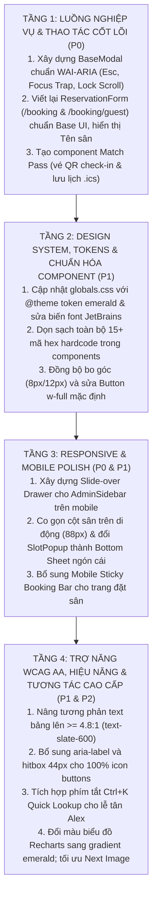

# HỆ THỐNG THIẾT KẾ ĐẶC TẢ CHI TIẾT (DESIGN SYSTEM SPECIFICATION)
## ShuttleVN — Nền tảng Quản lý và Đặt sân Cầu lông Trực tuyến

* **Phiên bản:** 2.1.0 (Quy chuẩn chính thức cho đợt Redesign 2026)
* **Định hướng phê duyệt:** **Định hướng 1 — "Athletic Kinetic" (Thể thao Hiện đại & Năng động)** kết hợp các tính năng lai tạo từ Precision Operative (Phím tắt `Ctrl+K`, Density Dial) và Warm Hospitality (Thẻ vé Match Pass QR, Bottom Sheet).
* **Tài liệu nền tảng:** `PRODUCT.md`, `FRONTEND_DISCOVERY.md`, `UI_UX_BASELINE_AUDIT.md`, `DESIGN_DIRECTIONS.md`.
* **Môi trường kỹ thuật:** Next.js 16 (App Router), React 19, Tailwind CSS v4, TypeScript 5, Recharts, Sonner Toast, Google Material Symbols.

---

## 1. TRIẾT LÝ THIẾT KẾ & NGUYÊN TẮC CỐT LÕI (CORE PRINCIPLES)

1. **Chuẩn xác Tuyệt đối (Absolute Precision):**
   Mọi con số, khung giờ (34 slot 30 phút), giá tiền (`quoteFingerprint`) và mã đơn (`DS-XXXXX`) phải hiển thị với độ tương phản cao, căn thẳng hàng (`tabular-nums`) bằng phông `JetBrains Mono`. Không làm tròn, không tính nhẩm giá client-side.
2. **Kỷ luật & Tối ưu Quét mắt (Disciplined Scannability):**
   Loại bỏ nhiễu thị giác, banner trang trí cồng kềnh; nhân viên lễ tân tại quầy (Alex) có thể nhận diện trạng thái đơn và thu tiền trong dưới 3 giây.
3. **Bản sắc Thể thao Chuyên nghiệp (Athletic Craft):**
   Sử dụng sắc xanh ngọc BWF (`emerald-600` `#059669`) làm màu nhận diện danh dự. Bố cục khỏe khoắn, đường nét dứt khoát, mang lại cảm xúc thi đấu đỉnh cao.
4. **Không Đa nhân cách Thiết kế (Zero Design Schizophrenia):**
   Thống nhất 100% Cổng Khách hàng, Cổng Quản trị và Form Xác nhận Đặt sân dưới một hệ thống token duy nhất. Chỉ phân tách bằng **Mật độ thông tin (Density Dial)**:
   - *Customer Portal:* Standard Density (thoáng đãng, thân thiện, padding 16-24px).
   - *Admin Portal:* Compact Density (nén dòng 44px, nút gọn, padding 8-16px).
5. **Tiếp cận Bao trùm (WCAG 2.1 AA Compliance):**
   Mọi văn bản có độ tương phản >= 4.8:1, hitbox nút bấm cảm ứng >= 44x44px, hỗ trợ 100% bàn phím và nhãn trợ năng ARIA.

---

## 2. KIẾN TRÚC DESIGN TOKENS 3 LỚP (THREE-LAYER TOKEN ARCHITECTURE)

```
┌────────────────────────────────────────────────────────┐
│  LAYER 3: COMPONENT TOKENS (Quy định từng component)    │
│  Button, Input, Card, Modal, CourtSlot, Badge, Table   │
├────────────────────────────────────────────────────────┤
│  LAYER 2: SEMANTIC TOKENS (Gán vai trò ngữ nghĩa)      │
│  --color-brand-primary, --color-surface-card, status   │
├────────────────────────────────────────────────────────┤
│  LAYER 1: PRIMITIVE TOKENS (Giá trị vật lý cơ sở)      │
│  Emerald, Slate, Amber, Rose, Sky; 4px/8px grid scale  │
└────────────────────────────────────────────────────────┘
```

### 2.1 Layer 1: Primitive Tokens (Giá trị Cơ sở)

#### A. Thang màu Primitives (Base Palette)
```css
:root {
  /* Emerald Palette (Thương hiệu & Thành công) */
  --primitive-emerald-50:  #ecfdf5;
  --primitive-emerald-100: #d1fae5;
  --primitive-emerald-200: #a7f3d0;
  --primitive-emerald-300: #6ee7b7;
  --primitive-emerald-400: #34d399;
  --primitive-emerald-500: #10b981;
  --primitive-emerald-600: #059669;
  --primitive-emerald-700: #047857;
  --primitive-emerald-800: #065f46;
  --primitive-emerald-900: #064e3b;

  /* Slate Palette (Cấu trúc & Trung tính) */
  --primitive-slate-50:  #f8fafc;
  --primitive-slate-100: #f1f5f9;
  --primitive-slate-200: #e2e8f0;
  --primitive-slate-300: #cbd5e1;
  --primitive-slate-400: #94a3b8;
  --primitive-slate-500: #64748b;
  --primitive-slate-600: #475569;
  --primitive-slate-700: #334155;
  --primitive-slate-800: #1e293b;
  --primitive-slate-900: #0f172a;

  /* Amber Palette (Cảnh báo & Chờ xử lý) */
  --primitive-amber-50:  #fffbeb;
  --primitive-amber-100: #fef3c7;
  --primitive-amber-500: #f59e0b;
  --primitive-amber-600: #d97706;
  --primitive-amber-700: #b45309;

  /* Red Palette (Hủy & Lỗi & Đóng) */
  --primitive-red-50:  #fef2f2;
  --primitive-red-100: #fee2e2;
  --primitive-red-500: #ef4444;
  --primitive-red-600: #dc2626;
  --primitive-red-700: #b91c1c;

  /* Blue Palette (Xác nhận & Thành viên) */
  --primitive-blue-50:  #eff6ff;
  --primitive-blue-100: #dbeafe;
  --primitive-blue-500: #3b82f6;
  --primitive-blue-600: #2563eb;
  --primitive-blue-700: #1d4ed8;

  /* Pure */
  --primitive-white: #ffffff;
  --primitive-black: #000000;
}
```

#### B. Thang Khoảng cách (Spacing Scale — 4pt/8pt Grid)
```css
:root {
  --space-1:  0.25rem;  /* 4px  - Micro gap, badge padding */
  --space-2:  0.5rem;   /* 8px  - Tight gap, input inner pad */
  --space-3:  0.75rem;  /* 12px - Compact element spacing */
  --space-4:  1.0rem;   /* 16px - Base card padding, form gaps */
  --space-5:  1.25rem;  /* 20px - Medium container padding */
  --space-6:  1.5rem;   /* 24px - Section gap, modal padding */
  --space-8:  2.0rem;   /* 32px - Page section separation */
  --space-10: 2.5rem;   /* 40px - Large layout spacing */
  --space-12: 3.0rem;   /* 48px - Hero / Header margins */
}
```

#### C. Thang Bo góc (Radii Scale)
```css
:root {
  --radius-sm:   0.375rem; /* 6px  - Compact controls */
  --radius-md:   0.5rem;   /* 8px  - Buttons, Inputs, Selects */
  --radius-lg:   0.75rem;  /* 12px - Cards, Tables, Modals */
  --radius-xl:   1.0rem;   /* 16px - Large Panels, Sheets */
  --radius-full: 9999px;   /* Pills, Status Badges, Avatars */
}
```

#### D. Thang Đổ bóng (Elevation & Shadows)
```css
:root {
  --shadow-none: none;
  --shadow-xs:   0 1px 2px 0 rgb(15 23 42 / 0.05);
  --shadow-sm:   0 1px 3px 0 rgb(15 23 42 / 0.08), 0 1px 2px -1px rgb(15 23 42 / 0.08);
  --shadow-md:   0 4px 6px -1px rgb(15 23 42 / 0.08), 0 2px 4px -2px rgb(15 23 42 / 0.08);
  --shadow-lg:   0 10px 15px -3px rgb(15 23 42 / 0.08), 0 4px 6px -4px rgb(15 23 42 / 0.08);
  --shadow-xl:   0 20px 25px -5px rgb(15 23 42 / 0.10), 0 8px 10px -6px rgb(15 23 42 / 0.10);
}
```

#### E. Thang Phân lớp Z-Index Chuẩn hóa
```css
:root {
  --z-sticky-col: 10;   /* Cột sân cố định trên bảng */
  --z-sticky-nav: 40;   /* Navigation headers */
  --z-chat-widget: 45;  /* Nút Chat AI nổi */
  --z-modal-backdrop: 50; /* Backdrop mờ modal */
  --z-modal-content:  51; /* Nội dung modal */
  --z-popover:        60; /* DatePicker, Dropdowns */
  --z-bottom-sheet:   70; /* Bottom Sheet di động */
  --z-toast:          100; /* Sonner Toasts */
}
```

---

### 2.2 Layer 2: Semantic Tokens (Token Ngữ nghĩa)

Các token này trực tiếp ánh xạ vào class Tailwind và biến CSS sử dụng trong mã nguồn:

| Token Name | Primitive Reference | Giá trị HEX | Vai trò & Quy định áp dụng |
|:---|:---|:---:|:---|
| `--color-brand-primary` | `var(--primitive-emerald-600)` | `#059669` | Nút CTA chính, tab active, đường nét thương hiệu |
| `--color-brand-hover` | `var(--primitive-emerald-700)` | `#047857` | Trạng thái hover/active nút CTA chính |
| `--color-brand-accent` | `var(--primitive-emerald-500)` | `#10b981` | Ring focus, icon nổi bật, đường kẻ nhấn |
| `--color-brand-subtle` | `var(--primitive-emerald-50)` | `#ecfdf5` | Nền ô slot khả dụng, hover hàng bảng, badge nhẹ |
| `--color-surface-bg` | `var(--primitive-slate-50)` | `#f8fafc` | Nền toàn trang cổng khách và cổng quản trị |
| `--color-surface-card` | `var(--primitive-white)` | `#ffffff` | Nền thẻ Card, bảng dữ liệu, hộp thoại Modal |
| `--color-surface-dark` | `var(--primitive-slate-900)` | `#0f172a` | Nền header khách, thanh trạng thái tối |
| `--color-surface-muted`| `var(--primitive-slate-100)` | `#f1f5f9` | Nền tiêu đề bảng, ô slot đã qua giờ |
| `--color-text-primary` | `var(--primitive-slate-900)` | `#0f172a` | Tiêu đề, số liệu chính, nhãn quan trọng (Contrast 14.5:1) |
| `--color-text-secondary`| `var(--primitive-slate-600)` | `#475569` | Nhãn form, tiêu đề bảng, văn bản phụ (Contrast 5.8:1) |
| `--color-text-muted` | `var(--primitive-slate-500)` | `#64748b` | Placeholder, timestamp kỹ thuật (Contrast 4.6:1) |
| `--color-border-subtle` | `var(--primitive-slate-200)` | `#e2e8f0` | Đường kẻ bảng, viền thẻ Card, divider |
| `--color-border-strong` | `var(--primitive-slate-300)` | `#cbd5e1` | Viền ô input, viền checkbox/radio |
| `--color-status-success`| `var(--primitive-emerald-600)` | `#059669` | Đơn Hoàn thành, Đã thanh toán, Sân Hoạt động |
| `--color-status-warning`| `var(--primitive-amber-600)` | `#d97706` | Đơn Chờ xác nhận, Chưa thanh toán, Sân Bảo trì |
| `--color-status-danger` | `var(--primitive-red-600)` | `#dc2626` | Đơn Đã hủy, Sân Đóng cửa, Tài khoản Bị khóa |
| `--color-status-info` | `var(--primitive-blue-600)` | `#2563eb` | Đơn Đã xác nhận, Khách Thành viên, Slot đã đặt |

---

### 2.3 Layer 3: Component Tokens & Quy chuẩn Thành phần

#### 1. Button Component (`src/components/ui/Button.tsx`)
- **Nguyên tắc:** Xóa bỏ class mặc định `w-full` để tránh phá vỡ giao diện; chuyển thành thuộc tính `fullWidth?: boolean`.
- **Thang kích thước:**
  - `sm`: `h-8 px-3 text-xs gap-1.5 rounded-md` (Dùng cho bảng admin, thao tác nhanh). Hitbox padding ngoài đảm bảo đạt 44px trên cảm ứng (`touch-target-expansion`).
  - `md`: `h-10 px-4 text-sm gap-2 rounded-lg` (Kích thước mặc định cho forms và action bars).
  - `lg`: `h-12 px-6 text-base gap-2.5 rounded-lg font-semibold` (Nút CTA đặt sân, thanh toán).
- **Biến thể (Variants):**
  - `primary`: `bg-emerald-600 text-white hover:bg-emerald-700 active:scale-[0.98] focus-visible:ring-2 focus-visible:ring-emerald-500/20`.
  - `secondary`: `bg-slate-100 text-slate-800 hover:bg-slate-200 border border-slate-200`.
  - `outline`: `border border-slate-300 bg-transparent text-slate-700 hover:bg-slate-50`.
  - `ghost`: `bg-transparent text-slate-600 hover:bg-slate-100 hover:text-slate-900`.
  - `danger`: `bg-red-600 text-white hover:bg-red-700 focus-visible:ring-red-500/20`.

#### 2. Input & Form Controls (`src/components/ui/Input.tsx`, `Label.tsx`)
- **Input:**
  - Chiều cao `h-10`, bo góc `rounded-lg`, viền `border border-slate-300`.
  - Nền `bg-white`, chữ `text-slate-900 text-sm`, placeholder `placeholder:text-slate-400`.
  - Focus state: `focus:border-emerald-600 focus:ring-2 focus:ring-emerald-500/20 focus:outline-none`.
  - Error state: `border-red-500 focus:border-red-600 focus:ring-red-500/20`.
- **Label:**
  - Bỏ ép buộc `uppercase text-[11px] font-mono`.
  - Chuẩn mới: `text-xs font-semibold text-slate-700 font-sans tracking-tight mb-1.5 block`. Kèm dấu `*` đỏ khi `required={true}`.

#### 3. Modal & Dialog Nền tảng (`BaseModal.tsx`)
- Chuẩn hóa component duy nhất thay thế 10 modal tự do:
  - Tự động gắn `role="dialog"`, `aria-modal="true"`, `aria-labelledby="modal-title"`.
  - Lắng nghe phím `Escape` để đóng; tự động khóa cuộn trang nền (`overflow: hidden` trên `document.body`).
  - Backdrop chuẩn: `fixed inset-0 bg-slate-900/40 backdrop-blur-xs z-50 animate-fade-in`.
  - Container chuẩn: `fixed inset-0 z-51 flex items-center justify-center p-4 overflow-y-auto`.
  - Thẻ nội dung: `bg-white rounded-xl shadow-xl border border-slate-200 max-w-lg w-full p-6 animate-scale-up`.

#### 4. Status Badge Component (`src/components/ui/Badge.tsx`)
- Ánh xạ 13 trạng thái hệ thống đồng bộ theo công thức: `border px-2.5 py-0.5 rounded-full text-xs font-mono font-medium inline-flex items-center gap-1.5`.
- **Quy chuẩn mã màu trạng thái:**
  - `Completed`, `Paid`, `Active`: `bg-emerald-50 text-emerald-700 border-emerald-200`.
  - `Pending`, `Unpaid`, `Maintenance`: `bg-amber-50 text-amber-700 border-amber-200`.
  - `Confirmed`, `Member`: `bg-blue-50 text-blue-700 border-blue-200`.
  - `Cancelled`, `Closed`, `Disabled`: `bg-red-50 text-red-700 border-red-200`.
  - `NoInvoice`: `bg-slate-100 text-slate-600 border-slate-200` (Nhãn: "Chưa lập hóa đơn").

#### 5. Bảng Dữ liệu Chuẩn (`DataTable.tsx`)
- **Tiêu đề cột `<thead>`:**
  - Nâng tương phản đạt chuẩn: `bg-slate-50 text-slate-600 font-sans text-xs font-semibold uppercase tracking-wider border-b border-slate-200 px-4 py-3`.
  - Bắt buộc có thuộc tính `scope="col"`.
- **Hàng dữ liệu `<tbody>`:**
  - Chiều cao dòng trong cổng Admin: `h-11` (44px), `px-4 py-2.5 border-b border-slate-100 text-sm text-slate-800`.
  - Hover effect: `hover:bg-slate-50/80 transition-colors duration-100`.
  - Nút thao tác hàng: Hitbox mở rộng đạt tối thiểu 40–44px, có thuộc tính `aria-label`.

---

## 3. HỆ THỐNG MẬT ĐỘ THÔNG TIN (DENSITY DIAL)

Để đáp ứng tối đa nhu cầu của cả Khách hàng và Nhân viên quầy mà không tạo ra 2 design system riêng biệt:

```
+-----------------------------------------------------------------------------------+
| KHÁCH HÀNG (Standard Density)         | QUẢN TRỊ / LỄ TÂN (Compact Density)       |
+---------------------------------------+-------------------------------------------+
| Spacing: 16px - 24px (Khoáng đạt)     | Spacing: 8px - 16px (Tối ưu màn hình)     |
| Chiều cao nút: 44px - 48px            | Chiều cao nút: 32px - 40px                |
| Chiều cao hàng bảng: 56px             | Chiều cao hàng bảng: 44px (Quét 15 dòng)  |
| Bo góc: 12px (rounded-xl)             | Bo góc: 8px (rounded-lg)                  |
| Trọng tâm: Cảm xúc, rõ ràng, an tâm   | Trọng tâm: Tốc độ, phím tắt, chính xác    |
+-----------------------------------------------------------------------------------+
```

---

## 4. HỆ THỐNG KIỂU CHỮ & TYPOGRAPHY HIERARCHY

### 4.1 Quy chuẩn Phông chữ & Biến CSS
- **`--font-hanken` (`Hanken Grotesk`):** Tiêu đề trang, tên thương hiệu, chỉ số KPI lớn.
- **`--font-inter` (`Inter`):** Nội dung văn bản, biểu mẫu, nhãn, dữ liệu bảng.
- **`--font-jetbrains` (`JetBrains Mono`):** Giờ thi đấu, mã đơn `DS-XXXXX`, mã hóa đơn `HD-...`, giá tiền VND, nhãn trạng thái. *(Sửa triệt để lỗi tham chiếu `--font-jetbrains-mono`).*

### 4.2 Ma trận Phân cấp Kiểu chữ (Type Scale Matrix)

| Cấp bậc | Size / Leading | Weight | Font Token | Nơi sử dụng |
|:---|:---:|:---:|:---|:---|
| **Display 1** | 32px / 40px | SemiBold (600) | `font-display` | KPI lớn trên Dashboard, Lời chào Hero |
| **Heading 1** | 24px / 32px | SemiBold (600) | `font-display` | Tiêu đề chính màn hình (`h1`) |
| **Heading 2** | 18px / 26px | Medium (500) | `font-display` | Tiêu đề khối Section, Card Header (`h2`) |
| **Heading 3** | 15px / 22px | SemiBold (600) | `font-sans` | Tiêu đề Modal, Thẻ nhóm dữ liệu (`h3`) |
| **Body Regular** | 14px / 20px | Regular (400) | `font-sans` | Văn bản chính, mô tả, nội dung bảng |
| **Body Strong** | 14px / 20px | SemiBold (600) | `font-sans` | Văn bản nhấn mạnh, tên khách trong bảng |
| **Label Small** | 12px / 16px | SemiBold (600) | `font-sans` | Nhãn Form Input, Tiêu đề cột Table |
| **Data Medium** | 14px / 20px | Medium (500) | `font-mono tabular-nums` | Giá tiền VND, Giờ slot đặt sân |
| **Data Small** | 12px / 16px | Regular (400) | `font-mono tabular-nums` | Mã đơn `DS-XXXXX`, Mã hóa đơn, Badge |
| **Caption** | 12px / 16px | Regular (400) | `font-sans` | Dòng trợ giúp dưới input, chú thích |

### 4.3 Quy tắc Định dạng Dữ liệu Kỹ thuật
- Tiền tệ: Bắt buộc dùng `Intl.NumberFormat('vi-VN')` xuất ra kèm ký hiệu `đ` (`150.000 đ`).
- Mã đơn & Hóa đơn: Luôn viết hoa, cố định phông mono (`DS-10042`, `HD-20261123-001`).
- Múi giờ: Luôn tính toán theo Giờ Việt Nam (UTC+7), không dùng `toISOString()` dạng UTC thô.

---

## 5. ĐẶC TẢ KHUNG GIAO DIỆN & RESPONSIVE (LAYOUT SHELLS)

### 5.1 Cổng Khách hàng (`CustomerLayout`)
```
+-----------------------------------------------------------------------------------+
| [🏸 ShuttleVN]    Lưới Sân    Tra Cứu Đơn    Hỗ Trợ AI           [1900 1234] [👤 Tài Khoản] |
+-----------------------------------------------------------------------------------+
| HERO TINH GỌN: "Sân Cầu Lông ShuttleVN" -- 14/16 Sân Đang Trống Hôm Nay           |
| [ Hôm nay, Thứ Hai 23/11/2026 ] [ Xem Theo Ngày v ]                               |
+-----------------------------------------------------------------------------------+
| LƯỚI MA TRẬN SÂN (34 Khung Giờ 05:00 - 22:00) ----------------------------------->|
| [Cột Sân Cố Định 140px / 88px Mobile] [ Cuộn Ngang Khung Giờ ]                    |
+-----------------------------------------------------------------------------------+
| FOOTER: (c) 2026 ShuttleVN -- Hotline: 1900 1234                                  |
+-----------------------------------------------------------------------------------+
| MOBILE STICKY BAR: Đã chọn 1 slot (Sân 3: 18:00 - 19:30)           [ ĐẶT SÂN NGAY ]|
+-----------------------------------------------------------------------------------+
```
- **Desktop (>= 1024px):** Container tối đa `1280px` căn giữa. Hero tinh gọn, bảng lưới sân hiển thị rộng rãi, cuộn ngang mượt mà.
- **Mobile (< 768px):**
  - Cột tên sân cố định thu gọn xuống `88px` (chỉ hiện "Sân 1", "Sân 2" và badge loại sân).
  - Xuất hiện **Mobile Sticky Booking Bar** ở đáy màn hình khi người dùng chọn ô slot, hiển thị tóm tắt sân, giờ và nút bấm to rõ trong tầm ngón tay cái.
  - Thay thế popup chọn thời lượng bằng **Bottom Sheet** trượt từ dưới lên.

### 5.2 Cổng Quản trị & Vận hành (`AdminLayout`)
```
+-----------------------------------------------------------------------------------+
| [☰ Menu Mobile] [ShuttleVN Admin]   [🔍 Tìm kiếm nhanh: Ctrl+K]   [🔔] [Alex - Lễ tân v] |
+-----------+-----------------------------------------------------------------------+
| SIDEBAR   | TOP ACTION BAR: Tiêu đề trang + Các nút hành động chính (Portal Action)|
| w-60      +-----------------------------------------------------------------------+
| Desktop   | DATA WORKSPACE:                                                       |
|           | • Thẻ chỉ số KPIs (Doanh thu, Đơn chờ, Sân hoạt động)                |
| Slide-over| • Bảng dữ liệu quản trị mật độ cao (Compact Table rows: 44px)         |
| Mobile    | • Phân trang chuẩn hóa (Pagination X-Y / Tổng)                        |
+-----------+-----------------------------------------------------------------------+
```
- **Desktop (>= 1024px):** Sidebar cố định `w-60` (240px) nền `#F8FAFC`, viền phải `#E2E8F0`. Vùng làm việc mở rộng tối đa theo màn hình.
- **Mobile & Tablet (< 1024px):**
  - **Slide-over Drawer:** Sidebar ẩn đi, mở ra dạng menu trượt từ cạnh trái khi bấm nút Hamburger trên topbar.
  - Giải quyết triệt để lỗi P0 bị co bóp giao diện quản trị thành dải hẹp trên điện thoại.

---

## 6. ĐẶC TẢ CHI TIẾT CÁC COMPONENT TRỌNG TÂM (CORE COMPONENT SPECS)

### 6.1 Màn hình Xác nhận Đặt sân (`ReservationForm`)
Khắc phục hoàn toàn lỗi P0 form HTML thô tại `/booking` và `/booking/guest`:
1. **Khung chứa:** Thẻ `Card` chuẩn `bg-white rounded-xl border border-slate-200 p-6 shadow-sm max-w-xl mx-auto`.
2. **Hiển thị Tên sân & Thời gian:**
   - Đặt ở vị trí trang trọng đầu trang: Icon sân cầu lông, Tên sân (vd: **SÂN 03 - SÀN GỖ TIÊU CHUẨN** kèm badge `Active`).
   - Thời gian: Ngày thi đấu, Khung giờ bắt đầu - kết thúc rõ ràng font `JetBrains Mono`.
3. **Bảng tóm tắt Giá minh bạch:**
   - Hiển thị từng mốc thời gian và đơn giá giờ từ server (`priceSegments`).
   - Tổng tiền nổi bật `text-2xl font-bold font-mono text-emerald-600`.
4. **Biểu mẫu Khách vãng lai (Guest Mode):**
   - Các trường Họ tên, SĐT, Email dùng component `Input` và `Label` chuẩn.
   - Nút "Nhận mã OTP" tích hợp bộ đếm ngược 60 giây (`CountdownTimer`), vô hiệu hóa nút trong lúc đếm để chống spam.
5. **Xử lý xung đột giá (409 Conflict):**
   - Hộp thoại cảnh báo lịch sự: *"Bảng giá sân vừa được cập nhật cho khung giờ cao điểm. Giá mới là [Số tiền]. Bạn có muốn tiếp tục xác nhận không?"* kèm nút "Xác nhận giá mới" màu `emerald-600` (thay vì nút nâu đất thô bạo hiện tại).

### 6.2 Thẻ Vé Vào Sân Hoàn tất (`BadmintonMatchPass`)
Thay thế màn hình thông báo 3 dòng lạnh lùng hiện tại sau khi đặt thành công:
```
+-------------------------------------------------------+
|  🏸 VÉ VÀO SÂN CẦU LÔNG SHUTTLEVN                     |
|  MÃ ĐƠN: DS-10042                  [ TRẠNG THÁI: CHỜ ]|
+-------------------------------------------------------+
|  SÂN THI ĐẤU:     SÂN 03 (SÀN GỖ TIÊU CHUẨN)         |
|  NGÀY CHƠI:       Thứ Hai, 23/11/2026                 |
|  THỜI GIAN:       18:00 - 19:30 (90 phút)             |
|  TỔNG THANH TOÁN: 180.000 đ                           |
+-------------------------------------------------------+
|  [ MÃ QR CHECK-IN ]     Hướng dẫn: Quý khách vui lòng |
|  [     CODE       ]     đến trước giờ chơi 10 phút để |
|  [   QUÉT TẠI     ]     nhận sân và thanh toán tại    |
|  [     QUẦY       ]     quầy lễ tân.                  |
+-------------------------------------------------------+
|  [ 📅 Thêm vào Lịch (.ics) ]   [ 🖨️ Lưu Ảnh / In Vé ]  |
+-------------------------------------------------------+
```

### 6.3 Ma trận Lưới sân 34 Slot (`CourtGrid`)
1. **Virtualization & Cuộn mượt:**
   - Giữ nguyên tối ưu `content-visibility: auto; contain-intrinsic-size: 72px 56px;`.
   - Chuyển wheel event listener sang `{ passive: true }`, loại bỏ giật lag cảnh báo console.
2. **Cột tên sân Sticky:**
   - Chiều rộng: 140px trên Desktop, 88px trên Mobile. Cố định `sticky left-0 z-10 bg-white border-r border-slate-200`.
3. **Bottom Sheet trên Mobile:**
   - Khi nhấp ô slot trên điện thoại, Bottom Sheet trượt lên từ đáy màn hình hiển thị: Tên sân, Khung giờ, 4 chip thời lượng (60p, 90p, 120p, 180p) và nút "Tiếp tục đặt sân" to bản 48px.

### 6.4 Phím tắt Toàn cục & Quick Lookup (`Ctrl+K`)
- Bổ sung hook bàn phím toàn cục `useHotkeys`:
  - `Ctrl+K` hoặc `Cmd+K`: Mở ngay `QuickLookupModal` tra cứu nhanh đơn đặt sân.
  - `Esc`: Đóng bất kỳ modal/dialog/popover nào đang mở.
- Nút "Tra cứu nhanh" trên topbar có gắn badge phím tắt `Ctrl K` rõ ràng.

---

## 7. QUY CHUẨN TRỢ NĂNG WCAG 2.1 AA (ACCESSIBILITY COMPLIANCE)

1. **Độ tương phản Màu chữ (Color Contrast Gate):**
   - Văn bản kích thước thông thường (< 18px): Tương phản tối thiểu **4.5:1** (Chuẩn của ShuttleVN đạt **4.8:1** với `text-slate-600` và **14.5:1** với `text-slate-900`).
   - Văn bản kích thước lớn (>= 18px hoặc 14px bold): Tương phản tối thiểu **3.0:1**.
   - Cấm dùng màu chữ `text-slate-400` trên nền trắng/xám cho bất kỳ nội dung mang tính thông tin.
2. **Kích thước Vùng cảm ứng (Touch Target Size):**
   - Mọi nút bấm, liên kết tương tác trên di động bắt buộc có diện tích tối thiểu **44x44px** (hoặc padding bù trừ `before:absolute before:inset-[-8px]`).
3. **Điều hướng Bàn phím & Focus Ring:**
   - Toàn bộ các phần tử tương tác bắt buộc có hiệu ứng focus nhìn thấy rõ: `focus-visible:ring-2 focus-visible:ring-emerald-500/20 focus-visible:ring-offset-2`.
   - Nghiêm cấm dùng class `outline-none` mà không có `focus-visible` thay thế.
4. **Trình đọc Màn hình (Screen Reader):**
   - 100% icon button bắt buộc có `aria-label="Tên hành động"`.
   - Bảng dữ liệu có `scope="col"` trên thẻ `<th>` và `caption` tóm tắt.

---

## 8. HƯỚNG DẪN TÍCH HỢP TAILWIND CSS V4 & MIGRATION PATH

### 8.1 Tích hợp với `globals.css` (Tailwind v4 `@theme`)
Toàn bộ biến token semantic sẽ được khai báo trong `@theme` của Tailwind v4:

```css
@import "tailwindcss";

@theme {
  --color-brand-primary: #059669;
  --color-brand-hover: #047857;
  --color-brand-accent: #10b981;
  --color-brand-subtle: #ecfdf5;

  --color-surface-bg: #f8fafc;
  --color-surface-card: #ffffff;
  --color-surface-dark: #0f172a;
  --color-surface-muted: #f1f5f9;

  --color-text-primary: #0f172a;
  --color-text-secondary: #475569;
  --color-text-muted: #64748b;

  --color-border-subtle: #e2e8f0;
  --color-border-strong: #cbd5e1;

  --font-display: var(--font-hanken), sans-serif;
  --font-sans: var(--font-inter), sans-serif;
  --font-mono: var(--font-jetbrains), monospace;

  --radius-sm: 0.375rem;
  --radius-md: 0.5rem;
  --radius-lg: 0.75rem;
  --radius-xl: 1.0rem;
}
```

### 8.2 Bảng Tra cứu Chuyển đổi Mã nguồn (Migration Lookup Table)

| Mã nguồn Cũ (Legacy/Faulty) | Mã nguồn Mới Chuẩn hóa (Standard) | Lý do Thay đổi |
|:---|:---|:---|
| `bg-emerald-700` trong form đặt | `bg-emerald-600 hover:bg-emerald-700` | Đồng bộ bảng màu thương hiệu |
| Hardcode `#1a1f2e` header | `bg-slate-900` hoặc token `surface-dark` | Loại bỏ hex hardcode |
| Hardcode `#FBFBFA` sidebar | `bg-slate-50` hoặc token `surface-bg` | Đồng bộ nền quản trị |
| Hardcode `#EDF3EC text-[#346538]` | `bg-emerald-50 text-emerald-700` | Loại bỏ màu rêu Notion dị biệt |
| `text-slate-400` / `text-gray-400` tiêu đề bảng | `text-slate-600 font-semibold` | Nâng tương phản đạt WCAG AA (5.8:1) |
| `--font-jetbrains-mono` trong Recharts | `--font-jetbrains` | Khắc phục lỗi rớt font mono |
| `rounded-[7px]`, `rounded-[14px]` | `rounded-lg` (8px), `rounded-xl` (12px) | Thống nhất bậc bo góc hệ thống |
| Nút `w-full` mặc định trong Button.tsx | Nút `inline-flex`, prop `fullWidth?: boolean` | Tránh vỡ layout hàng nút |
| `SlotPopup` nền đen `#1f2937` | Card trắng viền slate-200 / Bottom Sheet | Đồng bộ thẩm mỹ sáng sủa thể thao |
| `animate-bounce` 3 chấm chatbot | `animate-pulse` | Chuyển động êm ái, hiện đại |

---

## 9. LỘ TRÌNH TRIỂN KHAI THEO 4 TẦNG ƯU TIÊN (IMPLEMENTATION ROADMAP)



---
*Tài liệu DESIGN.md này là hợp đồng thiết kế chính thức và duy nhất của dự án ShuttleVN. Mọi công tác chỉnh sửa mã nguồn và refactor UI tiếp theo bắt buộc phải đối chiếu và tuân thủ 100% các quy chuẩn trong tài liệu này.*

