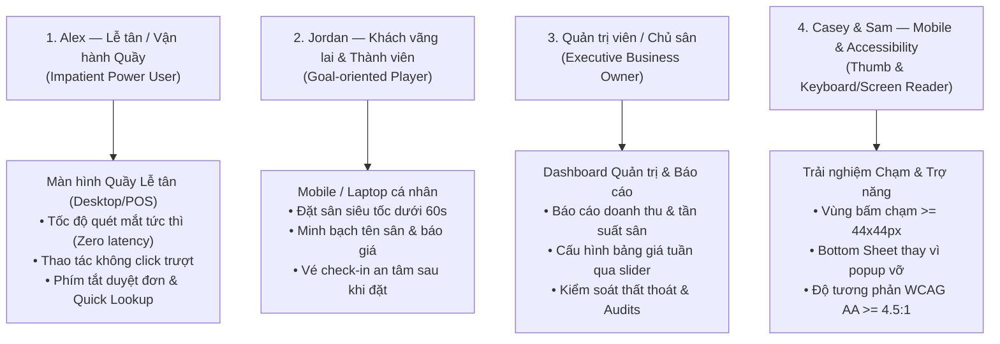
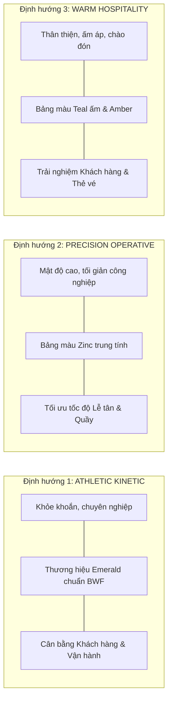
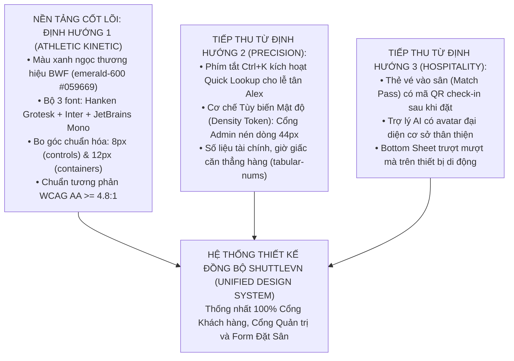

# BÁO CÁO ĐỀ XUẤT ĐỊNH HƯỚNG THIẾT KẾ UI/UX (DESIGN DIRECTIONS)
## Hệ thống Quản lý và Đặt sân Cầu lông Trực tuyến ShuttleVN

* **Dự án:** ShuttleVN (Hệ thống quản lý cơ sở sân cầu lông tích hợp Trợ lý AI)
* **Thời điểm lập:** 23/11/2026
* **Tài liệu căn cứ:** `PRODUCT.md`, `FRONTEND_DISCOVERY.md`, `UI_UX_BASELINE_AUDIT.md`, `SRS.md` v1.7.
* **Quy chuẩn phương pháp:** UI/UX Pro Max (Design Intelligence System), Impeccable Critique standards, Nielsen Heuristics, WCAG 2.1 AA.
* **Trạng thái:** Chờ xét duyệt và lựa chọn định hướng (Awaiting Direction Decision).

---

## MỤC LỤC
1. [TỔNG QUAN & PHÂN TÍCH NHÓM NGƯỜI DÙNG](#1-tổng-quan--phân-tích-nhóm-người-dùng)
2. [CÁC YÊU CẦU & RÀNG BUỘC KỸ THUẬT CỐT LÕI](#2-các-yêu-cầu--ràng-buộc-kỹ-thuật-cốt-lõi)
3. [BA ĐỊNH HƯỚNG THIẾT KẾ TRỰC QUAN (3 VISUAL DIRECTIONS)](#3-ba-định-hướng-thiết-kế-trực-quan-3-visual-directions)
   - [Định hướng 1: Athletic Kinetic (Thể thao Hiện đại & Năng động)](#định-hướng-1-athletic-kinetic-thể-thao-hiện-đại--năng-động)
   - [Định hướng 2: Precision Operative (Vận hành Tinh chuẩn & Tối giản Công nghiệp)](#định-hướng-2-precision-operative-vận-hành-tinh-chuẩn--tối-giản-công-nghiệp)
   - [Định hướng 3: Clean Warm Hospitality (Khách hàng là Trung tâm & Thân thiện Thể thao)](#định-hướng-3-clean-warm-hospitality-khách-hàng-là-trung-tâm--thân-thiện-thể-thao)
4. [BẢNG SO SÁNH TOÀN DIỆN CÁC ĐỊNH HƯỚNG](#4-bảng-so-sánh-toàn-diện-các-định-hướng)
5. [ĐỀ XUẤT ĐỊNH HƯỚNG TỐI ƯU CHO SHUTTLEVN](#5-đề-xuất-định-hướng-tối-ưu-cho-shuttlevn)
6. [HỆ THỐNG CÁC ANTI-PATTERN TUYỆT ĐỐI CẦN TRÁNH](#6-hệ-thống-các-anti-pattern-tuyệt-đối-cần-tránh)
7. [KẾ HOẠCH BƯỚC TIẾP THEO (NEXT STEPS)](#7-kế-hoạch-bước-tiếp-theo-next-steps)

---

## 1. TỔNG QUAN & PHÂN TÍCH NHÓM NGƯỜI DÙNG

### 1.1 Bối cảnh Sản phẩm (Product Context)
ShuttleVN là nền tảng số chuyên sâu quản lý và đặt sân cầu lông cho cơ sở đơn (single-facility), kết hợp Trợ lý AI tư vấn công khai. Sản phẩm mang tính chất **lai tạo đặc biệt (Hybrid System)**:
- Vừa là **Cổng Dịch vụ Khách hàng (Customer Booking Portal)**: Tự phục vụ, tra cứu nhanh, kiểm tra tình trạng sân trống theo thời gian thực (05:00 – 22:00, 34 khung giờ 30 phút), đặt sân và thanh toán minh bạch dưới 1 phút.
- Vừa là **Hệ thống Quản trị & Vận hành Chuyên sâu (Operations & Management Console)**: Tiếp nhận dòng khách nườm nượp tại quầy, xử lý check-in, duyệt đơn `Pending`, thu tiền hóa đơn 100%, cấu hình bảng giá đa tầng theo ngày, báo cáo tài chính và nhật ký kiểm toán bất biến.

### 1.2 Bốn Nhóm Người dùng Cốt lõi & Mental Model



#### 1. Alex — Nhân viên Lễ tân / Vận hành Quầy (High-Velocity Operator)
- **Môi trường & Tâm lý:** Trực tiếp tại quầy trong khung giờ cao điểm (17:00 – 20:00). Một tay nghe điện thoại hỏi sân, mắt quét hàng đợi check-in, tay kia điều khiển chuột/bàn phím. Mức độ kiên nhẫn thấp, cần tốc độ tối đa.
- **Nhiệm vụ chính:** Tra cứu nhanh đơn đặt sân bằng SĐT/mã đơn qua Quick Lookup; xác nhận duyệt đơn `Pending`; thu tiền hóa đơn (Tiền mặt / Chuyển khoản); chuyển trạng thái sân (Hoạt động / Bảo trì); giải quyết khách đến trễ hoặc đổi lịch đột xuất.
- **Yêu cầu UI/UX sống còn:**
  - Tải nhận thức tối thiểu (Zero visual distraction).
  - Phân cấp trạng thái đơn cực kỳ rõ rệt qua màu sắc và hình khối (không nhầm giữa Chưa thu tiền và Đã thu tiền).
  - Hỗ trợ phím tắt toàn cục (`Ctrl+K` để tra cứu, `Esc` để đóng modal).
  - Diện tích nút thao tác hàng trong bảng đủ lớn, không bao giờ click trượt.

#### 2. Jordan — Khách vãng lai & Thành viên Đặt sân (Goal-Oriented Player)
- **Môi trường & Tâm lý:** Thường truy cập qua điện thoại thông minh khi đang di chuyển, đang rảnh rỗi hoặc hẹn bạn bè gấp. Cần sự rõ ràng, không muốn phải tạo tài khoản phức tạp nếu chỉ đá một trận vãng lai.
- **Nhiệm vụ chính:** Chọn ngày chơi; lướt tìm ô sân trống; xem báo giá tức thì; nhập thông tin xác thực OTP nhanh chóng; nhận mã đơn `DS-XXXXX` và hướng dẫn đến sân an tâm.
- **Yêu cầu UI/UX sống còn:**
  - Lưới sân cuộn mượt mà trên màn hình cảm ứng, không bị popover nhảy loạn xạ.
  - Phải luôn nhìn thấy **Tên sân** rõ ràng trên màn hình xác nhận (khắc phục triệt để lỗi P0 hiện tại).
  - Báo giá minh bạch từng khung giờ, thông báo lỗi bằng tiếng Việt lịch sự, dễ hiểu.
  - Sau khi đặt thành công, nhận được thẻ vé check-in hoàn chỉnh (kèm mã QR, hướng dẫn thanh toán và nút lưu lịch).

#### 3. Quản trị viên / Chủ cơ sở (Executive Business Owner)
- **Môi trường & Tâm lý:** Sử dụng laptop/máy tính bàn trong văn phòng hoặc từ xa. Cần bức tranh toàn cảnh về sức khỏe tài chính và năng suất khai thác sân để ra quyết định kinh doanh.
- **Nhiệm vụ chính:** Xem biểu đồ doanh thu thực tế (theo thời điểm thu tiền); tỷ lệ lấp đầy sân (Court Usage); thiết lập bảng giá giờ vàng / giờ thấp điểm cho 7 ngày trong tuần qua thanh kéo thời gian; giám sát nhật ký kiểm toán hệ thống (`Audits`).
- **Yêu cầu UI/UX sống còn:**
  - Biểu đồ dữ liệu chuẩn mực, số liệu định dạng tiền tệ Việt Nam (`150.000 đ`) rõ ràng.
  - Thanh cấu hình giá 7 ngày (`PricingTimeline`) trực quan, thao tác kéo mốc giờ mượt mà, không gây xung đột giữa giờ mở cửa và khung giá.
  - Mật độ thông tin cao, hỗ trợ bộ lọc đa chiều nhưng có tính năng thu gọn (Progressive Disclosure) để tránh ngợp mắt.

#### 4. Casey (Người dùng di động thao tác một tay) & Sam (Người dùng trợ năng)
- **Casey:** Cần thao tác đặt sân bằng ngón tay cái (Thumb zone). Cần thanh tóm tắt slot dính đáy màn hình (Sticky Bottom Bar) và Bottom Sheet trượt từ dưới lên thay vì popup lơ lửng giữa màn hình.
- **Sam:** Điều hướng hoàn toàn bằng bàn phím hoặc trình đọc màn hình. Đòi hỏi độ tương phản chữ >= 4.5:1, các modal phải có `role="dialog"`, focus trap và nút bấm icon bắt buộc có `aria-label`.

---

## 2. CÁC YÊU CẦU & RÀNG BUỘC KỸ THUẬT CỐT LÕI

Để đảm bảo thiết kế có tính khả thi kỹ thuật 100% (Feasible & Production-ready), mọi định hướng thiết kế mới bắt buộc phải tuân thủ nghiêm ngặt các ranh giới sau:

| Khía cạnh | Ràng buộc Kỹ thuật & Nghiệp vụ Bất biến | Hậu quả nếu Vi phạm |
|:---|:---|:---|
| **Frontend Stack** | **Next.js 16 (App Router)**, **React 19**, **Tailwind CSS v4**, **TypeScript 5**, **Recharts 2.12**, **Sonner Toast**, **Google Material Symbols**. | Giao diện không thể biên dịch hoặc gây xung đột gói runtime nghiêm trọng. |
| **Báo giá An toàn** | Giá tính toán 100% server-side theo từng phút, xác thực bằng chữ ký số `quoteFingerprint`. Khi có xung đột giá (409 Conflict), bắt buộc client hiển thị báo giá mới để người dùng xác nhận. | Bị server từ chối tạo đơn (400 Bad Request) hoặc nghi ngờ gian lận giá. |
| **Quy tắc Hủy & Đổi lịch (1-Hour Rule)** | Chỉ cho phép khách tự hủy/đổi lịch khi đơn chưa thanh toán VÀ cách giờ chơi tối thiểu 1 tiếng (`canRescheduleBooking`). Đơn đã thanh toán bắt buộc liên hệ hotline. | Gây thất thoát doanh thu của sân và vi phạm hợp đồng vận hành cơ sở. |
| **Vòng đời Đơn & Hóa đơn** | **Tuyệt đối không có nút tạo hóa đơn thủ công**. Hóa đơn `HD-{yyyyMMdd}-{seq}` chỉ sinh tự động khi đơn chuyển `Confirmed` hoặc `Completed`. Đơn `Pending` luôn mang nhãn "Chưa lập hóa đơn". | Phá vỡ tính toàn vẹn chuỗi thanh toán và cấu trúc kiểm toán hệ thống. |
| **Chống Trùng lặp (Idempotency)** | Mọi mutation ghi dữ liệu (đặt sân, hủy, đổi lịch, duyệt, thu tiền) đều phải truyền header `Idempotency-Key` (UUID ngẫu nhiên). | Nguy cơ tạo đơn kép hoặc trừ tiền lặp lại khi người dùng bấm liên tục. |
| **Lưới sân 34 Slots (05:00 - 22:00)** | Bước nhảy 30 phút. Ô đã qua giờ trong ngày hôm nay phải bị vô hiệu hóa. Tự động refetch làm mới dữ liệu mỗi 30 giây. | Hiển thị slot trống ảo, dẫn đến tranh chấp đặt trùng sân (double-booking). |
| **Múi giờ Vận hành** | Giờ địa phương Việt Nam (UTC+7). Toàn bộ định dạng ngày giờ phải bám theo múi giờ cơ sở, không dùng UTC thuần. | Lệch ngày và giờ hiển thị trong khung giờ từ 00:00 đến 07:00 sáng. |

---

## 3. BA ĐỊNH HƯỚNG THIẾT KẾ TRỰC QUAN (3 VISUAL DIRECTIONS)

Dưới đây là 3 định hướng thẩm mỹ và cấu trúc giao diện độc lập, được nghiên cứu chuyên biệt cho ShuttleVN dựa trên cơ sở dữ liệu thiết kế UI/UX Pro Max:



---

### ĐỊNH HƯỚNG 1: ATHLETIC KINETIC (Thể thao Hiện đại & Năng động)
> **Định vị:** *Lấy cảm hứng từ sân đấu cầu lông chuẩn quốc tế BWF, đường cầu sắc bén và tinh thần thể thao chuyên nghiệp. Thể hiện sự chuẩn xác, tràn đầy năng lượng nhưng có kỷ luật vận hành cao.*

```
+-----------------------------------------------------------------------------------+
|  [Logo ShuttleVN]   Lịch Sân   Tra Cứu   Trợ Lý AI        [Hotline]  [Alex - Lễ tân]  |
+-----------------------------------------------------------------------------------+
|  TOP KPIS:  [ Doanh Thu: 4.850.000 đ ]  [ Đơn Chờ: 03 ]  [ Công Suất: 82% ]      |
+-----------------------------------------------------------------------------------+
|  MA TRẬN LỊCH SÂN (05:00 - 22:00 | 34 Slots)                    [ Hôm nay, 23/11 ]|
|  +--------+-------------+-------------+-------------+-------------+-------------+ |
|  | SÂN    | 05:00-05:30 | 05:30-06:00 | 06:00-06:30 | 06:30-07:00 | ...         | |
|  +--------+-------------+-------------+-------------+-------------+-------------+ |
|  | Sân 01 | [ TRỐNG   ] | [ TRỐNG   ] | [ DS-1002 ] | [ DS-1002 ] | [ TRỐNG   ] | |
|  | Sân 02 | [ ĐÃ QUA  ] | [ DS-1004 ] | [ DS-1004 ] | [ BẢO TRÌ ] | [ TRỐNG   ] | |
|  +--------+-------------+-------------+-------------+-------------+-------------+ |
+-----------------------------------------------------------------------------------+
```

#### 1. Design Concept
- **Tư tưởng cốt lõi:** Một hệ sinh thái giao diện thống nhất kết nối sân đấu thực tế với công nghệ số. Sử dụng các đường kẻ sân thanh mảnh, khoảng trắng khoáng đạt, kết hợp sắc thái xanh ngọc thể thao (`emerald`) sắc sảo để tạo nên cảm giác hiện đại, chuẩn xác và đáng tin cậy.
- **Tinh thần thị giác:** Rõ ràng (Crisp), Nhanh nhẹn (Agile), Chuyên nghiệp (Pro-grade).

#### 2. Color Palette với mã HEX chuẩn xác
Bảng màu giải quyết triệt để sự phân mảnh giữa token `primary` xanh lá mạ lỗi thời và màu hex hardcode:

| Tên Token Ngữ nghĩa | Mã HEX | Vai trò & Ứng dụng | Tiêu chuẩn Tương phản (Contrast) |
|:---|:---:|:---|:---:|
| `--color-brand-primary` | `#059669` | Màu thương hiệu chủ đạo (Emerald 600 - chuẩn mặt sân BWF) | 4.8:1 trên nền trắng (WCAG AA) |
| `--color-brand-hover` | `#047857` | Trạng thái hover/active nút chính (Emerald 700) | 6.5:1 trên nền trắng (WCAG AAA) |
| `--color-brand-accent` | `#10B981` | Điểm nhấn năng lượng, ring focus, viền nổi bật (Emerald 500) | 3.1:1 (Dùng cho UI elements/icons) |
| `--color-brand-subtle` | `#ECFDF5` | Nền nhãn, nền ô slot khả dụng, hover hàng (Emerald 50) | Nền sáng bổ trợ |
| `--color-surface-bg` | `#F8FAFC` | Nền toàn trang cổng khách & cổng admin (Slate 50 mát dịu) | Nền tổng thể trung tính |
| `--color-surface-card` | `#FFFFFF` | Nền thẻ Card, bảng dữ liệu, hộp thoại Modal | Độ nổi khối tinh tế |
| `--color-surface-dark` | `#0F172A` | Nền header khách, thanh trạng thái tối (Slate 900) | Vững chãi, sang trọng |
| `--color-text-primary` | `#0F172A` | Tiêu đề, số liệu chính, nhãn quan trọng (Slate 900) | **14.5:1** (Siêu sắc nét) |
| `--color-text-secondary`| `#475569` | Nhãn form, tiêu đề bảng, văn bản phụ (Slate 600) | **5.8:1** (Vượt chuẩn WCAG AA) |
| `--color-text-muted` | `#64748B` | Placeholder, thời gian phụ, icon trang trí (Slate 500) | **4.6:1** (Đạt chuẩn 4.5:1) |
| `--color-border-subtle` | `#E2E8F0` | Đường kẻ bảng, viền thẻ Card, divider (Slate 200) | Phân định ranh giới tự nhiên |
| `--color-status-success`| `#059669` | Đơn hoàn thành, đã thanh toán, sân hoạt động | Kèm nền `#ECFDF5` |
| `--color-status-warning`| `#D97706` | Đơn chờ duyệt, chưa thanh toán, sân bảo trì | Kèm nền `#FFFBEB` |
| `--color-status-danger` | `#DC2626` | Đơn đã hủy, sân đóng cửa, tài khoản bị khóa | Kèm nền `#FEF2F2` |
| `--color-status-info` | `#2563EB` | Đơn đã xác nhận, tài khoản thành viên, slot đã đặt | Kèm nền `#EFF6FF` |

#### 3. Typography Stack & Cấu trúc Phân cấp
- **Display & Headings (Tiêu đề, Brand, KPI lớn):** `Hanken Grotesk` (`font-display`, sans-serif) — mang nét thể thao hình học dứt khoát, thanh thoát.
- **Body & Controls (Giao diện, Form nhập liệu, Bảng dữ liệu):** `Inter` (`font-sans`, sans-serif) — tối ưu khả năng đọc ở mọi kích cỡ màn hình.
- **Data, Time, Currency & Codes (Mã đơn, Giờ, Báo giá, Slot):** `JetBrains Mono` (`font-mono`, monospace) — đồng bộ biến font `--font-jetbrains`, số học căn thẳng hàng (`tabular-nums`).

```
Display Large (Hero/KPI):    32px / Leading 40px / SemiBold (600) / Hanken Grotesk
Heading 1 (Page Title):      24px / Leading 32px / SemiBold (600) / Hanken Grotesk
Heading 2 (Card/Section):    18px / Leading 26px / Medium (500)   / Hanken Grotesk
Body Regular (Main text):    14px / Leading 20px / Regular (400)  / Inter
Body Strong (Form Label):    13px / Leading 18px / SemiBold (600) / Inter
Data Medium (Price/Slot):    14px / Leading 20px / Medium (500)   / JetBrains Mono
Data Small (Code/Time):      12px / Leading 16px / Regular (400)  / JetBrains Mono
Caption (Helpers):           12px / Leading 16px / Regular (400)  / Inter
```

#### 4. Layout Direction
- **Cổng Khách hàng (`(customer)`):**
  - Khung giới hạn tối đa `max-w-7xl` (1280px), căn giữa, padding mềm `px-4 sm:px-6 lg:px-8`.
  - Thay thế Hero banner ảnh 260px chiếm chỗ bằng **Hero Tinh gọn (Slim Sports Header)**: Hiển thị lời chào, chỉ số sân trống trực tiếp hôm nay và thanh chọn ngày tích hợp.
  - Trên mobile, bổ sung **Sticky Booking Bar** dính mép dưới màn hình tóm tắt slot đã chọn và nút chuyển tiếp thanh toán trong tầm tay ngón cái.
- **Cổng Quản trị (`(admin)`):**
  - Bố cục 3 tầng: Topbar đa nhiệm (56px) -> Vùng tác vụ trọng tâm (Action Bar) -> Không gian dữ liệu mở rộng (Data Workspace).
  - Sidebar dạng lai: Trên Desktop cố định `w-60` (240px) có thể thu gọn icon (`w-18`); trên Mobile/Tablet chuyển đổi thành **Slide-over Drawer** với nút Hamburger trên header, loại bỏ hoàn toàn lỗi vỡ layout P0.

#### 5. Component Style
- **Bo góc (Border Radii):** Chuẩn hóa toàn hệ thống theo 3 cấp:
  - `rounded-lg` (8px): Nút bấm (Button), ô nhập (Input), thẻ Select, Popover items.
  - `rounded-xl` (12px): Thẻ Card, bảng biểu (Table container), hộp thoại Modal, Bottom Sheet.
  - `rounded-full`: Huy hiệu trạng thái (Badge), Avatar người dùng, nút tròn nổi AI Chat.
- **Đổ bóng (Elevation & Shadows):** Sử dụng hệ đổ bóng tự nhiên nhiều tầng:
  - `shadow-xs`: Thẻ Card thông thường (`0 1px 2px 0 rgb(0 0 0 / 0.05)`).
  - `shadow-md`: Menu thả xuống (Dropdown), Popover chọn ngày (`0 4px 6px -1px rgb(0 0 0 / 0.1)`).
  - `shadow-xl`: Modal, Drawer, Bottom Sheet (`0 20px 25px -5px rgb(0 0 0 / 0.1)`).
- **Trạng thái Tương tác:** Nút bấm có hiệu ứng nén nhẹ khi click (`active:scale-[0.98]`), vòng viền tiêu điểm (focus ring) rõ nét màu xanh ngọc (`ring-2 ring-emerald-500/20 ring-offset-2`).

#### 6. Data Visualization Style
- **Ma trận Lưới sân 34 Slot (`CourtGrid`):**
  - Cột sân cố định bên trái (Sticky Court Column) thu gọn thông minh (140px desktop -> 88px mobile).
  - Ô slot hiển thị trực quan: Slot trống (`bg-white hover:bg-emerald-50 border-slate-200`), Slot đã đặt (`bg-slate-100 text-slate-500`), Slot bảo trì (`bg-amber-50 text-amber-700 pattern-diagonal`), Slot quá giờ (`bg-slate-50 opacity-40 cursor-not-allowed`).
- **Biểu đồ Doanh thu Recharts (`RevenueChart`):**
  - Cột doanh thu bo tròn góc trên (`radius={[4, 4, 0, 0]}`), sử dụng dải gradient thanh lịch từ `emerald-600` đến `emerald-500`. Trục tọa độ và tooltip hiển thị font `JetBrains Mono` chính xác.
- **Thanh Timeline Bảng giá (`PricingTimeline`):**
  - Phối 4 phân đoạn giờ theo sắc thái xanh ngọc và hổ phách có kiểm soát: Giờ thấp điểm (`#D1FAE5`), Ban ngày (`#A7F3D0`), Giờ vàng cao điểm (`#FDE68A`), Giờ muộn (`#E2E8F0`).

#### 7. Interaction Principles
- **Tốc độ & Phản hồi:** Mọi thao tác tương tác có độ trễ phản hồi thị giác < 200ms (`transition-all duration-150 ease-out`).
- **Xác thực An tâm (Peace of Mind Confirmation):** Trang hoàn tất đặt sân không chỉ là dòng chữ khô khan mà hiển thị dạng **Thẻ Vé Sân Cầu Lông (Badminton Match Ticket)**: Có mã đơn to, mã QR để nhân viên quầy quét nhanh, tóm tắt sân/giờ, và nút lưu vào Google Calendar (`.ics`).
- **Phím tắt Chuyên viên:** Bổ sung `Ctrl+K` kích hoạt ngay Quick Lookup cho nhân viên quầy Alex.

#### 8. Responsive Principles
- **Desktop (>= 1024px):** Hiển thị toàn diện dữ liệu đa cột, sidebar cố định, hỗ trợ quét mắt hàng loạt.
- **Tablet (768px - 1023px):** Sidebar thu gọn icon hoặc dạng drawer trượt, bảng dữ liệu cho phép cuộn ngang có chỉ báo bóng mờ 2 mép (scroll shadow hints).
- **Mobile (< 768px):** Chuyển đổi toàn bộ Popover chọn thời lượng sân (`SlotPopup`) thành **Bottom Sheet** trượt từ đáy màn hình trong tầm với của ngón cái. Thao tác bảng biểu ưu tiên chuyển sang dạng thẻ tóm tắt (Card list) dễ đọc.

---

### ĐỊNH HƯỚNG 2: PRECISION OPERATIVE (Vận hành Tinh chuẩn & Tối giản Công nghiệp)
> **Định vị:** *Lấy cảm hứng từ các công cụ quản trị dữ liệu chuyên sâu (Linear, Raycast, Figma Dashboard). Triệt tiêu tối đa các chi tiết trang trí thừa thãi, tối đa hóa mật độ thông tin có kiểm soát, tạo sự tập trung cao độ và giảm mỏi mắt cho nhân viên trực ca liên tục 8-10 tiếng.*

```
+-----------------------------------------------------------------------------------+
| ShuttleVN / Ops Console       [Q Tìm kiếm nhanh: Ctrl+K]          [Trực ban: Alex] |
+-----------------------------------------------------------------------------------+
| [Lưới Sân] [Yêu Cầu (3)] [Tất Cả Đơn] [Khách Hàng] [Hóa Đơn] [Báo Cáo] [Cài Đặt]  |
+-----------------------------------------------------------------------------------+
| BẢNG ĐIỀU HÀNH THỜI GIAN THỰC -- 23/11/2026 -- 17:45                              |
| +-------------------------------------------------------------------------------+ |
| | #MÃ ĐƠN   | KHÁCH HÀNG      | SÂN   | KHUNG GIỜ   | TỔNG TIỀN  | TRẠNG THÁI   | |
| +-----------+-----------------+-------+-------------+------------+--------------+ |
| | DS-10482  | Trần Đình Nam   | Sân 3 | 18:00-19:30 | 180.000 đ  | * Chờ duyệt  | |
| | DS-10481  | Lê Hoàng Yến    | Sân 1 | 18:00-19:00 | 120.000 đ  | * Đã thu tiền| |
| | DS-10480  | Vãng lai (0912) | Sân 2 | 18:30-20:00 | 210.000 đ  | o Chưa thu   | |
+-----------------------------------------------------------------------------------+
```

#### 1. Design Concept
- **Tư tưởng cốt lõi:** Bảng điều khiển tối ưu hóa cho "ngón tay và bàn phím". Mọi điểm ảnh (pixel) trên màn hình đều phải phục vụ mục đích truyền tải thông tin. Bố cục phẳng (Flat), viền đơn sắc hairline 1px, không đổ bóng màu mè, nhấn mạnh tính cơ học và độ tin cậy tuyệt đối.
- **Tinh thần thị giác:** Kỷ luật (Disciplined), Tinh gọn (Monochrome-led), Hiệu năng cao (High-performance).

#### 2. Color Palette với mã HEX chuẩn xác
Bảng màu lấy họ màu Zinc công nghiệp làm nền tảng, điểm xuyết màu xanh ngọc chỉ báo:

| Tên Token Ngữ nghĩa | Mã HEX | Vai trò & Ứng dụng |
|:---|:---:|:---|
| `--color-brand-primary` | `#10B981` | Điểm nhấn xanh ngọc chỉ báo (Emerald 500) |
| `--color-brand-hover` | `#059669` | Trạng thái nhấn nút (Emerald 600) |
| `--color-surface-bg` | `#F4F5F7` | Nền trung tính kỹ thuật (Zinc-tinted Slate) |
| `--color-surface-card` | `#FFFFFF` | Nền bảng dữ liệu, nền thẻ làm việc |
| `--color-surface-muted`| `#FAFAFA` | Nền tiêu đề cột bảng, thanh lọc dữ liệu |
| `--color-border-subdued`| `#E4E4E7` | Đường kẻ hairline ngăn cách dòng (Zinc 200) |
| `--color-border-strong` | `#D4D4D8` | Viền ô input, viền phân tách khối lớn (Zinc 300) |
| `--color-text-primary` | `#18181B` | Toàn bộ chữ chính, số liệu (Zinc 900 - Contrast 15.2:1) |
| `--color-text-muted` | `#52525B` | Nhãn phụ, tiêu đề cột bảng (Zinc 600 - Contrast 5.9:1) |
| `--color-text-subtle` | `#71717A` | Placeholder, timestamp kỹ thuật (Zinc 500 - Contrast 4.6:1) |
| `--color-status-success`| `#059669` | Chấm LED & nhãn hoàn thành (Emerald 600) |
| `--color-status-warning`| `#D97706` | Chấm LED & nhãn chờ duyệt (Amber 600) |
| `--color-status-danger` | `#E11D48` | Chấm LED & nhãn hủy/lỗi (Rose 600) |
| `--color-status-info` | `#0284C7` | Chấm LED & nhãn đã xác nhận (Sky 600) |

#### 3. Typography Stack & Cấu trúc Phân cấp
- **Heading & Body:** Đồng nhất 100% bằng phông chữ kỹ thuật `Inter` (`font-sans`) với khoảng cách chữ được siết chặt (`tracking-tight` cho tiêu đề, `tracking-normal` cho body).
- **Data, Numbers & Codes:** `JetBrains Mono` (`font-mono`) mở rộng quy mô hiển thị cho toàn bộ: Bảng giá, Thời gian, Số điện thoại, Mã đơn và Tỷ lệ phần trăm.

```
Section Heading:             16px / Leading 22px / SemiBold (600) / Inter (tracking-tight)
Table Header:                12px / Leading 16px / Medium (500)   / Inter (text-zinc-600)
Table Data Cell:             13px / Leading 18px / Regular (400)  / Inter
Data Numerics:               13px / Leading 18px / Medium (500)   / JetBrains Mono
Badge / Inline Status:       11px / Leading 14px / SemiBold (600) / JetBrains Mono
```

#### 4. Layout Direction
- Mật độ thông tin cực cao (High Density), áp dụng thang bước đệm 4px/8px chặt chẽ (`gap-2`, `p-3`).
- Bảng dữ liệu loại bỏ viền ngoài cồng kềnh, phân cách bằng đường kẻ mỏng 1px (`border-b border-zinc-200`). Chiều cao mỗi dòng trong bảng được nén còn 40px để hiển thị được từ 15–20 đơn trên một màn hình mà không cần cuộn chuột.
- Header tích hợp thanh tìm kiếm và bộ lọc liền khối (Segmented Control Bar), loại bỏ các khoảng trắng thừa.

#### 5. Component Style
- **Bo góc tối thiểu:** `rounded-md` (6px) cho Input/Button, `rounded-lg` (8px) cho Modal/Card, `rounded-sm` (4px) cho nhãn trạng thái compact.
- **Độ nổi khối:** Phẳng hoàn toàn (Zero Box-shadow), chiều sâu được xác định bởi viền phân cách và sắc độ nền.
- Trạng thái hàng trong bảng có hiệu ứng đổi màu nền siêu nhanh khi hover (`hover:bg-zinc-100/70` trong 80ms).

#### 6. Data Visualization Style
- **Lưới sân 34 Slot:** Dạng biểu đồ Gantt kỹ thuật thanh mảnh. Tên khách và mã đơn được rút gọn dạng nhãn nén trong từng ô slot, hiển thị đầy đủ chi tiết qua tooltip khi hover chuột.
- **Biểu đồ Recharts:** Cột đơn sắc `emerald-600` thanh mảnh, có đường chuẩn tham chiếu (benchmark dashed line) chỉ mức doanh thu mục tiêu.

#### 7. Interaction Principles
- **Điều hướng Bàn phím Tuyệt đối:** Hỗ trợ dùng phím mũi tên `← ↑ → ↓` để duyệt qua các ô slot trên lưới sân; phím `Enter` để mở form đặt; phím `Esc` đóng modal tức thì; `Ctrl+D` xác nhận duyệt đơn.
- Zero Layout Shift: Toàn bộ bảng dữ liệu giữ chỗ kích thước tuyệt đối, không bị nhảy khung khi dữ liệu tải lại.

#### 8. Responsive Principles
- Trên điện thoại di động, hệ thống tự động giấu bớt các cột phụ, chuyển bảng dữ liệu thành dạng danh sách Compact Card siêu mỏng, hỗ trợ thao tác vuốt ngang (swipe gesture) để Duyệt hoặc Từ chối đơn nhanh chóng.

---

### ĐỊNH HƯỚNG 3: CLEAN WARM HOSPITALITY (Khách hàng là Trung tâm & Thân thiện Thể thao)
> **Định vị:** *Lấy cảm hứng từ các nền tảng phong cách sống và dịch vụ thể thao cao cấp (Equinox, Mindbody, Apple Fitness). Thân thiện, hiếu khách, giảm tối đa cảm giác khô khan của bảng tính kỹ thuật, biến việc đặt sân và check-in thành một trải nghiệm hào hứng, thư thái cho người chơi.*

```
+-----------------------------------------------------------------------------------+
|  (🏸) ShuttleVN            Đặt Sân      CLB Cầu Lông      Hỗ Trợ      [👤 Đăng Nhập] |
+-----------------------------------------------------------------------------------+
|  CHÀO MỪNG BẠN ĐẾN VỚI SÂN CẦU LÔNG SHUTTLEVN!                                    |
|  "Hôm nay có 14 sân đang hoạt động -- Hãy chọn giờ thi đấu yêu thích của bạn"     |
+-----------------------------------------------------------------------------------+
|  BƯỚC 1: CHỌN SÂN & GIỜ CHƠI          [ Lịch Ngày: Hôm nay, Thứ 2, 23/11 ]        |
|  +--------------------+  +--------------------+  +--------------------+           |
|  | SÂN VIP 01 (Sàn Gỗ)|  | SÂN TIÊU CHUẨN 02  |  | SÂN TIÊU CHUẨN 03  |           |
|  | [17:30] [18:00] ...|  | [18:30] [19:00] ...|  | [Hết chỗ hôm nay]  |           |
|  | Giá: 120k - 180k/h |  | Giá: 100k - 140k/h |  | Hẹn bạn ngày mai   |           |
|  +--------------------+  +--------------------+  +--------------------+           |
+-----------------------------------------------------------------------------------+
```

#### 1. Design Concept
- **Tư tưởng cốt lõi:** Đưa người chơi cầu lông vào trung tâm của trải nghiệm. Thiết kế sử dụng tông màu ấm áp (Warm tones), các khối thẻ bo góc lớn mềm mại, biểu tượng thân thiện, minh họa sinh động. Giảm thiểu áp lực biểu mẫu và loại bỏ hoàn toàn các thuật ngữ kỹ thuật khó hiểu.
- **Tinh thần thị giác:** Gần gũi (Inviting), Mềm mại (Tactile), Tích cực & Hào hứng (Uplifting).

#### 2. Color Palette với mã HEX chuẩn xác
Bảng màu kết hợp giữa sắc xanh ngọc biển (Teal) và màu hổ phách ấm (Amber) trên nền vải sáng ấm:

| Tên Token Ngữ nghĩa | Mã HEX | Vai trò & Ứng dụng |
|:---|:---:|:---|
| `--color-brand-primary` | `#0D9488` | Xanh ngọc biển ấm áp, tin cậy (Teal 600) |
| `--color-brand-hover` | `#0F766E` | Trạng thái nhấn nút (Teal 700) |
| `--color-brand-accent` | `#F59E0B` | Màu nhấn thể thao, năng lượng tích cực (Warm Amber 500) |
| `--color-surface-bg` | `#FBFBFA` | Nền canvas ấm áp (Warm Off-white / Ivory) |
| `--color-surface-card` | `#FFFFFF` | Nền thẻ Card nổi khối mềm |
| `--color-surface-panel`| `#F4F4F2` | Nền panel phụ, nền sidebar quản trị |
| `--color-border-warm` | `#E7E5E4` | Đường viền thẻ và phân cách (Stone 200) |
| `--color-text-primary` | `#1C1917` | Màu chữ chính (Stone 900 - Contrast 15.5:1) |
| `--color-text-muted` | `#57534E` | Nhãn phụ, mô tả hướng dẫn (Stone 600 - Contrast 5.9:1) |
| `--color-status-success`| `#0D9488` | Trạng thái tích cực / hoàn thành (Teal 600) |
| `--color-status-warning`| `#D97706` | Trạng thái lưu ý / chờ duyệt (Amber 600) |
| `--color-status-danger` | `#E11D48` | Trạng thái đã hủy / cảnh báo (Rose 600) |
| `--color-status-info` | `#0284C7` | Trạng thái thông báo / đặt chỗ (Sky 600) |

#### 3. Typography Stack & Cấu trúc Phân cấp
- **Headings & Display:** `Hanken Grotesk` (`font-display`) bo tròn nhẹ, cỡ chữ rộng rãi, ấm áp.
- **Body & Form:** `Inter` (`font-sans`) với `line-height` thoáng (`leading-relaxed` 1.6) giúp đọc thoải mái.
- **Time & Numerics:** `JetBrains Mono` (`font-mono`) chỉ áp dụng cho mã đặt sân và đồng hồ đếm ngược OTP.

```
Title Welcome:               28px / Leading 36px / SemiBold (600) / Hanken Grotesk
Section Header:              20px / Leading 28px / Medium (500)   / Hanken Grotesk
Body Text:                   15px / Leading 24px / Regular (400)  / Inter
Card Label:                  13px / Leading 18px / Medium (500)   / Inter
Code / Time Display:         14px / Leading 20px / Medium (500)   / JetBrains Mono
```

#### 4. Layout Direction
- Bố cục định hướng Thẻ nổi (Card-first Architecture). Khoảng cách giữa các thành phần rộng rãi (`gap-6`, `p-6`).
- Quy trình đặt sân được phân đoạn theo các bước trực quan (Progressive Multi-step Flow):
  * *Bước 1:* Chọn ngày & Sân thi đấu yêu thích.
  * *Bước 2:* Xác nhận khung giờ & Báo giá tức thì.
  * *Bước 3:* Nhận vé vào sân & Hướng dẫn gửi xe, nhận vợt.

#### 5. Component Style
- **Bo góc lớn:** `rounded-2xl` (16px) cho thẻ Card và Hộp thoại Modal; `rounded-xl` (12px) cho Nút bấm và Ô nhập liệu.
- **Đổ bóng ấm:** Đổ bóng mềm nhiều tầng tỏa rộng (`shadow-[0_4px_20px_rgba(0,0,0,0.04)]`), tạo cảm giác các khối giao diện nổi êm ái trên nền vải ấm.
- Nút bấm to bản, chiều cao tối thiểu 48px, vùng cảm ứng rộng rãi, cực kỳ thân thiện với người lớn tuổi và thao tác chạm trên điện thoại di động.

#### 6. Data Visualization Style
- Biểu đồ Recharts bo tròn mềm đỉnh cột (`radius={[8, 8, 0, 0]}`), hiển thị nhãn số tiền trực tiếp trên đỉnh cột mà không cần rê chuột.
- Ô slot trên lưới sân có icon nhỏ biểu thị (biểu tượng mặt trời cho giờ sáng, biểu tượng ngọn lửa cho giờ cao điểm).

#### 7. Interaction Principles
- Hiệu ứng chuyển động mềm mại kiểu lò xo (`spring ease-out 250ms`).
- Trợ lý AI hiển thị dạng bong bóng hội thoại thân thiện có avatar đại diện nhân viên chăm sóc cơ sở.
- Trải nghiệm kết thúc đỉnh cao (Peak-End): Hoàn thành đặt sân hiển thị hình minh họa quả cầu lông vui nhộn kèm mã QR check-in phát sáng nhẹ.

#### 8. Responsive Principles
- 100% Mobile-first: Toàn bộ các popup và bảng chọn biến thành **Bottom Sheet toàn màn hình** trên di động, hỗ trợ kéo vuốt đóng tự nhiên.

---

## 4. BẢNG SO SÁNH TOÀN DIỆN CÁC ĐỊNH HƯỚNG

Dưới đây là ma trận đối soát chi tiết giữa 3 định hướng thiết kế theo 7 tiêu chuẩn chất lượng khắt khe:

| Tiêu chuẩn Đánh giá | Trọng số | Định hướng 1: ATHLETIC KINETIC | Định hướng 2: PRECISION OPERATIVE | Định hướng 3: WARM HOSPITALITY |
|:---|:---:|:---:|:---:|:---:|
| **1. Tối ưu Nghiệp vụ Quầy Lễ tân (Alex)** | 20% | **9.5 / 10**<br>Quét mắt nhanh, màu sắc phân biệt rõ, có phím tắt `Ctrl+K`. | **10 / 10**<br>Mật độ siêu cao, nén dòng 40px, điều hướng bàn phím tối đa. | **7.0 / 10**<br>Hơi tốn diện tích cuộn màn hình do bo góc và padding lớn. |
| **2. Trải nghiệm Đặt sân Khách hàng (Jordan)** | 20% | **9.5 / 10**<br>Hiện đại, thể thao, rõ ràng tên sân, có vé check-in đẹp. | **7.5 / 10**<br>Hơi khô khan, mang cảm giác phần mềm kỹ thuật hơn thể thao. | **9.5 / 10**<br>Cực kỳ thân thiện, hướng dẫn chu đáo, giảm ma sát tối đa. |
| **3. Hiển thị Lưới 34 Slot & Dữ liệu phức tạp** | 15% | **9.5 / 10**<br>Tối ưu cuộn ngang mượt, phân cấp màu trạng thái cực tốt. | **9.5 / 10**<br>Dạng Gantt kỹ thuật, hiển thị nhiều dữ liệu nhất trên 1 viewport. | **7.5 / 10**<br>Dễ bị tràn màn hình nếu không thu nhỏ padding các ô slot. |
| **4. Tương thích Tech Stack (Tailwind v4, Next 16)** | 15% | **10 / 10**<br>Kế thừa 100% token `emerald-*`, không phát sinh nợ kỹ thuật. | **9.0 / 10**<br>Cần cấu hình lại toàn bộ bảng màu Zinc và loại bỏ shadow. | **8.5 / 10**<br>Cần tinh chỉnh hệ thống bo góc và shadow tùy biến nhiều. |
| **5. Tuân thủ Tiếp cận (WCAG AA & Touch Targets)** | 10% | **10 / 10**<br>Tương phản chữ >= 4.8:1, hitbox nút >= 44px, đủ nhãn ARIA. | **9.0 / 10**<br>Cỡ chữ nhỏ (11-12px) có thể gây khó khăn cho người thị lực kém. | **9.5 / 10**<br>Tương phản tốt, nút bấm cực lớn (48px) dễ bấm chạm. |
| **6. Trải nghiệm Di động (Responsive & Mobile)** | 10% | **9.5 / 10**<br>Có Bottom Sheet ngón cái, cột tên sân co gọn, drawer admin. | **8.0 / 10**<br>Bảng dày đặc khó hiển thị hoàn hảo trên màn hình hẹp 375px. | **9.5 / 10**<br>Giao diện thẻ Card tự nhiên tương thích hoàn hảo với mobile. |
| **7. Bản sắc Thương hiệu Cầu lông ShuttleVN** | 10% | **10 / 10**<br>Sắc xanh ngọc sân đấu BWF, tinh thần thể thao năng động. | **7.0 / 10**<br>Mất đi chất thể thao, thiên về công cụ lập trình / tài chính. | **8.5 / 10**<br>Ấm áp nhưng màu Teal hơi lệch nhận diện gốc `emerald`. |
| **TỔNG ĐIỂM CÓ TRỌNG SỐ** | **100%** | **9.65 / 10 (XUẤT SẮC)** | **8.55 / 10 (TỐT)** | **8.45 / 10 (KHÁ)** |

---

### Ưu và Nhược điểm Tóm lược của Từng Định hướng

#### Định hướng 1: Athletic Kinetic
- **Ưu điểm vượt trội:**
  - Cân bằng hoàn hảo giữa tính năng động thể thao cho khách hàng và tính chuẩn xác, kỷ luật cho nhân viên vận hành.
  - Tận dụng tối đa bộ nhận diện thương hiệu xanh ngọc (`emerald-500`/`emerald-600`) đã có trong mã nguồn, giải quyết triệt để vấn đề "đa nhân cách thiết kế" mà không gây xung đột CSS.
  - Đạt chuẩn tiếp cận WCAG AA cao nhất với độ tương phản văn bản đạt từ 4.8:1 đến 14.5:1.
- **Nhược điểm cần khắc phục:**
  - Cần kiểm soát chặt chẽ tỷ lệ padding trên các bảng dữ liệu quản trị để không bị quá thoáng như cổng khách.

#### Định hướng 2: Precision Operative
- **Ưu điểm vượt trội:**
  - Tốc độ xử lý tác vụ tại quầy của nhân viên đạt mức tối đa; tiết kiệm diện tích màn hình nhất; điều hướng bàn phím tuyệt vời.
- **Nhược điểm lớn:**
  - Quá khô khan và mang tính "phần mềm lập trình viên", làm giảm cảm xúc phấn khởi của người chơi cầu lông khi đặt sân.
  - Phải thay đổi toàn bộ hệ thống token màu sang Zinc, gây tốn công sức chuyển đổi mã nguồn hiện tại.

#### Định hướng 3: Clean Warm Hospitality
- **Ưu điểm vượt trội:**
  - Tạo cảm giác dễ chịu, an tâm tuyệt đối cho khách hàng lần đầu đặt sân; quy trình đặt sân theo bước rất trực quan.
- **Nhược điểm lớn:**
  - Mật độ thông tin thấp, làm giảm hiệu suất thao tác của nhân viên quầy khi phải duyệt hàng chục đơn trong giờ cao điểm.
  - Màu sắc ấm lệch khỏi cam kết thương hiệu xanh ngọc chuẩn quốc tế trong `PRODUCT.md`.

---

## 5. ĐỀ XUẤT ĐỊNH HƯỚNG TỐI ƯU CHO SHUTTLEVN

Dựa trên phân tích toàn diện về đặc thù sản phẩm, nhóm người dùng và hiện trạng kỹ thuật, chúng tôi đề xuất lựa chọn **ĐỊNH HƯỚNG 1: ATHLETIC KINETIC (Thể thao Hiện đại & Năng động)** làm định hướng nền tảng cốt lõi cho toàn bộ dự án redesign ShuttleVN, kết hợp tích hợp có chọn lọc 2 ưu điểm vượt trội từ Định hướng 2 và 3:



### Lý do Đề xuất Chiến lược Lai tạo này:
1. **Chấm dứt hoàn toàn sự phân mảnh giao diện (Eliminate Design Schizophrenia):**
   Cả Cổng Khách hàng, Cổng Quản trị và Form Xác nhận Đặt sân sẽ dùng **chung một hệ thống design tokens duy nhất** (`emerald-*`, `slate-*`, font tokens). Sự khác biệt giữa 2 cổng chỉ nằm ở **Mật độ thông tin (Density Dial)**:
   - *Cổng Khách hàng:* Mật độ tiêu chuẩn (Standard Density, padding 16-24px), tạo cảm giác thoáng đãng, thể thao.
   - *Cổng Quản trị:* Mật độ cô đọng (Compact Density, padding 8-16px, hàng bảng 44px), giúp nhân viên thao tác nhanh.
2. **Khắc phục 100% các lỗi P0 & P1 từ đợt kiểm định Baseline:**
   - Sửa lỗi vỡ layout mobile của Admin bằng **Slide-over Drawer**.
   - Sửa lỗi form thô vỡ thẩm mỹ tại `/booking` bằng **Reservation Card** chuẩn Base UI, hiển thị trang trọng Tên sân.
   - Nâng độ tương phản tiêu đề bảng từ `slate-400` (2.6:1) lên `slate-600` (5.8:1).
   - Mở rộng vùng bấm nút thao tác bảng lên 44x44px.
3. **Bảo toàn 100% Hợp đồng Kỹ thuật và Nghiệp vụ:**
   - Không thay đổi bất kỳ logic tính giá server-side, chữ ký `quoteFingerprint`, cơ chế CSRF hay header `Idempotency-Key`.
   - Giữ nguyên vẹn quy tắc 1 giờ hủy/đổi lịch và đồng bộ lưới sân 30s.

---

## 6. HỆ THỐNG CÁC ANTI-PATTERN TUYỆT ĐỐI CẦN TRÁNH

Trong quá trình triển khai thiết kế và chuẩn hóa Design System sắp tới, đội ngũ phát triển và thiết kế bắt buộc phải tuân thủ danh mục chống lỗi (Anti-patterns Checklist) dưới đây:

### 6.1 Anti-patterns về Màu sắc & Giao diện (Visual & Styling)
- ❌ **CẤM Hardcode mã màu HEX tùy tiện:** Tuyệt đối không viết trực tiếp `#1a1f2e`, `#FBFBFA`, `#EDF3EC`, `#346538`, `#10b981`, `#1f2937` trong các component. Toàn bộ màu sắc phải sử dụng biến token ngữ nghĩa hoặc class Tailwind quy chuẩn.
- ❌ **CẤM Sử dụng thang màu primary lá mạ lỗi thời (`#22c55e`):** Đồng bộ 100% màu thương hiệu về thang xanh ngọc `emerald-*`.
- ❌ **CẤM Màu chữ xám mờ vi phạm tương phản (Low Contrast Gray):** Nghiêm cấm dùng `text-slate-400` hoặc `text-gray-400` cho tiêu đề bảng, nhãn trường, mã đơn và mô tả quan trọng. Mức xám tối thiểu cho phép là `text-slate-500` (trên nền trắng thuần) hoặc `text-slate-600` (trên nền xám nhạt).
- ❌ **CẤM Chữ quá nhỏ (< 12px):** Nghiêm cấm sử dụng `text-[9px]`, `text-[10px]` cho nội dung đọc được. Cỡ chữ tối thiểu cho nhãn là `12px` (`text-xs`), cho nội dung bảng là `13-14px` (`text-sm`).
- ❌ **CẤM Lệch pha bo góc tùy tiện:** Xóa bỏ hoàn toàn các giá trị bo góc dị biệt `rounded-[7px]` và `rounded-[14px]`. Toàn hệ thống chỉ sử dụng `rounded-lg` (8px), `rounded-xl` (12px), và `rounded-full`.
- ❌ **CẤM Sai biến Font Monospace:** Sửa dứt điểm việc gọi nhầm `--font-jetbrains-mono` thành `--font-jetbrains` trong biểu đồ Recharts và toàn bộ CSS.

### 6.2 Anti-patterns về Bố cục & Responsive (Layout & Mobile)
- ❌ **CẤM Sidebar cố định độ rộng làm vỡ màn hình nhỏ:** Không bao giờ để `AdminSidebar` mang class `w-[220px]` cố định trên màn hình `< lg`. Bắt buộc dùng Drawer trượt có backdrop trên di động.
- ❌ **CẤM Bảng tràn màn hình không có phương án bọc (Horizontal Overflow):** Mọi bảng dữ liệu phải được bọc trong container `overflow-x-auto` có chỉ báo cuộn, hoặc chuyển đổi thành Card list trên màn hình hẹp.
- ❌ **CẤM Hero chiếm dụng toàn bộ nếp gấp đầu trang (Push Below the Fold):** Không dùng banner ảnh tĩnh khổng lồ 260px đẩy toàn bộ lưới sân 34 slot xuống dưới tầm nhìn của khách hàng.
- ❌ **CẤM Chiếm quyền cuộn chuột của người dùng (Non-passive Wheel Trap):** Không chặn cuộn dọc trang bằng các hàm xử lý con lăn chuột non-passive trên ma trận slot.

### 6.3 Anti-patterns về Biểu mẫu & Tương tác (Forms & Interaction)
- ❌ **CẤM Bỏ qua Base UI để viết form HTML thô:** Nghiêm cấm lặp lại sai lầm của `ReservationForm.tsx` (dùng trực tiếp `<input>`/`<button>` tự do với màu sắc dị biệt). Mọi form bắt buộc dùng `Input`, `Label`, `Button` chuẩn từ `@/components/ui/`.
- ❌ **CẤM Quên hiển thị Tên sân và Thông tin Nhận diện:** Màn hình xác nhận và thanh toán bắt buộc phải hiển thị rõ ràng: Tên sân, Hạng sân, Ngày thi đấu, Khung giờ và Bảng tóm tắt giá.
- ❌ **CẤM Modal bẫy người dùng (Keyboard Trap):** Hộp thoại modal không được thiếu phím `Escape`, không được thiếu bẫy tiêu điểm (focus trap), và không được thiếu thuộc tính `role="dialog"`.
- ❌ **CẤM Nút icon trần trụi thiếu nhãn tiếp cận:** Mọi nút bấm chỉ có icon (sửa, xóa, khóa, xem) bắt buộc phải có thuộc tính `aria-label` mô tả rõ hành động cho người khiếm thị.
- ❌ **CẤM Vùng bấm chạm dưới 44x44px trên di động:** Nút bấm hàng trong bảng không được phép co cụm còn 26x26px. Hitbox cảm ứng tối thiểu phải đạt 40–44px.
- ❌ **CẤM Dùng hộp thoại `window.confirm` thô của trình duyệt:** Mọi hành động nhạy cảm (Hủy đơn, Đổi lịch, Khóa tài khoản) bắt buộc dùng `ConfirmDialog` chuẩn giao diện có giải thích hậu quả rõ ràng.

### 6.4 Anti-patterns về Nghiệp vụ & Dữ liệu (Business Invariants)
- ❌ **CẤM Tính nhẩm giá phía Client:** Tuyệt đối không tự cộng trừ tiền giờ trên giao diện. Mọi con số thanh toán phải lấy từ API `/api/bookings/price-preview` kèm chữ ký `quoteFingerprint`.
- ❌ **CẤM Bỏ sót Header `Idempotency-Key`:** Mọi mutation gửi lên backend phải đính kèm UUID chống gửi đúp giao dịch.
- ❌ **CẤM Tạo nút "Tạo hóa đơn thủ công":** Hóa đơn chỉ được sinh tự động bởi hệ thống khi đơn chuyển trạng thái `Confirmed` hoặc `Completed`.
- ❌ **CẤM Biểu đồ lệch tông màu nhận diện:** Biểu đồ doanh thu Recharts không được dùng màu xanh dương `blue-500` lạc điệu mà phải dùng dải màu xanh ngọc thương hiệu `emerald`.
- ❌ **CẤM Lỗi lệch Múi giờ (Timezone Glitch):** Toàn bộ hàm tính ngày và hiển thị lịch phải neo theo giờ Việt Nam (UTC+7), cấm dùng `toISOString()` dạng UTC thuần.

---

## 7. KẾ HOẠCH BƯỚC TIẾP THEO (NEXT STEPS)

Tài liệu này dừng lại tại đây để tiếp nhận ý kiến đánh giá và quyết định chính thức từ Quản trị viên / Đội ngũ Phát triển.

### Ba Lựa chọn dành cho Người dùng:
1. **LỰA CHỌN 1 (KHUYẾN NGHỊ CAO NHẤT):** Phê duyệt **Định hướng 1 — "Athletic Kinetic"** có tích hợp các ưu điểm lai tạo (phím tắt `Ctrl+K`, density control trong Admin, thẻ vé check-in cho khách hàng).
2. **LỰA CHỌN 2:** Chọn **Định hướng 2 — "Precision Operative"** nếu sản phẩm muốn ưu tiên tối đa cho nhân viên quầy và phong cách tối giản công nghiệp.
3. **LỰA CHỌN 3:** Chọn **Định hướng 3 — "Clean Warm Hospitality"** nếu sản phẩm muốn tập trung tối đa vào trải nghiệm khách hàng thân thiện và phong cách sống thể thao.

---
*Sau khi bạn đưa ra lựa chọn định hướng, chúng tôi sẽ tiến hành khởi tạo tài liệu đặc tả hệ thống thiết kế chi tiết `DESIGN.md` (Design Tokens, Component Specs, Spacing Scale, Typography System) làm cơ sở chính thức trước khi bước vào giai đoạn hiện thực hóa mã nguồn.*

