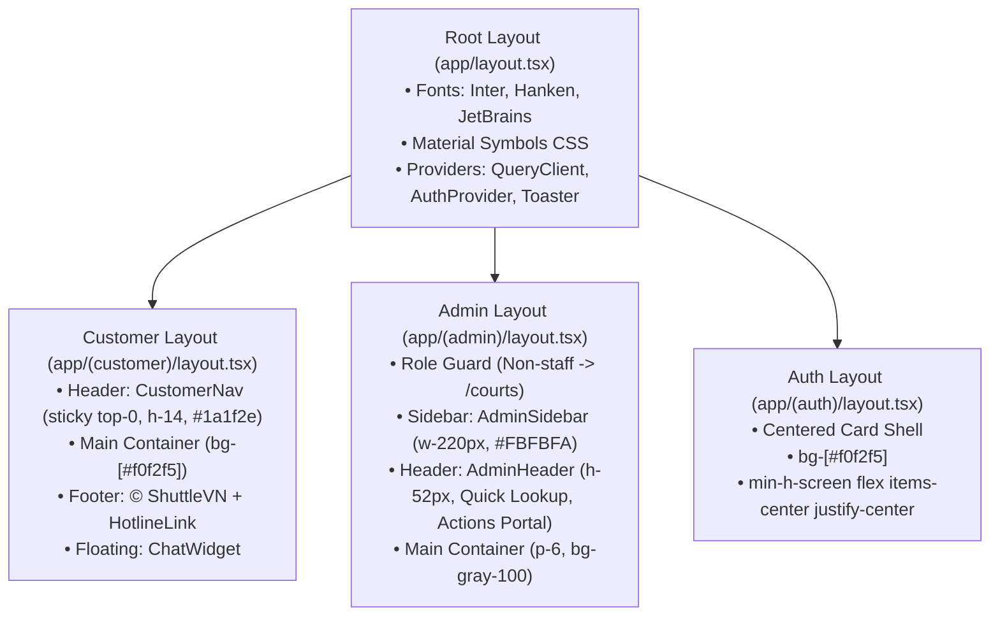

# BÁO CÁO KHẢO SÁT HIỆN TRẠNG FRONTEND (FRONTEND DISCOVERY)
## Hệ thống Quản lý và Đặt sân Cầu lông Trực tuyến ShuttleVN

* **Dự án:** ShuttleVN (Hệ thống quản lý sân cầu lông tích hợp Trợ lý AI)
* **Thời điểm khảo sát:** 23/11/2026
* **Phạm vi khảo sát:** Toàn bộ mã nguồn `shuttle-vn-frontend/`, tài liệu kiến trúc, quy chuẩn và giao tiếp API với `ShuttleVNBackend/`.
* **Ràng buộc tuân thủ:** Khảo sát hiện trạng thực tế dựa trên bằng chứng mã nguồn (100% evidence-based), không chỉnh sửa code, không thay đổi logic nghiệp vụ/DTO/database.

---

## 1. TECHNOLOGY STACK (NGĂN XẾP CÔNG NGHỆ)

Căn cứ từ `shuttle-vn-frontend/package.json`, `tsconfig.json`, `next.config.ts`, `tailwind.config.mts`:

### 1.1 Core Framework & Language
| Thành phần | Công nghệ / Phiên bản | Ghi chú & Chi tiết kỹ thuật |
| :--- | :--- | :--- |
| **Framework** | **Next.js `16.2.12`** (Runtime build ghi nhận `16.3.8 Turbopack`) | Kiến trúc **App Router**, cấu hình build `output: "standalone"`, `devIndicators: false`. |
| **Thư viện UI Core** | **React `19.2.8`** & **React DOM `19.2.8`** | Tương thích chuẩn React 19 Client Components (`"use client"`) và Server Components. |
| **Ngôn ngữ** | **TypeScript `^5`** | Cấu hình `strict: true`, target `ES2017`, moduleResolution `bundler`, Path alias `@/* -> ./src/*`. |

### 1.2 Styling & Typography Solution
| Thành phần | Công nghệ / Phiên bản | Hiện trạng triển khai |
| :--- | :--- | :--- |
| **CSS Engine** | **Tailwind CSS `^4.3.3`** | Tích hợp qua `@tailwindcss/postcss` (`^4.3.3`) & PostCSS (`^8.5.26`). File gốc `src/app/globals.css` dùng cú pháp `@import "tailwindcss"; @config "../../tailwind.config.mts";`. |
| **Tiện ích Class** | **clsx `^2.1.1`** & **tailwind-merge `^2.5.3`** | Đóng gói qua hàm `cn(...inputs)` tại `src/utils/index.ts` để merge dynamic classes. |
| **Bảng màu (Colors)** | Tailwind default `emerald-*` | *Hiện trạng đặc biệt:* `tailwind.config.mts` khai báo thang `primary-*` (`#22c55e`...), nhưng toàn bộ components thực tế sử dụng thang màu mặc định `emerald-*` (`emerald-500`, `emerald-600`...). |
| **Typography** | `next/font/google` | 3 font chính được nạp biến CSS qua `RootLayout`: <br>• `--font-inter`: `Inter` (`font-sans` - văn bản chung, form, bảng)<br>• `--font-hanken`: `Hanken_Grotesk` (`font-display` - tiêu đề trang, logo)<br>• `--font-jetbrains`: `JetBrains_Mono` (`font-mono` - mã đơn, giờ, giá, badge) |
| **Icons** | **Google Material Symbols Outlined** | Nạp qua `<link>` trong `head` của `src/app/layout.tsx`. Nút bấm dùng cú pháp `<span className="material-symbols-outlined">icon_name</span>`. Thư viện `lucide-react` (`^0.447.0`) có trong `package.json` nhưng gần như không dùng. |

### 1.3 State Management & Data Fetching
| Thành phần | Thư viện / Phiên bản | Mục đích & Chi tiết triển khai |
| :--- | :--- | :--- |
| **Server State** | **@tanstack/react-query `^5.56.2`** | Quản lý cache, đồng bộ dữ liệu máy chủ. Cấu hình singleton `QueryClient` (`staleTime: 2m`, `gcTime: 10m`, `retry: 1`, `refetchOnWindowFocus: false`). Đi kèm `@tanstack/react-query-devtools`. |
| **Client Global State** | **Zustand `^5.0.0`** | Quản lý state toàn cục nhẹ phía client qua 2 stores:<br>1. `auth.store.ts`: Lưu phiên đăng nhập `AuthUser`, vai trò `UserRole`, trạng thái xác thực `isAuthenticated`, `isLoading`.<br>2. `booking-cart.store.ts`: Giỏ hàng lưu tạm thời các slot đặt sân trong bộ nhớ. |
| **HTTP Client** | **Axios `^1.7.7`** | Cấu hình tại `src/lib/axios.ts` (`baseURL: "/api"`, `timeout: 15000`, `withCredentials: true`). Tự động đính kèm `X-CSRF-TOKEN` từ cookie `XSRF-TOKEN` cho các method `POST`, `PUT`, `PATCH`, `DELETE`. Tự động logout và điều hướng về `/login` khi nhận mã lỗi 401 (ngoại trừ các endpoint exempt). |
| **AI Streaming** | Native **`fetch` + ReadableStream** | Tầng `chat.service.ts` gọi `POST /api/assistant/chat/stream` qua Server-Sent Events (SSE) để stream phản hồi AI từng chunk văn bản. |

### 1.4 Form Handling, Validation & Data Tools
| Thành phần | Thư viện / Phiên bản | Vai trò |
| :--- | :--- | :--- |
| **Form Controller** | **React Hook Form `^7.53.0`** | Quản lý trạng thái form không gây re-render dư thừa. |
| **Schema Validation** | **Zod `^3.23.8`** + **@hookform/resolvers `^3.9.0`** | Kiểm định toàn bộ dữ liệu nhập phía client trước khi gửi lên API (email chuẩn RFC, SĐT 8-15 ký tự, password 8-128 ký tự). |
| **Notifications** | **Sonner `^1.5.0`** | Hiển thị Toast thông báo ở góc trên bên phải (`top-right`, thời gian 3s). |
| **Charts** | **Recharts `^2.12.7`** | Vẽ biểu đồ cột doanh thu theo ngày/tháng trong phân hệ Báo cáo & Thống kê. |
| **Date Utilities** | **date-fns `^4.1.0`** | Xử lý chênh lệch ngày, định dạng ngày tháng. |
| **Image Optimization**| **sharp `^0.35.3`** | Xử lý tối ưu ảnh phía server của Next.js. |

---

## 2. ROUTE INVENTORY (DANH MỤC TUYẾN ĐƯỜNG)

Kết quả biên dịch từ lệnh `next build` và cấu trúc thư mục `src/app/`:

| URL Path | File mã nguồn (`page.tsx`) | Route Group | Kiểu Render | Quyền truy cập (`RoleGuard` / Logic) |
| :--- | :--- | :--- | :--- | :--- |
| `/` | `src/app/page.tsx` | Root | Static (`○`) | Chuyển hướng tự động (`redirect('/courts')`) |
| `/login` | `src/app/(auth)/login/page.tsx` | `(auth)` | Static (`○`) | Công khai (Đã đăng nhập được chuyển hướng) |
| `/register` | `src/app/(auth)/register/page.tsx` | `(auth)` | Static (`○`) | Công khai |
| `/set-password` | `src/app/(auth)/set-password/page.tsx` | `(auth)` | Dynamic (`ƒ`) | Công khai (Kích hoạt tài khoản từ email qua query token) |
| `/courts` | `src/app/(customer)/courts/page.tsx` | `(customer)` | Static (`○`) | Công khai (Khách hàng & Vãng lai xem lưới sân) |
| `/booking` | `src/app/(customer)/booking/page.tsx` | `(customer)` | Static (`○`) | Thành viên đã đăng nhập |
| `/booking/guest` | `src/app/(customer)/booking/guest/page.tsx` | `(customer)` | Static (`○`) | Công khai (Khách vãng lai đặt nhanh kèm OTP) |
| `/my-bookings` | `src/app/(customer)/my-bookings/page.tsx` | `(customer)` | Static (`○`) | Thành viên (`Customer`) |
| `/lookup` | `src/app/(customer)/lookup/page.tsx` | `(customer)` | Static (`○`) | Công khai (Tra cứu đơn bằng mã + SĐT/Email) |
| `/profile` | `src/app/(customer)/profile/page.tsx` | `(customer)` | Static (`○`) | Thành viên (`Customer`, `Employee`, `Admin`) |
| `/dashboard` | `src/app/(admin)/dashboard/page.tsx` | `(admin)` | Static (`○`) | Chỉ `Admin` |
| `/booking-requests` | `src/app/(admin)/booking-requests/page.tsx`| `(admin)` | Static (`○`) | `Admin` & `Employee` |
| `/bookings/[id]` | `src/app/(admin)/bookings/[id]/page.tsx` | `(admin)` | Dynamic (`ƒ`) | `Admin` & `Employee` |
| `/all-bookings` | `src/app/(admin)/all-bookings/page.tsx` | `(admin)` | Dynamic (`ƒ`) | Chỉ `Admin` |
| `/schedule` | `src/app/(admin)/schedule/page.tsx` | `(admin)` | Static (`○`) | `Admin` & `Employee` |
| `/payments` | `src/app/(admin)/payments/page.tsx` | `(admin)` | Static (`○`) | `Admin` & `Employee` |
| `/manage-courts` | `src/app/(admin)/manage-courts/page.tsx` | `(admin)` | Static (`○`) | Chỉ `Admin` (Sidebar đã lọc, Header lọc) |
| `/customers` | `src/app/(admin)/customers/page.tsx` | `(admin)` | Static (`○`) | `Admin` & `Employee` |
| `/customers/[id]` | `src/app/(admin)/customers/[id]/page.tsx` | `(admin)` | Dynamic (`ƒ`) | `Admin` & `Employee` |
| `/employees` | `src/app/(admin)/employees/page.tsx` | `(admin)` | Static (`○`) | Chỉ `Admin` |
| `/statistics` | `src/app/(admin)/statistics/page.tsx` | `(admin)` | Static (`○`) | Chỉ `Admin` |
| `/audits` | `src/app/(admin)/audits/page.tsx` | `(admin)` | Static (`○`) | Chỉ `Admin` |

### Quy tắc Middleware & Proxy (`src/proxy.ts`):
* Chạy dưới dạng Proxy (Middleware) của Next.js 16.
* Nhận diện cookie `shuttlevn.auth`.
* Cho phép các đường dẫn công khai (`PUBLIC_PATHS`): `/login`, `/register`, `/set-password`, `/courts`, `/lookup`, `/booking/guest`.
* Nếu người dùng chưa đăng nhập cố tình truy cập các đường dẫn khác, tự động chuyển hướng về `/courts`.

---

## 3. SCREEN INVENTORY (DANH MỤC MÀN HÌNH)

Chi tiết 22 màn hình hiện hữu theo đối tượng người dùng:

### 3.1 Phân hệ Xác thực & Tài khoản (Auth)
1. **Màn hình Đăng nhập (`/login`):**
   * *Component:* `LoginForm.tsx`
   * *Mô tả:* Nhập Email và Mật khẩu (có toggle hiện/ẩn). Xử lý banner cảnh báo tài khoản bị khóa do nhập sai 5 lần (`BR-12`), banner tài khoản chờ kích hoạt (`PendingActivation` - mã lỗi 403) kèm nút gửi lại liên kết kích hoạt.
2. **Màn hình Đăng ký (`/register`):**
   * *Component:* `RegisterForm.tsx`
   * *Mô tả:* Đăng ký tài khoản khách hàng thành viên (Họ tên, SĐT 8-15 số, Email, Mật khẩu 8-128 ký tự). Có nút gửi mã xác minh email (OTP) trực tiếp trên form.
3. **Màn hình Đặt mật khẩu kích hoạt (`/set-password`):**
   * *Component:* `SetPasswordForm.tsx`, `ResendSetupLinkButton.tsx`
   * *Mô tả:* Đón nhận query `token` và `email` từ đường dẫn trong email kích hoạt do nhân viên tạo cho khách hàng. Xóa token khỏi thanh URL ngay khi nạp để bảo mật; hỗ trợ nút gửi lại email kích hoạt nếu token hết hạn.

### 3.2 Phân hệ Khách hàng (Customer Portal)
4. **Màn hình Lưới sân & Chọn slot (`/courts`):**
   * *Component:* `CourtsClient.tsx`, `CourtGrid.tsx`, `CourtSlotCell.tsx`, `SlotPopup.tsx`, `CustomDatePicker.tsx`
   * *Mô tả:* Lưới ma trận thời gian thực (34 khung giờ x số lượng sân). Hỗ trợ xem trạng thái slot (Trống, Đã đặt, Đóng/Quá giờ). Nhấp ô slot sẽ mở popup chọn thời lượng (60/90/120/150/180 phút), hiển thị giá tạm tính từ API server và điều hướng sang trang xác nhận. Lưới tự động refetch mỗi 30 giây.
5. **Màn hình Xác nhận đặt sân cho Thành viên (`/booking`):**
   * *Component:* `member-booking-client.tsx`, `ReservationForm.tsx`
   * *Mô tả:* Tóm tắt thông tin sân, khung giờ và báo giá từ server (`quoteFingerprint`). Khách hàng xác nhận để tạo đơn đặt sân chính thức.
6. **Màn hình Đặt sân nhanh cho Khách vãng lai (`/booking/guest`):**
   * *Component:* `guest-booking-client.tsx`, `ReservationForm.tsx (guest=true)`
   * *Mô tả:* Dành cho khách chưa có tài khoản. Yêu cầu nhập Họ tên, SĐT, Email và xác thực OTP gửi qua email trước khi hoàn tất đặt sân.
7. **Màn hình Lịch sử đặt sân (`/my-bookings`):**
   * *Component:* `BookingHistoryList.tsx`, `BookingCard.tsx`, `BookingListToolBar.tsx`, `RescheduleBookingModal.tsx`
   * *Mô tả:* Xem danh sách đơn của thành viên theo tab trạng thái (`Pending`, `Confirmed`, `Completed`, `Cancelled`). Cho phép xem chi tiết, xem thông tin thanh toán, thực hiện Hủy đơn hoặc Đổi lịch (trước giờ bắt đầu ít nhất 1 giờ và đơn chưa thanh toán).
8. **Màn hình Tra cứu đơn (`/lookup`):**
   * *Component:* `LookupClient.tsx`, `BookingLookupForm.tsx`, `BookingLookupResult.tsx`
   * *Mô tả:* Cho phép khách tra cứu trạng thái đơn bằng Mã đơn `DS-XXXXX` kết hợp SĐT hoặc Email. Hiển thị thông tin tóm tắt và hướng dẫn liên hệ hotline nếu cần đổi/hủy.
9. **Màn hình Hồ sơ cá nhân (`/profile`):**
   * *Component:* `ProfileClient.tsx`, `ProfileInfoForm.tsx`, `ChangePasswordForm.tsx`, `ProfileSidebar.tsx`
   * *Mô tả:* Cập nhật Họ tên, SĐT (Email bị khóa cố định); tab Đổi mật khẩu (yêu cầu mật khẩu cũ, mật khẩu mới 8-128 ký tự).
10. **Trợ lý AI nổi toàn site (`ChatWidget`):**
    * *Component:* `ChatWidget.tsx`, `ChatPanel.tsx`, `ChatMessageItem.tsx`, `ChatQuickPrompts.tsx`
    * *Mô tả:* Nút tròn góc phải dưới ở Cổng khách hàng. Hỗ trợ tư vấn giờ trống, hướng dẫn đặt sân và chính sách giá thông qua stream SSE với backend.

### 3.3 Phân hệ Quản trị & Vận hành (Admin & Staff Portal)
11. **Bảng điều khiển Quản trị (`/dashboard` - Admin):**
    * *Component:* `DashboardClient.tsx`, `DashboardStats.tsx`, `BookingDetailModal.tsx`
    * *Mô tả:* Hiển thị 3 chỉ số then chốt (Doanh thu hôm nay, Đơn chờ duyệt, Lượt sân đặt trong ngày) và danh sách các đơn đặt sân cần xử lý gấp (xếp theo giờ chơi gần nhất).
12. **Tiếp nhận Yêu cầu đặt sân (`/booking-requests` - Admin & Nhân viên):**
    * *Component:* `BookingRequestsClient.tsx`, `ConfirmBookingModal.tsx`, `RejectBookingModal.tsx`, `BookingDetailModal.tsx`
    * *Mô tả:* Bảng danh sách các đơn `Pending` xếp theo thứ tự cũ nhất trước. Cung cấp các nút Xác nhận (chọn đã thu tiền/chưa thu tiền), Từ chối (nhập lý do), hoặc Xem chi tiết.
13. **Chi tiết đơn & Xử lý nghiệp vụ (`/bookings/[id]` - Admin & Nhân viên):**
    * *Component:* `BookingDetailClient.tsx`, `BookingDetailView.tsx`, `ConfirmBookingModal.tsx`, `RejectBookingModal.tsx`, `RescheduleBookingModal.tsx`, `ConfirmDialog.tsx`
    * *Mô tả:* Màn hình chuyên sâu quản lý vòng đời đơn: dòng thời gian lịch sử trạng thái, thông tin giá từng mốc, hóa đơn liên quan. Cho phép Xác nhận, Từ chối, Đổi lịch thay khách, hoặc Ghi nhận hoàn thành lượt chơi.
14. **Theo dõi Đặt sân toàn hệ thống (`/all-bookings` - Admin):**
    * *Component:* `AllBookingsClient.tsx`, `BookingDetailModal.tsx`
    * *Mô tả:* Bảng dữ liệu tra cứu toàn bộ đơn trong hệ thống với bộ lọc đa tiêu chí: Từ ngày - Đến ngày, Sân, Trạng thái đơn, Khách hàng, Từ khóa tìm kiếm.
15. **Lịch sân vận hành (`/schedule` - Admin & Nhân viên):**
    * *Component:* `ScheduleClient.tsx`, `CourtGrid.tsx`, `CustomDatePicker.tsx`
    * *Mô tả:* Xem ma trận lịch sân theo ngày ở chế độ vận hành (read-only grid), hiển thị chi tiết thông tin đơn trên từng slot.
16. **Hóa đơn & Thu tiền (`/payments` - Admin & Nhân viên):**
    * *Component:* `InvoiceList.tsx`, `InvoiceEvidence.tsx`, `InvoicePaymentForm.tsx`
    * *Mô tả:* Quản lý danh sách hóa đơn `HD-{yyyyMMdd}-{seq}`, lọc theo mã hoặc trạng thái (`Unpaid`, `Paid`, `Cancelled`, `Refunded`). Mở chi tiết chứng cứ thu tiền, xác nhận thu tiền đủ qua `PATCH /api/invoices/{id}/pay`, và tra cứu lịch sử chuỗi hóa đơn thay thế.
17. **Quản lý sân & Bảng giá (`/manage-courts` - Admin):**
    * *Component:* `ManageCourtsClient.tsx`, `CourtStats.tsx`, `CourtTable.tsx`, `CourtCardGrid.tsx`, `CourtFormModal.tsx`, `CourtStatusModal.tsx`, `CourtOperationsModal.tsx`, `PricingTimeline.tsx`
    * *Mô tả:* Chuyển đổi giữa chế độ xem Thẻ/Danh sách; tạo sân mới; chỉnh sửa thông tin sân; đổi trạng thái hoạt động (Hoạt động / Bảo trì / Đóng); cấu hình lịch mở cửa và dòng thời gian phân bổ bảng giá 7 ngày trong tuần qua thanh kéo `PricingTimeline`.
18. **Quản lý Khách hàng (`/customers` - Admin & Nhân viên):**
    * *Component:* `CustomersClient.tsx`, `CustomerFormModal.tsx`
    * *Mô tả:* Danh bạ khách hàng kèm tìm kiếm debounced (tên, SĐT, email). Nút thêm khách hàng mới (tạo tài khoản `PendingActivation` và gửi email kích hoạt).
19. **Hồ sơ chi tiết Khách hàng (`/customers/[id]` - Admin & Nhân viên):**
    * *Component:* `CustomerDetailClient.tsx`, `CustomerProfileForm.tsx`, `CustomerAccountCard.tsx`, `CustomerBookingsCard.tsx`
    * *Mô tả:* Xem thông tin cá nhân khách, trạng thái tài khoản (Active, Disabled), các nút Khóa/Mở khóa tài khoản khách, và bảng lịch sử đặt sân của riêng khách hàng đó.
20. **Quản lý Nhân viên (`/employees` - Admin):**
    * *Component:* `EmployeesClient.tsx`, `EmployeeFormModal.tsx`, `ConfirmDialog.tsx`
    * *Mô tả:* Danh sách nhân viên, thống kê số lượng nhân viên hoạt động / quản trị viên; form thêm nhân viên mới (tạo tài khoản và mật khẩu trực tiếp); sửa thông tin; khóa/mở khóa tài khoản; xóa nhân viên.
21. **Báo cáo & Thống kê (`/statistics` - Admin):**
    * *Component:* `StatisticsClient.tsx`, `RevenueReportView.tsx`, `RevenueReportTable.tsx`, `RevenueChart.tsx`, `CourtUsageReportView.tsx`, `CourtUsageTable.tsx`, `ReportSection.tsx`
    * *Mô tả:* Lọc theo khoảng ngày và nhóm theo Ngày/Tháng. Báo cáo doanh thu chỉ tính trên các hóa đơn `Paid` theo thời điểm thu (kèm biểu đồ Recharts BarChart). Báo cáo tần suất sử dụng sân tính theo số giờ và lượt đặt không bị hủy.
22. **Nhật ký hoạt động (`/audits` - Admin):**
    * *Component:* `AuditsClient.tsx`, `loading.tsx`
    * *Mô tả:* Bảng nhật ký kiểm toán hệ thống chỉ đọc, bất biến. Cho phép lọc theo khoảng thời gian, tác nhân (`System`, `Employee`, `Customer`), thao tác (`Added`, `Modified`, `Deleted`), và tên đối tượng; hiển thị trực quan giá trị Trước → Sau.

---

## 4. COMPONENT INVENTORY (DANH MỤC THÀNH PHẦN GIAO DIỆN)

### 4.1 Thư viện UI cơ bản (Base / Atomic UI - `src/components/ui/`)
* **`Button.tsx`:** Nút bấm đa dụng hỗ trợ 3 biến thể (`primary`, `outline`, `ghost`), 3 kích cỡ (`sm`, `md`, `lg`), tự động hiển thị spinner khi `loading={true}`. *Lưu ý:* Mặc định mang class `w-full`.
* **`Badge.tsx`:** Nhãn trạng thái dạng viên (`rounded-full`) với màu sắc ngữ nghĩa ánh xạ cho Booking (`Pending`, `Confirmed`, `Completed`, `Cancelled`), Invoice (`Unpaid`, `Paid`, `Cancelled`, `Refunded`), Court (`Active`, `Maintenance`, `Closed`), và Account (`Active`, `Disabled`, `PendingActivation`).
* **`Card.tsx`:** Khung thẻ trắng bo góc `rounded-[14px]` kèm đổ bóng nhẹ `shadow-[0_4px_24px_rgba(0,0,0,0.07)]`.
* **`Input.tsx`:** Ô nhập liệu hỗ trợ icon đầu vào, tự động sinh nút con mắt Hiện/Ẩn khi `type="password"`, tự hiển thị thông báo lỗi bên dưới ô.
* **`Label.tsx`:** Nhãn input viết hoa `font-mono text-[11px] font-semibold text-gray-500`, hỗ trợ thuộc tính `required` hiển thị dấu hoa thị `*` đỏ.
* **`ConfirmDialog.tsx`:** Hộp thoại xác nhận hành động nguy hiểm (`warning`, `danger`) với backdrop xám mờ `z-[110]`.
* **`CustomDatePicker.tsx`:** Popover chọn ngày dạng lịch bàn cờ, hiển thị thứ ngày Việt Nam (`T2, 23/11/2026`), có nút quay lại "Hôm nay".
* **`Pagination.tsx`:** Điều khiển phân trang server-side chuẩn, gồm thống kê `X-Y / Tổng`, nút Trước/Sau và hiển thị trang hiện tại.
* **`HotlineLink.tsx`:** Component render số hotline chuẩn hóa lấy từ cấu hình `APP_CONFIG.hotline`.
* **`LoginButton.tsx` & `UserMenu.tsx`:** Nút đăng nhập và menu thả người dùng (chứa avatar chữ cái đầu, link Hồ sơ, Lịch sử, Đăng xuất) trên thanh điều hướng.

### 4.2 Thành phần Layout (`src/components/layout/`)
* **`CustomerNav.tsx`:** Thanh header cổng khách hàng nền tối `#1a1f2e`, `sticky top-0 z-50`, chứa Logo, các liên kết điều hướng và `UserMenu`.
* **`AdminSidebar.tsx`:** Thanh menu bên trái cổng quản trị (`w-[220px]`, nền `#FBFBFA`, viền phải `#EAEAEA`), hỗ trợ lọc động các mục menu theo vai trò người dùng (`Admin` thấy 10 mục, `Employee` thấy 4 mục).
* **`AdminHeader.tsx`:** Thanh topbar quản trị (`h-[52px]`), hiển thị tiêu đề trang động, nút mở `QuickLookupModal` và khu vực portal `#admin-header-actions` để các trang nhúng nút thao tác (Thêm sân, Thêm nhân viên...).
* **`auth-provider.tsx`:** Provider bọc toàn app, tự động gọi `authService.getProfile()` khi khởi động để nạp dữ liệu phiên vào `useAuthStore`.

### 4.3 Thành phần Nghiệp vụ Miền (Domain Components)
* **Đặt sân & Lưới sân (`src/components/court/`, `src/components/booking/`):**
  * `CourtGrid.tsx`: Bảng ma trận 34 khung giờ x sân, tính toán tỷ lệ cuộn ngang qua con lăn chuột.
  * `CourtSlotCell.tsx`: Ô slot đơn lẻ với tối ưu hóa rendering `content-visibility: auto; contain-intrinsic-size: 72px 56px;`.
  * `SlotPopup.tsx`: Popover nổi định vị theo tọa độ pixel của ô slot để chọn thời lượng.
  * `ReservationForm.tsx`: Form xác nhận đặt sân dùng chung cho cả thành viên và khách vãng lai.
  * `BookingCard.tsx`: Thẻ hiển thị đơn đặt sân trong danh sách lịch sử của khách hàng.
  * `QuickLookupModal.tsx` & `QuickLookupResults.tsx`: Modal tra cứu nhanh dành cho nhân viên tại quầy.
* **Quản trị Sân & Bảng giá (`src/components/admin/`):**
  * `PricingTimeline.tsx`: Thanh slider 2 đầu mút trực quan để kéo/thả mốc giờ và chia khung giá sân.
  * `CourtTable.tsx` & `CourtCardGrid.tsx`: Hai chế độ hiển thị danh sách sân.
  * `CourtStats.tsx`: Thẻ đếm số lượng sân đang hoạt động / bảo trì.
  * `RevenueChart.tsx`: Biểu đồ BarChart thống kê doanh thu.
* **Thanh toán & Hóa đơn (`src/components/payment/`):**
  * `InvoiceList.tsx`: Bảng hóa đơn phân trang với tìm kiếm theo mã và trạng thái.
  * `InvoiceEvidence.tsx`: Hiển thị chi tiết chứng từ thanh toán, phương thức thu, nhân viên thực hiện.
  * `InvoicePaymentForm.tsx`: Form thu tiền hóa đơn (Tiền mặt / Chuyển khoản) với kiểm tra `Idempotency-Key`.
* **Trợ lý AI (`src/components/chatbot/`):**
  * `ChatWidget.tsx`: Nút tròn nổi kích hoạt khung chat.
  * `ChatPanel.tsx`: Khung giao diện trò chuyện chứa banner bảo đảm thông tin, danh sách tin nhắn và input nhập liệu.
  * `ChatMessageItem.tsx`: Render từng bong bóng chat của khách và trợ lý (hỗ trợ hiển thị trạng thái gọi tool tìm kiếm).
  * `ChatQuickPrompts.tsx`: Các chip gợi ý câu hỏi nhanh (Hướng dẫn đặt sân, Giá theo giờ, Giờ trống).

### 4.4 Danh mục Modals / Dialogs Nghiệp vụ
| Tên Component | Mục đích nghiệp vụ | Quyền |
| :--- | :--- | :--- |
| `BookingDetailModal.tsx` | Xem chi tiết toàn diện đơn đặt sân, thông tin khách, mốc giá, timeline trạng thái | Admin / Nhân viên |
| `ConfirmBookingModal.tsx` | Xác nhận duyệt đơn `Pending` (chọn Đã thu tiền / Chưa thu tiền) | Admin / Nhân viên |
| `RejectBookingModal.tsx` | Từ chối đơn `Pending` (bắt buộc nhập lý do) | Admin / Nhân viên |
| `RescheduleBookingModal.tsx` | Xem báo giá chênh lệch và thực hiện đổi lịch sân (thành viên hoặc nhân viên làm thay) | Thành viên / Nhân viên |
| `CourtFormModal.tsx` | Thêm mới hoặc chỉnh sửa tên/mô tả sân | Admin |
| `CourtStatusModal.tsx` | Chuyển đổi trạng thái hoạt động của sân (Hoạt động / Bảo trì / Đóng) | Admin |
| `CourtOperationsModal.tsx` | Thiết lập giờ mở cửa và bảng giá theo 7 ngày trong tuần | Admin |
| `EmployeeFormModal.tsx` | Thêm mới tài khoản nhân viên hoặc sửa hồ sơ nhân viên | Admin |
| `CustomerFormModal.tsx` | Thêm khách hàng mới và kích hoạt gửi email đặt mật khẩu | Admin / Nhân viên |
| `QuickLookupModal.tsx` | Tra cứu nhanh đơn đặt sân bằng số điện thoại, mã đơn, tên khách | Admin / Nhân viên |

---

## 5. LAYOUT INVENTORY (DANH MỤC KHUNG GIAO DIỆN)

Ứng dụng chia làm 4 cấp độ Layout:



### 5.1 Quy chuẩn Bề rộng Khung hiển thị (Max-width Standards)
* **Lưới sân khách hàng (`/courts`):** `max-w-[1400px] mx-auto px-7 py-6` (tối ưu không gian cuộn ngang 34 ô slot).
* **Lịch sử đặt sân & Hồ sơ cá nhân (`/my-bookings`, `/profile`):** `max-w-[960px] mx-auto px-7 py-7`.
* **Tra cứu đơn (`/lookup`):** `max-w-[560px] mx-auto px-4 py-10`.
* **Vùng nội dung quản trị (`(admin)/*`):** `flex-1 p-6 overflow-auto` (co giãn theo toàn bộ bề rộng màn hình làm việc sau khi trừ 220px sidebar).

---

## 6. API INTEGRATION OVERVIEW (TỔNG QUAN TÍCH HỢP API)

### 6.1 Cơ chế Kết nối & Bảo mật
* **Proxy Rewrite:** Được cấu hình trong `next.config.ts`:
  ```typescript
  async rewrites() {
    const backendUrl = process.env.NEXT_PUBLIC_API_BASE_URL?.replace(/\/$/, "");
    return backendUrl ? [{ source: "/api/:path*", destination: `${backendUrl}/:path*` }] : [];
  }
  ```
  Giúp trình duyệt gửi request tới cùng domain frontend (`/api/...`), giải quyết triệt để vấn đề CORS và chặn cookie bên thứ ba.
* **Xác thực Cookie (HttpOnly):** Sử dụng cookie tên `shuttlevn.auth`. Mọi request Axios tự động gửi kèm cookie nhờ `withCredentials: true`.
* **Bảo vệ CSRF:** Axios request interceptor đọc cookie `XSRF-TOKEN` và tự động gắn vào header `X-CSRF-TOKEN` cho mọi request thay đổi dữ liệu (`POST`, `PUT`, `PATCH`, `DELETE`).
* **Bảo vệ Trùng lặp Giao dịch (Idempotency):** Các mutation quan trọng (`createBooking`, `cancelBooking`, `rescheduleBooking`, `confirmBooking`, `payInvoice`, `completeBooking`) đều truyền header `Idempotency-Key` với giá trị UUID ngẫu nhiên để chống submit 2 lần do mạng chập chờn.

### 6.2 Bảng tổng hợp Endpoints theo Domain Service

| Domain Service | Endpoint API Backend | HTTP Method | Mục đích | Headers / Params đặc thù |
| :--- | :--- | :---: | :--- | :--- |
| **`authService`** | `/api/auth/login` | `POST` | Đăng nhập tài khoản | Body: `LoginRequest` |
| | `/api/auth/register` | `POST` | Đăng ký thành viên | Body: `RegisterRequest` |
| | `/api/auth/issue-code` | `POST` | Gửi mã OTP xác minh email | Body: `IssueCodeRequest` |
| | `/api/auth/logout` | `POST` | Đăng xuất xóa phiên cookie | — |
| | `/api/auth/me` | `GET` | Lấy thông tin tài khoản hiện tại | Cookie `shuttlevn.auth` |
| | `/api/profile` | `PUT` | Cập nhật họ tên, số điện thoại | Body: `UpdateProfileRequest` |
| | `/api/auth/set-password` | `POST` | Đặt mật khẩu kích hoạt qua token | Body: `SetPasswordRequest` |
| | `/api/auth/resend-setup-link`| `POST` | Gửi lại liên kết email kích hoạt | Timeout 35s |
| | `/api/profile/change-password`| `PUT`| Đổi mật khẩu | Body: `ChangePasswordRequest` |
| **`courtService`** | `/api/courts` | `GET` | Lấy danh sách toàn bộ sân | Trả về `PaginatedResponse<Court>` |
| | `/api/courts/{id}` | `GET` | Xem chi tiết 1 sân | — |
| | `/api/courts/grid` | `GET` | Lấy ma trận slot sân theo ngày | Query: `?date=YYYY-MM-DD` |
| | `/api/courts` | `POST` | Tạo sân mới | Admin |
| | `/api/courts/{id}` | `PATCH` | Cập nhật thông tin sân | Admin |
| | `/api/courts/{id}/status` | `PATCH` | Đổi trạng thái (Active/Maint/Closed) | Admin |
| | `/api/courts/{id}/schedules` | `GET` | Lấy lịch mở cửa 7 ngày của sân | — |
| | `/api/courts/{id}/schedules/{dow}` | `PUT` | Cập nhật giờ mở cửa ngày cụ thể | `dow`: 0 (CN) -> 6 (T7) |
| | `/api/courts/{id}/pricing-rules` | `GET` | Lấy bảng giá 7 ngày của sân | — |
| | `/api/courts/{id}/pricing-rules/{dow}` | `PUT` | Lưu các khung giá của ngày | Array `PricingRule` |
| **`bookingService`** | `/api/bookings/price-preview` | `GET` | Báo giá trước khi đặt sân | Trả `quoteFingerprint`, `totalCost` |
| | `/api/bookings` | `POST` | Tạo đơn đặt sân cho Thành viên | Header: `Idempotency-Key` |
| | `/api/bookings/quick` | `POST` | Tạo đơn cho Khách vãng lai | Header: `Idempotency-Key` |
| | `/api/bookings/me` | `GET` | Lấy danh sách đơn của tôi | Query: `pageNumber`, `pageSize` |
| | `/api/bookings/{id}` | `GET` | Chi tiết 1 đơn đặt sân | — |
| | `/api/bookings/code/{code}` | `GET` | Tra cứu đơn bằng mã (Frontend gọi) | Ghi chú: Cần backend lookup chuẩn |
| | `/api/bookings/{id}/reschedule-preview` | `GET` | Xem báo giá chênh lệch khi đổi lịch | — |
| | `/api/bookings/{id}/reschedule` | `PATCH` | Đổi ngày/giờ lịch đặt sân | Header: `Idempotency-Key` |
| | `/api/bookings/{id}/cancel` | `PATCH` | Hủy đặt sân | Header: `Idempotency-Key` |
| | `/api/bookings/{id}/invoice` | `GET` | Lấy hóa đơn liên kết của đơn | — |
| **`bookingAdminService`** | `/api/booking-requests` | `GET` | Lấy danh sách đơn `Pending` | Query phân trang, xếp cũ nhất trước |
| | `/api/booking-requests/{id}` | `GET` | Chi tiết đơn phía quản trị | Kèm `statusHistory`, `priceSegments` |
| | `/api/booking-requests/{id}/confirm` | `POST` | Xác nhận duyệt đơn | Header: `Idempotency-Key` |
| | `/api/booking-requests/{id}/reject` | `POST` | Từ chối đơn | Header: `Idempotency-Key` |
| | `/api/booking-requests/{id}/complete` | `POST` | Ghi nhận khách hoàn thành lượt chơi | Header: `Idempotency-Key` |
| | `/api/admin/bookings` | `GET` | Danh sách đặt sân toàn hệ thống | Đa bộ lọc (ngày, sân, status, kw) |
| **`customerService`** | `/api/accounts/customers` | `GET` | Danh sách khách hàng | Query keyword debounced |
| | `/api/accounts/customers/{id}` | `GET` | Chi tiết hồ sơ khách hàng | — |
| | `/api/accounts/customers` | `POST` | Tạo tài khoản khách (chờ kích hoạt) | Timeout 35s |
| | `/api/accounts/customers/{id}` | `PUT` | Sửa họ tên, SĐT khách | — |
| | `/api/accounts/customers/{id}/bookings` | `GET` | Lịch sử đặt sân của khách | Phân trang |
| | `/api/accounts/{id}/lock` | `POST` | Khóa tài khoản khách | Chuyển trạng thái `Disabled` |
| | `/api/accounts/{id}/unlock` | `POST` | Mở khóa tài khoản khách | Reset bộ đếm lỗi về 0 |
| **`employeeService`** | `/api/employees` | `GET` | Danh sách nhân viên | Phân trang |
| | `/api/employees/{id}` | `GET` | Chi tiết nhân viên | — |
| | `/api/employees` | `POST` | Tạo nhân viên mới kèm mật khẩu | Admin |
| | `/api/employees/{id}` | `PUT` | Sửa họ tên, SĐT nhân viên | Admin |
| | `/api/employees/{id}/lock` | `POST` | Khóa tài khoản nhân viên | Admin |
| | `/api/employees/{id}/unlock` | `POST` | Mở khóa nhân viên | Admin |
| | `/api/employees/{id}` | `DELETE` | Xóa nhân viên (chỉ non-admin) | Admin |
| **`invoiceService`** | `/api/invoices` | `GET` | Danh sách hóa đơn | Lọc theo `code`, `status` |
| | `/api/invoices/{id}` | `GET` | Chi tiết hóa đơn và chứng cứ | — |
| | `/api/invoices/{id}/history` | `GET` | Chuỗi lịch sử hóa đơn thay thế | — |
| | `/api/invoices/{id}/pay` | `PATCH` | Thu tiền hóa đơn | Header: `Idempotency-Key` |
| **`dashboardService`**| `/api/admin/dashboard` | `GET` | Lấy 3 chỉ số KPI và đơn gấp | Admin |
| | `/api/admin/statistics/revenue` | `GET` | Báo cáo doanh thu theo kỳ | Query: `fromDate`, `toDate`, `groupBy` |
| | `/api/admin/statistics/court-usage` | `GET` | Báo cáo tần suất sử dụng sân | Query: `fromDate`, `toDate`, `groupBy` |
| **`auditService`** | `/api/audits` | `GET` | Lấy danh sách nhật ký kiểm toán | Query: Actor, Action, Entity, Date |
| **`quickLookupService`**| `/api/quick-lookup` | `GET` | Tra cứu nhanh đa năng | Keyword (mã đơn, SĐT, tên) |
| **`chatService`** | `/api/assistant/chat/stream` | `POST` (SSE) | Trợ lý AI streaming câu trả lời | Đọc luồng `ReadableStream` |

---

## 7. EXISTING FUNCTIONALITY (CHỨC NĂNG QUAN TRỌNG CẦN BẢO TOÀN)

Khi thực hiện redesign UI, các chức năng và quy tắc nghiệp vụ sau **tuyệt đối không được làm thay đổi hoặc phá vỡ**:

1. **Quy tắc Lưới sân & Khung giờ chơi (34 Slots Matrix):**
   * Hoạt động từ 05:00 đến 22:00 cố định (34 slot 30 phút).
   * Lưới tự động làm mới mỗi 30 giây để cập nhật xung đột đặt sân.
   * Ô đã qua giờ trong ngày hôm nay phải bị vô hiệu hóa đặt.
2. **Cơ chế Báo giá An toàn của Máy chủ (Price Preview & Anti-tamper):**
   * Giá không bao giờ được tính nhẩm ở client. Client luôn gọi `/api/bookings/price-preview` để nhận `totalCost` và `quoteFingerprint`.
   * Khi gửi yêu cầu đặt, client gửi kèm `quoteFingerprint`. Nếu giá thay đổi (mã lỗi 409 Conflict), giao diện bắt buộc phải hiển thị báo giá mới để người dùng xác nhận lại trước khi tạo đơn.
3. **Quy tắc Hủy & Đổi lịch đặt sân (1-Hour Rule):**
   * Khách chỉ được tự hủy hoặc đổi lịch khi: Đơn chưa thanh toán (`Unpaid` hoặc chưa có hóa đơn) VÀ thời điểm hiện tại cách giờ bắt đầu ít nhất 1 tiếng (`canRescheduleBooking(booking)`).
   * Đơn đã thanh toán bắt buộc phải hiển thị thông báo yêu cầu liên hệ nhân viên qua hotline để xử lý hoàn tiền ngoài hệ thống.
4. **Vòng đời Đơn & Tự động sinh Hóa đơn:**
   * Trạng thái đơn: `Pending` (Chờ xác nhận) → `Confirmed` (Đã xác nhận) → `Completed` (Hoàn thành) hoặc `Cancelled` (Đã hủy).
   * **Tuyệt đối không có nút tạo hóa đơn thủ công** (Quy tắc `D-07`). Hóa đơn chỉ được hệ thống tự động sinh ra khi đơn chuyển sang `Confirmed` hoặc `Completed`.
   * Đơn `Pending` nhãn thanh toán bắt buộc hiển thị là "Chưa lập hóa đơn" (`NO_INVOICE_LABEL`).
5. **Nghiệp vụ Thu tiền & Hóa đơn thay thế:**
   * Thu tiền phải thu đúng và đủ 100% số tiền trên hóa đơn (không hỗ trợ đặt cọc hay trả góp).
   * Ghi nhận đầy đủ phương thức (Tiền mặt / Chuyển khoản), thời điểm thu và mã định danh nhân viên xác nhận.
6. **Bảo mật Tài khoản & Phân quyền (RBAC):**
   * Phân cấp 3 vai trò nghiêm ngặt: `Customer`, `Employee`, `Admin`.
   * Khóa tài khoản tự động sau 5 lần đăng nhập sai liên tiếp (`BR-12`). Mở khóa bởi nhân viên/admin đưa bộ đếm về 0.
   * Bảo vệ Quản trị viên cuối cùng (`BR-27`): Nghiêm cấm khóa, xóa hoặc hạ quyền tài khoản Quản trị viên `Active` duy nhất còn lại.
7. **Bảo vệ Trợ lý AI (AI Boundary):**
   * Trợ lý AI chỉ mang tính chất tư vấn thông tin công khai (giá tham khảo, giờ trống).
   * AI không có quyền hạn tạo, sửa, hủy đơn hoặc thanh toán thay người dùng.

---

## 8. COMPLEX DATA SURFACES (DỮ LIỆU PHỨC TẠP: BẢNG, BIỂU ĐỒ, LỊCH)

Bảng phân loại các màn hình có thành phần hiển thị dữ liệu phức tạp đòi hỏi sự thận trọng đặc biệt khi tái thiết kế:

| Nhóm dữ liệu | Màn hình áp dụng | File Component | Đặc tính phức tạp cần lưu ý |
| :--- | :--- | :--- | :--- |
| **Ma trận Lưới sân thời gian thực** | `/courts`, `/schedule` | `CourtGrid.tsx`, `CourtSlotCell.tsx` | • Render đồng thời hàng trăm ô slot.<br>• Chuyển đổi con lăn chuột dọc thành cuộn ngang.<br>• Cột tên sân sticky cố định bên trái (`z-[5]`).<br>• CSS Virtualization (`content-visibility: auto`).<br>• Đếm ngược tự động refetch mỗi 30s. |
| **Thanh chia dải giá đa tầng** | `/manage-courts` | `PricingTimeline.tsx` | • Slider 2 đầu mút tùy chỉnh dạng drag & drop.<br>• Chia đoạn thời gian tối thiểu 30 phút.<br>• Phối màu 4 phân đoạn giờ thấp điểm / ban ngày / cao điểm / muộn. |
| **Bảng dữ liệu Đa bộ lọc** | `/all-bookings` | `AllBookingsClient.tsx` | • Bộ lọc đồng thời: Từ ngày - Đến ngày, Dropdown sân, Dropdown trạng thái, Ô tìm kiếm từ khóa debounced.<br>• Phân trang máy chủ 20 bản ghi/trang. |
| **Bảng Kiểm toán Hệ thống** | `/audits` | `AuditsClient.tsx` | • Hiển thị so sánh Before/After (Trước/Sau) của từng trường dữ liệu.<br>• Lọc theo 5 trường metadata. |
| **Bảng Hóa đơn & Chuỗi lịch sử** | `/payments` | `InvoiceList.tsx`, `InvoiceEvidence.tsx` | • Bảng Master-Detail.<br>• Khối `<details>` lồng nhau hiển thị cây phân nhánh các hóa đơn thay thế tiền nhiệm. |
| **Biểu đồ Doanh thu & Báo cáo** | `/statistics` | `StatisticsClient.tsx`, `RevenueChart.tsx` | • Tích hợp thư viện Recharts (BarChart).<br>• Chuyển đổi linh hoạt giữa nhóm Ngày và Tháng.<br>• Xử lý format tiền tệ Việt Nam (`Intl.NumberFormat`). |

---

## 9. TESTING BASELINE (KIỂM TRA CÁC SCRIPTS HỆ THỐNG)

Đã thực hiện kiểm tra thực tế 100% các script trong `shuttle-vn-frontend/package.json`:

```json
"scripts": {
  "dev": "next dev",
  "build": "next build",
  "start": "next start",
  "lint": "next lint",
  "type-check": "tsc --noEmit",
  "check:api-error": "node --disable-warning=MODULE_TYPELESS_PACKAGE_JSON scripts/check-api-error.mjs"
}
```

### Kết quả kiểm định chi tiết:

| Lệnh Script | Lệnh thực thi | Kết quả | Trạng thái chi tiết & Bằng chứng |
| :--- | :--- | :---: | :--- |
| **Type Check** | `npm run type-check` (`tsc --noEmit`) | **PASS (0 errors)** | Exit code `0`. Toàn bộ codebase đạt chuẩn TypeScript 100% không có lỗi kiểu dữ liệu. |
| **API Error Check** | `npm run check:api-error` | **PASS (17/17 cases)** | Exit code `0`. Xác minh toàn bộ 17 trường hợp bóc tách và dịch lỗi tiếng Việt từ backend đều đạt chuẩn. |
| **Lint** | `npm run lint` (`next lint`) | **FAIL (Exit code 1)** | **Lý do kỹ thuật xác thực:** <br>1. Trong Next.js 16 (`next@16.2.12` / Turbopack), lệnh `next lint` đã bị loại bỏ/thay đổi cách phân giải tham số dòng lệnh. CLI Next.js diễn giải từ khóa `lint` thành tên thư mục dự án dẫn đến lỗi: `Invalid project directory provided, no such directory: D:\Shuttle-VN\shuttle-vn-frontend\lint`.<br>2. Thư mục frontend hiện **chưa có file cấu hình ESLint** (`.eslintrc.json` hoặc `eslint.config.js`). |
| **Build** | `npm run build` (`next build`) | **PASS (Exit code 0)** | Exit code `0`. Biên dịch thành công trong 11.9s với Next.js Turbopack; sinh gói Standalone đầy đủ 22 routes tĩnh và động. |
| **Test** | `npm test` | **KHÔNG TỒN TẠI** | **Lý do kỹ thuật xác thực:** Trong `package.json` **không có script `test`**. Quét toàn bộ thư mục `src/` ghi nhận **0 file test** (`*.test.*`, `*.spec.*`). Dự án chưa thiết lập test runner tự động (như Jest hay Vitest). |

---

## 10. CÁC RỦI RO KHI THỰC HIỆN REDESIGN & BIỆN PHÁP PHÒNG NGỪA

Dưới đây là các rủi ro kỹ thuật và nghiệp vụ lớn nhất cần lưu ý khi bắt đầu công việc redesign giao diện:

### 10.1 Rủi ro về Thiết kế UI & CSS Engine (Tailwind v4)
* **Xung đột Thang màu (`primary-*` vs `emerald-*`):** Hiện tại cấu hình `tailwind.config.mts` định nghĩa `primary` là xanh lá lá mạ (`#22c55e`), nhưng 95% components thực tế đang dùng `emerald-*`. Nếu áp dụng redesign bằng class `primary-*` thiếu đồng bộ sẽ gây lệch màu trầm trọng.
* **Vỡ cơ chế Virtualization & Cuộn ngang của Lưới sân (`CourtGrid`):** Lưới sân phụ thuộc vào thuộc tính CSS `content-visibility: auto` và cơ chế biến đổi `wheel deltaY` thành `scrollLeft`. Thay đổi cấu trúc DOM bọc ngoài hoặc overflow có thể làm tê liệt trải nghiệm cuộn mượt hoặc gây lag đơ khi render 340 ô slot.
* **Xung đột Thứ tự Phân lớp (Z-Index Collisions):** Hệ thống có nhiều lớp chồng chéo rất nhạy cảm: SlotPopup (`z-[200]`), ConfirmDialog (`z-[110]`), Modal Admin (`z-[100]`), UserMenu (`z-60`), CustomerNav & ChatWidget (`z-50`), Sticky Table Columns (`z-[5]`, `z-10`). Redesign nếu thay đổi tùy tiện z-index sẽ khiến popup bị chìm dưới lưới hoặc modal bị header che khuất.

### 10.2 Rủi ro về Nghiệp vụ & Hợp đồng Dữ liệu (Business & API Contracts)
* **Nguy cơ tính nhẩm giá phía Client:** Đặt sân cầu lông ShuttleVN phụ thuộc vào phân đoạn giá theo từng phút và thứ trong tuần trên máy chủ. Bất kỳ nỗ lực nào tự tính giá ở giao diện đều sẽ gây lỗi sai lệch tổng tiền hoặc bị server từ chối vì sai `quoteFingerprint`.
* **Mất mát Header `Idempotency-Key`:** Các mutation đổi lịch, hủy đơn, xác nhận đơn và thanh toán đều bắt buộc phải gửi UUID idempotency để ngăn chặn duplicate records khi người dùng click nhanh nhiều lần.
* **Mất Cookie CSRF hoặc Cấu hình Credentials:** Khi chỉnh sửa các hàm gọi API hoặc chuyển đổi HTTP client, nếu quên cấu hình `withCredentials: true` hoặc quên interceptor `X-CSRF-TOKEN`, toàn bộ request ghi dữ liệu sẽ bị backend trả mã lỗi 401/403.
* **Sai lệch Múi giờ (Timezone Bug):** Giờ thi đấu tại sân là giờ Việt Nam (UTC+7). Tránh sử dụng hàm `getTodayISO()` hoặc `Date.toISOString()` lấy theo UTC gốc vì sẽ làm sai lệch ngày trong khung giờ từ 00:00 đến 07:00 sáng.

### 10.3 Rủi ro về Phân quyền & Điều hướng (Routing & RBAC)
* **Rò rỉ giao diện theo Vai trò (Role Leakage):** Nhân viên (`Employee`) và Quản trị viên (`Admin`) dùng chung layout `(admin)` nhưng quyền hạn khác biệt (Nhân viên không được quản lý sân, không được xem bảng điều khiển doanh thu, không được quản lý nhân viên). Phải đảm bảo `AdminSidebar` và các trang luôn được khóa bằng `RoleGuard`.
* **Cơ chế Proxy chuyển tiếp (`src/proxy.ts`):** Các route mới được thêm vào khu vực công khai bắt buộc phải khai báo bổ sung vào `PUBLIC_PATHS` trong `src/proxy.ts`, nếu không người dùng chưa đăng nhập sẽ bị tự động đá văng về `/courts`.

### 10.4 Rủi ro về Thiếu hụt Công cụ Kiểm thử Tự động
* Do dự án **hoàn toàn chưa có hệ thống test tự động (0% unit/integration tests)** và script `npm run lint` đang bị lỗi tương thích với Next.js 16 CLI, mọi thay đổi trong quá trình redesign sẽ chỉ dựa vào `npm run type-check` và kiểm thử thủ công trên trình duyệt. Điều này đặt ra yêu cầu kiểm soát hồi quy (manual regression testing) cực kỳ cẩn trọng đối với từng luồng nghiệp vụ.

---

*Báo cáo được tổng hợp đầy đủ, khách quan, chính xác dựa trên việc quét trực tiếp toàn bộ cây mã nguồn và chạy kiểm thử môi trường thực tế của dự án ShuttleVN.*

