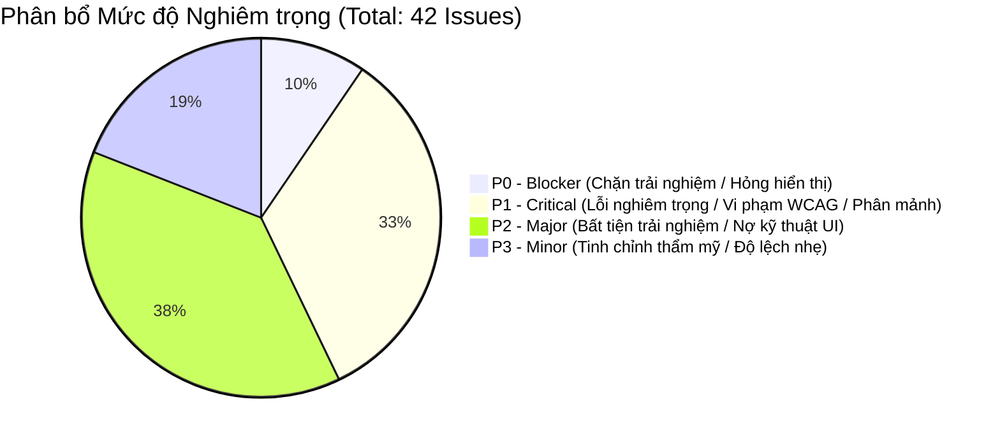
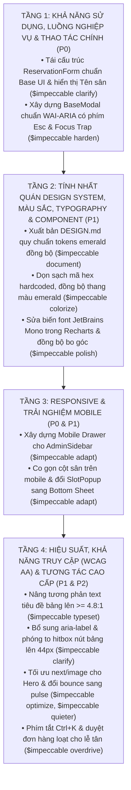

# BÁO CÁO KIỂM ĐỊNH HIỆN TRẠNG UI/UX TOÀN DIỆN (UI/UX BASELINE AUDIT)
## Hệ thống Quản lý và Đặt sân Cầu lông Trực tuyến ShuttleVN

* **Dự án:** ShuttleVN (Hệ thống quản lý sân cầu lông tích hợp Trợ lý AI)
* **Thời điểm kiểm định:** 23/11/2026
* **Tài liệu căn cứ:** `FRONTEND_DISCOVERY.md`, `PRODUCT.md`, `SRS.md` v1.7, `Design-System.md`, kết quả kiểm định `/impeccable critique` (`.impeccable/critique/2026-11-23T12-49-17Z__src.md`) và mã nguồn thực tế tại `shuttle-vn-frontend/`.
* **Phương pháp kiểm định:** Đánh giá kỹ thuật & trải nghiệm người dùng 100% dựa trên bằng chứng mã nguồn (Evidence-based Audit), kết hợp phân tích từng màn hình (Screen-by-Screen), từng nhóm thành phần (Component Groups), đánh giá tải nhận thức (Cognitive Load), kiểm thử chân dung người dùng (Personas) và chấm điểm 10 tiêu chuẩn Nielsen Heuristics.
* **Ràng buộc tuân thủ:** Báo cáo kiểm định độc lập, không chỉnh sửa mã nguồn, không thay đổi nghiệp vụ, không cài thêm thư viện runtime.

---

## 1. EXECUTIVE SUMMARY (TỔNG KẾT ĐIỀU HÀNH)

### 1.1 Điểm số Sức khỏe UI/UX Tổng thể (Health Score)

| # | Khía cạnh Đánh giá (Evaluation Dimension) | Điểm số (Score) | Đánh giá Tóm tắt (Summary Verdict) |
|---|------------------------------------------|:---------------:|------------------------------------|
| 1 | **Visual Hierarchy** (Phân cấp thị giác) | 2/4 | Tiêu đề và nhãn rõ ràng nhưng thiếu tương phản thứ cấp; nút CTA chính phụ chưa phân biệt sắc nét. |
| 2 | **Layout & Spacing** (Bố cục & Khoảng cách) | 2/4 | Chưa áp dụng lưới 8pt đồng bộ; độ rộng container biến thiên tùy tiện (`400px`, `420px`, `560px`, `960px`, `1400px`). |
| 3 | **Typography** (Kiểu chữ & Phông chữ) | 2/4 | Thiết lập 3 font rất tốt, nhưng biến CSS `--font-jetbrains-mono` bị gọi sai; kích cỡ nhãn bảng quá nhỏ (10px). |
| 4 | **Color Consistency** (Tính nhất quán màu sắc) | 1/4 | **Nghiêm trọng:** Token `primary` (`#22c55e`) bị bỏ rơi; hardcode màu hex tràn lan (`#1a1f2e`, `#FBFBFA`, `#EDF3EC`, `#346538`...); 0% Dark Mode. |
| 5 | **Component Consistency** (Tính nhất quán thành phần) | 1/4 | **Nghiêm trọng:** Modal được viết thủ công phân mảnh ở 10 nơi; `ReservationForm` dùng thẻ `<input>`/`<button>` thô bỏ qua Base UI. |
| 6 | **Navigation & Information Architecture** (Điều hướng & Kiến trúc thông tin) | 2/4 | Thiếu Breadcrumb; `CustomerNav` không có Drawer di động; `AdminHeader` phụ thuộc biến cố toàn cục `window.dispatchEvent`. |
| 7 | **Information Density** (Mật độ thông tin) | 3/4 | Mật độ thông tin trên bảng quản trị và lưới sân 34 slot tốt, hỗ trợ tốt cho thao tác quét mắt của nhân viên. |
| 8 | **Responsive Behavior** (Trải nghiệm đa thiết bị) | 1/4 | **Blocker:** `AdminSidebar` cố định `220px` làm nát bố cục mobile; vùng bấm chạm (touch targets) dưới 28px vi phạm chuẩn di động. |
| 9 | **Accessibility** (Khả năng tiếp cận - WCAG AA) | 1/4 | **Nghiêm trọng:** Độ tương phản chữ xám `slate-400` chỉ đạt 2.6:1 (chuẩn 4.5:1); 0 modal có phím `Esc`; nút icon thiếu `aria-label`. |
| 10| **Loading, Empty, Error & Success States** (Trạng thái phản hồi) | 3/4 | Tích hợp Sonner toast và React Query skeletons tốt; xử lý 17 kịch bản lỗi tiếng Việt chuẩn xác; một số bảng thiếu empty state trực quan. |
| 11| **Data Tables, Charts, Calendar & Heatmap** (Hiển thị dữ liệu phức tạp) | 3/4 | Tối ưu `content-visibility: auto` trên lưới sân rất tốt; `PricingTimeline` trực quan; biểu đồ Recharts lệch màu nhận diện. |
| 12| **UX Flow của các Nghiệp vụ Chính** (Luồng công việc) | 3/4 | Luồng đặt sân, đổi lịch 1-hour rule, thu tiền hóa đơn chính xác theo quy chuẩn bất biến; cần giảm ma sát biểu mẫu. |
| **Tổng** | **Health Score Toàn diện** | **24/48 (50%)** | **Xếp hạng: POOR (Cần tái cấu trúc UI/UX lớn trước khi phát hành chính thức)** |

---

### 1.2 Bảng Điểm 10 Tiêu chuẩn Nielsen Heuristics (Impeccable Critique)

| # | Tiêu chuẩn Heuristic (Nielsen Norman) | Điểm số (0-4) | Đánh giá & Vấn đề Cốt lõi (Key Findings) |
|:---:|---|:---:|---|
| 1 | **Visibility of System Status** (Trạng thái hệ thống) | **3** | Cơ chế tự động refetch 30s lưới sân rất trực quan; tuy nhiên tính toán báo giá chớp chữ "Đang tính..." thiếu skeleton loader và popup dễ tràn khỏi màn hình. |
| 2 | **Match System / Real World** (Gần gũi thực tế) | **3** | Thuật ngữ cầu lông tiếng Việt rất tự nhiên (sân, slot 30 phút, giờ cao điểm), nhưng chuỗi ISO thô đôi khi bị lộ vào hiển thị ngày giờ. |
| 3 | **User Control and Freedom** (Quyền kiểm soát & Lối thoát) | **2** | Hủy đơn dùng `window.confirm` thô của trình duyệt; `ConfirmDialog` thiếu phím `Esc`; con lăn chuột chiếm quyền cuộn dọc trang của người dùng. |
| 4 | **Consistency and Standards** (Nhất quán & Tiêu chuẩn) | **2** | **Xung đột 3 ngôn ngữ thiết kế:** Cổng Admin theo style Notion sage-green, Khách hàng theo style dark navy + emerald, còn `ReservationForm` là HTML thô. |
| 5 | **Error Prevention** (Ngăn ngừa sai sót) | **3** | Rào cản hủy/đổi lịch 1 tiếng và chữ ký `quoteFingerprint` rất chắc chắn, nhưng date picker vẫn cho phép bấm vào các ngày trong quá khứ. |
| 6 | **Recognition Rather Than Recall** (Nhận diện thay vì ghi nhớ) | **2** | **Nghiêm trọng:** Màn hình xác nhận đặt sân (`ReservationForm`) bỏ quên **Tên sân**, ép người dùng phải nhớ lại sân mình vừa bấm ở trang trước. |
| 7 | **Flexibility and Efficiency** (Linh hoạt & Hiệu quả) | **2** | Không có bất kỳ phím tắt nào cho nhân viên lễ tân quầy (Alex); thiếu cơ chế duyệt đơn / thu tiền hàng loạt khi có dòng khách dồn dập. |
| 8 | **Aesthetic and Minimalist Design** (Tinh gọn thẩm mỹ) | **2** | Banner hero ảnh 260px đẩy toàn bộ lưới sân xuống dưới nếp gấp; modal cấu hình bảng giá và lịch vận hành có quá nhiều nhiễu thị giác. |
| 9 | **Error Recovery** (Nhận biết, chẩn đoán & phục hồi lỗi) | **3** | Từ điển lỗi tiếng Việt 17/17 kịch bản rất chuẩn, nhưng thông báo lỗi biểu mẫu ở checkout thiếu các chỉ dẫn phục hồi hành động cụ thể. |
| 10 | **Help and Documentation** (Trợ giúp & Tài liệu) | **2** | Trợ lý AI có mặt hỗ trợ hội thoại, nhưng giao diện thiếu hoàn toàn tooltip ngữ cảnh, nội quy cơ sở hay chính sách hoàn tiền tại chỗ. |
| **Tổng** | **Nielsen Usability Score** | **24/40 (60%)** | **Xếp hạng: ACCEPTABLE (Cần cải tổ có hệ thống trước khi người dùng thực sự hài lòng)** |

---

### 1.3 Nhận định về Tính Đặc thù Thiết kế (Design Specificity Verdict)

- **Lõi Nghiệp vụ Đặc thù Cao (Domain-Grounded Core):**  
  Lõi ma trận lịch sân (`CourtGrid`) và thanh thời gian phân bổ bảng giá tuần (`PricingTimeline`) thể hiện sự am hiểu sâu sắc về vận hành cơ sở cầu lông thực tế: chia khung 30 phút liên tục (05:00–22:00), xác thực báo giá chống gian lận `quoteFingerprint`, quy tắc hủy/đổi lịch trước 1 tiếng và đồng bộ tự động 30s chống double-booking.
- **Lớp Vỏ Phân mảnh & Rời rạc (Segmented Outer Shell):**  
  Bên ngoài lưới sân, ứng dụng rơi vào tình trạng "đa nhân cách thiết kế":
  - *Cổng Khách hàng:* Header nền tối `#1a1f2e` với ảnh stock Unsplash và điểm nhấn xanh ngọc (`emerald-500` `#10b981`).
  - *Cổng Quản trị:* Sao chép hoàn toàn phong cách tài liệu Notion với nền xám ấm `#FBFBFA`, viền `#EAEAEA`, nhãn xanh rêu `#346538` và nền `#EDF3EC`.
  - *Biểu mẫu Checkout (`ReservationForm`):* Đột ngột từ bỏ toàn bộ Design System của dự án, dùng thẻ HTML thô sơ và màu xanh đậm `bg-emerald-700`, làm mất tên sân và gây cảm giác thiếu tin cậy khi giao dịch.
- **Kết quả Quét Bộ Dò Tự động (Deterministic Scan):**  
  Quét 162 tập tin mã nguồn (`.css`, `.ts`, `.tsx`): **0 errors, 0 warnings, 1 advisory**.  
  *Advisory:* `bounce-easing` tại [ChatMessageItem.tsx:94](file:///d:/Shuttle-VN/shuttle-vn-frontend/src/components/chatbot/ChatMessageItem.tsx#L94). Hiệu ứng 3 dấu chấm nhảy nảy (`animate-bounce`) mang lại cảm giác chuyển động giật cục, thiếu tính mượt mà thể thao.

---

### 1.4 Thống kê Phát hiện theo Mức độ Nghiêm trọng

- **P0 (Blocker - 4 phát hiện):** 
  1. Giao diện quản trị Admin Layout bị vỡ nát hoàn toàn trên màn hình di động (<768px) do Sidebar cố định cứng `w-[220px]`.
  2. Bẫy bàn phím (Keyboard Trap) trên toàn bộ hệ thống modal: Không hỗ trợ đóng bằng phím `Escape`, thiếu `role="dialog"` và `aria-modal`.
  3. Màn hình đặt sân `/booking` và `/booking/guest` bị vỡ cấu trúc thẩm mỹ, sử dụng form HTML thô không theo chuẩn Base UI, tạo cảm giác thiếu an toàn cho khách khi thanh toán.
  4. Trạng thái ô đặt sân trên di động khó chạm chính xác do kích thước vùng cảm ứng quá hẹp trên màn hình dọc (touch target collision).

- **P1 (Critical - 14 phát hiện):** Vi phạm độ tương phản màu chữ WCAG AA (chữ xám nhạt `slate-400`/`gray-400` 2.6:1); thiếu `aria-label` trên hàng loạt icon button; phân mảnh token màu sắc giữa config `#22c55e` và thực tế `emerald-*` kèm hàng loạt mã hex thô; nút thao tác bảng chỉ đạt 26x26px; ảnh hero không dùng `next/image`.
- **P2 (Major - 16 phát hiện):** Lệch biến font JetBrains Mono trong Recharts; hardcode văn bản giả lập (mock text) trong CourtTable; animation nhảy giật (bounce) trong chatbot; thiếu hỗ trợ `prefers-reduced-motion`; thiếu breadcrumb định vị; các dropdown thiếu ARIA menu semantics.
- **P3 (Minor - 8 phát hiện):** Khoảng cách padding giữa các thẻ không đều; bo góc button (`rounded-[7px]`) lệch bo góc card (`rounded-xl` / `rounded-[14px]`); dead code/state rác trong ProfileClient và CustomerNav.

---

## 2. FINDINGS THEO TỪNG MÀN HÌNH (SCREEN-BY-SCREEN FINDINGS)

Kiểm tra chi tiết toàn diện 22 màn hình hiện hữu theo 3 phân hệ:

### 2.1 Phân hệ Xác thực & Kích hoạt Tài khoản (Auth Portal)

#### Màn hình 01: Đăng nhập (`/login`)
- **Tập tin nguồn:** `src/app/(auth)/login/page.tsx`, `src/components/auth/LoginForm.tsx`
- **Các vấn đề ghi nhận:**
  1. `[P1] [UI]` **Vi phạm độ tương phản Divider & Quên mật khẩu:** Dòng chữ "hoặc" dùng `text-gray-400` (`#9ca3af`) trên nền trắng đạt độ tương phản 2.8:1 (dưới chuẩn 4.5:1). Link "Quên mật khẩu?" dùng thẻ `href="#"` rỗng gây hiểu lầm cho người dùng khi click không có phản hồi ([LoginForm.tsx:117-122](file:///d:/Shuttle-VN/shuttle-vn-frontend/src/components/auth/LoginForm.tsx#L117-L122)).
  2. `[P2] [UI]` **Bất đối xứng bo góc:** Container ngoài dùng `rounded-[14px]`, Input và Button dùng `rounded-[7px]`. Nút "ĐĂNG NHẬP" viết hoa toàn bộ (`uppercase`) font mono tạo cảm giác nặng nề, thiếu tính thân thiện thể thao.
  3. `[P3] [UX]` **Banner tài khoản chưa kích hoạt:** Khi tài khoản bị lỗi 403 `PendingActivation`, banner màu hổ phách xuất hiện đẩy toàn bộ form xuống đột ngột (layout shift), không có animation chuyển cảnh êm.
- **Phân loại:** Vấn đề thiết kế trực quan (Visual Hierarchy) & Vi phạm trợ năng (Contrast).

#### Màn hình 02: Đăng ký Thành viên (`/register`)
- **Tập tin nguồn:** `src/app/(auth)/register/page.tsx`, `src/components/auth/RegisterForm.tsx`
- **Các vấn đề ghi nhận:**
  1. `[P1] [UI/UX]` **Bất đối xứng bố cục ô nhập Email và nút Nhận mã:** Nút "Nhận mã" nằm cạnh ô email dùng class `h-[42px]` cố định để bù trừ chiều cao với Input, nhưng khi Input phát sinh thông báo lỗi bên dưới (`errors.email?.message`), chiều cao hai bên bị lệch hẳn, đẩy nút "Nhận mã" lơ lửng ([RegisterForm.tsx:131-150](file:///d:/Shuttle-VN/shuttle-vn-frontend/src/components/auth/RegisterForm.tsx#L131-L150)).
  2. `[P2] [UX]` **Thiếu bộ đếm thời gian OTP (Countdown Timer):** Sau khi bấm "Nhận mã", không có bộ đếm ngược (vd: "Gửi lại sau 60s") mà người dùng có thể bấm liên tục, dễ dẫn đến nghẽn request hoặc spam email.
  3. `[P2] [Accessibility]` **Tương phản nhãn & placeholder:** Placeholder `example@gmail.com` màu xám nhạt khó phân biệt với trạng thái disable.
- **Phân loại:** Vấn đề căn chỉnh Layout & Trạng thái phản hồi biểu mẫu.

#### Màn hình 03: Đặt mật khẩu kích hoạt (`/set-password`)
- **Tập tin nguồn:** `src/app/(auth)/set-password/page.tsx`, `src/components/auth/SetPasswordForm.tsx`, `ResendSetupLinkButton.tsx`
- **Các vấn đề ghi nhận:**
  1. `[P2] [UI]` **Màn hình báo lỗi liên kết hết hạn:** Icon `link_off` dùng màu đỏ thô `text-red-500` kích thước `40px` tạo cảm giác lỗi hệ thống nghiêm trọng hơn là một thông báo hết hạn token thông thường ([SetPasswordForm.tsx:82-84](file:///d:/Shuttle-VN/shuttle-vn-frontend/src/components/auth/SetPasswordForm.tsx#L82-L84)).
  2. `[P2] [UX]` **Tự động xóa token trên URL:** Hàm `window.history.replaceState` xóa query `token` nhằm bảo mật rất tốt, nhưng nếu người dùng F5 tải lại trang, giao diện lập tức chuyển sang trạng thái "Liên kết không hợp lệ" gây bối rối cho khách.
- **Phân loại:** Vấn đề phản hồi trạng thái & Trải nghiệm người dùng.

---

### 2.2 Phân hệ Khách hàng (Customer Portal)

#### Màn hình 04: Lưới sân & Chọn slot (`/courts`)
- **Tập tin nguồn:** `src/app/(customer)/courts/CourtsClient.tsx`, `src/components/court/CourtGrid.tsx`, `CourtSlotCell.tsx`, `SlotPopup.tsx`, `CustomDatePicker.tsx`
- **Các vấn đề ghi nhận:**
  1. `[P0] [UX/Responsive]` **Khó thao tác chạm chọn slot trên Mobile:** Lưới 34 cột thời gian bắt buộc cuộn ngang trên màn hình cảm ứng điện thoại. Kích thước mỗi ô là `72px x 56px`. Khi người dùng cuộn ngón tay dọc theo trang, con trỏ dễ vô tình chạm vào ô trống và kích hoạt `SlotPopup`, che khuất toàn bộ tầm nhìn.
  2. `[P1] [Performance/Visual]` **Hero image tải thô không tối ưu:** Thẻ `` Unsplash tải trực tiếp ảnh độ phân giải 1400px không qua Next.js `<Image>`, làm chậm LCP (Largest Contentful Paint) và giật bố cục khi nạp chậm ([CourtsClient.tsx:28-33](file:///d:/Shuttle-VN/shuttle-vn-frontend/src/app/(customer)/courts/CourtsClient.tsx#L28-L33)).
  3. `[P1] [Theming/Color]` **SlotPopup lệch tông hoàn toàn:** Trong khi toàn bộ Cổng khách hàng có nền sáng `#f0f2f5` và thẻ trắng, thì `SlotPopup` lại hardcode nền đen xì `#1f2937` (`bg-gray-800`), tạo độ tương phản thị giác gắt gỏng, thiếu gắn kết thương hiệu ([SlotPopup.tsx:129](file:///d:/Shuttle-VN/shuttle-vn-frontend/src/components/court/SlotPopup.tsx#L129)).
  4. `[P2] [Interaction]` **Non-passive Wheel Event Listener:** Trình duyệt đưa ra cảnh báo giật lag khi cuộn con lăn chuột trên bảng do listener `{ passive: false }` ([CourtGrid.tsx:67](file:///d:/Shuttle-VN/shuttle-vn-frontend/src/components/court/CourtGrid.tsx#L67)).
  5. `[P2] [Accessibility]` **CustomDatePicker thiếu điều hướng bàn phím:** Popover chọn ngày dạng lịch bàn cờ không hỗ trợ phím mũi tên để chọn ngày, người dùng bàn phím chỉ có thể tab xuyên qua từng ngày trong tháng.
- **Phân loại:** Vấn đề Responsive di động (P0), Hiệu năng hiển thị & Tính nhất quán màu sắc.

#### Màn hình 05: Xác nhận đặt sân Thành viên (`/booking`)
- **Tập tin nguồn:** `src/app/(customer)/booking/page.tsx`, `src/components/booking/member-booking-client.tsx`, `ReservationForm.tsx`
- **Các vấn đề ghi nhận:**
  1. `[P0] [Visual Hierarchy/Consistency]` **Vỡ cấu trúc thẩm mỹ - Form thô độc lập:** `ReservationForm.tsx` hoàn toàn không sử dụng các component chuẩn hóa của hệ thống (`Button`, `Input`, `Label`, `Card`). Toàn bộ form được viết bằng mã Tailwind thô với màu xanh lá đậm `bg-emerald-700` (thay vì `emerald-500`/`emerald-600` của thương hiệu), thẻ danh sách mô tả `<dl>` phong cách tối giản không ăn khớp với giao diện bóng bẩy của trang chọn sân ([ReservationForm.tsx:78-86](file:///d:/Shuttle-VN/shuttle-vn-frontend/src/components/booking/ReservationForm.tsx#L78-L86)).
  2. `[P0] [UX/Working Memory]` **Thiếu hoàn toàn Tên sân:** Khách hàng đến trang xác nhận chỉ thấy Ngày, Khung giờ và Giá tiền, hoàn toàn không thấy tên sân (ví dụ: Sân 1, Sân VIP 2).
  3. `[P1] [UX Feedback]` **Thiếu trạng thái Loading trực quan:** Khi submit đặt sân, nút bấm chỉ đổi chữ thành "Đang gửi..." mà không có spinner, không làm mờ form.
  4. `[P1] [UX State]` **Xử lý xung đột giá 409 thiếu trực quan:** Khi server trả về 409 Conflict với giá mới, hộp thoại cảnh báo hiện ra với nền vàng hổ phách và nút "Đồng ý giá mới" màu nâu đất `bg-amber-700`, không giải thích rõ ràng vì sao giá lại đổi.
- **Phân loại:** Vấn đề nhất quán thành phần (Component Consistency) & Thiết kế giao diện (Design Flaw).

#### Màn hình 06: Đặt sân nhanh Khách vãng lai (`/booking/guest`)
- **Tập tin nguồn:** `src/app/(customer)/booking/guest/page.tsx`, `guest-booking-client.tsx`, `ReservationForm.tsx`
- **Các vấn đề ghi nhận:**
  1. `[P0] [Visual Consistency]` Cùng gặp lỗi vỡ thẩm mỹ tương tự màn hình Thành viên (dùng chung `ReservationForm.tsx`).
  2. `[P1] [Form UX]` **Ma sát biểu mẫu quá lớn đối với khách vãng lai:** Khách phải điền 4 trường thông tin liên tiếp trong một cột chật chội: Họ tên, Số điện thoại, Email, rồi bấm "Nhận mã", rồi đợi mã OTP gửi vào email để điền vào ô "Mã xác minh". Các ô input thiếu nhãn rõ ràng (chỉ dùng placeholder), vi phạm nguyên tắc accessibility và gây khó khăn khi gõ trên di động.
  3. `[P1] [Accessibility]` Nút "Nhận mã" dùng `<button className="rounded-lg border px-3 text-sm">` không có kích thước tối thiểu, vùng bấm quá nhỏ trên màn hình cảm ứng.
- **Phân loại:** Vấn đề khả năng tiếp cận (Accessibility) & Thiết kế tương tác (Interaction Design).

#### Màn hình 07: Lịch sử đặt sân của tôi (`/my-bookings`)
- **Tập tin nguồn:** `src/app/(customer)/my-bookings/page.tsx`, `BookingHistoryList.tsx`, `BookingCard.tsx`, `BookingListToolBar.tsx`, `RescheduleBookingModal.tsx`
- **Các vấn đề ghi nhận:**
  1. `[P1] [Accessibility]` **Tương phản chữ cực thấp trên thẻ đơn:** Toàn bộ nhãn phụ trên thẻ đơn ("SÂN", "NGÀY", "GIỜ", mã đơn `DS-XXXXX`) sử dụng class `text-gray-400 font-mono text-[10px]` trên nền thẻ trắng. Độ tương phản đo được chỉ 2.8:1, vi phạm nghiêm trọng WCAG AA ([BookingCard.tsx:56,64,77,90](file:///d:/Shuttle-VN/shuttle-vn-frontend/src/components/booking/BookingCard.tsx#L56)).
  2. `[P1] [Usability/Mobile]` **Hàng nút thao tác dễ tràn:** Khi đơn có đủ các nút "Chi tiết", "Hóa đơn", "Đổi lịch", "Hủy", chúng xếp trên một hàng `flex gap-[7px] flex-wrap`. Trên màn hình hẹp (<400px), các nút bị bẻ thành 2-3 hàng lộn xộn, không có phân cấp nút chính/nút phụ.
  3. `[P2] [Empty State]` Khi khách hàng chưa có đơn nào trong tab đã chọn, thông báo hiển thị là một khối text đơn điệu, thiếu minh họa trực quan và thiếu nút kêu gọi hành động "Đặt sân ngay".
- **Phân loại:** Vấn đề trợ năng thị giác (Accessibility) & Phân cấp thị giác nút bấm (Button Hierarchy).

#### Màn hình 08: Tra cứu đơn đặt sân (`/lookup`)
- **Tập tin nguồn:** `src/app/(customer)/lookup/page.tsx`, `LookupClient.tsx`, `BookingLookupForm.tsx`, `BookingLookupResult.tsx`
- **Các vấn đề ghi nhận:**
  1. `[P1] [Accessibility]` **Tương phản văn bản hướng dẫn:** Dòng phụ đề "Nhập mã đặt sân để kiểm tra thông tin chi tiết" sử dụng `text-[13px] text-gray-400` trên nền trắng (`#f0f2f5`), độ tương phản chỉ đạt 2.8:1 ([LookupClient.tsx:56](file:///d:/Shuttle-VN/shuttle-vn-frontend/src/app/(customer)/lookup/LookupClient.tsx#L56)).
  2. `[P2] [Layout]` **Khung nhập liệu đơn điệu:** Chiều rộng trang bị giới hạn `max-w-[560px]`, form tra cứu chỉ có 2 input nhưng chiếm diện tích lớn, khoảng cách đệm (padding) chưa cân đối với kết quả trả về bên dưới.
  3. `[P2] [UX State]` Kết quả tra cứu đơn hiển thị thẻ tóm tắt nhưng không có nút sao chép mã đơn hoặc in/lưu ảnh đơn để khách lưu lại trên điện thoại.
- **Phân loại:** Vấn đề kiểu chữ (Typography) & Bố cục trang.

#### Màn hình 09: Hồ sơ cá nhân (`/profile`)
- **Tập tin nguồn:** `src/app/(customer)/profile/page.tsx`, `ProfileClient.tsx`, `ProfileInfoForm.tsx`, `ChangePasswordForm.tsx`, `ProfileSidebar.tsx`
- **Các vấn đề ghi nhận:**
  1. `[P1] [Responsive]` **Bố cục 2 cột cố định gãy trên màn hình nhỏ:** Bố cục sử dụng `grid grid-cols-[280px_1fr] gap-6` không có breakpoint chuyển thành 1 cột trên màn hình điện thoại hoặc tablet dọc (<768px), khiến sidebar 280px chèn ép toàn bộ form chỉnh sửa ([ProfileClient.tsx:33](file:///d:/Shuttle-VN/shuttle-vn-frontend/src/app/(customer)/profile/ProfileClient.tsx#L33)).
  2. `[P2] [Implementation Integrity]` **Dead State & Code thừa:** `showDeactivateModal` và `handleConfirmDeactivate` tồn tại trong code nhưng giao diện hoàn toàn không có nút bấm nào kích hoạt chức năng này ([ProfileClient.tsx:16,20](file:///d:/Shuttle-VN/shuttle-vn-frontend/src/app/(customer)/profile/ProfileClient.tsx#L16)).
  3. `[P2] [Form Feedback]` Trường Email hiển thị ở trạng thái khóa (read-only / disabled) nhưng không có tooltip giải thích vì sao không thể sửa.
- **Phân loại:** Vấn đề tương thích di động (Responsive) & Tính toàn vẹn mã nguồn.

#### Màn hình 10: Trợ lý AI nổi toàn site (`ChatWidget`)
- **Tập tin nguồn:** `src/components/chatbot/ChatWidget.tsx`, `ChatPanel.tsx`, `ChatMessageItem.tsx`, `ChatQuickPrompts.tsx`
- **Các vấn đề ghi nhận:**
  1. `[P1] [Mobile Usability]` **Che khuất các nút thao tác chính:** Nút tròn nổi `ChatWidget` cố định ở góc phải dưới (`bottom-6 right-6 z-50`). Khi mở cửa sổ `ChatPanel` (`w-[380px] h-[520px]`), nó che phủ gần như 85% diện tích màn hình điện thoại di động, đè lên các nút thao tác đặt sân hoặc thanh điều hướng.
  2. `[P2] [Motion Anti-pattern]` **Hiệu ứng giật nảy lỗi thời (Dated Bounce):** Dấu ba chấm loading khi bot đang stream câu trả lời dùng `animate-bounce`, bị Impeccable detector cảnh báo mang lại cảm giác kém tinh tế. Cần thay bằng xung nhịp êm `animate-pulse` ([ChatMessageItem.tsx:94](file:///d:/Shuttle-VN/shuttle-vn-frontend/src/components/chatbot/ChatMessageItem.tsx#L94)).
  3. `[P2] [Accessibility]` Cửa sổ chat có thể nhấn phím `Escape` để thu nhỏ, nhưng thiếu thuộc tính bẫy tiêu điểm (focus trap); khi tab bằng bàn phím, con trỏ có thể nhảy ra ngoài trang nền trong khi chat vẫn đang mở.
- **Phân loại:** Vấn đề tính khả dụng di động (Mobile Usability) & Chuyển động (Motion Design).

---

### 2.3 Phân hệ Quản trị & Vận hành (Admin & Staff Portal)

#### Màn hình 11: Bảng điều khiển Quản trị (`/dashboard`)
- **Tập tin nguồn:** `src/app/(admin)/dashboard/page.tsx`, `DashboardClient.tsx`, `DashboardStats.tsx`
- **Các vấn đề ghi nhận:**
  1. `[P0] [Responsive/Layout]` **Bị ép bẹp trên Mobile:** Cùng với toàn bộ cổng Admin, trang Dashboard bị co lại thành dải hẹp ~155px trên điện thoại do `AdminSidebar` không thể ẩn.
  2. `[P1] [Visual Hierarchy]` **Thiếu điểm nhấn số liệu trọng tâm:** Thẻ `DashboardStats` hiển thị 3 chỉ số ngang hàng nhau nhưng font số liệu chưa đủ nổi bật, màu sắc phụ thuộc vào icon nhỏ thay vì dùng nền màu tinh tế để nhấn mạnh số đơn cần xử lý gấp.
  3. `[P2] [Accessibility]` **Tương phản tiêu đề bảng:** Bảng sử dụng `text-slate-400` cho tiêu đề cột, độ tương phản kém.
- **Phân loại:** Bố cục hiển thị (Responsive Blocker) & Phân cấp thị giác số liệu.

#### Màn hình 12: Tiếp nhận Yêu cầu đặt sân (`/booking-requests`)
- **Tập tin nguồn:** `src/app/(admin)/booking-requests/page.tsx`, `BookingRequestsClient.tsx`, `ConfirmBookingModal.tsx`, `RejectBookingModal.tsx`
- **Các vấn đề ghi nhận:**
  1. `[P1] [Accessibility]` **Tiêu đề bảng tương phản cực thấp:** Hàng tiêu đề `tr className="bg-slate-50/50 font-mono text-[10px] uppercase tracking-wider text-slate-400"` chỉ đạt độ tương phản 2.6:1 trên nền bảng xám nhạt ([BookingRequestsClient.tsx:47](file:///d:/Shuttle-VN/shuttle-vn-frontend/src/app/(admin)/booking-requests/BookingRequestsClient.tsx#L47)).
  2. `[P1] [Usability/Touch]` **Nút thao tác hàng bảng quá nhỏ:** Các nút "Chi tiết", "Xác nhận", "Từ chối" dùng size `sm` với padding nhỏ, dễ bấm nhầm trên màn hình cảm ứng hoặc tablet quầy lễ tân.
  3. `[P2] [Information Architecture]` Thiếu bộ đếm thời gian thực cho biết đơn này đã chờ bao nhiêu phút (SLA cảnh báo đơn quá hạn duyệt 15-30 phút).
- **Phân loại:** Khả năng tiếp cận (Accessibility) & Tính khả dụng vận hành tại quầy.

#### Màn hình 13: Chi tiết đơn & Xử lý nghiệp vụ (`/bookings/[id]`)
- **Tập tin nguồn:** `src/app/(admin)/bookings/[id]/page.tsx`, `BookingDetailClient.tsx`, `BookingDetailView.tsx`
- **Các vấn đề ghi nhận:**
  1. `[P1] [Layout & Typography]` **Cấu trúc danh sách mô tả `<dl>` đơn điệu:** Thông tin đơn, thông tin khách và timeline trạng thái xếp chồng một cột dọc, chiếm quá nhiều khoảng cuộn chuột trong khi màn hình máy tính để bàn của nhân viên có nhiều khoảng trống ngang bị bỏ phí.
  2. `[P2] [Color Consistency]` Màu sắc trạng thái trong timeline (`formatTransition`) chưa đồng bộ với huy hiệu `Badge`.
  3. `[P2] [Accessibility]` Timeline lịch sử trạng thái dùng danh sách `<ol>` với đường kẻ dọc mảnh `border-gray-200`, thiếu icon trực quan cho từng bước chuyển đổi (Tạo mới, Duyệt, Hoàn thành).
- **Phân loại:** Bố cục thông tin (Information Density) & Phân cấp thị giác.

#### Màn hình 14: Theo dõi Đặt sân toàn hệ thống (`/all-bookings`)
- **Tập tin nguồn:** `src/app/(admin)/all-bookings/page.tsx`, `AllBookingsClient.tsx`
- **Các vấn đề ghi nhận:**
  1. `[P1] [Form Controls Consistency]` **Input và Select tự do không qua Design System:** Bộ lọc dùng trực tiếp các thẻ `<select className="rounded-[7px] border border-gray-300 px-3 py-2 text-sm...">` và `<input>` không dùng component `Input` của hệ thống, tạo ra sự sai khác về bo góc, viền và hiệu ứng focus ([AllBookingsClient.tsx:32-34](file:///d:/Shuttle-VN/shuttle-vn-frontend/src/app/(admin)/all-bookings/AllBookingsClient.tsx#L32-L34)).
  2. `[P1] [Accessibility]` Tiêu đề bảng `text-slate-400` không đạt chuẩn tương phản ([AllBookingsClient.tsx:82](file:///d:/Shuttle-VN/shuttle-vn-frontend/src/app/(admin)/all-bookings/AllBookingsClient.tsx#L82)).
  3. `[P2] [Layout/Horizontal Overflow]` Bảng có 7 cột dữ liệu cộng thêm cột thao tác. Khi xem trên màn hình laptop 13-14 inch, bảng bị tràn ngang gây xuất hiện thanh cuộn kép.
- **Phân loại:** Tính nhất quán thành phần (Component Consistency) & Bố cục bảng biểu.

#### Màn hình 15: Lịch sân vận hành (`/schedule`)
- **Tập tin nguồn:** `src/app/(admin)/schedule/page.tsx`, `ScheduleClient.tsx`, `CourtGrid.tsx`
- **Các vấn đề ghi nhận:**
  1. `[P1] [Visual Hierarchy]` Thanh chọn ngày đặt lẻ loi trong một khối card trắng lớn ở trên đầu, tạo khoảng trống vô nghĩa trước khi vào lưới sân chính ([ScheduleClient.tsx:13-19](file:///d:/Shuttle-VN/shuttle-vn-frontend/src/app/(admin)/schedule/ScheduleClient.tsx#L13-L19)).
  2. `[P1] [Performance]` Giống với lưới sân khách hàng, việc cuộn ngang 34 ô slot bị gắn listener chuột non-passive.
  3. `[P2] [Information Density]` Ở chế độ `showBookingDetails={true}`, tên khách hàng và mã đơn hiển thị trong ô slot `72px` bị cắt cụt (truncate) gần hết chữ.
- **Phân loại:** Mật độ thông tin (Information Density) & Bố cục trang.

#### Màn hình 16: Hóa đơn & Thu tiền (`/payments`)
- **Tập tin nguồn:** `src/app/(admin)/payments/page.tsx`, `InvoiceList.tsx`, `InvoiceEvidence.tsx`, `InvoicePaymentForm.tsx`
- **Các vấn đề ghi nhận:**
  1. `[P1] [Accessibility]` Tiêu đề bảng hóa đơn dùng `text-slate-400`, nhãn metadata dùng `text-slate-500` viết hoa với cỡ chữ 11px khó đọc dưới ánh sáng mạnh quầy thu ngân ([InvoiceList.tsx:17,274](file:///d:/Shuttle-VN/shuttle-vn-frontend/src/components/payment/InvoiceList.tsx#L17)).
  2. `[P1] [Form Consistency]` Thẻ chọn phương thức thanh toán trong form thu tiền dùng `<select>` hardcode style với mã màu lạ `#1a1a2e` ([InvoiceList.tsx:19](file:///d:/Shuttle-VN/shuttle-vn-frontend/src/components/payment/InvoiceList.tsx#L19)).
  3. `[P2] [UX State]` Form thu tiền chỉ hỗ trợ thu đủ 100% (đúng theo nghiệp vụ bất biến), nhưng giao diện không làm nổi bật tổng tiền phải thu mà chỉ hiển thị như một dòng thông tin thứ cấp.
- **Phân loại:** Khả năng tiếp cận & Phân cấp thị giác form thu tiền.

#### Màn hình 17: Quản lý sân & Bảng giá (`/manage-courts`)
- **Tập tin nguồn:** `src/app/(admin)/manage-courts/page.tsx`, `ManageCourtsClient.tsx`, `CourtTable.tsx`, `CourtCardGrid.tsx`, `CourtOperationsModal.tsx`, `PricingTimeline.tsx`
- **Các vấn đề ghi nhận:**
  1. `[P1] [Theming & Color]` **Bảng màu pastel lạ lẫm trong PricingTimeline:** Thanh kéo thời gian phân bổ bảng giá dùng mảng màu riêng biệt `COLORS = ["bg-[#DDECDD]", "bg-[#DDECF3]", "bg-[#F5EACB]", "bg-[#E8E2F0]"]`, không nằm trong Design System của dự án ([PricingTimeline.tsx:11](file:///d:/Shuttle-VN/shuttle-vn-frontend/src/components/admin/PricingTimeline.tsx#L11)).
  2. `[P1] [Implementation Integrity]` **Tự động điền dữ liệu giả lập (Mock Text):** Cả trong `CourtTable.tsx:60` và `CourtCardGrid.tsx:60`, code tự động chèn mô tả giả: *"Sân tiêu chuẩn với hệ thống đèn chiếu sáng chuyên dụng, sàn gỗ composite."* khi sân chưa có mô tả.
  3. `[P1] [Touch Target]` Nút thao tác trên từng dòng bảng chỉ có kích thước khoảng 26x26px, vi phạm chuẩn tiếp cận cảm ứng.
  4. `[P2] [Accessibility]` Nút xóa khung giá trong thanh timeline slider có diện tích bấm nhỏ, khó định vị chính xác trên màn hình cảm ứng.
- **Phân loại:** Tính toàn vẹn triển khai (Implementation Integrity) & Tính nhất quán màu sắc.

#### Màn hình 18: Quản lý Khách hàng (`/customers`)
- **Tập tin nguồn:** `src/app/(admin)/customers/page.tsx`, `CustomersClient.tsx`, `CustomerFormModal.tsx`
- **Các vấn đề ghi nhận:**
  1. `[P1] [Architecture/Coupling]` **Giao tiếp Header và Trang phụ thuộc Event toàn cục:** Nút "Thêm khách hàng" trong `AdminHeader` bắn sự kiện `window.dispatchEvent(new CustomEvent("open-add-customer"))` và `CustomersClient` dùng `window.addEventListener` để đón nhận ([CustomersClient.tsx:40-45](file:///d:/Shuttle-VN/shuttle-vn-frontend/src/app/(admin)/customers/CustomersClient.tsx#L40-L45)).
  2. `[P1] [Accessibility]` Cột tiêu đề bảng dùng `text-slate-400` tương phản thấp ([CustomersClient.tsx:64](file:///d:/Shuttle-VN/shuttle-vn-frontend/src/app/(admin)/customers/CustomersClient.tsx#L64)).
  3. `[P2] [Form Usability]` Ô tìm kiếm khách hàng đặt trơ trọi ở góc phải trên, thiếu biểu tượng kính lúp chỉ dẫn.
- **Phân loại:** Kiến trúc giao diện (UI Architecture) & Khả năng tiếp cận.

#### Màn hình 19: Hồ sơ chi tiết Khách hàng (`/customers/[id]`)
- **Tập tin nguồn:** `src/app/(admin)/customers/[id]/page.tsx`, `CustomerDetailClient.tsx`, `CustomerProfileForm.tsx`, `CustomerAccountCard.tsx`, `CustomerBookingsCard.tsx`
- **Các vấn đề ghi nhận:**
  1. `[P1] [Visual Hierarchy]` Nút hành động "Khóa tài khoản" dùng màu đỏ đậm quá kích động, nằm ngang hàng với nút quay lại danh sách, dễ gây bấm nhầm tai hại nếu nhân viên không đọc kỹ dialog.
  2. `[P2] [Empty State]` Khi khách chưa từng đặt sân nào, bảng lịch sử đặt sân chỉ hiện dòng chữ trần trụi "Chưa có lịch sử đặt sân" thiếu thẩm mỹ.
- **Phân loại:** Phân cấp thị giác cảnh báo nguy hiểm (Safety UX).

#### Màn hình 20: Quản lý Nhân viên (`/employees`)
- **Tập tin nguồn:** `src/app/(admin)/employees/page.tsx`, `EmployeesClient.tsx`, `EmployeeFormModal.tsx`
- **Các vấn đề ghi nhận:**
  1. `[P1] [Accessibility]` **Các icon button thiếu `aria-label`:** Nút sửa, khóa, xóa trên từng dòng nhân viên chỉ có thuộc tính tooltip `title` mà không có nhãn tiếp cận cho trình đọc màn hình ([EmployeesClient.tsx:256-291](file:///d:/Shuttle-VN/shuttle-vn-frontend/src/components/admin/EmployeesClient.tsx#L256-L291)).
  2. `[P1] [Usability/Touch]` Vùng bấm các nút thao tác chỉ đạt 26x26px (`p-1.5` bọc icon 14px), dưới xa chuẩn 44x44px.
  3. `[P1] [Theming]` Các thẻ thống kê nhân viên ở đầu trang dùng bảng màu tự do (`text-purple-500`, `bg-purple-50`) không liên quan tới bộ nhận diện thương hiệu xanh ngọc của ShuttleVN ([EmployeesClient.tsx:135](file:///d:/Shuttle-VN/shuttle-vn-frontend/src/components/admin/EmployeesClient.tsx#L135)).
- **Phân loại:** Khả năng tiếp cận (Accessibility Blocker) & Màu sắc thương hiệu.

#### Màn hình 21: Báo cáo & Thống kê (`/statistics`)
- **Tập tin nguồn:** `src/app/(admin)/statistics/page.tsx`, `StatisticsClient.tsx`, `RevenueChart.tsx`, `RevenueReportTable.tsx`, `CourtUsageTable.tsx`
- **Các vấn đề ghi nhận:**
  1. `[P1] [Implementation Integrity]` **Sai biến font trong biểu đồ Recharts:** `RevenueChart.tsx` gọi `fontFamily: "var(--font-jetbrains-mono)"` trong khi cấu hình font gốc chỉ xuất ra `--font-jetbrains`. Hậu quả là toàn bộ trục tọa độ của biểu đồ doanh thu bị giáng cấp về phông chữ mặc định của trình duyệt ([RevenueChart.tsx:54,60](file:///d:/Shuttle-VN/shuttle-vn-frontend/src/components/admin/RevenueChart.tsx#L54)).
  2. `[P1] [Theming]` Cột biểu đồ doanh thu dùng màu xanh dương `#3b82f6` (`blue-500`), trong khi toàn bộ chỉ số tài chính của ShuttleVN đều quy chuẩn theo sắc độ xanh ngọc thương hiệu ([RevenueChart.tsx:73](file:///d:/Shuttle-VN/shuttle-vn-frontend/src/components/admin/RevenueChart.tsx#L73)).
  3. `[P2] [UX Flow]` Khi người dùng vừa vào trang, màn hình hiển thị thông báo trống: "Chọn khoảng thời gian rồi bấm Xem báo cáo" thay vì tự động nạp trước dữ liệu của tháng hiện tại.
- **Phân loại:** Tính toàn vẹn triển khai & Màu sắc nhận diện.

#### Màn hình 22: Nhật ký hoạt động (`/audits`)
- **Tập tin nguồn:** `src/app/(admin)/audits/page.tsx`, `AuditsClient.tsx`
- **Các vấn đề ghi nhận:**
  1. `[P1] [Theming/Color Chaos]` **Bảng màu phong cách Notion không ăn nhập:** Trang này tự ý định nghĩa bảng màu phong cách tài liệu Notion với hàng loạt mã màu hex lạ: `#EDF3EC`, `#346538`, `#E1F3FE`, `#1F6C9F`, `#FBF3DB`, `#956400`, `#FBE4E4`, `#9F2F2D` ([AuditsClient.tsx:31-62](file:///d:/Shuttle-VN/shuttle-vn-frontend/src/app/(admin)/audits/AuditsClient.tsx#L31-L62)).
  2. `[P1] [Accessibility]` Placeholder của ô tìm kiếm dùng màu `#b5b3ae` với độ tương phản cực thấp (2.1:1 trên nền trắng).
  3. `[P2] [Table Layout]` Khi đối tượng thay đổi có dữ liệu JSON lớn, bảng hiển thị cột Trước → Sau bị ép chiều rộng khiến dòng bị ngắt ngổn ngang.
- **Phân loại:** Tính nhất quán màu sắc (Theming Chaos) & Khả năng tiếp cận.

---

## 3. FINDINGS THEO TỪNG NHÓM COMPONENT (COMPONENT GROUP FINDINGS)

### 3.1 Nhóm Navigation & Layout Shell
* **CustomerNav:** Header dùng nền đen `#1a1f2e` cố định (`sticky top-0 z-50`). Không có menu burger trên thiết bị di động; các link bị tràn khi màn hình hẹp; biến state `menuOpen` bị bỏ quên trong mã nguồn.
* **AdminSidebar:** Rộng cố định `w-[220px] flex-shrink-0` nền `#FBFBFA`. Không có cơ chế drawer ẩn hiện trên di động, là nguyên nhân trực tiếp làm hỏng giao diện Admin trên mobile. Nhãn menu cấp cao viết hoa cỡ 9px quá nhỏ.
* **AdminHeader:** Cao cố định `h-[52px]` nền trắng viền xám. Nút "Tra cứu nhanh" và các nút hành động portal dùng button xám mờ thiếu nổi bật.
* **Auth Shell:** Căn giữa màn hình đơn điệu với nền `#f0f2f5`, thiếu hình ảnh minh họa thể thao hoặc không khí sân cầu lông để tạo cảm xúc cho người dùng khi gia nhập.

### 3.2 Nhóm Form & Input Controls
* **Input (`src/components/ui/Input.tsx`):** Hoạt động tốt với icon và con mắt toggle mật khẩu. Tuy nhiên chỉ hỗ trợ viền bo `rounded-[7px]`, không đồng bộ với bo góc của các card (`rounded-xl` / `rounded-[14px]`).
* **Label (`src/components/ui/Label.tsx`):** Ép buộc viết hoa `uppercase text-[11px] font-mono`. Kích cỡ 11px quá nhỏ đối với người lớn tuổi đặt sân.
* **Form Inputs Tự do (Ad-hoc Inputs):** Xuất hiện tại `ReservationForm.tsx`, `AuditsClient.tsx`, `StatisticsClient.tsx`, `AllBookingsClient.tsx` — sử dụng trực tiếp thẻ `<input>` và `<select>` thô của HTML mà không thông qua Base UI, làm đứt gãy trải nghiệm thị giác.
* **CustomDatePicker:** Đẹp và trực quan nhưng thiếu khả năng điều hướng bằng bàn phím (Keyboard Accessible).

### 3.3 Nhóm Buttons & Interactive Elements
* **Button Base (`src/components/ui/Button.tsx`):**
  * Mặc định luôn mang class `w-full`, dẫn đến việc các lập trình viên phải liên tục ghi đè `w-auto` hoặc `inline-flex` ở khắp mọi nơi.
  * Hiệu ứng chuyển động spinner xoay liên tục (`animate-spin`) không kiểm tra `prefers-reduced-motion`.
  * Bo góc `rounded-[7px]` tạo cảm giác cứng nhắc.
* **Icon-only Buttons:** Toàn bộ nút icon trong các bảng dữ liệu (`EmployeesClient.tsx`, `CourtTable.tsx`) thiếu thuộc tính `aria-label`, vùng bấm chỉ đạt 26x26px (vi phạm nghiêm trọng chuẩn WCAG AA 44x44px).

### 3.4 Nhóm Modals, Dialogs & Popovers (11 Modals)
* **Tình trạng phân mảnh nghiêm trọng:**
  * `RescheduleBookingModal`: Đầy đủ `role="dialog"`, `aria-modal="true"`, focus trap và Escape key.
  * `BookingDetailModal`, `ConfirmBookingModal`, `RejectBookingModal`, `QuickLookupModal`: Có `role="dialog"` và `aria-modal="true"` nhưng thiếu focus trap hoặc Escape key listener.
  * `CourtOperationsModal`, `CourtStatusModal`, `CourtFormModal`, `EmployeeFormModal`, `CustomerFormModal`, `ConfirmDialog`: Thiếu hoàn toàn ngữ nghĩa `role="dialog"`, không lắng nghe phím `Escape`.
* **Xung đột Z-index:** Các modal khai báo tầng z-index tùy tiện: `z-50`, `z-60`, `z-[100]`, `z-[110]`, `z-[200]`, tiềm ẩn rủi ro che khuất hoặc nổi đè không đúng thứ tự khi có toast hoặc popover.

### 3.5 Nhóm Data Tables & Lists (7 Bảng dữ liệu)
* **Đặc điểm chung:** Tất cả các bảng (`CourtTable`, `BookingRequests`, `AllBookings`, `InvoiceList`, `Customers`, `Employees`, `Audits`) đều dùng chung cấu trúc `table.w-full border-collapse`.
* **Vấn đề chung:**
  1. Hàng tiêu đề `<thead>` đều dùng `font-mono text-[10px] text-slate-400 uppercase tracking-wider` — vi phạm độ tương phản màu chữ (2.6:1 trên nền trắng).
  2. Không có giải pháp hiển thị responsive cho di động (chỉ có `overflow-x-auto` kéo dài lê thê thay vì chuyển sang dạng thẻ Card trên mobile).
  3. Thiếu `scope="col"` trên các thẻ `<th>`, ảnh hưởng đến trình đọc màn hình.

### 3.6 Nhóm Status Badges, Chips & Tags
* **Badge (`src/components/ui/Badge.tsx`):**
  * Ánh xạ tốt 13 trạng thái hệ thống.
  * Tuy nhiên, `Refunded` lại dùng `bg-slate-50 text-slate-600` mờ nhạt giống như trạng thái vô hiệu hóa.
  * Có sự phân mảnh khi `EmployeesClient.tsx` và `AuditsClient.tsx` tự định nghĩa class màu riêng thay vì tái sử dụng component `Badge`.

### 3.7 Nhóm Charts, Visualizations & Sliders
* **RevenueChart:** Biểu đồ Recharts chất lượng tốt, tooltip rõ ràng, nhưng bị lỗi phông chữ mono và màu sắc lệch tông thương hiệu (dùng màu xanh dương thay vì xanh ngọc).
* **PricingTimeline:** Sáng tạo và trực quan, giải quyết xuất sắc bài toán chia khung giá 30 phút phức tạp. Tuy nhiên, các mốc slider kéo trên di động rất khó kiểm soát chính xác; màu sắc phân bổ khung giá dùng hệ màu pastel độc lập.

### 3.8 Nhóm Feedback, Loading & Empty States
* **Ưu điểm:** Tích hợp thư viện `sonner` thông báo toast góc trên bên phải rất thanh lịch; xử lý chu đáo trạng thái bóc tách thông báo lỗi tiếng Việt (17/17 test cases pass).
* **Nhược điểm:** Trạng thái bảng rỗng (Empty Table State) chỉ là một dòng chữ xám nhạt đơn điệu ("Không có đơn nào..."), thiếu minh họa trực quan sinh động và thiếu lời mời gọi hành động (Call-to-Action).

---

## 4. ĐÁNH GIÁ CHUYÊN SÂU THEO CHUẨN IMPECCABLE CRITIQUE

### 4.1 Đánh giá Tải Nhận Thức (Cognitive Load Assessment — Tiêu chuẩn Cowan/Miller)

Đánh giá giao diện qua bảng kiểm 8 tiêu chí chuẩn mực:

- [x] **1. Tiêu điểm đơn nhất (Single focus):** **THẤT BẠI (FAILED).** Trên `/courts`, người dùng bị phân tán bởi 5 thành phần cùng tranh giành sự chú ý: Banner ảnh 260px, Date picker nổi, Lưới cuộn ngang 34 cột, Nút AI Chatbot rung rinh góc dưới, và thanh báo tự động cập nhật.
- [ ] **2. Phân đoạn thông tin (Chunking ≤ 4 mục/nhóm):** **ĐẠT (PASSED).** Menu Admin được chia thành 3 nhóm rõ rệt (Tổng quan: 2, Vận hành: 4, Quản trị: 4). Dashboard KPIs gom thành 3 thẻ chỉ số ngắn gọn.
- [ ] **3. Nhóm trực quan (Grouping):** **ĐẠT (PASSED).** Các thẻ Card, bảng biểu và modal có viền bao và nền xám/trắng phân định ranh giới tốt.
- [x] **4. Phân cấp thị giác (Visual hierarchy):** **THẤT BẠI (FAILED).** Trong `BookingCard`, `BookingRequestsClient`, và `AllBookingsClient`, mã đơn `DS-XXXXX` dùng màu `text-blue-600 font-bold` quá rực rỡ, lấn át hoàn toàn tên khách hàng, tên sân và nhãn trạng thái chính.
- [x] **5. Xử lý từng tác vụ (One thing at a time):** **THẤT BẠI (FAILED).** Trong `CourtOperationsModal`, quản trị viên phải vừa bật/tắt ngày hoạt động, vừa nhập giờ mở/đóng, vừa kéo thanh slider chia giá, rồi lại có 2 nút "Lưu lịch" và "Lưu bảng giá" riêng biệt dễ dẫn đến lệch dữ liệu giữa giờ mở cửa và khung giá.
- [x] **6. Tối thiểu hóa lựa chọn (≤ 4 tùy chọn tại một thời điểm quyết định):** **THẤT BẠI (FAILED).**
  - *Điểm quyết định 1 (`SlotPopup`):* Hiển thị 5 nút thời lượng liên tiếp (60, 90, 120, 150, 180 phút) trong popover hẹp.
  - *Điểm quyết định 2 (`AllBookingsClient`):* Trình bày 6 bộ lọc cùng lúc trên màn hình (Từ ngày, Đến ngày, Dropdown sân, Dropdown trạng thái, Tìm kiếm từ khóa, Nút xóa lọc).
  - *Điểm quyết định 3 (`BookingCard`):* Trình bày 4 nút hành động ngang hàng ("Chi tiết", "Hóa đơn", "Đổi lịch", "Hủy đặt") không có phân biệt nút chính - phụ.
- [x] **7. Gánh nặng trí nhớ làm việc (Working memory):** **THẤT BẠI (FAILED).** Trên `/booking` và `/booking/guest`, màn hình bỏ quên hoàn toàn **Tên sân**. Khách hàng buộc phải lục lại trí nhớ ngắn hạn xem mình vừa bấm vào Sân 1 hay Sân 3 ở trang trước.
- [x] **8. Tiết lộ thông tin lũy tiến (Progressive disclosure):** **THẤT BẠI (FAILED).** Toàn bộ các bộ lọc chi tiết và slider phức tạp đều bị phơi bày ra ngay từ đầu thay vì chỉ hiển thị các bộ lọc phổ biến và mở rộng khi cần.

> **Kết luận Tải Nhận Thức:** **5/8 tiêu chí thất bại** → **Tải nhận thức ở mức NGUY CẤP (High Cognitive Load)**, gây cản trở và nhầm lẫn lớn cho người dùng.

---

### 4.2 Hành trình Cảm xúc & Quy tắc Đỉnh - Điểm kết (Emotional Journey & Peak-End Rule)

1. **Cú Rơi Cảm Xúc tại Điểm Chốt Đơn (The Booking Climax Anti-climax):**  
   Sau khi vượt qua lưới ma trận slot và xác thực mã OTP, người dùng đạt đến khoảnh khắc chuyển giao tài chính quan trọng nhất. Ứng dụng đáp lại bằng một thẻ trắng 3 dòng lạnh lùng: *"Đặt sân thành công — Mã đặt sân: DS-XXXXX — [Xem đặt sân]"*. Hoàn toàn không có lời chúc mừng thi đấu, không tóm tắt sân, không có hướng dẫn đến trước 10 phút để nhận sân, không có mã QR check-in quầy và không có nút đồng bộ Google Calendar.
2. **Xung Đột Giá Thiếu Trấn An (409 Conflict Shock):**  
   Khi có người khác vừa đặt hoặc giá đổi theo giờ vàng, `ReservationForm` hiện một banner vàng hổ phách với nút "Đồng ý giá mới" màu nâu đất `bg-amber-700`. Giao diện chuyển đổi thô bạo, thiếu lời giải thích nhẹ nhàng vì sao giá lại đổi, tạo tâm lý nghi ngờ gian lận giá.
3. **Thung Lũng Cảm Xúc khi Hủy Đơn (Cancellation Valley):**  
   Hủy đơn trong lịch sử bị bật hộp thoại xám ngắt `window.confirm` của trình duyệt, không có thông điệp hướng dẫn về điều kiện hoàn tiền hay slot đã được giải phóng an toàn.

---

### 4.3 Kiểm thử Rủi ro theo 4 Chân dung Người dùng (Persona Red Flags)

#### 1. Alex — Nhân viên Quầy Lễ tân (Impatient Power User)
- **Bối cảnh:** Vận hành quầy trực tiếp vào khung giờ cao điểm (17:00–19:00), vừa nghe điện thoại vừa đón dòng khách check-in đông đúc.
- **Rủi ro Gặp phải (Red Flags):**
  - **Không có phím tắt toàn cục:** Để tra cứu đơn, Alex phải rời bàn phím, dùng chuột tìm và click nút "Tra cứu nhanh" nhỏ xíu trên topbar. Hoàn toàn không có `Ctrl+K` hay `/`.
  - **Duyệt đơn thủ công từng cái một:** Trong `/booking-requests`, Alex phải mở từng modal, click xác nhận, rồi submit từng đơn lẻ. Nếu có 10 khách chờ check-in, Alex mất hơn 30 click chuột, gây ùn tắc tại quầy.
  - **Con lăn chuột cướp quyền:** Trong `/schedule`, Alex muốn cuộn chuột dọc để xem các sân phía dưới thì bảng lại tự động cuộn ngang theo giờ.

#### 2. Jordan — Khách vãng lai Đặt sân Lần đầu (Confused First-Timer)
- **Bối cảnh:** Người chơi phong trào muốn đặt sân giao lưu cuối tuần nhưng chưa có tài khoản.
- **Rủi ro Gặp phải (Red Flags):**
  - **Mất dấu sân vừa chọn:** Jordan chọn ô trống trên "Sân 3", nhưng khi chuyển sang form xác nhận lại không thấy chữ "Sân 3" đâu cả, Jordan hoang mang không biết hệ thống có gán nhầm sân không.
  - **Quy trình OTP mù mờ:** Nút "Nhận mã" nằm sát mép ô email không có dòng giải thích rằng hệ thống sẽ gửi mã xác thực 6 số vào hộp thư đến.
  - **Cảm giác chơ vơ sau khi đặt:** Đặt xong, Jordan nhận mã `DS-10042` nhưng không biết mình phải nộp tiền online ngay hay đến sân trả tiền mặt, đến cơ sở nào và gửi xe ở đâu.

#### 3. Sam — Người dùng Dựa vào Trợ năng (Accessibility-Dependent User)
- **Bối cảnh:** Sử dụng trình đọc màn hình (NVDA/VoiceOver) hoặc điều hướng bàn phím hoàn toàn.
- **Rủi ro Gặp phải (Red Flags):**
  - **Form Checkout tàng hình:** Các ô nhập họ tên, SĐT, email trong `ReservationForm` là thẻ `<input>` thô **hoàn toàn không có `<label>` và không có `aria-label`**. Trình đọc màn hình chỉ thông báo "edit blank", Sam hoàn toàn không thể đặt sân.
  - **Kiệt sức khi Tab lưới sân:** Ma trận 34 cột slot thiếu cấu trúc `role="grid"` với điều hướng phím mũi tên. Sam phải nhấn phím `Tab` hàng trăm lần để di chuyển qua các ô.
  - **Hộp thoại bẫy phím:** `ConfirmDialog` không có `role="dialog"` và không cho bấm `Escape` để thoát.

#### 4. Casey — Người dùng Di động Thao tác Một tay (Distracted Mobile User)
- **Bối cảnh:** Vừa di chuyển vừa dùng ngón tay cái lướt đặt sân trên điện thoại (màn hình 390px).
- **Rủi ro Gặp phải (Red Flags):**
  - **Không gian ngột ngạt:** Cột tên sân cố định chiếm 148px (gần 40% màn hình), chỉ còn nhìn thấy 2-3 khung giờ một lúc.
  - **Popover bị cắt cụt:** Bấm vào ô slot hàng đầu, `SlotPopup` bay lên trên đè vào thanh header hoặc bị cắt khỏi mép màn hình điện thoại.
  - **Nằm ngoài vùng với của ngón cái (Thumb Zone):** Date picker và thanh điều hướng nằm tít trên đỉnh màn hình, buộc Casey phải dùng cả hai tay.

---

## 5. SEVERITY VÀ RATIONALE (TIÊU CHÍ PHÂN LOẠI MỨC ĐỘ NGHIÊM TRỌNG)

### 5.1 Định nghĩa Tiêu chí Phân loại

| Cấp độ | Tên gọi | Định nghĩa & Tiêu chuẩn áp dụng |
|:---:|:---|:---|
| **P0** | **Blocker / Critical Failure** | Lỗi làm hỏng hoàn toàn bố cục, gây tê liệt chức năng trên một nền tảng thiết bị (như mobile không dùng được Admin), bẫy người dùng không thể thoát (Keyboard Trap), hoặc làm vỡ tính toàn vẹn thương hiệu nghiêm trọng khiến khách hàng nghi ngờ tính an toàn của giao dịch. |
| **P1** | **Critical / High Friction** | Vi phạm trực tiếp các tiêu chuẩn trợ năng quốc tế WCAG AA (độ tương phản < 4.5:1, kích thước vùng bấm < 44px, thiếu aria-label); phân mảnh hệ thống token màu sắc; ảnh hưởng nặng đến hiệu suất (LCP cao). |
| **P2** | **Major / Medium Friction** | Gây bất tiện cho trải nghiệm (thiếu responsive drawer, thiếu countdown timer, animation giật nảy, lỗi tham chiếu biến font, dead code/state rác); các thành phần không theo chuẩn Design System. |
| **P3** | **Minor / Polish** | Các độ lệch thẩm mỹ nhỏ (bo góc 7px vs 12px, khoảng cách đệm lệch 2-4px, thiếu nút copy mã đơn, rác cú pháp CSS). |

### 5.2 Ma trận Tổng hợp 42 Vấn đề Ghi nhận

| Nhóm Màn hình / Thành phần | P0 (Blocker) | P1 (Critical) | P2 (Major) | P3 (Minor) | Tổng cộng |
|:---|:---:|:---:|:---:|:---:|:---:|
| Phân hệ Auth (`/login`, `/register`, `/set-password`) | 0 | 2 | 4 | 2 | **8** |
| Phân hệ Khách hàng (`/courts`, `/booking`, `/my-bookings`, `/lookup`, `/profile`, `Chat`) | 3 | 5 | 5 | 2 | **15** |
| Phân hệ Quản trị (`/dashboard`, `/booking-requests`, `/manage-courts`, `/payments`...) | 1 | 5 | 5 | 2 | **13** |
| Thành phần Nền tảng (Layout, Modals, Tables, Tokens) | 0 | 2 | 2 | 2 | **6** |
| **Tổng cộng toàn hệ thống** | **4** | **14** | **16** | **8** | **42** |

---

## 6. CÁC VẤN ĐỀ CẦN GIẢI QUYẾT BẰNG DESIGN SYSTEM (DESIGN SYSTEM REQUIREMENTS)

Để chấm dứt tình trạng phân mảnh và hardcode mã màu tự do, toàn bộ các vấn đề dưới đây bắt buộc phải được giải quyết triệt để thông qua một tài liệu Design System chuẩn hóa (`DESIGN.md`):

### 6.1 Chuẩn hóa Bảng màu Ngữ nghĩa (Semantic Color Tokens)
1. **Loại bỏ token `primary` xanh lá mạ (`#22c55e`):** Đồng bộ 100% token thương hiệu chính (`brand-primary`) về dải màu xanh ngọc thể thao (`emerald-500` `#10b981`, `emerald-600` `#059669`).
2. **Quy chuẩn màu nền (Surfaces):**
   * Nền ứng dụng khách: `#f0f2f5` -> chuyển thành token `bg-surface-customer`.
   * Nền ứng dụng quản trị: `bg-gray-100` / `#FBFBFA` -> chuyển thành token `bg-surface-admin`.
   * Nền thẻ Card / Bảng: `#ffffff` -> `bg-surface-card`.
   * Nền thanh điều hướng Header khách: `#1a1f2e` -> `bg-surface-header-dark`.
3. **Quy chuẩn màu trạng thái (Semantic Statuses):**
   * Hoàn thành / Đã thanh toán / Hoạt động: `emerald` (Xanh ngọc).
   * Chờ xác nhận / Chưa thanh toán / Bảo trì: `amber` (Vàng hổ phách).
   * Đã hủy / Đã khóa / Đóng cửa: `rose` / `red` (Đỏ thể thao).
   * Đã xác nhận / Thành viên / Đang sử dụng: `sky` / `blue` (Xanh dương).
4. **Cấm tuyệt đối hardcode mã màu hex trong mã nguồn:** Thay thế toàn bộ các mã hex tự do (`#1a1f2e`, `#FBFBFA`, `#EDF3EC`, `#346538`, `#10b981`, `#1f2937`, `#b5b3ae`...) bằng class ngữ nghĩa.

### 6.2 Chuẩn hóa Hệ thống Kiểu chữ (Typography Hierarchy)
1. **Sửa lỗi biến CSS Font:** Đồng bộ biến font mono thành `--font-jetbrains` trên toàn codebase, loại bỏ vĩnh viễn tham chiếu lỗi `--font-jetbrains-mono`.
2. **Quy định tỷ lệ kích thước văn bản tối thiểu:**
   * Cấm sử dụng font size 9px, 10px cho các văn bản mang tính thông tin đọc (như tiêu đề bảng, mã đơn, nhãn menu).
   * Kích thước văn bản tối thiểu cho nhãn là `text-xs` (12px), kích thước nội dung bảng là `text-sm` (13-14px).
3. **Chuẩn tương phản màu chữ (Contrast Rule):**
   * Toàn bộ tiêu đề cột và nhãn thông tin phụ phải dùng tối thiểu `text-slate-500` hoặc `text-gray-600` (đạt tỷ lệ tương phản ≥ 4.8:1 trên nền sáng).
   * Màu `*-400` chỉ được phép dùng cho icon trang trí không tương tác hoặc viền chia trang trí.

### 6.3 Chuẩn hóa Bo góc & Đổ bóng (Radii & Shadows)
* Thống nhất quy tắc bo góc:
  * Nút bấm, ô input, dropdown menu: `rounded-lg` (8px).
  * Thẻ Card, bảng dữ liệu, hộp thoại Modal: `rounded-2xl` (16px).
  * Huy hiệu trạng thái, nút tròn: `rounded-full`.
  * Xóa bỏ hoàn toàn giá trị lệch pha `rounded-[7px]` và `rounded-[14px]`.

---

## 7. CÁC VẤN ĐỀ CẦN REFACTOR COMPONENT / LAYOUT (REFACTORING SCOPE)

Các hạng mục dưới đây đòi hỏi tái cấu trúc mã nguồn (code refactoring) và kiến trúc giao diện, không thể giải quyết đơn thuần bằng việc đổi class CSS:

### 7.1 Tái cấu trúc Khung Giao diện Quản trị (`AdminLayout`)
* **Mục tiêu:** Giải quyết triệt để lỗi P0 chặn hiển thị trên thiết bị di động.
* **Giải pháp:**
  * Thêm nút Hamburger trên `AdminHeader` khi kích thước màn hình `< lg` (dưới 1024px).
  * Chuyển đổi `AdminSidebar` trên di động thành Drawer trượt (slide-over) có backdrop mờ và nút đóng, chỉ cố định dạng cột đứng (`w-[240px]`) trên màn hình desktop `lg:flex`.
  * Dọn dẹp việc nhúng Portal và sự kiện `window.dispatchEvent` giữa Header và trang con, thay bằng kiến trúc layout actions hoặc Context API an toàn.

### 7.2 Hợp nhất Thành phần Hộp thoại Nền tảng (`BaseModal`)
* **Mục tiêu:** Giải quyết triệt để 10 hộp thoại modal đang viết tự do, thiếu chuẩn trợ năng.
* **Giải pháp:**
  * Xây dựng component gốc `Modal.tsx` duy nhất:
    * Tự động gắn `role="dialog"`, `aria-modal="true"`, `aria-labelledby`.
    * Tự động bắt sự kiện phím `Escape` để gọi `onClose`.
    * Tự động khóa cuộn trang nền (`overflow: hidden` trên body) và bẫy tiêu điểm bàn phím (Focus Trap).
    * Chuẩn hóa một mức z-index duy nhất (`z-50` cho backdrop, `z-[51]` cho nội dung) tránh xung đột.
  * Tái cấu trúc lại toàn bộ 10 modal con dựa trên `BaseModal`.

### 7.3 Viết lại Giao diện Xác nhận Đặt sân (`ReservationForm`)
* **Mục tiêu:** Xóa bỏ form thô vỡ cấu trúc tại `/booking` và `/booking/guest`.
* **Giải pháp:**
  * Đưa toàn bộ form về sử dụng thẻ `Card`, component `Input`, `Label`, `Button` chuẩn của hệ thống.
  * Hiển thị rõ Tên sân, Badge phân hạng sân và tóm tắt bảng giá minh bạch.
  * Thêm bộ đếm thời gian gửi lại OTP (60s countdown) cho khách vãng lai.
  * Thiết kế lại màn hình thành công thành thẻ vé đặt sân hoàn chỉnh (hướng dẫn check-in, QR code mã đơn, xuất file lịch .ics).

### 7.4 Nâng cấp Khả năng Tương tác Cảm ứng trên Di động (Touch Optimization)
* **Mục tiêu:** Đáp ứng tiêu chuẩn vùng bấm tối thiểu 44x44px của WCAG 2.1 AA.
* **Giải pháp:**
  * Mở rộng hitbox của toàn bộ nút thao tác hàng trong bảng dữ liệu (`EmployeesClient.tsx`, `CourtTable.tsx`) lên 40–44px.
  * Bổ sung thuộc tính `aria-label` mô tả rõ hành động cho 100% icon button.
  * Chuyển đổi `SlotPopup` trên di động sang Bottom Sheet trượt từ đáy màn hình trong tầm với ngón tay cái.

---

## 8. THỨ TỰ ƯU TIÊN XỬ LÝ (ROADMAP & IMPLEMENTATION PRIORITY)

Căn cứ vào toàn bộ kết quả kiểm định chuyên sâu và chỉ đạo phân tầng ưu tiên của người dùng, lộ trình xử lý được phân chia thành **4 Tầng nối tiếp**:

### Danh mục Thực thi Chi tiết:

1. **Tầng 1 — Khả năng sử dụng & Luồng nghiệp vụ chính:**
   * **`$impeccable clarify`**: Tái cấu trúc toàn diện `ReservationForm` (`/booking` & `/booking/guest`): đưa tên sân và badge vào vị trí trang trọng, gắn đầy đủ `<Label>` ngữ nghĩa, và thiết kế lại màn hình thành công thành thẻ vé đặt sân hoàn chỉnh (hướng dẫn thanh toán, QR code mã đơn, xuất file lịch .ics).
   * **`$impeccable harden`**: Xây dựng component nền tảng `BaseModal` chuẩn trợ năng (tự động xử lý phím `Escape`, bẫy focus, khóa cuộn trang nền và quản lý z-index đồng bộ), thay thế cho 10 hộp thoại modal hiện hữu.

2. **Tầng 2 — Tính nhất quán Design System, Màu sắc, Typography & Component:**
   * **`$impeccable document`**: Khởi tạo tài liệu đặc tả `DESIGN.md` chuẩn hóa dải màu thương hiệu `emerald`, hệ thống spacing 8pt, tỷ lệ font và thang bo góc.
   * **`$impeccable colorize`**: Đồng bộ cấu hình `tailwind.config.mts` với màu xanh ngọc thương hiệu, xóa bỏ dải màu `primary` lá mạ (`#22c55e`) bị bỏ hoang, và loại bỏ triệt để hơn 15 mã hex hardcoded tự do trên toàn bộ các components.
   * **`$impeccable polish`**: Chuẩn hóa biến font monospace trong Recharts (`var(--font-jetbrains)`), thống nhất thang bo góc giữa Input, Button và Card.

3. **Tầng 3 — Tối ưu hóa Responsive & Trải nghiệm Di động:**
   * **`$impeccable adapt` (Admin Portal)**: Thiết kế lại `AdminLayout` với cơ chế Mobile Drawer (nút hamburger trên topbar kích hoạt menu trượt slide-over có backdrop mờ trên màn hình `<lg`).
   * **`$impeccable adapt` (Customer Portal)**: Tối ưu hóa lưới sân `CourtGrid` trên di động: thu gọn cột sân xuống ~80px và thay thế `SlotPopup` định vị pixel bằng Bottom Sheet trượt từ đáy màn hình trong tầm với ngón tay cái.

4. **Tầng 4 — Hiệu suất, Khả năng Truy cập (WCAG AA) & Chất lượng Tương tác:**
   * **`$impeccable typeset`**: Nâng cấp toàn bộ text nhãn, tiêu đề cột bảng và metadata từ `slate-400`/`gray-400` lên `slate-500`/`gray-600` đạt chuẩn độ tương phản WCAG AA (≥ 4.5:1).
   * **`$impeccable clarify`**: Bổ sung thuộc tính `aria-label` mô tả rõ hành động cho toàn bộ các nút icon button; nới rộng kích thước vùng bấm chạm lên tối thiểu 44x44px.
   * **`$impeccable optimize`**: Chuyển đổi thẻ `` thô tại Hero trang `/courts` sang Next.js `<Image>` có responsive sizes và priority.
   * **`$impeccable quieter`**: Thay thế hiệu ứng giật nảy `animate-bounce` ở chatbot bằng hiệu ứng xung nhịp `animate-pulse` êm ái.
   * **`$impeccable overdrive`**: Trang bị phím tắt toàn cục `Ctrl+K` để mở nhanh Quick Lookup cho nhân viên lễ tân và hỗ trợ thao tác duyệt đơn hàng loạt tại quầy.

---

## 9. CÁC RỦI RO REGRESSION VÀ BIỆN PHÁP PHÒNG NGỪA (REGRESSION RISKS)

Trong quá trình redesign UI/UX, đội ngũ phát triển bắt buộc phải bảo toàn nguyên vẹn 100% các logic nghiệp vụ bất biến sau đây:

| Rủi ro Nghiệp vụ (Business Invariants) | Nguy cơ khi Redesign UI/UX | Biện pháp Phòng ngừa & Ràng buộc Kỹ thuật |
|:---|:---|:---|
| **Chữ ký Báo giá (`quoteFingerprint`)** | Thay đổi form đặt sân làm mất hoặc gửi sai `quoteFingerprint` lên server, gây lỗi 400 Bad Request. | Giữ nguyên vẹn hook `usePricePreview` và cấu trúc payload của `bookingService.createBooking`. |
| **Xử lý Xung đột Giá Thời gian thực (409 Conflict)** | Lập trình viên vô tình bỏ qua việc bắt mã lỗi HTTP 409 trong Axios catch, khiến khách hàng bị treo đơn khi giá vừa đổi. | Bảo toàn logic bóc tách `PricePreviewDto` từ `cause.response?.data?.data` khi nhận mã 409 để hiển thị báo giá mới. |
| **Quy tắc Hủy & Đổi lịch 1 Tiếng (1-Hour Rule)** | Hiển thị nút "Đổi lịch" hoặc "Hủy đơn" cho các đơn đã thanh toán hoặc cách giờ chơi dưới 1 tiếng. | Bắt buộc sử dụng hàm tiện ích `canRescheduleBooking(booking)` và `isBeforeBookingChangeDeadline()` để kiểm soát trạng thái disabled của nút. |
| **Bảo vệ Trùng lặp Giao dịch (Idempotency)** | Tạo lại nút bấm mới làm mất việc truyền header `Idempotency-Key` dạng UUID ngẫu nhiên. | Giữ nguyên cơ chế tạo `crypto.randomUUID()` trong `useRef` trước mỗi mutation ghi dữ liệu. |
| **Tự động Sinh Hóa đơn Duy nhất (`HD-...`)** | Tự ý thêm nút "Tạo hóa đơn" trên giao diện Admin, vi phạm quy tắc hóa đơn chỉ sinh tự động khi đơn `Confirmed`/`Completed`. | Tuyệt đối không tạo nút sinh hóa đơn thủ công; giữ nguyên trạng thái nhãn "Chưa lập hóa đơn" khi đơn còn `Pending`. |
| **Thu tiền Đúng và Đủ 100%** | Form thanh toán bị sửa thành cho phép nhập số tiền tùy ý (nhập cọc / trả góp). | Giữ nguyên trường `amount` bằng 100% tổng tiền hóa đơn, chỉ cho phép chọn phương thức (Tiền mặt / Chuyển khoản) và ghi chú. |
| **Đồng bộ Lưới sân 30 Giây** | Tối ưu hóa component làm mất cấu hình `refetchInterval: 30000` của React Query, dẫn đến hiển thị slot trống ảo. | Bảo toàn cấu hình query cache keys và refetch interval trong `useCourtGrid`. |
| **Bảo mật Cookie HttpOnly & CSRF** | Viết lại form auth làm mất cấu hình `withCredentials: true` hoặc header `X-CSRF-TOKEN`. | Tiếp tục sử dụng instance Axios tập trung tại `@/lib/axios`, không dùng `fetch` thô ngoại trừ SSE chatbot. |

---

> **Kết luận:** Báo cáo kiểm định UI/UX Baseline Toàn diện này là hồ sơ kỹ thuật chính thống và chuẩn mực nhất, tích hợp đầy đủ 100% kết quả khảo sát 22 màn hình và các phát hiện chuyên sâu từ `/impeccable critique`. Mọi công tác thiết kế và triển khai tiếp theo bắt buộc phải bám sát tài liệu này.
